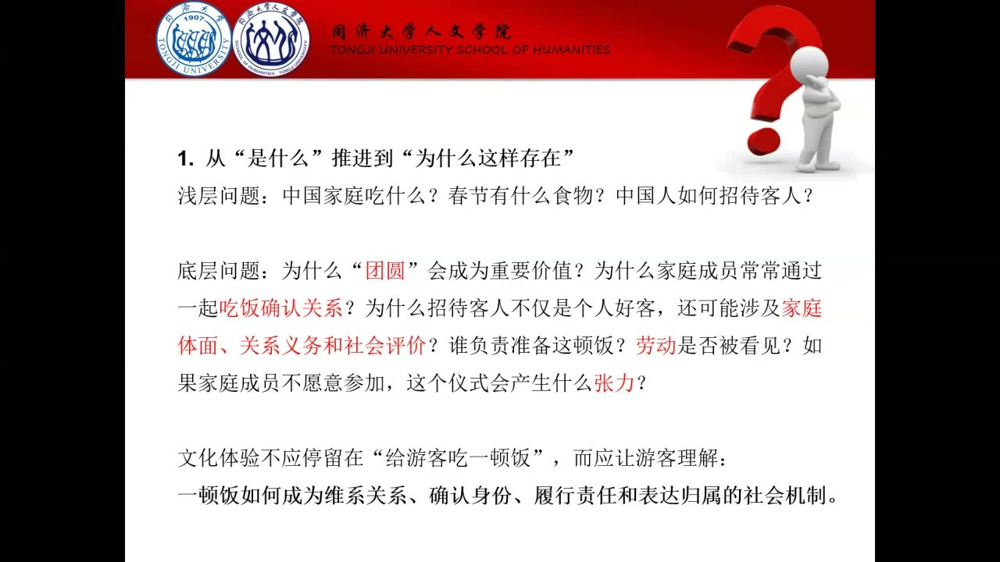
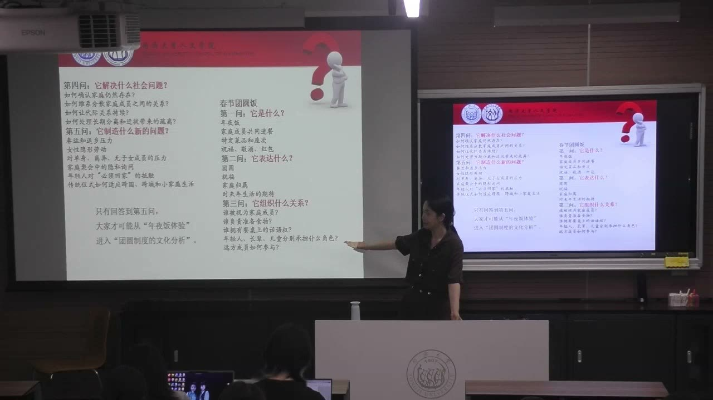
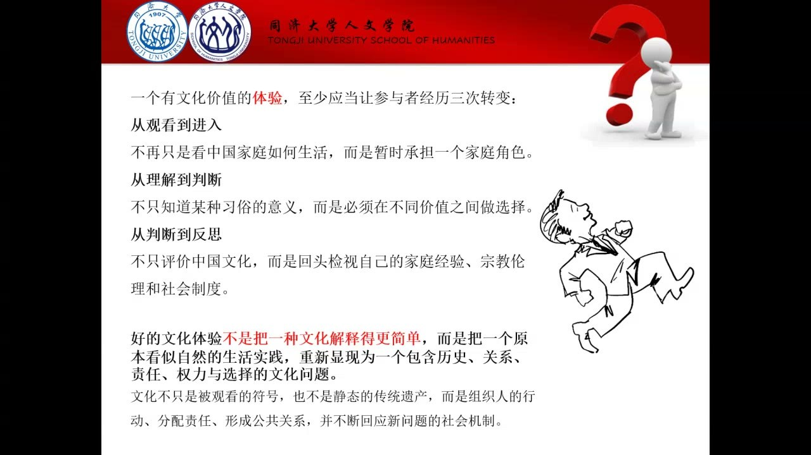
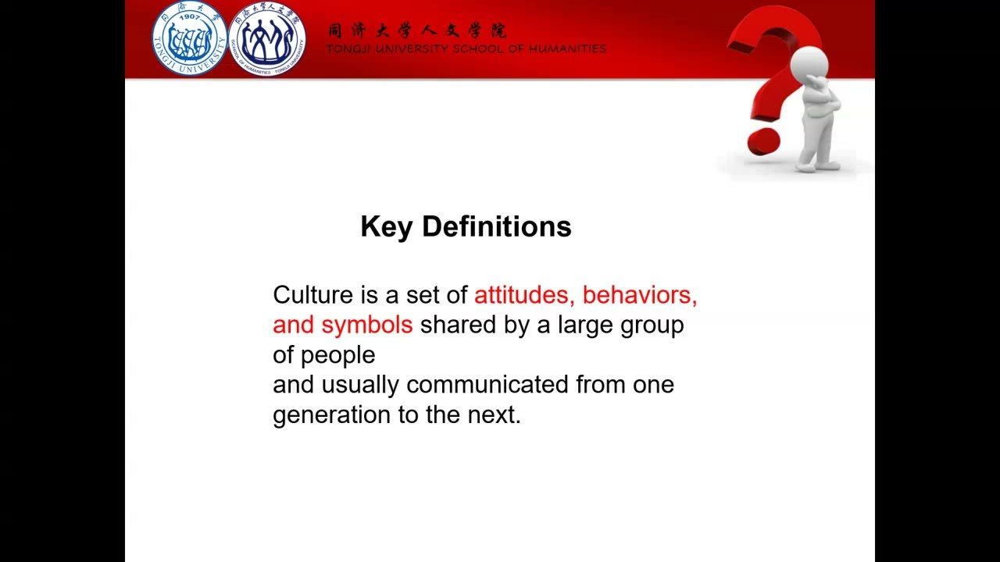
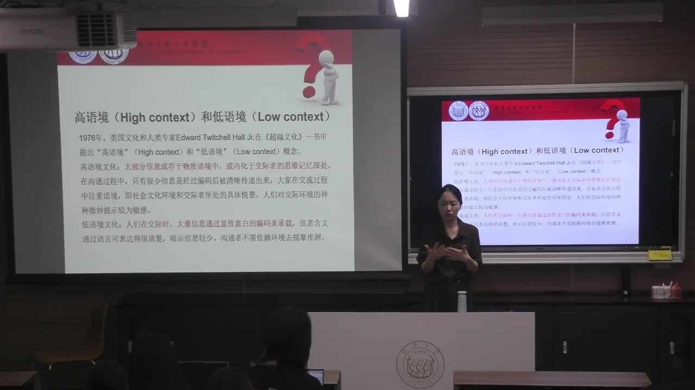
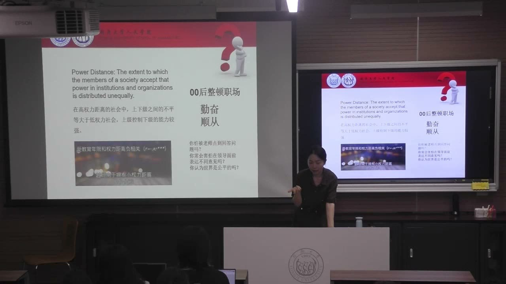
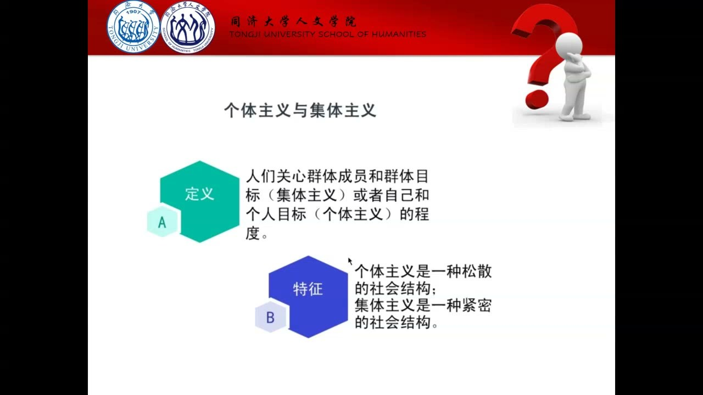
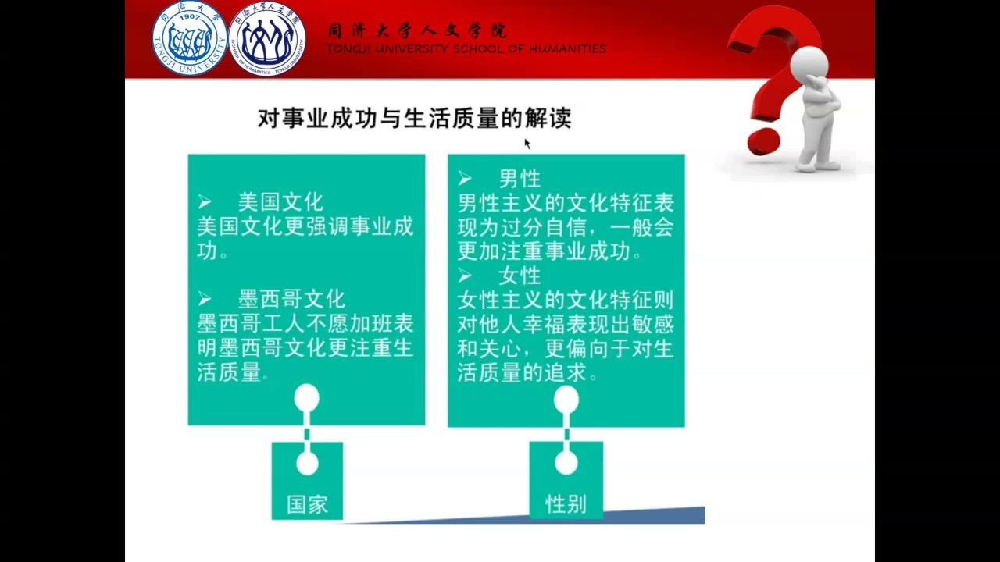

### 课程安排与任务

#### 确认分组与持续挖掘文化价值

已完成组队的小组在课程群更新名单；讨论仍按既有分组开展。接下来约四至五周继续围绕项目的价值挖掘，不急于进入交互行为的设计。每位成员都要提出自己的方向，并使用上一节确定的讨论角色。

#### 讨论角色与座位安排

小组要记录从不同想法到共同选择的协作过程。教师提醒五人组调整座位，围绕走道安排位置，让第五位成员也便于交流；四人组可沿用原来的方式。人员空缺或其他困难，不应使小组跳过文化价值的分析。

### 文化体验的价值：从对象到机制

项目的上限取决于前期挖掘出的文化价值。交互形式可以帮助表达，但不能代替对关系、秩序与选择的理解。

#### 符号为什么需要回到生活场域？

菌菇、饺子、春联等都可以成为文化对象。把对象单独展示出来，体验者只能认识一种食物或一个符号；文化体验还需要解释人怎样与它共同生活，怎样利用它，以及这种相处形成了什么关系与秩序。

以云南菌菇为例，值得挖掘的是居民长期与菌菇共存的生活经验，以及它怎样进入烹饪和地方饮食的创造。对象进入语境后才显得鲜活。先发现一种文化体验供给不足，随后立即设计互动，会跳过决定项目价值的分析环节。

#### 团圆饭：吃什么之外，人怎样被组织起来？

吃饺子、包饺子是体验的形式；团圆饭背后还有家庭成员重新聚合、确认关系和履行义务的机制。平时分散在各地的成员在春节共同进餐，家庭便通过这个行为再次确认自己的存在。

可以进一步追问：谁准备饭菜，谁承担劳动，怎样安排座次，谁拥有话语权，谁负责招待？家庭协作、待客、代际传承和商品化等结构，会影响不同角色的选择。温暖、归属和压力可能同时存在，不能为了展示和谐而删去文化实践中的矛盾。

#### 五层追问怎样让研究继续深入？

围绕同一文化对象连续追问五层：它是什么；它表达了什么；它组织了什么关系；它解决了什么社会问题；它又产生了什么新问题。团圆饭中的菜品、座次和祝福是表层形式，归属感是表达，家庭角色和劳动分配是关系，而家庭延续及其新压力属于更深的分析。

停留在“是什么”，通常只增加形式上的新鲜感。走到关系与新问题，才能说明一种文化为何存在、在哪些条件下发生变化，以及不同的人怎样承受它的利益和代价。

#### 让体验者经历位置与判断的转换

教师提出的转换是：从观看到进入，从理解到判断，从判断到反思。让体验者承担一个关系角色，在具体情境中做选择，再回看自身的文化经验，比把文化解释得更简单更能产生价值。

例如“已经吃饱，主人仍不断劝菜”，可以同时涉及热情、亲近、边界与尊重。设计前要理解不同选择及其语境，不能用固定的“中国人”或“外国人”标签代替研究。面向具体宗教背景的受众时，也要核对看似相似的伦理表达是否具有相同的关系含义。

### 文化怎样影响行动：编程、方向与工具

组织文化不仅是口号，也表现为稳定的态度、行为与符号。它影响成员怎样理解同一句话、怎样选择行动和处理冲突。

#### 稳定的文化编程与突破的可能

课堂把文化概括为一群人共享并能够传递的态度、行为和符号。在组织中，重点是工作时的表现、价值判断与成员之间的传递。长期重复的生活经验像潜在的代码，使某些反应显得自然。

这种稳定影响并不排除创造性突破。创意可以冲破习惯形成的限制，但分析组织行为时仍要认识成员原有的文化秩序。只有知道某种行为为什么看似理所当然，才能理解碰撞带来的不适。

#### 文化是决定方向，还是提供行动资源？

“扳道夫”的隐喻强调文化像改变轨道的人，左右行动的方向。例如身体想放松，课堂中的体面规范却使人抑制这个动作。“工具箱”的隐喻则强调人能够取用不同文化资源，为不同的行动策略提供支撑。

这两种解释帮助检视体验设计：设计是否假定处于一种文化就必然作出同一选择，还是让参与者发现同一文化中也有多种可调用的资源？文化秩序与策略空间是两个需要共同考察的方面。

#### 谁在定义一个群体？

文化差异还涉及定义的位置。一个群体对自身生活方式的理解，可能与其他群体给它的称呼或评价不同。教师以流动生活群体为例，说明外部定义可能包含主流社会的排斥，而内部定义强调另一种生活秩序。

研究不能把外部标签直接当成对象的自我认识。流动与定居的评价会随社会条件变化；同样一种行为，在不同群体和时代中可能获得不同意义。

### 高低语境与研究中的表达偏差

语言是否充分承载信息，会改变组织沟通，也会改变问卷答案能够解释的范围。

#### 同一句话为何可能具有不同含义？

高语境交流依赖语言之外的共同经验、关系背景和微妙提示；低语境交流则更多要求把信息明确说出来。“来一下办公室”在不同关系和情境中，可能只是地点指令，也可能暗示批评、支持或其他目的。

课堂以不同文化环境作倾向性的比较。进入一个共享背景较少的组织时，需要把原本期待对方领会的意思说清；进入依赖默契的环境时，需要观察语境和行为。群体倾向不能作为判定每个个体的固定标签。

#### 问卷里的“很好”，为什么可能和现场不同？

教师并不完全赞同课堂播放片段的整体观点，而是借它讨论回答背后的语境。问卷中积极参加、愿意支持等表态，未必对应实际行动。访谈里的肯定之后可能还有许多“但是”，更深的顾虑需要在交流和观察中发现。

教师结合自己的研究经验，强调不能凭一组漂亮的态度分数提交结论。应核对问卷与实际情境之间的出入。同一对象的持续观察可以帮助认识态度的稳定与变化，但仍不能自动消除语境造成的偏差。

#### 把文化差异放回组织的具体构成

交流方式与成员是否拥有共同文化背景有关。背景差异较大的组织，暗示可能造成误解；依赖共同经验的组织，单看字面也可能遗漏关键信息。沟通双方都需要根据组织的实际构成调整表达。

分析不能停留在国家名称的归类。更有用的问题是：成员到底共享哪些经验；哪些含义没有被说出；新进入的人要通过什么观察才能理解；哪些信息应该被明确表达。

### 权力距离与时间安排：平等协作如何运行

创意组织需要开放表达，也需要作出决定。文化习惯会影响成员能否提出异议、承担选择，以及怎样保护工作与私人时间的边界。

#### 权力距离关心怎样接受不平等

权力距离关注组织中权力较小的成员预期并接受权力分配不平等的程度。课堂以给上级发消息前反复修改、害怕表达不同意见等情形，说明层级关系如何进入日常行为。

教师建议通过自己是否害怕被点到、是否敢于表达不同意见，以及怎样判断公平来反思这种习惯。礼貌称谓与是否完全接受对方观点并不是同一件事。

#### 降低层级以后，谁来推动决策？

从习惯由组长分工的环境进入较平等的创意团队，可能出现一种不适：人人提出想法，却没有人愿意排除其他选项、确定行动方向。担心自己制造不平等，反而让讨论迟迟不能结束。

教师举出的推进方式包括把方案分解为若干维度，逐项比较和排除；也包括有人先提出一个可行方向，再由其他成员明确回应。小组需要观察自己如何完成从讨论到选择的过程，并把这段协作经验纳入反思。

#### 时间被切成任务，还是容纳多件事？

单元时间偏向一个时间单元处理一件事，安排明确时段并划分工作与私人生活；多元时间偏向在同一时期处理多件事，更依赖整体性的协调。是否预约固定讨论时间，还是间隔发送零散信息，是课堂用来说明差异的例子。

沟通工具也会参与塑造边界。随时可联络，不代表对方始终处于工作时间。跨文化协作需要看清各方对预约、即时回复和私人时间的期待，否则容易把时间安排的差异理解为不合作。

### 责任、风险、成就与组织的价值导向

文化维度帮助提出比较问题；具体判断仍要回到成员的责任、组织的目标以及真实的行动方式。

#### 个人主义不等于拒绝集体

教师把个人主义的关键放在为自己的选择负责：收益与代价都由自己承担。一个人可以加入多个集体，也可以在集体中成长；是否服从集体，不能单独说明其责任取向。

课堂用“无条件的我们”和“无条件的我”作对照：前者把集体成员身份视为天然归属，关系较紧密；后者强调个人主动建构关系并承担加入某个组织的义务，关系较可重组。教师从历史与家庭文化解释这种差异，目的在于帮助小组反思成员怎样理解自己的参与。

#### 风险是在前面安排，还是发生后调整？

课堂通过事先确定风险预案与问题出现后灵活应变作比较。前者重视把可能的风险提前纳入程序，后者可能保留多个可调整的行动路径。有没有完整的事前预案，与最终能否有效解决问题不能直接画等号。

这些是教师结合文化经验提出的比较解释。分析小组时，可以关注：方案确定后是否允许修改；谁负责预案；风险出现时有哪些备选路径；成员怎样接受不确定性。

#### 追求成功与照顾生活质量

有些组织把事业成功、竞争、勇敢和个人表现放在优先位置；有些组织更看重生活质量，以及成员情绪、关心和体谅。课堂介绍相关理论的“男性文化／女性文化”命名，同时明确指出教师不赞同性别化的命名方式。

理解这组比较时应关注价值导向，不能把它理解为男性和女性的能力差异。组织希望得到什么结果、怎样评价成员、怎样处理效率与照顾之间的关系，才是比较的内容。

#### 组织的收益与更长的责任视野

课堂还补充长期与短期导向，讨论组织怎样考虑当期收益，以及自身与家庭、社会和国家的联系。教师用不同历史文化背景解释这些倾向，并把它们放回“文化编程”的问题。

这些比较帮助小组提出问题，不能直接替代对某个组织的调查。观察成员是否只考虑当前项目成果，还是同时考虑关系维护、长期影响与公共责任，更能把维度转为可讨论的组织行为。

### 概念对照与自测

| 比较对象 | 前者关注 | 后者关注 |
| --- | --- | --- |
| 文化对象／文化机制 | 可展示的食物、物件与符号 | 人的关系、秩序、选择与张力 |
| 高语境／低语境 | 共享背景、关系与隐含信息 | 语言中明确表达的信息 |
| 高／低权力距离 | 较能接受组织中的权力不平等 | 较重视限制不平等与表达异议 |
| 单元／多元时间 | 固定时段、单项任务与边界 | 多项事务并行、整体协调 |
| 集体／个体导向 | 天然的集体归属与紧密关系 | 主动建构关系并承担个人责任 |

#### 为什么设计一个“包饺子”活动还不等于完成文化价值挖掘？

包饺子是形式。还要解释它表达什么，组织哪些角色和义务，解决什么问题，并让体验者面对真实选择与矛盾。

#### 五层追问的终点为什么包括“新问题”？

文化实践的作用会随条件变化，归属与压力可能并存。新问题能揭示谁承担代价，以及一种关系如何发生变化。

#### 高语境为什么会影响问卷解释？

回答者可能依据关系、期待和隐含意思作答。态度分数未必与行动相同，需要访谈与现场材料核对。

#### 平等讨论为什么仍需要明确的决定？

开放表达不能自动完成方案选择。小组需要建立比较、排除与确认方向的方式，才能把讨论转为行动。

#### 一个人在集体中工作，可以体现个人主义吗？

可以。课堂强调是否主动选择关系并对自己的行动、收益和代价负责，而不是简单看是否离开集体。

### 来源范围

原始转写含课堂互动，正文只整理教师讲授、解释、回应与课程任务。时间范围为两分钟音频分段边界，不是逐句对齐时间。
