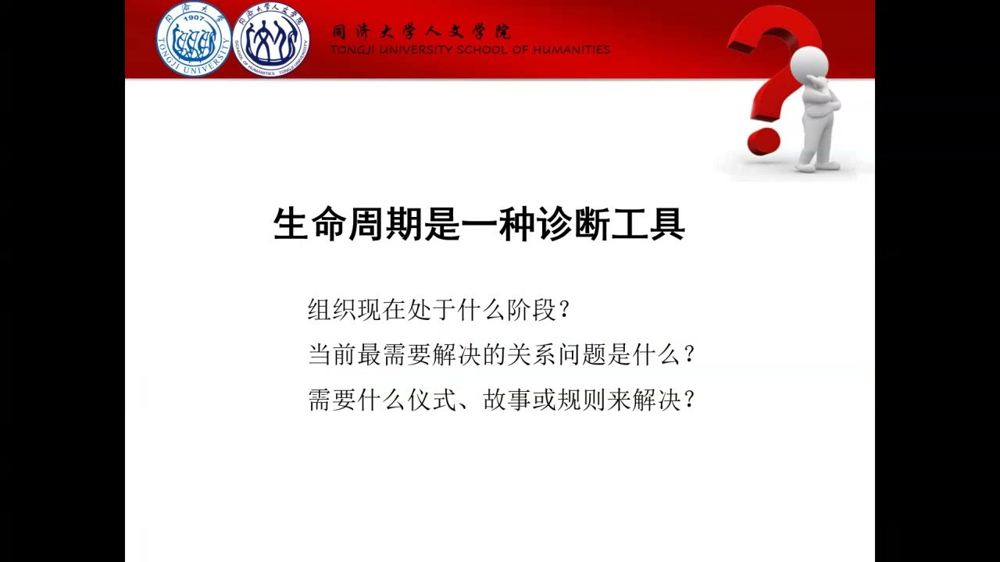
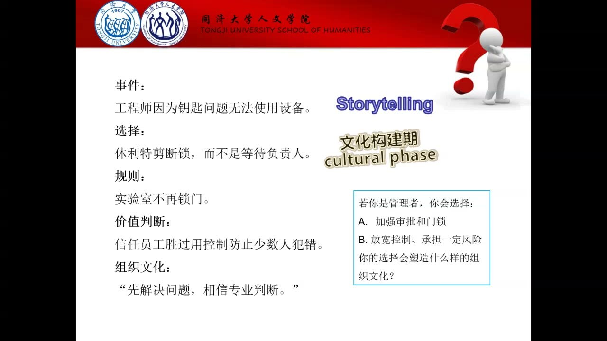
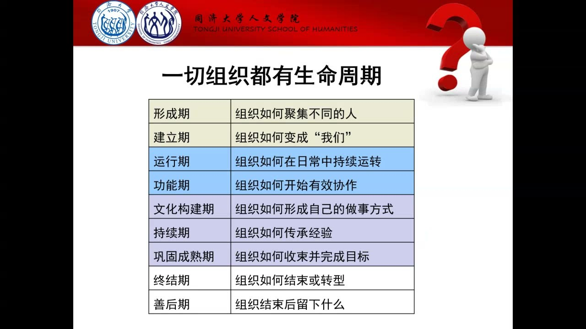
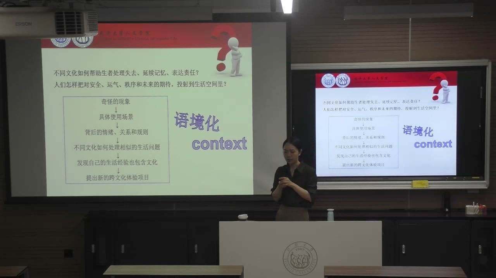

### 课程安排与任务

#### 诊断本组并形成组织契约初稿
<!-- source: 6 -->
小组讨论需要回答三个问题：组织目前处于什么阶段；当前最需要解决的关系问题是什么；需要什么仪式、故事或规则来解决。不能只报一个阶段名称，还要结合实际的协作状况解释判断。

教师提供简化的组织契约模板，要求结合上周以来的组队活动、既有组织经验和生命周期理论，写出本组共同完成什么、重视什么文化价值、怎样决策、怎样处理冲突。模板只是分类框架，应根据本组情况填写，并在组织推进后继续调整。本次先形成初级版本，不要求把尚未经历的问题全部预先写死。

#### 确定文化体验项目的方向
<!-- source: 78 -->
项目方向可以超出饮食和节庆。确定内容后，要进一步说明体验者代入什么角色、面对什么情境、能够做什么决定，以及体验结束后怎样反思和形成判断。小组需要尽快确定方向，寻找现有文化体验项目做得不够的地方，讨论中遇到问题可向教师咨询。

田爱路的往年案例只用于说明语境化方法，并非与本班完全相同的任务。本班仍需满足跨文化比较体验的要求，不能直接照搬案例的选项或主题。

#### 过程记录、贡献划分与期末反思
<!-- source: 32 -->
讨论时继续分工并保留记录，尤其记录意见如何产生、取舍和变化。这些材料在完工期用于打包成果，也为期末 reflective writing 提供依据。期末需说明成员贡献如何划分，组织规则应帮助形成判断付出的尺度。

反思写作要把亲身组织经历与组织行为学理论比较：哪些地方符合理论预期，哪些地方没有按预期发展，原因是什么，本组的特殊性在哪里。教师在结尾补充，群内书单可作为选题和思考的参考，不要求全部阅读；课堂文化现象及其历史线索也可以发展为论文问题。本节未给出新的明确提交日期。

### 一、生命周期是一种诊断工具

组织从生成、发展到结束，并非只经历任务清单的变化，也经历关系、身份和意义的变化。

#### 从一群个体变成“我们”
<!-- source: 0 -->
临时聚集的人不一定已经形成真正的组织。一起完成文化节、舞蹈排练或课程项目，都会遇到任务安排、冲突、妥协和经验传递。教师以自己的舞蹈团经历说明：迟到、排练冲突、删减舞段等事件，既影响作品，也可能成为组织后来记住的共同经历。

规则、仪式和故事把成员连接成一个小的社会空间。成员逐步形成彼此信任、依赖和对共同目标的理解，也形成“我们”和外部之间的边界。边界在这里首先说明身份和关系，并不意味着可以省略与外部的沟通。

#### 阶段名称服务于问题判断
<!-- source: 4 -->
生命周期分期帮助判断“此时需要植入什么”。初期可能缺规则，之后可能需要共同仪式、应对困难的故事，临近结束又需要收束、记录和交接。不同阶段用同一种处理方式，可能抓不到当前的问题。

教师强调分期不是绝对化的固定路径。它是诊断工具：依据组织实际状态，识别阶段、关系问题和相应手段。不能因为课表推进了几周，就断言小组一定进入某个阶段，也不能为了符合理论而编造共同经历。

### 二、形成与建立：从差异走向共同身份

形成期聚集不同的人，建立期则使这些人开始知道如何共同做事。

#### 形成期：理解差异，建立最初的信任
<!-- source: 8 -->
成员在不熟悉的环境中，需要读懂彼此表达，承接观点，分解任务，并把任务交给合适的人。此时的重点是识别成员差异及其可能带来的多样性收益。

教师延续前课对多样性的要求，提醒不要只靠熟人关系扩展成员，否则可能削弱不同经验和观点进入组织的机会。把不同的人放在一起只是起点，还需要使差异能进入讨论和协作。

#### 建立期：规则、衡量指标与沟通渠道
<!-- source: 8 -->
建立期应明确规则、阶段目标、衡量付出的指标，以及沟通联络方式。例如成员请假后，任务由谁承接、是否调整进度、怎样避免负担无声地转移给其他人，都需要讨论。没有规则，成员可能不知道边界，组织也可能迟滞。

共享在线文档可承载意见、资料与持续讨论，线下面谈或共同调研则是另一种渠道。工具本身不等于沟通已经发生，关键在于成员知道去哪里表达、怎样接续他人的工作，并能够追踪阶段任务。

贡献划分也应与这些约定相连。教师举出以往小组平均划分或细致区分贡献的不同做法，要求本组形成适合自身的尺度，没有规定所有小组必须采用同一种算法。

#### 仪式如何产生共同身份
<!-- source: 12 -->
入学、佩戴校徽、共同吃饭、一起调研等活动，都可能使成员感到自己进入一个区别于日常的共同情境。仪式不一定盛大，也不一定完全预先策划；它的重要性在于调动共同情绪、确认“我们是谁”。

为组织投入时间，意味着放弃部分其他活动的机会，因而也体现承诺。教师借文化史中的仪式故事说明付出与身份确认的联系，讨论的重点是承诺机制，而不是要求小组模仿某种宗教形式或付出过度代价。

### 三、运行与文化构建：困难怎样成为共同的做事方式

当注意力从“怎样组成组织”转向“怎样完成实际工作”，关系基础就会受到任务变化的检验。

#### 运行期与功能期：压力下重新调整
<!-- source: 16 -->
运行期开始关注日常工作和任务流程。功能期则涉及持续调整：项目方向、阶段目标、最终期限，以及成员的个性、优势和短板，都可能需要重新整合。市场中的竞争、预算或外部要求，也会改变原先的计划。

如果共同身份和信任没有建立，调整任务时成员容易感到孤立，觉得其他人没有和自己一起承担压力。前期的规则、沟通和认同不是与工作无关的装饰，而是应对变化的关系基础。组织不只是把工作分出去，还要使成员能够在变化时继续有效协作。

#### 文化构建期：事件经过讲述成为故事
<!-- source: 18 -->
共同经历的事件，经过反复记忆、讲述和解释，逐渐成为组织故事。故事使成员知道组织重视什么、遇到困难时怎样选择，也帮助后来者判断是否愿意加入。

故事不是只把经历包装成宣传。它必须能说明行动原则，使成员在新的问题面前形成可共享的判断。教师把从压力和调整走向文化构建，视为判断小组是否形成真正组织的重要转折。

#### 惠普案例：选择、规则与价值判断相连
<!-- source: 20 -->
教师用惠普的故事说明文化构建：工程师因门锁不能使用设备，负责人选择剪断锁，而不是只追究开锁者责任。课堂叙述把这个选择与实验室不再上锁的规则，以及信任员工专业判断的价值联系起来。

这一案例的分析链是：遇到事件，作出选择，形成规则，再通过反复讲述表达组织文化。“承担少数人可能犯错的风险，也愿意给予信任”，与“以更多控制防止犯错”，会使成员对组织形成不同理解。它是课堂中的文化分析案例，不是要求所有组织在实际管理中取消门锁或审批。

#### 领导者怎样使故事被分享和传承
<!-- source: 24 -->
领导者需要营造可以自由讲故事的氛围，允许成员说出并不完美的经历；还要筛选、重复并分享能够说明改进和共同原则的故事。故事是否与大部分成员有关，比它是否围绕某位领导或某个外部名人更重要。

如果故事只剩“见过谁”的标签，它可能更偏向展示，而未说明本组织怎样共同做事。如果没有可共享的故事，成员也可能缺乏彼此支持的感受。文化构建要让共同经历成为可传递的经验，而不是只留下个别人的功劳叙述。

### 四、持续、成熟与结束：把经验留给后来者

组织文化能否持续，要看它怎样处理成员进出、创意收束和成果交付。

#### 持续期：欢迎新成员，承认离开者的贡献
<!-- source: 26 -->
人员流动不是简单更换名单。离开者若悄无声息地消失，现有成员可能猜测原因，也可能觉得自己的付出不会被承认。需要承认离开者贡献、给予适当祝福，同时明确离开后的组织边界。

新成员也可能感到自己处于既有关系网络之外。讲述组织故事、介绍新成员的经验、安排临时负责人或导师等做法，可以帮助认识和融入。课堂项目中的主持人轮换，使不同成员体验关注全体和维持大局的位置，也是促进持续协作的一种方法。

#### 巩固成熟期：及时收束创意
<!-- source: 30 -->
创意组织前期可以扩大可能性，后期却必须把发散的想法整合成有限时间内可完成的目标。教师以学期项目举例：前段时间多探索，后段逐步删去暂时不能落地的点子。这个时间安排用于说明工作节奏，不意味着只要到了某周就自动成熟。

即使有人仍不断提出更好的创意，组织也要判断是否有时间实现。领导者需要把握期限、处理成员对继续探索的期待，并承受外部干预的压力。好点子可以另寻发展机会，但当前项目不能无限等待下一次突破。

#### 完工期：成果不只是最后的成品
<!-- source: 32 -->
完工期要把成品、流程、测试、过程记录等整理为可交接的成果。记录不是临近结束才补写的装饰，讨论路线、修改过程和关键取舍都应在推进中保存。

教师以电视节目模式的打包说明：除最终节目之外，台本、屏幕文字、拍摄方法和操作流程，也构成可传递的生产经验。这类打包使经验成为组织资产，可能支持交接、商业化或继续开发；不能据此把所有项目都等同于申请专利。

#### 终结与善后：把实践和理论重新对照
<!-- source: 34 -->
组织完成任务后可能结束、转型，成员也可能进入新的组织。善后不仅是散伙，还包括总结、研究和留下经验。reflective writing 要解释实际发展与理论路径之间的关系，而不是证明小组每一步都符合理论。

理论与实践存在偏差，可以成为有价值的分析对象。关键是用记录说明发生了什么、为何如此，并识别组织的特殊条件。课件总表概括了从形成到善后的主要问题，课堂还单独展开了成果打包的完工期。

### 五、文化不等于学历：从符号进入具体生活问题

项目不必限于熟悉的饮食、节庆分类。文化研究关心共享的意义怎样在具体场景中发挥作用。

#### 文化是一套共享的意义、规则和行为
<!-- source: 62 -->
日常说一个人“没文化”，常把文化与知识、学历混在一起；本课使用的概念不同。文化包括一群人共享的态度、行为、符号与意义，以及他们怎样运用这些内容共同处理问题。

因此，理解文化不应停在一个静态名词上。除了知道某种传统叫什么，还要看谁在使用、何时使用、参与者怎样理解，以及它如何组织人与人之间的关系。文化也会演化，不是封闭不变的清单。

#### 特殊语言现象也能显示身份和边界
<!-- source: 74 -->
课堂播放网络视频后，教师回到具体游戏情境分析语言现象：某些表达可以宣泄情绪、确认内部身份、排斥外部人群，并在特定群体中协调关系和行动。这说明日常觉得“不够高雅”的现象，也可以成为研究共享规则的入口。

这里要理解的是教师提出的分析方法，而不是把视频中的传播规模、民族性格概括等说法当成研究结论。能被文化研究分析，也不意味着所有表达方式都值得模仿或赞同；关键是先解释场景与作用。

#### 先理解它处理什么，再讨论如何评价
<!-- source: 74 -->
教师以悼念活动和生活空间观念为例，说明语境化可以揭示行为背后的失去、记忆、责任、秩序感和未来期待。研究者若一开始只给出正面或负面的标签，可能跳过参与者怎样理解和使用这些做法。

关注某种实践的文化意义，与证明其客观功效是不同的问题。跨文化比较应围绕相近生活问题展开：不同群体怎样处理失去、表达责任或建立空间秩序，而不只是把两套外观不同的符号并排展示。

### 六、语境化体验：让参与者进入角色并作出选择

好的文化体验把抽象内容转成有处境、有关系、有后果的选择，并留出反思空间。

#### 从奇怪现象走向比较问题
<!-- source: 76 -->
语境化的路线可以概括为：发现看似奇怪的现象，进入具体使用场景，分析背后的情绪、关系和规则，再比较不同文化如何处理相似生活问题，进而发现自己的日常经验也包含文化。

这个过程能把“做一次年夜饭体验”之类宽泛方向，推进为更明确的问题：参与者在怎样的关系中面对什么选择，这个选择表达了什么，另一文化又如何处理相似处境。项目的创新点也可以从既有体验未处理的问题中寻找。

#### 田爱路案例：把抽象主题转成情境中的选择
<!-- source: 76 -->
教师介绍往年田爱路相关案例：把地点、民国时期爱情故事与投票选择结合，让体验者思考特定历史语境中对关系、家庭认可等问题的处理。其价值在于使参与者进入情境，而不只是观看“爱情文化”的符号。

案例可以启发方法，但教师没有把它宣布为统一样板，更提醒本班项目要求不同。学习的是如何把概念转成可体验的实际选择，而非把同一套题目换个包装。

#### 角色、决定与反思构成完整方案
<!-- source: 78 -->
设计方案时至少要说清：体验者代入谁；他所处的历史或当下情境是什么；他能作出什么决定；决定为何在这个文化中具有意义；体验后怎样回看自己的判断。

交互并不只是增加一个按钮或安排一次投票。若选择与文化处境没有关系，它仍可能只是概念说明的装饰。教师要求把具体生活问题、参与者选择和跨文化比较连起来，使体验者通过做决定理解不同文化的处理方式。

### 概念对照与自测

| 阶段或概念 | 主要问题 | 相应做法 |
| --- | --- | --- |
| 形成期 | 不同的人如何开始协作 | 理解差异、建立初步信任、分解任务 |
| 建立期 | 如何变成“我们” | 规则、衡量指标、沟通渠道与仪式 |
| 运行期和功能期 | 工作怎样持续并应对变化 | 调整目标、期限和人员协作 |
| 文化构建期 | 怎样形成自己的做事方式 | 共同事件、故事、价值与行动原则 |
| 持续期 | 经验怎样随人员流动继续存在 | 欢迎、认可、故事分享与轮换 |
| 巩固成熟和完工 | 如何按时完成并交接 | 收束创意、过程记录、成果打包 |
| 终结与善后 | 结束后留下什么 | 转型、总结、反思与理论比较 |
| 语境化体验 | 人在什么处境下作什么选择 | 角色、问题、决定、跨文化比较与反思 |

#### 为什么组织契约不能只套模板？
模板只列出类别。规则需要回应本组当前阶段、真实关系问题、成员投入和决策方式，并随着组织经历继续调整。

#### 一次共同吃饭为什么可能成为组织仪式，也可能只是聚餐？
关键在于它是否形成共同情绪、身份认同和反复理解的意义。活动形式本身不能保证成员已经形成“我们”。

#### 文化体验为什么不能只把两国符号并排展示？
文化比较要联系相近生活问题与具体场景，让参与者理解不同角色为何作出选择，并在体验后反思。仅展示符号，可能没有进入它们发挥作用的语境。

### 课程时间线

00:00—06:00：生命周期、组织故事及规则仪式的重要性
06:00—08:00：三个诊断问题与生命周期总览
08:00—12:00：形成期、建立期，规则指标和沟通渠道
12:00—16:00：仪式、投入与共同身份
16:00—20:00：运行期和功能期，压力下的关系基础
20:00—24:00：惠普信任故事及文化构建的分析链
24:00—28:00：组织故事的分享与人员离开的处理
28:00—32:00：欢迎新成员、轮换与成熟期的创意收束
32:00—36:00：完工打包、终结善后与 reflective writing
36:00—40:00：组织诊断、契约初稿与小组讨论安排
40:00—60:00：小组讨论时段，未编入教师知识正文
60:00—64:00：讨论后的教师引导，拓展文化项目与文化定义
64:00—74:00：课堂视频及过渡，以教师后续分析为正文主线
74:00—78:00：语境化、生活问题比较与田爱路案例
78:00—82:00：角色、决定、反思和项目选题安排
82:00—94:00：小组讨论时段，零散声音未编入正文
94:00—96:00：教师补充书单、文化现象与论文思路
96:00—99:45：课后环境与零散声音，未编入正文
