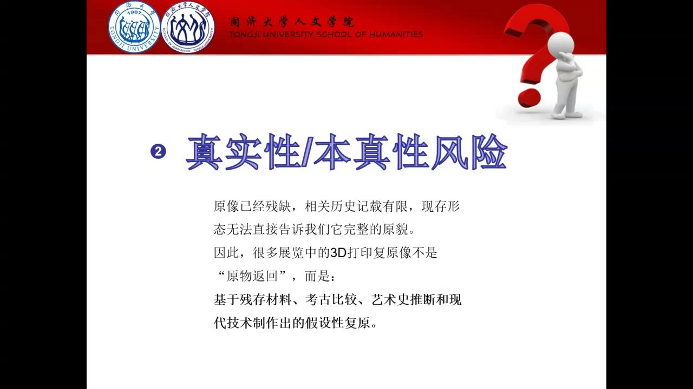
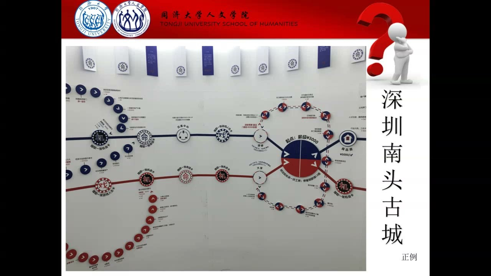
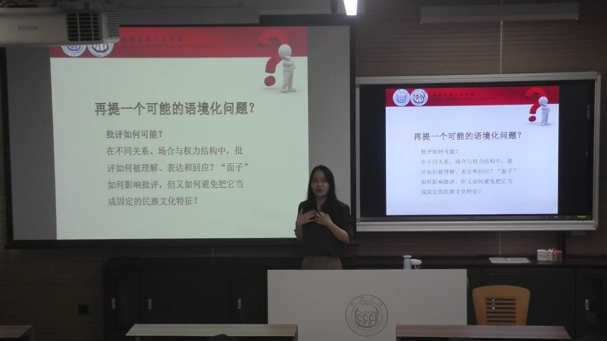

### 课程安排与任务

#### 用工作坊检查项目的两类风险
<!-- source: 0 -->
本次以项目诊断工作坊为主。教师指出，第六、七周左右遇到瓶颈很正常，需要检查文化体验设计是否陷入本质主义，以及是否存在真实性、本真性风险，再继续训练语境化分析能力。

各组结合当前项目讨论：是否先给某个人群规定一种特质，再围绕它设计体验？是否把经过重建、包装或数字复原的形象，当成未经改变的历史真实？项目所讨论的文化，究竟帮助什么人在什么条件下解决什么问题？

#### 组内讨论与逐组诊断
<!-- source: 64 -->
教师讲授结束后，各组先讨论，约十分钟后教师到各组交流；希望提前讨论的小组可以举手。讨论重点是现有项目的问题、可能落入的两类陷阱，以及能否把笼统文化概念转成具体处境中的问题。课堂为工作坊保留讨论时间，没有在这里另行公布新的书面提交截止日期。

### 本质主义：把复杂的人压缩成固定特质

文化差异可以讨论，但不能把差异直接写成人群天生、永远、人人相同的属性。

#### 从“这个群体就是这样”到有条件的倾向
<!-- source: 0 -->
本质主义的典型做法，是先把某种特质与一个人群绑定，再用它解释其中所有人的行为。文化体验如果先认定某个族群“天生擅长某事”，再让参与者体验这种能力，就已经把复杂文化压缩成了预设标签。

反对这种做法并不等于否认文化差异，而是承认差异具有历史性、流动性和情境性。更合适的表达是：某些人在某些条件下形成了某种倾向，它在不同历史阶段会变化，群体内部也有不同反应。同一套文化资源遇到不同问题，可能产生不同选择。

#### 国家、族群与“我们”的视角都不是天然统一的
<!-- source: 4 -->
不能把个体行为直接归结为一个民族或国家的性格。地域、阶层、世代、性别、宗教、教育等差异，会让同一群体内部出现不同立场。即使来自同一个班级，也不意味着面对具体问题时会作出相同选择。

还要检查研究者是否把自己的文化视角当成普遍的客观标准。课堂以现代化过程中的文化评价为例，提醒项目设计者：当自身的传播和生产能力增强后，也可能用熟悉的标准评判其他地区，忽略当地人的经验和条件。

#### 饮食、舞蹈与服饰如何重新放回历史
<!-- source: 8 -->
“西方人不吃内脏”的印象，会被苏格兰羊肚、佛罗伦萨牛肚包等饮食例子打破。教师借此说明，某些当代传播印象不能代替历史沿革；饮食实践还会受到物质供给、宗教解释和现实调整的影响。

少数民族体验若只让观众换衣服、唱歌、跳舞，也可能把丰富的人群压缩成“能歌善舞”的符号。设计需要追问：这套服饰和舞蹈来自什么历史？今天哪些人在使用？他们如何理解？进入现代生活后发生了什么变化？项目应从具体实践中发现问题，而不是先定性格再寻找证明。

### 真实性：完整形象中加入了哪些解释

残缺遗存经过技术处理后变得完整，不代表完整形象就是未经选择的原物。文化体验需要说明自己的解释与重建。

#### 数字复原是基于证据的假设性重建
<!-- source: 16 -->
课堂以云冈石窟造像说明：原像残缺、历史记载有限时，现存形态未必能告诉我们全部原貌。3D打印或数字展陈中的完整造像，往往结合残存材料、考古比较、艺术史推断与现代技术。视觉完整性是被重新建构出来的，文化意义也可能随之改变。

类似地，AI让古画人物活动起来时，可能把原本的人物面貌、神情与韵味改造成现代影像习惯。画面更流畅、更完整，不等于与历史更接近。需要区分遗存提供了什么、设计者推断了什么、技术又补充了什么。

#### 复原仍有价值，但要交代不确定性与立场
<!-- source: 20 -->
复原可以帮助教育、传播、研究可视化，也能让不同方案相互比较。教师强调的不是停止复原，而是明确做了哪些处理、哪些部分原本不确定，以及设计者的立场如何影响文化再现。

研究者自身的年龄、性别、经历和研究方向，都可能影响问题选择和叙述方式。承认并说明这些条件，能让阅读者和体验者理解解释从何而来。在文化研究中，教师主张重视具体人的差异和经验，不能为了表现一种完全中立的姿态，把鲜活的人都处理成同质对象。

#### 谁有权重新定义与展示文化
<!-- source: 18 -->
再现问题还包含权力关系。拥有传播、生产和数字技术能力的人，可能让自己的版本成为公众最熟悉的版本，而文化内部成员的解释未必同样可见。观众记住的某幅古画，也可能主要来自后来的小品、改编、人物变形或复原影像。

项目因此需要检查：谁决定形象如何呈现？谁的理解进入最终作品？文化内部的人是否有发言位置？解释不只是把缺口填满，也是决定哪些经验被突出、哪些被忽略。

### 活态文化、符号消费与具体选择

文化由人承载。保存建筑、陈列器具或复制生活外观，都未必保留了原来的人际关系与生活过程。

#### 古镇与异国情调：外观相似不等于生活仍在
<!-- source: 22 -->
教师批评一种古镇开发方式：把居民迁出，再把空间填成相似的商业摊位。建筑仍在，原本生活其中的人及其日常关系却消失，活态空间就可能凝固成景观。体验者消费的也许是“古镇”的符号，而非由具体人承载、不断变化的文化。

课堂援引鲍德里亚的符号消费视角，追问消费究竟指向完整文化，还是只指向一个可反复生产的表象。另一展览例子将他者的房屋、器具甚至生活材料搬入陈列空间：即使物件高度还原，观众也可能只关注它“与我不同”，而没有理解当地人与土地、资源和日常生活的复杂关系。教师把这种观看解释为异国情调消费。

#### 南头古城：让参与者面对人曾经面对的选择
<!-- source: 26 -->
深圳南头古城的体验被用作相对正面的例子。它没有只在入口列出“深圳精神”的几条定义，而是把具体人经历过的生活难题、资源约束和行动选择做成卡牌，让参与者进入处境。

教师以办厂情境说明：有限时间内建设厂房、安排工人住宿、完成通路通水通电等要求，意味着真实的风险与组织行动。“开拓”因此不是先给出的口号，而是从人在条件约束下如何选择、如何协作中被理解。项目需要让参与者知道人为什么这样做，而不仅是记住一个文化品牌名称。

#### 商业化并不自动消灭真实性
<!-- source: 30 -->
古镇商业化带来风险，不等于所有商业化都必然摧毁本真性。教师借相关研究提醒：商业化也可能支持文化延续、传播和重新创造。问题要落到具体项目：什么被改变了，新的展示服务于谁，不同参与者受到什么影响。

“印象”系列等舞台化展示，把地方生活重新包装为可观看的表演。不能只问演出是否像当地文化，还要问当地人怎么看这种包装，哪些实践被保留、重组或放大，以及新的受众与利益关系如何改变文化定义。

### 异质性、流动性与文化转译的条件

语境化分析要从“文化有什么特点”推进到“文化在什么处境中帮助谁应对什么问题”，并继续追问这种应对依赖哪些条件。

#### 差异共处和不断迁移都是具体生活问题
<!-- source: 32 -->
异质性指向与不同文化、地域、族群或其他经验的人共处；流动性指向人离开既有生活秩序、进入新地方和新关系。来到上海、继续迁往别处，都会让人面对融入、边界和生活重建的问题。文化既可能帮助应对，也可能形成阻碍。

课堂借列维－斯特劳斯《忧郁的热带》所讨论的他者问题，解释排斥差异、把差异吸纳进自身体系等应对方式。商品化体验里的差异往往显得安全、有趣，但现实共处还涉及资源、身份和秩序，不能把消费体验中的轻松感直接推到所有历史与现实关系上。

#### 历史例子用于提出问题，不能再变成固定标签
<!-- source: 38 -->
教师用对唯一真理的追求、中庸与和而不同等线索，对比不同历史文化处理差异的倾向，同时说明这种倾向不是普遍、永恒的本质；它与政治制度、权力及其他价值结合，才会产生具体后果。

课堂谈到犹太社群、罗姆人和流动学者哥利亚德，主要为了讨论稳定秩序如何对待边界、差异和流动。流动学者追随教师、跨地求学的经历，被用于呈现知识追求与定居秩序之间的张力。这些历史材料在课堂中服务于问题建构，不能把复杂群体再缩成统一性格，也不能用某一种解释替代全部历史条件。

#### 上海万圣节：文化主体性如何获得支撑
<!-- source: 50 -->
教师以一场上海万圣节活动为例，讨论外来节庆为什么可以被改写为本土青年理解的角色扮演与表达。影视人物、地方流行语和不同传统形象混合出现，说明参与者不仅接收外来符号，也在使用自己的资源重新解释和生产。

文化转译能力，是把外来文化资源转成在本土生活中能够理解、使用与再生产的形式。它依赖影视、游戏、表演、化妆、传播、教育、经济和技术等支撑，也依赖参与者理解文化和表达自身的能力。不能只说“中国文化包容”，便跳过这些具体条件。

#### 开放与保护要看双方能力及具体处境
<!-- source: 58 -->
课堂用水坝比喻不同文化的势能差异：封闭可能妨碍文化发展，但如果生产、传播和经济能力差距过大，无壁垒开放也可能削弱较弱一方的主体性。教师提出的是有条件的分析，不是为所有文化设定同一个开放或封闭答案。

文化共存不只靠观念层面的包容，还与生产率、组织体系、文字、教育、传播等条件有关。项目若让参与者作出文化选择，应把能够支撑这种选择的资源、成本和能力放进情境，而不是让文化符号悬空运作。

### 把语境化用于项目与阅读

生活中的困扰可以成为问题起点，但要继续说明关系、场合、历史变化与条件，才会成为有分析价值的文化问题。

#### “批评如何可能”也是文化体验问题
<!-- source: 62 -->
批评在艺术身份中可能被看成必要修养，在某些日常关系里却容易引起尴尬或被理解为伤害面子。教师以自己的研究举例，追踪从文人画评价到近代艺术公共批评的变化，关注近代报刊中的论辩如何重组评价关系和艺术精神。

问题不应停在“中国人重面子，所以不能批评”。应问：在什么关系、场合和权力结构中，批评如何被表达、理解和回应？评价对象与公共讨论方式变化后，批评的意义如何变化？这样才能把经验性困扰转为可研究、可设计的语境化问题。

#### 理论阅读各自帮助追问什么
<!-- source: 12 -->
课堂推荐的阅读分别打开不同的问题，不必把它们都压成同一种“文化本质”理论。

| 阅读线索 | 帮助追问的问题 |
| --- | --- |
| Fredrik Barth《族群与边界：文化差异的社会组织》 | 群体身份如何在互动与边界区分中形成 |
| 霍布斯鲍姆等《传统的发明》 | 看似久远的传统如何被创造、重组与制度化 |
| 爱德华·萨义德《东方学》 | 他者形象如何与知识生产及权力关系联系 |
| 斯图亚特·霍尔关于文化认同的讨论 | 身份如何不断被叙述与重新定位 |
| 鲍德里亚《符号政治经济学批判》 | 体验消费的是生活文化，还是脱离生活的符号 |
| Dean MacCannell关于舞台化真实性的讨论 | 展示如何把商业布景包装成当地真实生活 |
| Erik Cohen关于真实性与商品化的讨论 | 商业化改变了哪种真实性，服务于谁 |
| Laurajane Smith《遗产的用途》 | 谁有权定义值得保护、展示和认证的遗产 |

后面几项与真实性讨论相联系。它们共同帮助项目识别解释权、展示对象和参与者，而不是提供一个脱离条件的好项目公式。

### 概念对照与自测

| 问题 | 风险表现 | 需要推进的分析 |
| --- | --- | --- |
| 本质主义 | 某群体天生、永远、人人如此 | 历史变化、内部差异与具体情境 |
| 真实性 | 把完整复原直接等同原物 | 材料依据、推断、技术与解释立场 |
| 符号消费 | 只留下建筑、服饰和口号 | 人的生活、关系、资源与实践 |
| 语境化 | 文化停留在概念与标签 | 谁遇到什么问题，为什么这样选择 |
| 文化转译 | 只用包容性解释文化共存 | 生产、传播、教育和主体能力 |

#### 让参与者换民族服装、学一段舞，为什么仍可能不够？
因为服装和舞蹈可能被拿来代表整个群体，却没有呈现历史沿革、当代使用者、内部差异和实际生活。需要把形象重新放回由具体人承载的文化实践。

#### 承认数字复原包含假设，是否等于复原没有价值？
不是。复原仍可用于教育、研究和传播。需要交代哪些来自遗存、哪些来自推断，说明不确定性与设计者的解释立场，让不同方案能够被理解和比较。

#### “万圣节能被本土化，因为文化包容”少了哪一层？
少了转译能力的具体条件。文化产品、传播技术、展演经验、教育和参与者的主体能力，使外来资源能够被重新理解、使用和生产。

#### 一个项目如何从口号推进到具体处境？
像南头古城的例子那样，让参与者面对真实行动者遇到的资源、时间、组织要求和选择，理解人为什么行动，而不是只记住先行规定的文化精神。

#### 为什么“重面子”不能直接当成批评困难的最终解释？
它会把随关系、场合、权力和历史变化的实践固定化。更有用的问题是批评如何表达、由谁回应，以及公共评价方式变化后它的意义如何改变。

### 课程时间线

00:00—04:00：项目诊断工作坊与本质主义的定义
04:00—08:00：历史变化、群体内部差异及研究者视角
08:00—12:00：饮食例子与少数民族体验设计的反思
12:00—16:00：族群边界、传统发明、东方学与身份讨论
16:00—22:00：数字复原、完整性建构及解释立场
22:00—26:00：古镇活态生活、景观与符号消费
26:00—30:00：异国情调反例及南头古城的具体选择
30:00—34:00：商业化、舞台化真实性与语境化问题
34:00—38:00：异质性、流动性及面对他者的张力
38:00—46:00：文化倾向、制度权力与群体边界的课堂讨论
46:00—50:00：罗姆人与哥利亚德的流动性例子
50:00—58:00：上海万圣节活动与文化转译能力
58:00—62:00：开放、保护及文化共存的物质和组织条件
62:00—66:00：批评如何可能，组内讨论与逐组交流安排
66:00—99:41：项目工作坊讨论阶段
