### 河姆渡与崧泽：材料、环境和审美

史前艺术进入建筑、生活器物和动物形象。它们与材料利用、居住环境和生产生活的变化密切相关。

#### 木胎漆碗与干栏式居住

河姆渡漆碗以木材雕出碗形，再在表面涂漆，兼有保护器胎与改善外观的作用。教师由这件早期漆器补充漆器的不同胎体，说明同一材料工艺可以进入多种器物制作。

干栏式建筑通过木桩把地板抬离地面，以适应南方温暖湿润、沼泽较多的环境，减少潮湿和动物侵扰。遗址所见的成排木桩，是上部建筑消失后留下的支承结构。它与北方半地穴式居住的差异，体现先民依据自然条件选择营建方式。

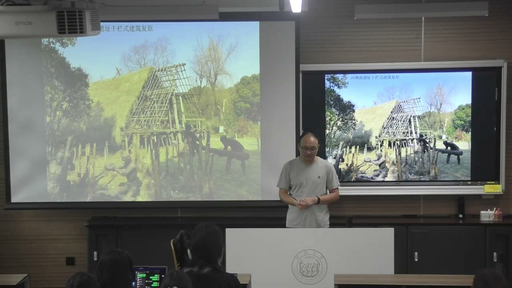

#### 崧泽陶器怎样把实用与美观结合？

崧泽以今上海地区地名命名。教师以三足釜、陶豆和镂空陶尊说明，史前中期的陶器已经不只是满足盛装、烹饪等用途，也出现规整造型、彩绘和有意安排的装饰。三足釜还可与后来青铜鼎的器型作比较。

镂空陶尊的外层具有几何装饰，内部仍能盛液体。理解器物时需要看清内外结构，不能因为外表有孔洞就断定它没有实用功能。装饰层与容器结构结合，是分析工艺与审美的重要切口。

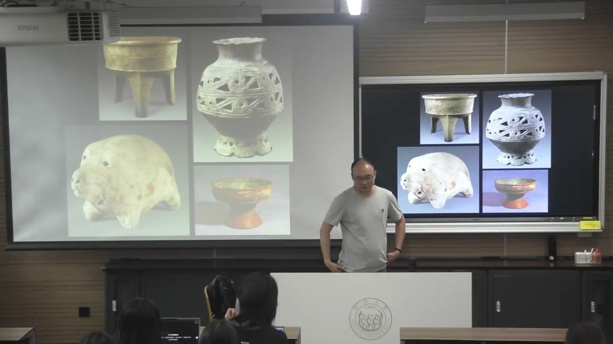

#### 陶猪形象与生产生活的变化

教师将小型陶猪视为可能的玩具或非实用造型，其具体用途保留推测。猪为杂食动物，驯养需要更多食物供给；课堂借此讨论定居聚落、稻作生产与动物驯化之间的关系。

河姆渡猪形象中较长的鬃毛等特征，与崧泽较圆润的猪形象可以形成比较。教师用这种差异解释驯化过程中外形的变化，以及今天观看者为何觉得后者更“可爱”。它把动物造型放回人类与动物长期相处的生活过程，而不是仅比较雕塑是否好看。

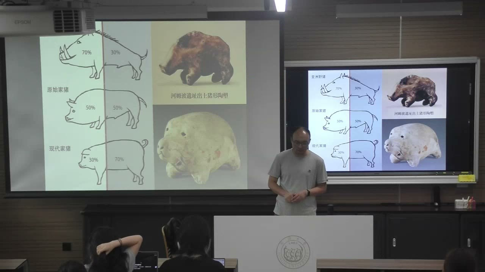

### 良渚玉器：精美工艺与解释边界

良渚玉器提供了关于礼仪、信仰与群体联系的材料，但精美的图像并不意味着我们已经知道它们的全部含义。

#### 良渚文化不只等于一处遗址

良渚遗址是命名依据和重要中心，良渚文化的分布还包括苏南、浙北与上海等区域。不能把文化分布范围直接缩为遗址公园所在地。教师同时提醒，上海有较长的史前文化发展，不能以近代城市印象概括这片土地的历史。

发达的稻作、编织与纺织构成物质生活背景；与艺术关系最直接、代表性最强的是玉器。良渚玉器种类多、雕琢精细，玉琮、玉璧、玉钺等需要结合类型、工艺和出土地点理解。

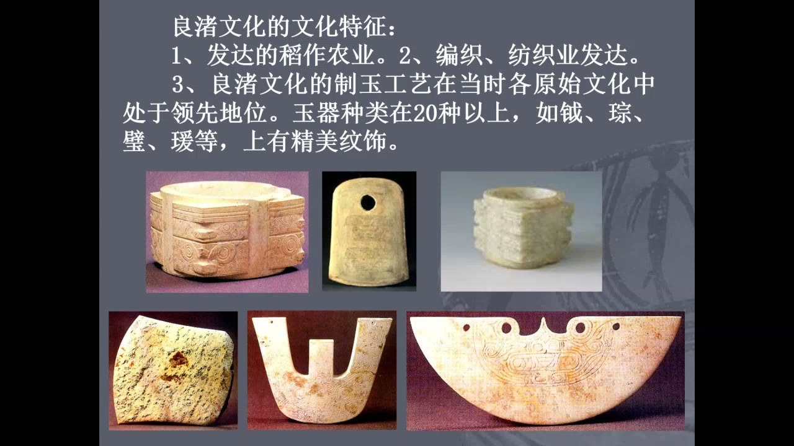

#### 玉琮的名称、形制与后世解释

玉琮的外方内圆容易让后人联想到“天圆地方”，但教师明确提醒，不应把后来成型的观念直接投射到良渚时期。今天的名称依据后世文献及形制比定，不等于我们知道先民当时怎样称呼它。

埋藏环境会改变玉器表面，使一些器物看起来不再像今天熟悉的温润玉石。上海福泉山出土玉琮保存状况较好，可以与其他受沁较重的器物比较。观察材料时，需要区分原始材质和后来的保存状态。

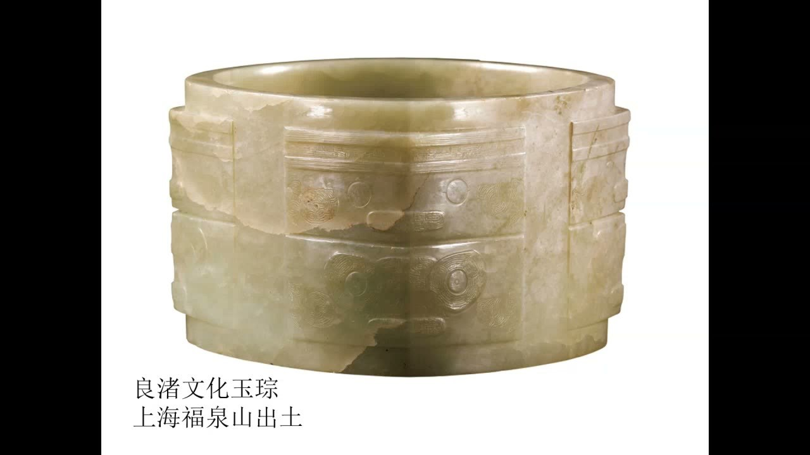

#### 神人兽面纹：能看见什么，还不知道什么？

教师在课堂播放片段后强调，玉琮王的神人兽面纹可以辨认人、羽冠、手与兽体等要素，但人物与兽的关系、图像的确切含义仍存在不同解释。图像出现得广泛，并不能让某一种解释自动成为定论。

贵族墓葬和祭祀遗址的出土语境，使这些玉器与礼仪、信仰及沟通神灵的活动相联系。它们在当时具有具体功能，不能只按照今天“艺术品”的观看方式理解。

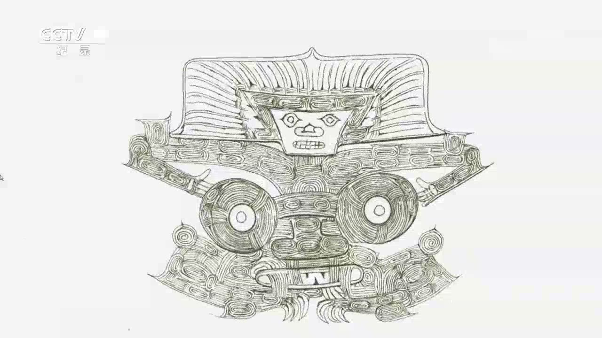

#### 发现良渚玉器，不等于发现良渚文化遗址

玉器便携且珍贵，可以通过交流、流转等方式进入其他地区。因此，在一处遗址发现良渚风格玉器，可能说明文化联系，并不直接证明该遗址属于良渚文化。

同样，图像由复杂到简单、由具体到抽象的排列，未必就是年代先后。教师对部分类型学排序提出保留：地域和风格差异也可能造成这种变化，年代推断仍需要更多材料。文化归属、交流范围、形制差异与年代是需要分别检验的问题。

### 水城与觚：生活格局、材料置换和意义变化

建筑与器物形式会延续，但材料、用途和文化解释都可能变化。延续性要与具体的变化一起观察。

#### 良渚水城为何适应当地环境？

良渚古城中央的莫角山是人工堆筑高地，高等级建筑位于其上。教师由此强调台基的重要性：分析中国建筑不能只看地面的梁柱、屋顶和木构，也要看支承建筑并塑造等级的营建基础。

城市有多个水城门，城内城外河网密布，河岸经过木桩或木板整治。河道兼有防卫、运输和生活联系的作用。这种布局利用天然地势和水系，形成与北方城市不同的临水居住格局，课堂用江南水乡作帮助理解的比较。

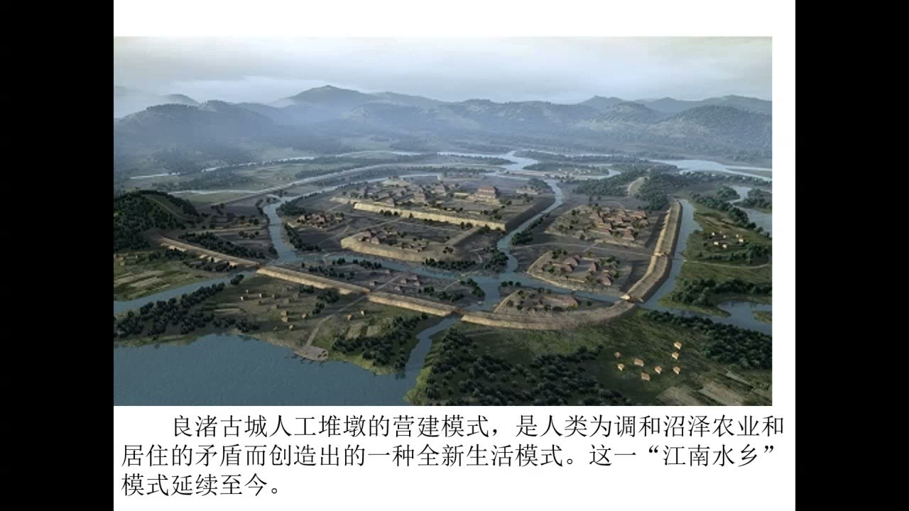

#### 觚的形制怎样跨越材料？

觚具有张开的喇叭口、细腰和较高圈足。盛液体的空间与下部支承要分别辨认；不能把外形全部理解为容积。教师用陶觚与青铜觚比较，说明很多青铜器器型继承了史前陶器的范本。

“材料置换”是器型大致延续、材质发生变化的现象。从陶到铜，再到清代玉制器物，相似形态可以跨越很长时段。比较时既要看形态的继承，也要问不同工匠怎样适应新的材料。

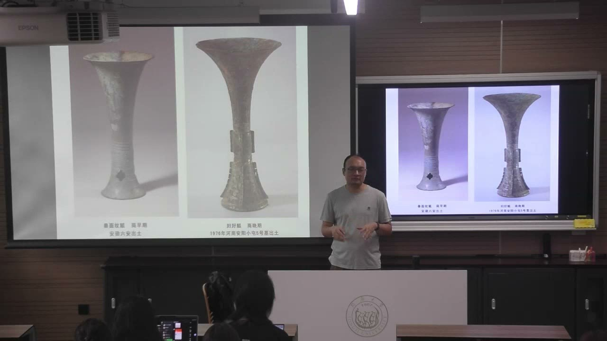

#### 同一器型的意义也会转变

早期觚与酒和礼仪相关，后来的观看者又把这种高挑器物理解为花器，并以“花觚”称呼和使用。课堂以乾隆时期玉花觚及博物馆展陈中插花的方式说明，后世理解会再次改变器物的用途与展示。

所以器物史不能只列一个不变的功能标签。相似形制在不同材料、时代和使用场景中，可能从礼仪酒器进入宫廷审美和花艺生活。器型的延续，与名称、用途及意义的变化可以同时发生。

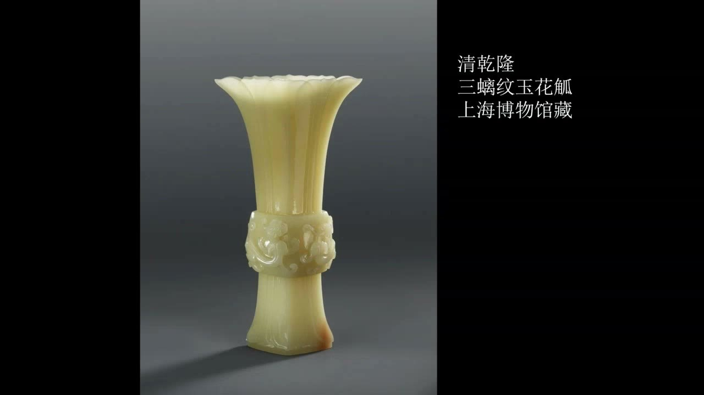

### 青铜时代：技术路径、战争与礼制

青铜时代既是材料技术发展的阶段，也是理解国家权力与礼仪体系的重要背景。中国的具体器物构成，需要结合出土材料讨论。

#### 从藏品材料分类到时代划分

课堂介绍三时代划分的形成：博物馆工作者整理工具和武器时，以石、青铜、铁等材料分类，并逐步把它们与不同发展阶段对应。青铜时代指主要以青铜制造武器和工具的时代。

这种划分帮助组织考古材料，但不同地区进入、延续和结束某一阶段的时间并不相同。课堂采用中国青铜时代从二里头文化至战国中期的分期框架，并提醒青铜艺术自身的变化不能完全等同于朝代更替。

#### 从天然红铜到青铜合金

天然红铜具有延展性，可锻、可熔，与石材的破碎方式不同。先民先使用少量天然铜制作小型工具，随后认识铜矿并学会冶炼，以扩大材料来源。孔雀石最初也因特殊色彩被用作饰物，后来才进入冶铜技术。

红铜较软，限制了器物制作和使用。合金技术使材料性能发生变化；课堂讲述的中国青铜器以锡青铜为主，也涉及铜与其他元素组合。技术形成是长期积累，不能想象成一夜完成的时代转换。

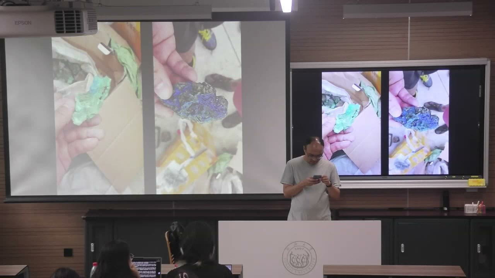

#### 鼎簋为何从食器成为等级标志？

鼎原有炊煮肉食的功能，簋用于盛装粮食。到礼制体系中，它们的数量与组合被赋予等级意义。课堂介绍天子九鼎八簋、诸侯七鼎六簋等文献中的理想规则，并解释“一言九鼎”“问鼎”等表达的文化背景。

文献规范与考古所见需要比较。教师用遵循七鼎六簋的墓葬和曾侯乙墓的较高规格组合说明，实际使用可能突破规则，不能把所有墓葬机械套入同一制度。

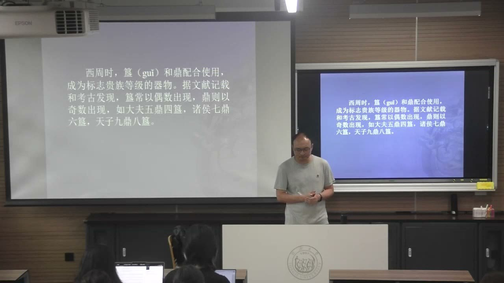

#### “祀与戎”及普通人的工具

战争需要先进兵器，祭祀依赖不同形制和组合的礼器，两者都与青铜铸造关系密切。教师据留存器物指出，中国青铜器在兵器、礼器方面尤其突出，直接用于普通生产的工具相对较少。

青铜时代并不意味着所有人都普遍使用青铜。普通劳动者仍可能大量使用石器与木器，个别豪华农具也可能具有礼仪用途。时代名称、技术水平和不同阶层的日常工具不能混为一谈。

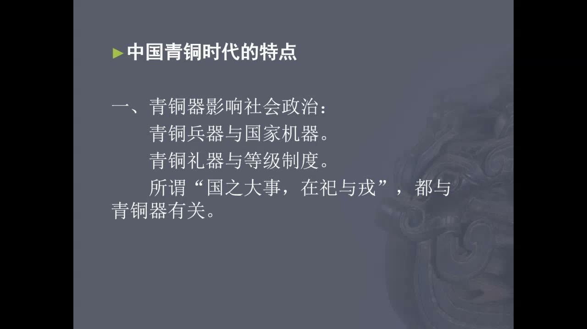

### 二里头、早商与殷墟：遗址证据怎样改变认识

朝代认定、工艺水平和城市布局都需要具体材料。科学发掘的器物与遗址，能修正仅凭传世文献或经验形成的判断。

#### 二里头文化与夏：高度关联仍需要证据

课堂根据年代和分布与文献活动范围的重合，介绍二里头文化与夏的高度关联，同时明确保留认定上的证据边界。不能把“可能对应”直接改写成已经找到完全确定的证明。

遗址以今河南偃师二里头命名。教师借洛阳不同时期城址的位置图提醒：同名古都在各时期的中心可以相距较远，不能用今天的市中心反推每个时代的都城所在。

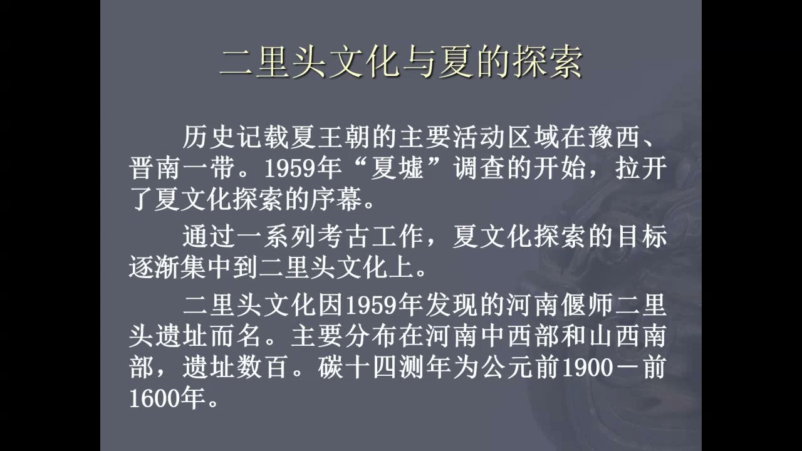

#### 器物线图与精细铸造的观察方法

容器线图常把剖面与外轮廓放在同一张图中：一侧显示器壁厚度和内部结构，另一侧显示外形。看懂这种表示方式，才能准确比较陶器与青铜器，而不只依据一张正面照片判断。

二里头器物的陶、铜之间存在相似器型与纹饰。教师尤其关注薄壁、细足、长流等精巧青铜爵的铸造，指出“小而精”对陶范精度和工艺的要求很高，不能仅以器物体积评价技术水平。

#### 早商城址、原始瓷与可靠出土语境

商代都城多次迁移，郑州、偃师、洹北和安阳等城址属于不同阶段。早商城址中居住、作坊与墓葬分区，以及更加丰富的青铜器和列鼎，可以帮助认识工艺与制度发展的基础。

二里岗原始瓷尊以接近后世瓷器的原料制作，施釉并经较高温度烧成，但与成熟瓷器仍有差距，所以称为“原始瓷”。教师强调，它的可信性来自科学发掘的出土背景；不能因为不符合既有认知，就把可靠发现当成伪品。

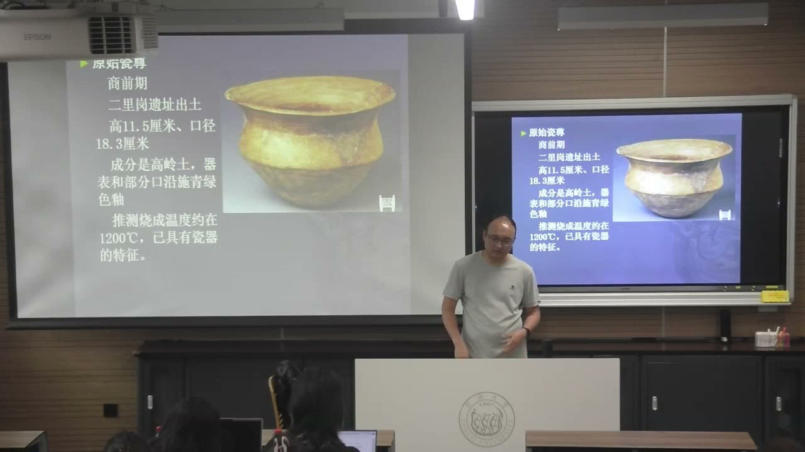

#### 殷墟的学术意义与未解问题

殷墟是晚商都城的重要遗址。持续发掘使商代获得有力的考古证明，李济等人的方法、工作与人才培养，也推动中国考古学形成。教师由此说明基于考古材料研究艺术史的意义。

殷墟总体布局又提出新的问题：截至教师讲述时的考古认识，未发现明确城墙。大都城是否一定有城墙，防卫与空间如何组织，都不能仅凭今天对“城市”的想象回答。把“未发现”直接等同于完全确定的“不存在”仍需谨慎。

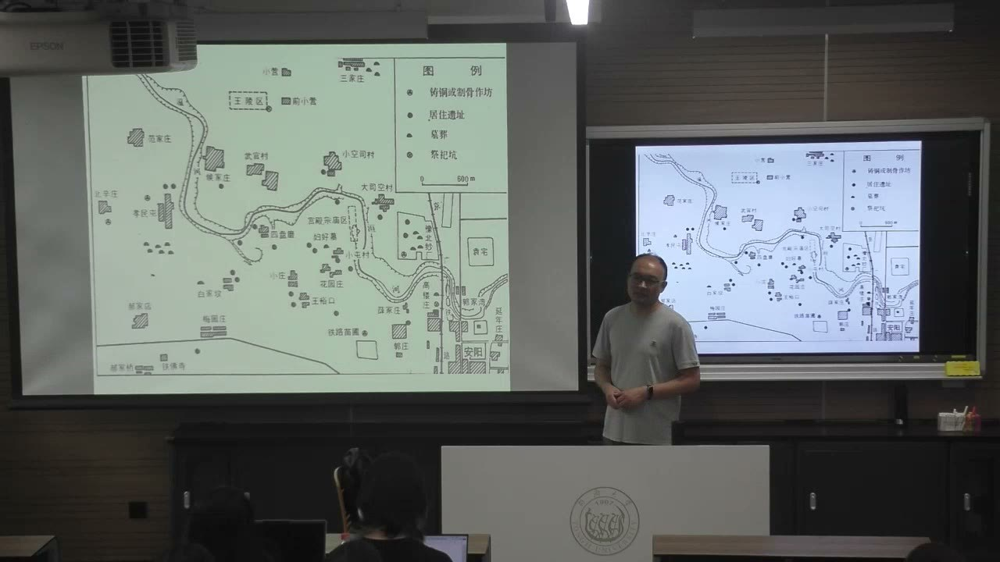

### 妇好墓：器物、女性角色与文化意象

妇好墓把祭祀、军事、生活审美和收藏联系起来。器物形制与纹饰，需要放回墓主人和时代文化中理解。

#### 宫殿区的墓葬与妇好的多重角色

妇好墓位于宫殿宗庙区，与传统王陵区的分布不同。郑振香带队发掘，墓葬保存完整并出土大量器物，为认识墓主人提供了丰富材料。教师由这个案例介绍女性考古学家与女性历史人物。

妇好是商王武丁的重要配偶，也参与国家祭祀和军事活动。其角色不能被后宫生活的刻板印象概括。完整器物组合、铭文与甲骨记载，需要共同用于理解她在国家生活中的位置。

#### 鸮尊的造型、纹饰与意义变迁

鸮尊把猫头鹰形象与酒器结合，内部中空，脑后设盖，可以盛酒并取用。器表从整体形体到羽毛细部布满纹饰，较写实的动物形态与更细密的装饰并存，不能只把它看成动物雕塑。

教师把商代鸮形象与战斗、信仰联系起来，再比较后世的负面评价和当代文创中的可爱形象。同一动物意象会在不同历史时期获得不同含义；后来的“不祥”印象不能直接解释商代器物。

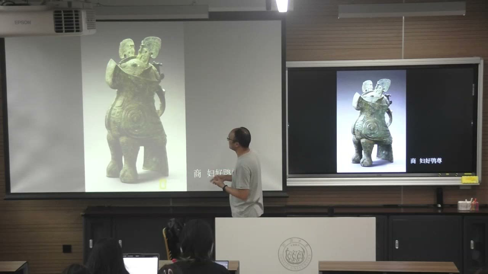

#### 兵器与文字材料怎样共同说明军事活动？

教师以妇好墓青铜钺、铭文以及甲骨材料讲解妇好的军事角色。带“妇好”铭文的器物提供身份线索；甲骨文中的征战记载又使墓葬材料进入更具体的行动历史。

课堂区别纯粹展示权力的礼仪兵器与具有开刃、使用痕迹的器物，并据此讨论祭祀和军事的关联。课堂把器物观察与文字记载相互参照，用于讨论妇好在祭祀和军事中的作用。

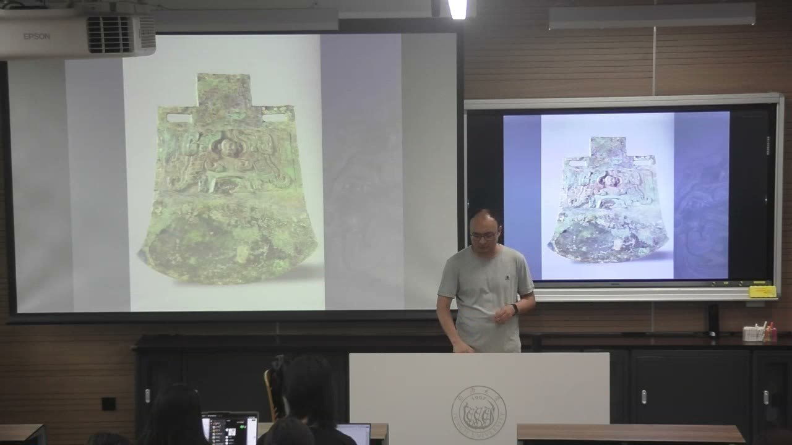

#### 生活器物、材料组合与古物收藏

象牙杯与青铜觚等器型可以相互比较，象牙、绿松石和精密雕刻的组合呈现材料与工艺的审美效果。另一类杯形利用象牙本身的弧度安排流口，说明工匠并非只复制造型，还利用材质的天然特点。

玉笄、骨笄、动物形玉器等显示生活审美和佩戴、把玩需求。墓中还有年代早于商代的石家河文化玉凤，教师用它说明古物在后来的时代仍可能被珍藏和流转。它与新制器物一起陪葬，使收藏也成为理解物品生命史的角度。

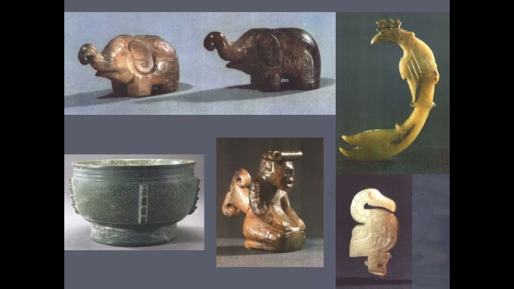

### 概念对照与自测

| 比较对象 | 需要区分的内容 | 课堂例子 |
| --- | --- | --- |
| 器型／材料 | 形态延续不等于材质不变 | 陶觚、铜觚与玉花觚 |
| 后世解释／原始含义 | 名称与观念不能倒推先民思想 | 玉琮与“天圆地方” |
| 文化分布／器物流转 | 一件外来器物不直接决定遗址归属 | 其他地区发现良渚玉器 |
| 礼制规范／实际使用 | 文献理想与考古组合可能不同 | 七鼎六簋与较高规格组合 |
| 时代名称／日常工具 | 先进材料并不普及于所有阶层 | 青铜时代仍有石、木工具 |
| 群体身份／具体角色 | 不能用后宫想象限制女性历史角色 | 妇好的祭祀、军事与收藏 |

#### 为什么河姆渡与北方先民采用不同居住形式？

温暖湿润、沼泽较多的环境促使地板抬离地面；建筑要结合当地自然条件和生活需求理解。

#### 能直接把玉琮解释为“天圆地方”吗？

不能。课堂强调这类后来的思想和命名不必然等于良渚先民自己的称呼与解释。

#### 一处遗址有良渚玉琮，就属于良渚文化吗？

不一定。珍贵、便携的玉器可能流转；它也可能反映交流，文化归属需要更多材料。

#### 为什么器物线图常同时画剖面与轮廓？

两部分分别呈现器壁厚度、内部结构和外形，帮助准确比较容器的制作与形态。

#### 青铜时代为什么还可以大量使用石器和木器？

时代划分说明材料技术与代表性器物，不意味着各阶层的全部工具同时更换。

#### 妇好鸮尊为何既是动物形象又是功能器物？

它中空、有盖、可以盛酒，并参与祭祀礼仪；动物造型与器物功能、信仰含义结合。

### 来源范围

原始转写含课堂互动，正文只整理教师讲授、解释、回应与课程任务。时间范围为两分钟音频分段边界，不是逐句对齐时间。
