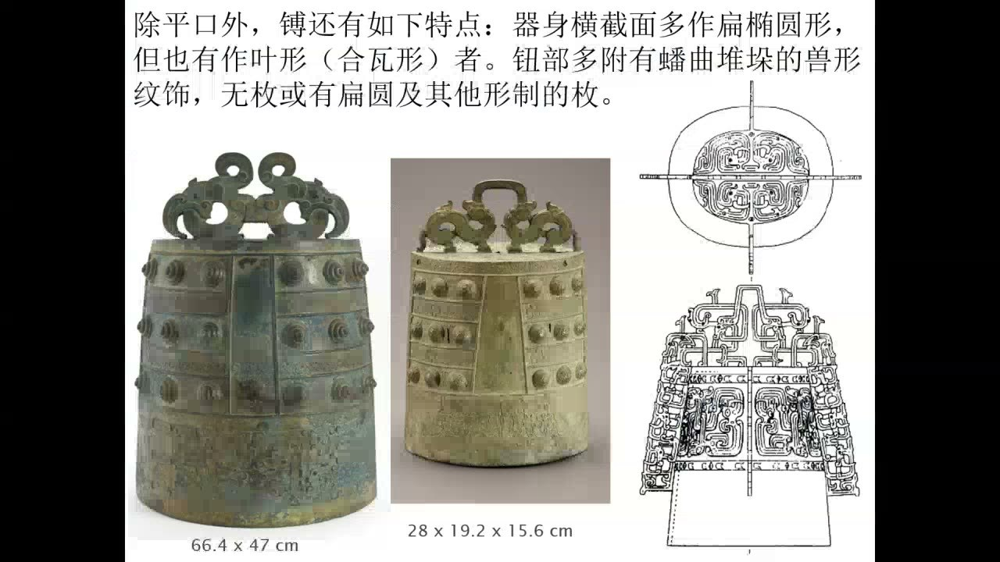
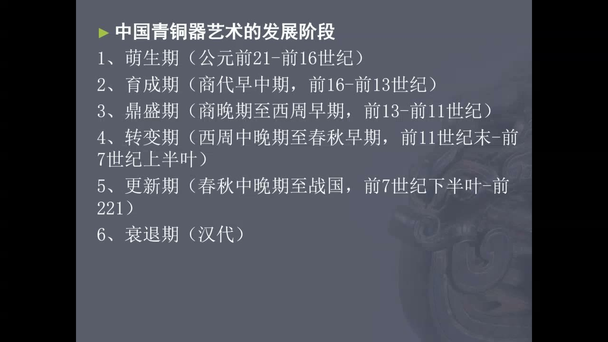
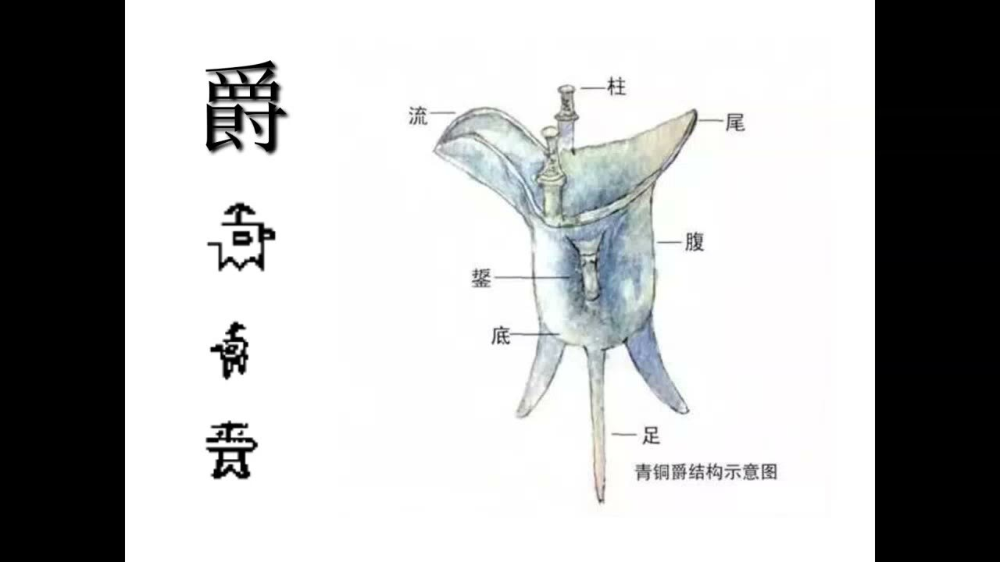
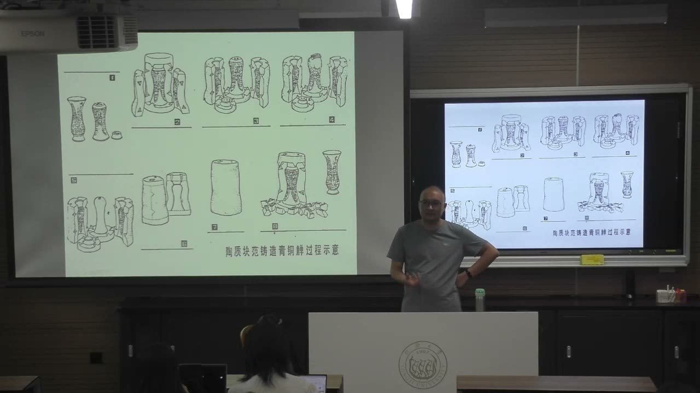
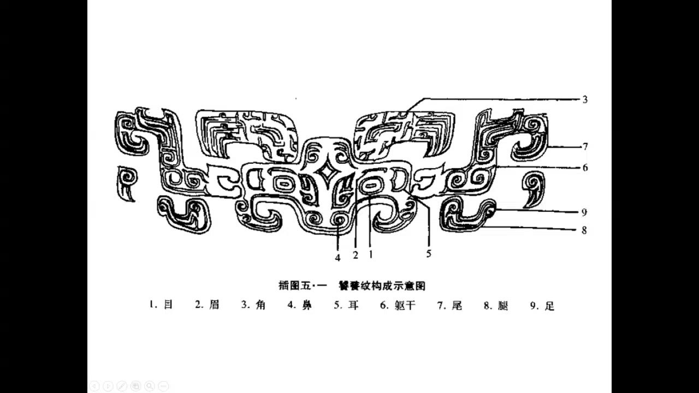
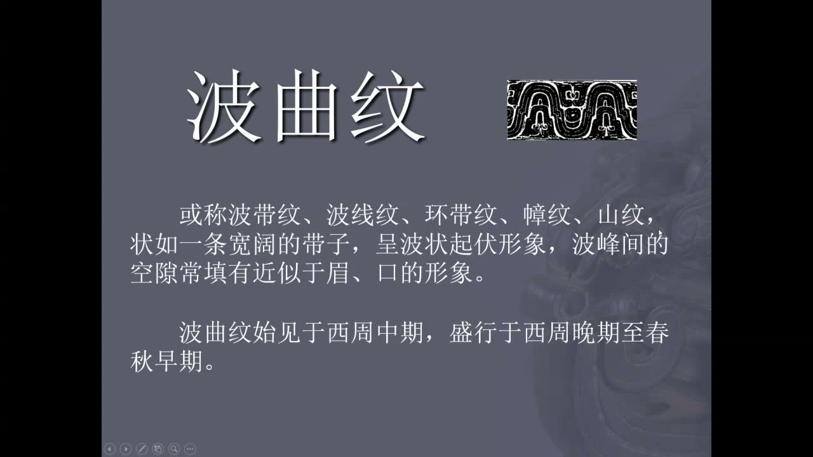

### 一、曾侯乙墓：器物怎样共同呈现贵族生活

墓葬的重要性不只在于体量，更在于保存状况、随葬品的完整程度，以及不同材料和功能之间的联系。

#### 棺椁、漆器与地方信仰
<!-- source: 0 -->
曾侯乙墓属于竖穴棺椁墓，墓葬结构本身并非独有，但规模宏大、保存较完整，随葬品种类丰富而精美，因而成为理解青铜时代艺术的重要案例。外棺以铜构件形成框架，再结合木板；内棺为髹漆彩绘木棺。葬具既有结构设计，也有几何纹饰和象征性图像。

棺上的门窗式图形、鸟兽与人兽结合的形象，被教师联系到灵魂出入、神性和守护的观念。形象中的兵器、鸟兽身体等超自然特征，与楚地文化背景有关。不能把这些装饰只看成漂亮花纹，也要考察它们在墓葬中的位置和作用。

#### 材料组合与完整的生活图景
<!-- source: 4 -->
鸭形漆盒、彩绘衣箱等随葬品呈现日常生活的不同方面；衣箱上的二十八星宿图像，又使实用物品与知识、信仰联系起来。彩漆木雕梅花鹿的身体由木材雕刻、表面彩绘，头部插入的却是真鹿角。相似的真实鹿角，也见于楚地一些镇墓兽的组合方式。

理解作品需要同时看造型、材料和制作方法。看起来逼真的鹿角，不一定是雕刻技艺造成的仿真效果，也可能直接使用天然材料。随葬品还应区分生活用品与信仰性器物，不能仅凭外形归类。

### 二、编钟：声音、形制与铭文互相证明

曾侯乙墓中的乐器种类丰富。编钟的意义尤其在于：成套实物、声音和铭文能够互相印证。

#### 编磬与编钟都是成套演奏系统
<!-- source: 6 -->
编磬以加工、打磨的石片为发声部分，不同大小的石片悬挂在架上，敲击时发出不同音高。编钟则以青铜钟组成演奏系统。两者都不是仅靠单件器物就能理解的收藏品，还涉及排列、悬挂、演奏方式和多人配合。

曾侯乙编钟上有大量标示音名和乐理关系的铭文，其价值超出对墓主家世、铸器缘由的普通记载。教师把它比作青铜材质的音乐书：既是乐器，也是研究当时音乐知识的材料。

#### 甬钟、钮钟与一钟双音
<!-- source: 8 -->
甬钟顶部有柱状的甬，以甬部附近的结构悬挂；钮钟则通过顶部的钮穿绳悬挂。甬钟悬挂时可呈一定倾斜，钮钟更接近垂直。辨认两者时，悬挂结构比单纯比较大小更关键。

中国青铜时代许多钟的横截面为合瓦形或叶形，区别于圆形截面的钟。敲击正面、侧面的不同位置，可以得到不同音高，分别称为正鼓音、侧鼓音。这里讨论的是特定形制和相应发声方式，不能直接套用于所有时代、所有钟类。

#### 从形状推测到铭文证据
<!-- source: 18 -->
黄翔鹏根据器物形制及声音提出，一口青铜钟在古代演奏时可以使用两个音。但“今天能够敲出两个音”，并不自动证明“古人当时就这样使用”，所以这一解释曾受到质疑。

曾侯乙编钟上每钟标示不同音名的铭文，使物理可能性与当时的使用意图联系起来。这是本课重要的方法例子：研究应把形制观察、实验或演奏结果、文字材料结合，而不是把功能推测直接当作历史事实。课堂播放的原物声音采录片段，帮助理解文物不仅可看，也具有可研究的声音属性。

#### 镈与钟的礼仪、身份功能
<!-- source: 24 -->
曾侯乙编钟中有一件形制特殊的镈。课堂用它与甬钟、钮钟比较：镈的口沿较平，常见扁椭圆形截面，也有合瓦形者；器形和悬挂、陈列方式有关，不能把全部外观相近的器物都视为同一种钟。

青铜钟的用途包括祭祀、宴饮等礼仪场合的音乐演奏，也可用于显示贵族身份、军队活动，以及承载记事或音乐知识的铭文。器物形制、数量与阶层名分相关，但实际墓葬还存在僭越等复杂情况，不能用一个规范机械解释所有发现。

### 三、读懂青铜器：分类与分期是两条线索

器名解决“这是什么”，用途解释“它做什么”，艺术分期则说明“它处在怎样的变化过程中”。

#### 生僻器名背后的金石学传统
<!-- source: 28 -->
许多青铜器名称沿用古代文献中的用字。宋代金石学家收藏、整理器物，尤其重视铭文，并尝试把实物与礼书等文献中描述的器物对应。部分命名后来得到新发现支持，部分被修正，另一些仍带有约定沿用的性质。

器名不是无需检验的答案。熟悉名称之后，还要看器形、组合、出土背景和实际使用痕迹。教师提醒，生僻器名和器物识别仍需个人知识积累，不能把 AI 给出的名称当成已经核实的结论。

#### 七类用途与礼乐文明
<!-- source: 30 -->
按用途可分为食器、酒器、水器、乐器、兵器、工具、车马器。食器、酒器和水器虽然与饮食相关，但饮食活动也可上升为礼仪，所以它们与乐器共同构成理解礼乐文明的重要部分。

艺术发展阶段不完全等于朝代更替。教师采用马承源的分期线索，课件列出萌生期、育成期、鼎盛期、转变期、更新期、衰退期。本节详细展开前几个阶段，讲至西周中晚期到春秋早期的变化；后面的更新期、衰退期只是总览中的位置。

### 四、萌生与育成：礼仪造型、材料工艺和酒器组合

早期青铜器已经兼具使用功能、礼仪意味和装饰设计，不能只按“是否方便日常使用”判断其造型。

#### 二里头青铜器与绿松石镶嵌
<!-- source: 32 -->
二里头文化的青铜容器、乐器、兵器、工具与饰件，以及铸造遗迹，反映较成规模的生产。器形复杂、器壁薄而均匀，是技术水平的重要表现；做得厚大并不必然更高明，也可能增加铜料消耗。

二里头爵的长流、长尾、束腰和细长锥足，具有超出简单盛酒需要的仪式性。铜牌饰上的绿松石镶嵌，还要求先在铜质部分预留位置，再将石料切割、打磨成相应形状，借助黏合材料固定。这体现不同材料工匠之间的配合。

#### 钺既可以是兵器，也可能表示权力
<!-- source: 38 -->
同样被称为钺的器物，用途不一定相同。妇好墓中的钺与课堂展示的上博镶嵌十字纹方钺，形成了锋刃使用与身份象征的对照。后者没有开刃，精美装饰和无锋刃状态，使教师更倾向于把它理解为类似权杖的身份标识。

今天出土或展示的往往只有青铜部分，当年还需要结合木柄、孔洞与捆绑结构，才能成为可持握的完整器物。判断用途应看是否开刃、怎样装柄、是否有使用痕迹，不能因名称像兵器就断言它一定参与过战斗。

#### 爵的部位与温酒功能的争议
<!-- source: 42 -->
爵的主要部位包括流、尾、柱、腹、底、足和鋬。流用于倾注，鋬是把手；辨认这些部位，有助于比较夏代、商代和西周早期的形制变化。影视中常把爵当作直接饮酒的杯，但教师更倾向于其主要功能是温酒。

支持温酒解释的依据包括：部分出土爵底部有烟炱等受火痕迹；长流、高柱的形制并不便利于直接饮用；爵与其他饮酒器的配对关系也提示分工。关于柱的礼仪象征、持取或挂滤网功能，课堂介绍了不同解释，尚不能据此确认唯一用途。温酒的证据与“只能温酒”的排他结论也应区分。

#### 觚、觯与成组器物的关系
<!-- source: 54 -->
觚通常具有喇叭口、高而狭长的器身，是课堂介绍的饮酒器。觯也用于饮酒，课堂展示的实例体量接近手持杯，一些还带盖。识别功能时，教师尤其强调墓葬中器物的组合。

商代的觚与爵常等量配对；西周早期的一些组合则出现两个爵配一觚、一觯，或一爵配一觯的现象。饮酒器发生替换，而爵保持存在，是支持“爵与觚、觯功能不同”的一条证据。组合证据需要与器形、使用痕迹互相参照，不能只按外观猜功能。

### 五、范铸法：从器物表面追溯生产过程

铸造技术既决定器形能否实现，也会在器表和底部留下可观察的痕迹。

#### 外范与内模之间的空隙形成器壁
<!-- source: 60 -->
单合范的示例说明基本原理：将型腔合拢，注入铜液，冷却后取得成品。铸造中空容器更复杂，需要外范和内模配合，在两者之间保留将来成为器壁的空间。纹饰须与相应范面设计结合。

许多容器采用口沿向下、底部向上的倒铸方式。教师解释，浇注口连接处通常比较粗糙，需要去除、打磨；把这类处理更多安排在底部，有利于保持口沿平滑。器物的使用要求，会反过来影响生产方案。

#### 双合范、三合范与范线
<!-- source: 62 -->
器形决定外范怎样分块。圆形器可用双合范，一些三足器适合三合范；复杂器物需要更复杂的拼合。两块范之间无法绝对无缝，铜液进入接合位置，就可能留下范线或披缝。显眼处可能打磨，底部或边角则可能保留。

课堂所讲的陶范工艺，取出铸件时往往要破坏范体。即使两件器物采用相同设计，也可能因重新制范、手工制作与后续处理而存在细部差别。研究时不能只追求正面的完整图案，也应观察接缝和局部工艺痕迹。

#### 方鼎底部的交叉结构为何有意义
<!-- source: 88 -->
方鼎具有四足和平底，范包的组织与铜液流动更加复杂。课堂用模拟铸造图和实验铸件，说明工匠在内模相应位置开出连接四足的通道，使铜液更充分地流到需要的位置。铸成后，鼎底会留下交叉的凸起结构。

这类底部痕迹虽然不一定承担主要装饰作用，却能说明工艺如何解决充型问题。教师建议参观时在允许的视角内多看底部和边角，把“看纹饰”扩展为“看制作过程留下了什么”。

### 六、鼎盛期：动物造型与兽面纹的识读

商晚期至西周早期的器形和装饰具有延续性，王朝更替并未使艺术形式立即全部更新。

#### 觥是盛酒器，器盖与器身共同构成动物
<!-- source: 66 -->
青铜觥通常有盛酒的腹部、流、鋬及精巧的盖，器盖常呈兽首形，整体可结合多种动物形象。它更接近盛酒、倾注的容器，不能把“觥筹交错”中泛指酒杯的觥，直接等同于这一特定青铜器形。

课堂展示父乙觥，强调器盖与器身接合处既要实现开合，也要让动物形象连续。凤鸟作为主体纹饰，空余部位再填入小鸟和其他纹样，体现这一阶段装饰繁密、很少留白的特点。分析应同时看主体纹样、辅助纹样与器形的关系。

#### “饕餮”命名与“兽面纹”的谨慎表达
<!-- source: 70 -->
吕大临《考古图》把某类青铜器兽面形象称为饕餮，与古代文献中关于饕餮的描述相联系。但文献的“有首无身”等说法，不能与每一件实物完全对应；有些纹饰有躯干、尾和足，有些则省略或抽象化。

因此，教师介绍“兽面纹”作为更稳妥的描述性名称。它确认图案具有兽面特征，却不要求先证明所画一定是传说中的饕餮。器名、纹饰名称都可能同时包含观察和解释，学习时要识别两者的差别。

#### 从双眼定位，并把展开图还原到器面
<!-- source: 72 -->
辨认复杂兽面纹，可从突出的双眼入手，再找眉、鼻、角、耳和向两侧展开的躯干、腿、足、尾。线图看起来像“一头两身”，可能与圆器周面被展开成平面有关。把图案重新想象为包覆器物，就能理解两侧身体如何共同组织一个形象。

并非所有实例都完整保留各部位。部分器物仅有兽面，有些让躯干与头部脱开、强化装饰性，也有高度抽象化的例子。不能用一张标准图要求所有实物都具备同一套细节。

### 七、转变期：从重酒到重食，铭文成为历史材料

西周中晚期到春秋早期，礼器组合、制度与装饰发生变化；这种变化应与前期的延续一起理解。

#### 簋的食器功能与利簋的历史价值
<!-- source: 80 -->
簋用于盛放熟的谷物等主食。器物命名常结合“作器者名字＋器类”：利簋即以利的名字和簋这一器类命名；不知道作器者时，则可能按纹饰等特征命名。

利簋之所以被称为“西周第一器”，关键在于内底铭文记载武王克商，而不只是器形精美。教师以它说明，铭文可以与文献、干支历谱和天文推算相互参照。课堂采用课件所列“公元前1046年1月20日”的推算结果；这属于课上介绍的具体断代方案，不能理解为器物铭文直接写有现代公历日期。

#### 重食、列鼎列簋与赐命作器
<!-- source: 84 -->
教师把西周礼器变化概括为减少酒器、增加食器的“重食”趋向，并联系周人对商代经验的总结。列鼎列簋和编钟的形制、数量，逐步与阶层名分相联系。

“赐命作器”指臣下因功绩、战争或重大礼仪活动受到赏赐，借赏赐铸造器物并记述其事。较长的铭文使器物同时保存政治、礼仪与文字艺术的信息。诸侯国经济和铸造能力的发展，也使不同地区拥有自己的作坊与工匠，不能把全部青铜生产都想成单一中心的活动。

#### 大克鼎的波曲纹：描述与解释要分开
<!-- source: 92 -->
大克鼎的主体装饰不是单纯以兽面占满主要区域，而是具有波状起伏的带状纹饰，兽面处于较次要的位置。波曲纹也被称为波带纹、波线纹等；这些名称主要描述形态。

“幛纹”“山纹”等称呼则进一步解释图案代表什么。教师介绍李零以其他实例及纹样间的动物等线索论证“山纹”的观点，同时保留其作为解释方案的性质。纹饰不只有一种机械对应的含义，分析文创素材时也应说明自己借用的是视觉形式，还是某种历史解释。

### 课程安排与任务

#### 把博物馆参观变成观察练习
<!-- source: 90 -->
参观青铜器展陈时，可结合悬挂方式辨认钟类，结合器物组合和使用痕迹判断酒器功能，并观察器底、边角的范线与铸造结构。兽面纹先找眼睛，再追踪其他部位。教师提到过往考试曾考纹饰识别，但本节没有据此明确宣布本次考试题型，也没有布置新的书面提交任务。

### 概念对照与自测

| 对象或方法 | 核心观察 | 解释边界 |
| --- | --- | --- |
| 甬钟与钮钟 | 顶部悬挂结构及悬挂姿态 | 不能只靠大小判断 |
| 爵、觚、觯 | 器形、受火痕迹及配对组合 | 爵的具体功能仍有争议 |
| 青铜觥 | 腹、流、鋬与兽首形盖 | 不等于成语中泛称的酒杯 |
| 范线与鼎底交叉结构 | 分范接缝及铜液流动设计 | 工艺痕迹不全是装饰纹样 |
| 饕餮纹与兽面纹 | 双眼定位，联系器物周面 | 描述性名称不预设神兽身份 |
| 波曲纹与山纹说 | 波状带纹及其间的细节 | 形态描述与意义解释分开 |

#### 为什么“一口钟能发两音”还不够证明古人使用一钟双音？
物理可能性不等于历史使用方式。还需要音名铭文、器物组合等材料说明当时人的意图，曾侯乙编钟提供了这种相互印证。

#### 为什么爵底受火痕迹和爵觚配对需要合起来看？
受火痕迹支持温酒用途，配对说明不同器类可能承担互补功能。二者比单凭影视印象或一种外形推测更有解释力，但不能消除所有功能争议。

#### 展开图像“一头两身”，为什么不能马上认定为双身神兽？
器物周面的图案被展开后，可能把身体的两个侧面并列呈现。应把平面纹样还原到器形，同时观察具体实例是否省略、分离或抽象了身体部分。

### 课程时间线

00:00—06:00：曾侯乙墓、棺椁漆绘与随葬品的材料和信仰
06:00—12:00：编磬、编钟，甬钟与钮钟的形制和发声
12:00—18:00：编钟原物声音采录片段与教师补充
18:00—24:00：一钟双音的研究证据和编钟的声音体验
24:00—28:00：镈的特点，钟的礼仪、身份及铭文功能
28:00—34:00：青铜器命名、用途分类与艺术分期
34:00—42:00：二里头爵、绿松石镶嵌与钺的功能
42:00—46:00：爵的部位及历代形制变化
46:00—50:00：课间与恢复授课
50:00—60:00：爵的温酒争议，觚、觯与酒器组合
60:00—66:00：范铸法、倒铸、双合范和三合范
66:00—72:00：鼎盛期酒器、父乙觥与繁密装饰
72:00—80:00：饕餮纹命名、兽面纹识别及图案展开
80:00—88:00：簋与利簋，重食趋向、赐命作器及铸造发展
88:00—92:00：方鼎底部交叉结构与铜液流动
92:00—95:00：大克鼎波曲纹及山纹解释，课堂结束
95:00—99:45：课后环境与零散声音，未编入教师知识正文
