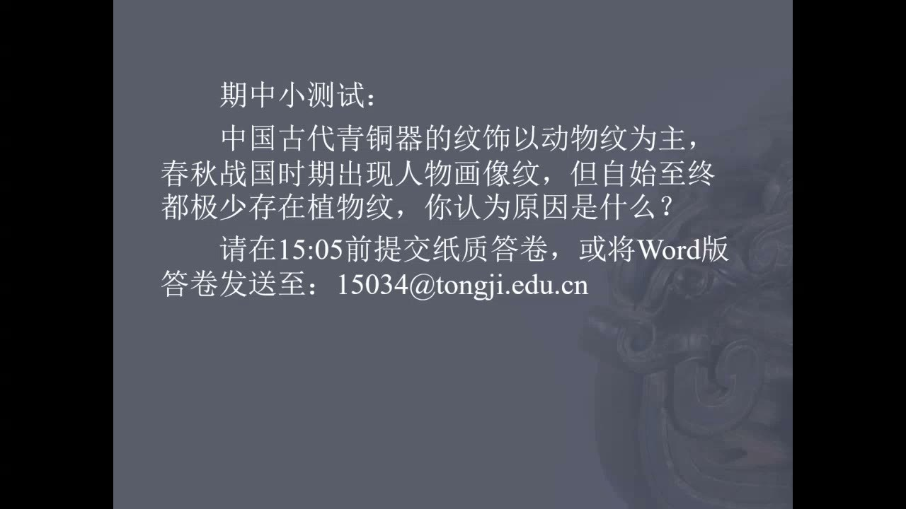
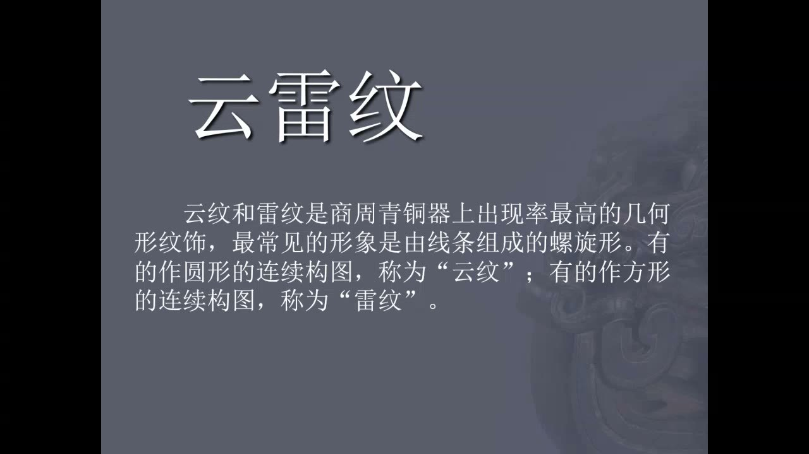
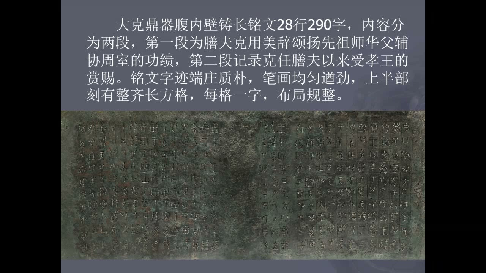
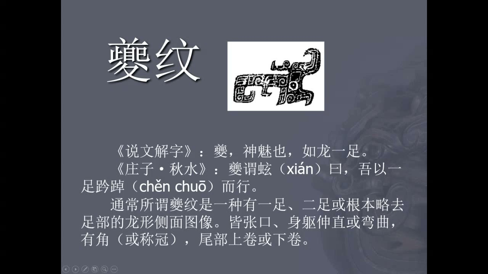
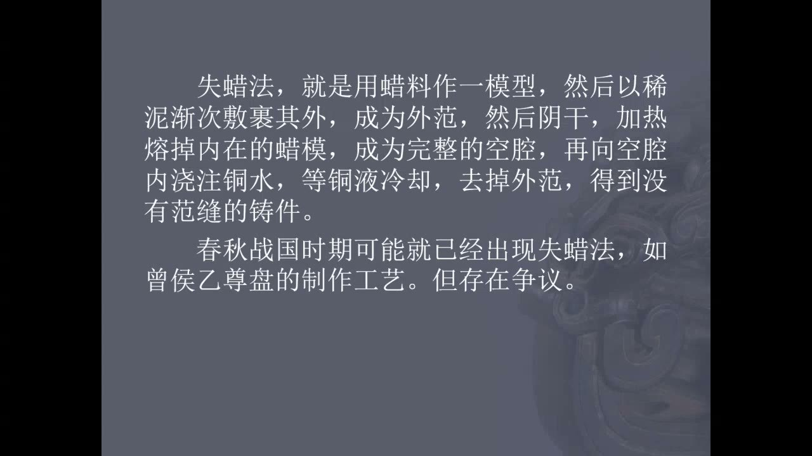

### 课程安排与任务

#### 10月26日当堂期中小测试
<!-- source: 44 -->
题目是：“中国古代青铜器的纹饰以动物纹为主，春秋战国时期出现人物画像纹，但自始至终都极少存在植物纹，你认为原因是什么？”这项作业计入期中成绩。课堂要求在当日15:05前提交纸质答卷，或将Word版答卷发至15034@tongji.edu.cn；电子版不要交PDF。

教师说明这是一道开放题，可以查资料、与朋友讨论或使用AI，关键是形成能够自圆其说的解释，并按时提交。关于植物纹较少的原因，学术界仍有争论，没有唯一标准答案。不能把课堂提出的问题误记为教师已经给出了某一种确定结论。

#### 图像辨认与课外观看
<!-- source: 2 -->
学习纹饰需要看课件、记住形象，能够把名称和实际图案对应起来。云雷纹不是画一朵云或画雷电；上古工匠留下的器物形象，也为后世瓷器、丝织品等载体的装饰奠定了基础。教师提及过去闭卷考试曾让同学画云雷纹，是强调图像记忆的重要性。

宴乐攻战纹壶和曾侯乙尊盘可以结合《如果国宝会说话》的相关内容继续观看，分别理解器物图像的叙事细节与复杂铸造工艺的复原思路。

### 云雷纹与礼乐制度

转变期延续至西周中晚期、春秋早期，器物的实用功能逐渐与身份、政治和礼制意义结合。

#### 云纹偏圆，雷纹偏方
<!-- source: 0 -->
云雷纹的基本形态是线条组成的螺旋。较圆、连续卷曲的通常称为云纹；偏方、转折较明显的通常称为雷纹。不过方圆并不总能严格区分，有的转角已经圆化，有的构图兼有两种形态，因此常合称“云雷纹”。它们与写实的云、雷并没有直接对应关系。

在青铜器上，云雷纹往往充当背景、装饰带或边框，而不一定是主纹。辨认时要同时看线条的形态和它在整个器物装饰中的位置，不能只靠名称联想自然现象。

#### 列鼎列簋：食器成为等级符号
<!-- source: 4 -->
鼎、簋原本分别与肉食、谷物盛贮等饮食活动有关，后来也成为政权和等级的象征。课堂以“天子九鼎八簋、诸侯七鼎六簋”说明列鼎列簋制度。河南三门峡虢国国君墓的七鼎六簋，被用作遵循相应规格的例子。

曾侯乙墓的九鼎八簋，则被教师解释为突破身份规格的“僭越”。编钟的规模也可以放在类似的等级关系中理解。“礼崩乐坏”因此不只是文献中的抽象说法，也能通过墓葬器物的数量、组合和规模获得具体形象。

#### 大克鼎铭文：祖先、功绩与赏赐
<!-- source: 6 -->
上海博物馆藏大克鼎腹内有28行、290字铭文。课件将内容分成两段：一段由膳夫克颂扬祖先师华父辅弼周室的功绩，另一段记录克任膳夫以来受到孝王赏赐。铭文由赞颂先祖、记述自身功绩与王室赏赐，联系到“子子孙孙永保用”的传承愿望。

器物不只保存食物，也保存家族记忆与政治关系。铭文所呈现的文字布局、用笔和书法意义，教师留到后续书法专题继续讨论；此处重点是理解铸器、受赏与祖先祭祀之间的联系。

### 更新期的龙蛇纹饰

春秋中晚期至战国的更新期，各地政治、经济与自然条件的差异，也体现在晋、齐鲁、荆楚等地域的青铜器风格上。龙纹的发展和工艺创新成为重要线索。

#### 龙纹分类与夔纹的识别
<!-- source: 8 -->
龙纹的分类并不都使用同一种标准：有的按龙的姿态、身体构形区分，有的按想象中的龙类区分。辨认时应看它如何回顾、盘绕、卷曲，而不是把所有带状纹样都直接叫作龙。

夔纹也称夔龙纹。课件援引《说文解字》中“如龙一足”的描述，并结合《庄子·秋水》的故事说明名称来源。图像中常见龙形的侧面、大眼、张口、角或冠，身体伸直或弯曲，尾部上下卷曲；足部可能表现一足、二足，也可能省略。应从眼睛和头部找到身体、尾巴与足，而不是只数脚。

#### “一足”也可能与观看角度有关
<!-- source: 12 -->
教师把平面夔纹与妇好墓出土的玉雕相比较。玉雕侧面看起来只有一只脚，从正面却能看到分隔结构，提示它可能实际表现两足。平面的侧面图像，可能把前后重叠的足压缩成一个可见轮廓。

这是一种借助不同材质、不同视角相互参照的图像解释方法。它说明文献命名、平面纹样和立体造型需要一起观察；教师提出的是对具体造型的解释，不能仅凭“一足”的名称就断定所有夔纹都在表现完全相同的动物结构。

#### 蟠螭、蟠虺与蛇纹的重复单元
<!-- source: 14 -->
“蟠”强调龙蛇等形象相互缠绕。课堂把螭解释为个头较小的龙形，蟠螭纹乍看像丝带，但沿着眼、头和身体辨认，仍能找到交错缠绕的动物。类似纹样也见于玉器，显示不同材料的工匠会使用相近的装饰资源。

蟠虺纹以蛇形缠绕构成单元，再通过重复形成较大的纹饰带。制作时可以先刻出类似印章的纹样工具，在尚软的陶外范上连续模印，形成统一而复杂的装饰。重复并不等于整件器物逐笔重刻。

独体蛇纹的识别也有争论。面对有学者称作蚕纹的图像，教师依据头部、眼睛以及游动轨迹等形态，倾向解释为蛇纹。课堂进一步借《诗经》的梦占意象说明蛇与女性的历史文化联想；这是象征意义的解释，不是由器物纹样直接推断人物性格或生育结果。

### 人物画像与空间、时间的叙事

动物纹、几何纹之外，春秋战国时期出现更复杂的人物活动。纹饰不只装饰器表，也开始表现可辨认的事件与情节。

#### 宴乐攻战纹壶：分层的社会生活
<!-- source: 22 -->
四川博物院藏战国宴乐攻战纹壶，把宴饮、礼仪与战争等活动分层安排在器身。将曲面图像展开，有助于逐层阅读它的内容。城墙上的守军、城下持兵器和架云梯的人物，只用简练的线条就划分出城内、城外、城上和城下。

水战场面中，划船与持兵器交战的人物各有分工。戈、戟等长柄兵器的细节，可以与出土兵器的形制相互参看。人物虽然不是后世写实绘画的造型，却已经努力表现动作、器具和场景的关系。

#### 乐舞、射礼与情节发展的读法
<!-- source: 24 -->
宴乐场面中的编钟、编磬及持槌乐师，给上节课讨论的击奏方式提供了直观图像。射礼场面则能看见轮流射箭、箭靶与报靶者。射箭不仅用于战争，也属于贵族交往和礼仪修养，技术表现会影响宴饮与社交中的体面。

分层构图既展现空间，也让观看者联想到战争、庆功和宴饮之间的时间关系。教师提出由战事转到庆功宴乐的读法，是对情节的解释。许多礼仪由吃饭、洗手、射箭等日常行为演化而来，理解图像时需要把礼制活动重新放回生活场景。

### 模印、失蜡法与器物的原初外观

纹饰越来越细密，既与题材变化有关，也依赖制作手段。器物今天的锈色不能直接代表它刚制作完成时的外观。

#### 牛尊：结构功能与模块组合
<!-- source: 28 -->
上海博物馆藏牛尊，过去也曾被称作犀尊。课堂以它解释温酒结构：牛腹中空，背部嵌入的盛酒容器与腹腔分开，在腹腔注入热水即可给酒保温。功能因此需要通过器物内部的空间结构理解。

从表面纹饰看，牛的头、身、后部等位置有重复构图。工匠把少数装饰单元放在不同部位，以重复和排列组合制造丰富的整体效果。这仍属于陶范铸造的技术体系，不能因为纹饰繁复就立即判定使用失蜡法。

#### 失蜡法：从蜡模到金属的材料置换
<!-- source: 30 -->
失蜡法先制作蜡质模型，再在外部形成耐受浇铸的包覆结构；加热使蜡熔化流走，原先蜡占据的位置留下空腔，金属液进入空腔，冷却后去除外范并修整，形成铸件。课件强调，春秋战国青铜器是否、如何使用这种工艺，存在研究争议。

课堂视频用现代头像铸造作演示：从石膏原型取模，形成空心蜡头像，再修细蜡模；蜡容易加工，便于修正细节。这里的核心是理解材料一层层置换的原理，而不是认为古代使用的所有具体材料和操作都与演示完全相同。

#### 蜡条与支钉分别解决什么问题
<!-- source: 32 -->
蜡模周围添加的蜡条，脱蜡后成为金属液流动的通道，帮助液体到达各个细小部位。支钉则贯穿并支撑内外结构，避免内芯移位、空腔塌合，从而保持预期的壁厚。两者一个关系到流动，一个关系到结构稳定，作用不同。

浇铸冷却后，需要去掉多余的浇道、支钉突出部分，再打磨抛光。支钉或垫片的材料成分如果与器体不一致，可能在表面留下颜色不同的斑块；类似现象在陶范铸造的青铜器上也能观察到。

#### 曾侯乙尊盘：复杂造型与工艺推断的限度
<!-- source: 38 -->
尊是酒器，盘是水器。曾侯乙尊盘把二者结合起来，口沿等部位形成密集、立体、镂空的蟠螭状结构，显著区别于平面的装饰带。如何制作这种彼此缠绕、难以脱范的造型，是研究工艺的关键问题。

教师介绍的解释包括：将纹饰单元分别铸造再组合，或借助失蜡法整体成形；课堂提及X光观察与工艺复原，用来讨论这些方案。即使某种现代复原办法确实能做出相近器物，也只能证明它具有可行性，不能反过来认定古人必然采用完全相同的工序。课件关于“存在争议”的限定需要保留。

#### 嵌错工艺与青铜器的多彩外观
<!-- source: 42 -->
春秋战国器物还会在铸好的主体上预留凹槽，嵌入红铜、金丝、银丝、绿松石等材料，形成动物纹和其他图案。嵌错意味着在青铜主体之外继续增加装饰层次，而不只是把单一金属铸得更细。

青铜器当时被称为“吉金”，新制时的明亮金属色，与今天常见的锈蚀绿并不相同。再结合红铜、金银和绿松石，可以想象出明亮、丰富的颜色关系。认识青铜时代的审美，需要区分制作时的外观、材料搭配与长期埋藏氧化后的状态。

### 概念对照与自测

| 线索 | 核心识别点 | 容易混淆之处 |
| --- | --- | --- |
| 云雷纹 | 连续螺旋，云偏圆、雷偏方 | 不是写实的云和雷电 |
| 夔纹 | 龙形侧面、眼口、卷尾与足部 | “一足”名称不代替具体图像观察 |
| 蟠螭、蟠虺纹 | 动物缠绕与单元重复 | 不能只当作无意义的丝带 |
| 人物画像纹 | 分层活动、器具、动作与情节 | 图像读法与确定历史事件不同 |
| 模印 | 少量纹样单元在陶范上重复 | 纹饰繁密不等于失蜡铸造 |
| 失蜡法 | 蜡模脱失后留下浇铸空腔 | 复原可行不等于古代工序已被证实 |

#### 为什么识别纹饰不能只记名称？
云雷纹的名称容易让人联想到自然现象，夔纹的“一足”也容易被误当成所有图像的固定结构。需要观察线条、眼口、足尾、组合方式和在器物上的位置，才能把名称与具体形象对应起来。

#### 蜡条和支钉能互相代替吗？
不能。蜡条脱失后形成流道，帮助金属液充满细部；支钉维持内外结构和空腔厚度。铸件的完整性既依赖流动顺畅，也依赖结构稳定。

#### 为什么做出了曾侯乙尊盘的现代复原品，仍不能宣布工艺问题已经解决？
因为同一造型可能有不同实现路径。成功复原只说明某个方案可行，仍需结合器物自身的结构、检测结果和其他证据，讨论它是否符合古代的实际制作方式。

#### 青铜器表面绿色越浓，是否越能代表古人的审美？
不能。绿色主要涉及今天可见的锈蚀状态，不能直接等同于新制器物的颜色。课堂强调原有金属光泽与嵌错材料的丰富配色。

### 课程时间线

00:00—04:00：云雷纹的方圆、装饰位置与图像记忆
04:00—06:00：列鼎列簋、等级与曾侯乙的僭越
06:00—08:00：大克鼎铭文、祖先功绩与王室赏赐
08:00—10:00：更新期的地域风格与龙纹分类
10:00—14:00：夔纹、文献命名与侧面观看问题
14:00—18:00：蟠螭、蟠虺纹及重复模印
18:00—22:00：独体蛇纹的辨认及文化象征解释
22:00—28:00：宴乐攻战纹壶的人物、空间与礼仪叙事
28:00—30:00：牛尊的温酒结构与装饰单元组合
30:00—38:00：失蜡法演示、蜡条流道与支钉
38:00—42:00：曾侯乙尊盘及工艺复原的证据限度
42:00—46:00：嵌错工艺、原初色彩与期中小测试布置
46:00—52:00：提交格式及开放题的论证要求
52:00—99:44：课堂作答与提交阶段，临近下课再次提醒纸质和邮件交卷
