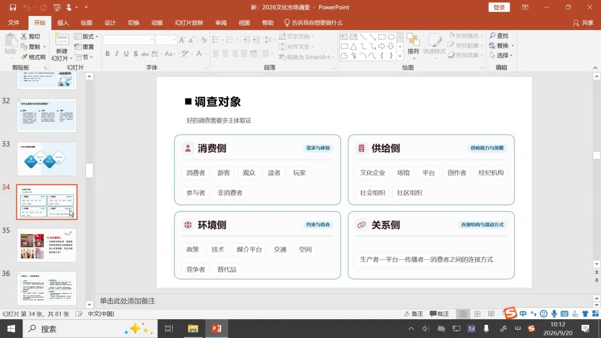
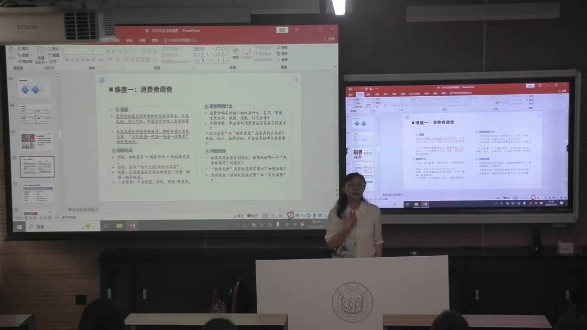
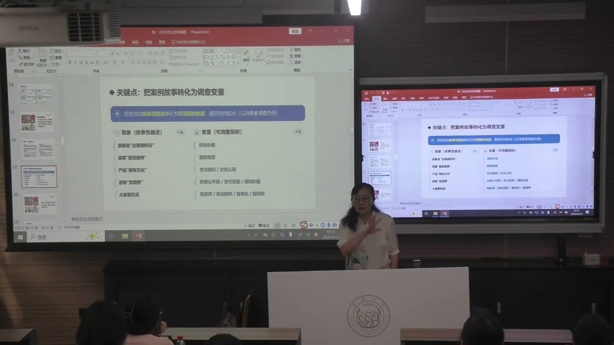
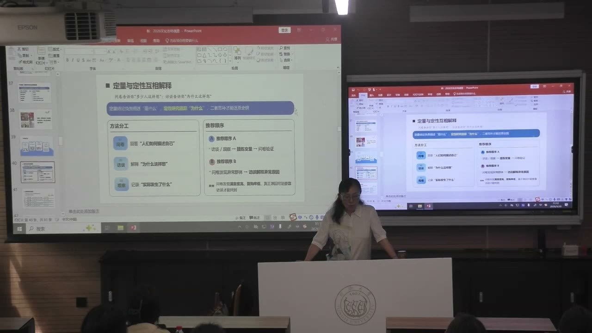
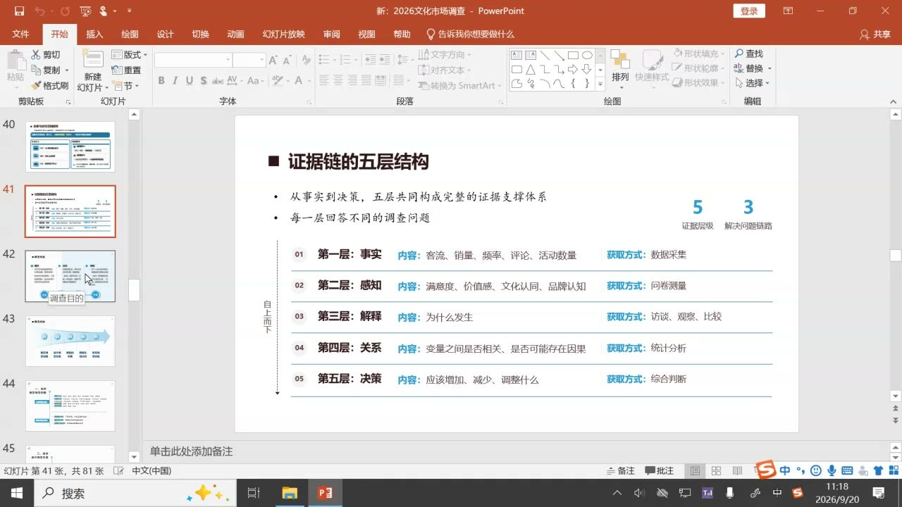
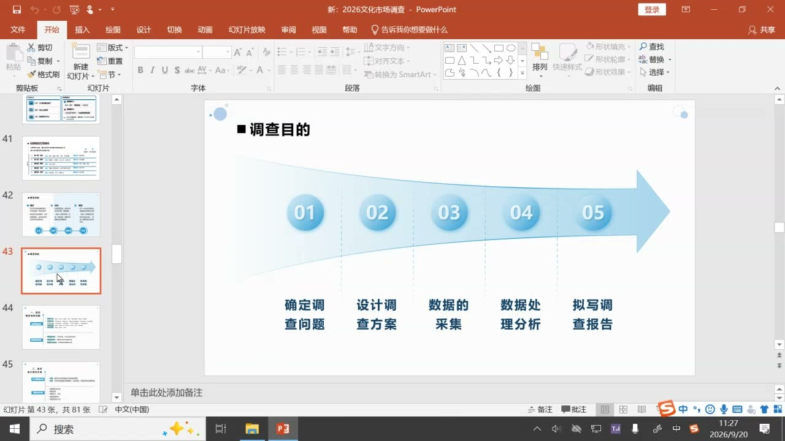
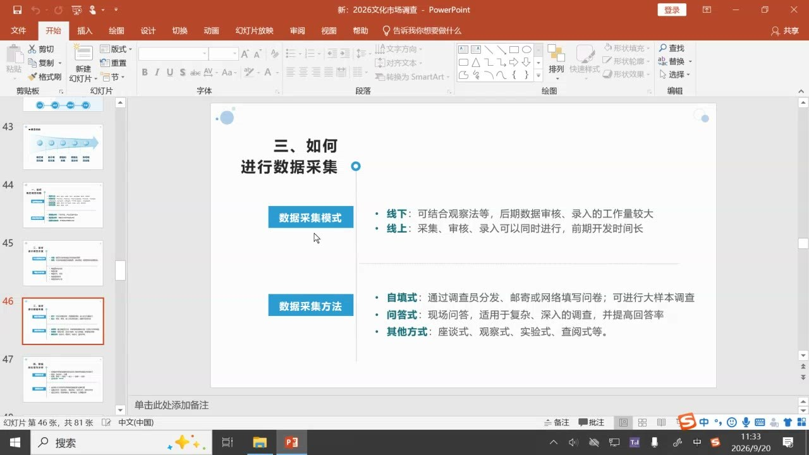

### 课程安排与任务

#### 上海红色资源小组调查与计划书

各组围绕分配的上海红色资源对象开展调查，先设计调查方案或计划书，确定方法、进度和人员分工，最后形成研究报告。对象限定上海；调查时间须明确。具体主题、时间节点和操作安排以后续教师布置为准。

#### 后续课程与数据处理工具

教师说明后续由潘老师结合案例指导方案、问卷及数据处理，并在需要时通知使用电脑、下载相应工具。具体工具与下载安排以后续课堂通知为准。

### 调查的边界、目的与多主体视角

文化市场不断变化。调查要把个人感受转为可以核对的材料，并明确自己究竟要了解哪一部分市场。

#### 消费者调查与整个市场的调查

狭义调查主要面向消费者，了解其需求、行为与想法；广义调查还包括市场运行、环境、营销与效果。只调查观众，未必能够解释一个演出项目的全部状况。对象与目的的范围，决定需要获得哪些材料。

文化市场覆盖多种行业、区域和产业链环节。已有调查不能永久代替新的调查：消费者、产品供给和环境会变化。同样的主题，仍可能因为时间与条件不同而需要重新研究。

#### 从“票容易买”到描述、诊断与预测

教师以《剧院魅影》说明个人买票感受的限制。“容易买”或“难买”缺少量化尺度；售票等材料才能更具体地描述市场容量、需求结构和复购情况。描述关注发生了什么，而不能只表达个人印象。

诊断通过定性与定量分析解释现状，例如环境、同期演出或其他选择是否影响需求。相同数据也可能有不同分析，需要核对方法和证据。预测则面向后续选择：是否继续驻演、怎样调整产品或服务、有哪些替代方向。

#### 消费侧、供给侧、环境侧与关系侧

消费侧包括购买者、游客和可能知道信息但没有购买的人；供给侧包括文化单位、创作者、企业、平台和场馆等。环境侧涉及政策、技术、媒介、交通空间、竞争者和替代品；关系侧把生产、平台、传播与消费串联起来。

教师用音乐剧场馆和博物馆文创说明，消费者的体验可能与设施、审批、组织安排及设计能力有关。不能把每个问题都归给消费者，也不能只凭消费者问卷说明整条产业链。

### 故宫文创：把文化资源转为当代生活用品

案例的调查主线不是笼统地评价文创好不好，而是解释文化元素怎样被重新设计、解释，并进入消费者的日常生活。

#### 一个明确的调查目的怎样收束案例？

“故宫文创”本身范围很大。课堂把目的收束为：馆藏文化资源怎样通过文创产品进入日常消费。消费者的购买行为是这条链的关键，因此从消费侧开始，再按目的延伸到其他主体。

调查主线是资源、产品、场景、消费者：哪些馆藏元素被选择；怎样转化成生活用品、文化礼品或设计产品；进入何种购买场景；最终被谁、为何购买。渠道和消费情境也需要调查，而不是只罗列馆藏资源。

#### 购买动机怎样拆成可回答的问题？

购买可能出于实用、审美、文化认同、收藏、送礼或社交分享。不同动机需要对应不同问题和选项。为了送礼而购买的人，可能更在意收礼者的偏好；喜欢收藏的人，可能重视限量、编号与制作信息。

消费者的年龄、职业、教育等基本信息可以帮助比较不同群体，但应依据调查目的选择。教师在本节要求问卷以基本信息开头，再进入正式问题；这一安排是课堂提出的设计要求，具体信息项目仍要与研究相关。

#### 文化含量、设计、价格与品牌信任

文创不只是把文化符号印在商品上。文化元素的转化难度、设计表现、色彩还原、品控、实用性和品牌信任，都可能影响消费者对价值的判断。教师以兼具观赏与实用功能的博物馆产品，说明消费体验可能因意外发现的用途而增强。

问卷可以进一步比较价格接受程度、文化含量、设计与实用性的重要程度。问题不只是“是否喜欢”，还包括喜欢到什么程度、在哪个价格范围愿意购买，以及是否愿意推荐。不同维度不能用一个笼统的好评代替。

#### 文化消费与旅游纪念为什么需要区分？

购买博物馆商品，可能因为文化元素本身具有吸引力，也可能主要为了证明“到过这里”。两种动机可以同时存在，但对产品开发的含义不同。调查要追问故宫元素是否真正构成购买理由，以及怎样寻找反例来检验这种解释。

消费者评论中的未满足需求，还能延伸新的调查问题。买过不等于已经完全满意；“如果再有某种功能就更好”的反馈，可能提供开发方向。常设展、特展、旅游情境和线上促销，也会影响购买时点与频率。

### 从故事到变量：把体验与认同变成指标

故事可以解释文化资源为何有吸引力，变量则让这种吸引力成为可比较、可核对的研究对象。

#### 翠玉白菜：叙事怎样参与价值形成？

教师以翠玉白菜说明，成为受欢迎的文创原型不只取决于文物的经济价值。巧雕、色彩和吉祥寓意进入故事性描述，使游客有理解、联想和赠送的理由。文物背后的叙事能够参与产品的传播和转化。

课堂介绍关于财富、清白、婚嫁与生养的叙事，同时以推断方式讲述其身份解释。整理和研究时要区分作品特征、符号解释与故事推测，不能把营销中形成的故事直接视为已经确证的史实。

#### “喜欢”如何继续分成可测量指标？

“喜欢”只说明方向，研究还需要知道程度。可以使用有层次的回答尺度，比较体验价值、推荐意愿、文化感知、文化认同、价格公平感、支付意愿和感知价值。不同指标分别解释产品怎样进入消费。

例如品控影响体验价值，是否愿意推荐涉及后续传播；某个文化形象能否代表一次观展经历，涉及文化感知与认同。指标要让回答者能够理解，而不是先选一个抽象词，再要求消费者自行猜测其含义。

#### 购买频率、复购与展览设计

购买频率、重复购买和特定时期的购买增多，是进一步观察的行为指标。特展把借来的特色资源集中到某个时段，可能形成与常设展不同的需求；代表性馆藏又可能产生较稳定的购买。

消费者觉得价格是否合适，也可能随市场环境变化。研究应明确调查时段，比较不同产品、场景与群体，不能把过去的价格判断当作今天的固定答案。调查结果要能够反过来帮助品类选择和产品定位。

### 文献、问卷、访谈与观察怎样互相解释

方法不是四选一。每种方法回答不同的问题，组合使用才能把人数、理由和实际行为联系起来。

#### 文献法与AI：先了解已有研究，再回到来源

正式进场前，先查找与对象和目的相关的既有研究，了解研究要点、成果和未解决的问题。应尽量充分地认识前人的工作，才能判断自己的研究是在重复还是推进。

教师认可AI对拓展思路和发现材料的帮助，同时明确要求回溯查证，尤其不能未经核对便引用其观点。旧研究并不意味着新调查多余：市场是动态的，但哪些问题仍有效、哪些需要更新，都要经过甄别。

#### 问卷的优势与短问卷要求

问卷便于获得较多样本，描述购买动机、行为、价格区间，以及不同群体的分布。有效回收数量才构成数据基础。选项必须清楚、合理，包含回答者能够选择的答案，不能让人看完仍不知道怎么勾选。

教师对陌生人参与的现场问卷提出尽量短、最好在三分钟内完成的实践建议。过长或难理解会造成放弃，设计质量直接影响回收和答案。这个建议服务于现场调查，不应被机械理解成所有研究问卷的统一长度。

#### 访谈追问理由，观察核对实际发生

访谈要围绕目的追问深层理由。研究全貌时，除消费者之外，还应努力接触商店员工、设计者或运营负责人，不能仅因为方便就只访谈一种主体。现场观察则记录停留、触摸、浏览路径、客流等具体行为。

问卷主要告诉我们多少人、什么人怎样描述自己；访谈帮助解释为什么；观察提供实际发生的情况。自己在现场获得的材料是一手资料，网络上的他人观察属于二手资料。两类材料都可以使用，但来源位置不能混淆。

#### 定量与定性、探索与验证的相互补充

定量分析帮助说明是什么和有多少，定性分析解释为什么。只有数字而没有解释，难以还原文化消费；只有个别理由而不比较范围，也难以判断现象的分布。

课堂建议在文献之后先做访谈和观察，从实际经验中找到指标，再设计问卷检验。也可以在问卷发现异常群体后，再用访谈解释异常。方法顺序可以因问题调整，但不能不加甄别地照搬五年前、十年前的指标。

### 五层证据链：从材料走到对策

结论需要显示自己的来路。把一堆材料变成报告，关键在于各层之间的逻辑联系。

#### 事实、感知、解释、关系、决策

第一层是事实，如产品、销量、评论及调查得到的材料；第二层是感知，如满意度、文化认同和品牌判断；第三层是解释，分析为什么形成这样的状况；第四层是关系，回到材料检验变量是否相关、是否可能存在因果；第五层才是决策，形成品类、资源或设计上的建议。

解释不是凭空给一个理由，建议也不能突然跳出来。同样的材料可能产生不同报告，差异往往发生在如何组织解释与检验证据关系。每个结论都要能回溯到支持它的材料。

#### 证据链的逻辑不等于报告的章节顺序

证据链说明结论如何得到支撑；研究报告还要按调查目的、方案、资料处理与成果等形式组织。不能因为有五层证据，就机械把报告写成五个同名章节。

教师特别强调独立的逻辑推理训练。得到AI生成的答案，并不等于已经掌握中间的推理。现场研究、材料核对和亲自分析，帮助把现成结论变成自己能够解释、验证和负责的判断。

### 调查方案与实施：把范围、分工和时间写清

调查方案是活动纲领。问题、方法、采集、分析和报告之间，需要能够执行的衔接。

#### 调查对象与范围要在开工前确定

确认行业、对象形态和产业链范围：是产品、服务还是整个行业；是只调查消费者，还是包括生产与其他主体。接受委托时应先沟通清楚，避免完成后才发现对方需要另一类数据。

空间与时间同样是范围。课程红色资源调查限定在上海，不能改成家乡对象。报告必须写出具体调查时段，至少明确年月；市场不断变化，脱离时间的材料难以解释。探索性、描述性或其他研究导向，也要依照选题目的确定。

#### 问题—方案—采集—分析—报告

课堂归纳五个步骤：确定调查问题，设计调查方案，采集数据，处理与分析数据，撰写调查报告。对象和目的在起点确定，资料处理则把前面的材料连接到结论与建议。

方案或计划书包括目的、对象、方式方法、进度安排和组织计划。小组要明确谁负责访谈、观察或问卷，保证材料有足够的量并符合设计。安排应对齐教师给定的时间，不能临近汇报才发现调查没有完成。

#### 采集模式、方法与后续工具学习

采集可以在线上或线下完成，包括自填式问卷、提问回答、座谈、实验和查阅等方式。面对面访谈与现场观察可以补充线上材料难以显示的情境；线上访谈也可以依据条件安排。

后续课程将结合各组案例讲解具体调查方案与数据处理工具。工具用于整理和分析材料，不能代替前面对对象、目的和方法的判断。最后以调查报告呈现成果，使小组通过真实案例掌握研究方法。

### 概念对照与自测

| 比较对象 | 主要回答 | 需要补充的证据 |
| --- | --- | --- |
| 描述／诊断／预测 | 现状是什么／为什么／以后怎样调整 | 事实、解释及对策之间的对应 |
| 问卷／访谈／观察 | 多少人怎样表态／为何这样想／实际发生什么 | 三种方法互相核对 |
| 定量／定性 | 数量、分布与差异／理由、过程与意义 | 不能只列数字或只有个别故事 |
| 一手／二手资料 | 自己获得的材料／他人已有的记录 | 明确材料来源与适用范围 |
| 证据链／报告形式 | 结论怎样获得支持／成果怎样组织呈现 | 逻辑层次不能机械等同章节 |
| 文化消费／旅游纪念 | 文化元素的吸引／到访与记忆 | 购买动机及其反例 |

#### 为什么不能仅凭“这次票很好买”描述演出市场？

个人感受没有统一尺度，还需售票、容量、需求和复购等材料，才能形成较准确的描述。

#### 文创调查为何不能一开始就随意列问卷？

应先明确对象与目的，再用文献、访谈和观察形成指标；随意列问题可能遗漏消费者真实关切。

#### 知道消费者“喜欢”，为什么还要研究喜欢的程度？

体验、认同、价格和推荐可能不同。程度指标帮助比较人群并将结果用于开发判断。

#### 问卷、访谈与观察分别有什么贡献？

问卷描述表态的分布，访谈解释理由，观察核对实际行为。它们能相互说明而不是简单替代。

#### 从解释到决策为什么还要检验变量关系？

提出理由并不等于得到证据。要回溯材料检验相关或可能的因果，才能支撑建议。

#### 调查方案至少要写清哪些实施条件？

目的、对象与时空范围、方式方法、进度和人员分工，并说明怎样采集、分析和形成报告。

### 来源范围

原始转写含课堂互动，正文只整理教师讲授、解释、回应与课程任务。时间范围为两分钟音频分段边界，不是逐句对齐时间。
