### 课程安排与任务

#### 组队、分工与调查方案

在班群在线文档中组队并明确分工，先确定小组的选题，再围绕选题设计调查方案。已有主题之外的选题可以与教师商量后加入。校园文化也是可行方向，可围绕特定纪念日、节日，调查学校图书馆、校史馆、团委等机构的活动及参与情况。

选择题目要同时考虑兴趣和进入现场的便利程度。并非必须选择校外项目；便于持续接触对象、收集材料的校园议题同样能够形成调查。

#### 小组问卷与访谈的具体要求

小组调查要同时练习问卷和访谈。问卷可以线上发放，但也必须到线下现场：每组线下问卷30份，线上问卷100份以上，条件允许可增加线上样本。教师建议小组每人至少访谈一人，实际体验提问、追问和记录的过程。

问卷应按选题设置必要的人口统计信息，并同时包括行为类、态度类问题；每组都要设计量表题，为后续定量分析练习提供相应数据。线上与线下使用同一套问卷，以便合并整理。

线下调查也用于观察现场、了解观众的兴趣与反应，并体验受访者拒绝调查的情形。课程考核着重方法的应用过程，以及发现、分析和解决问题的意识；并不要求一份没有局限的研究报告。

#### 后续方法学习与预习

调查方法之后还会学习抽样及定性、定量分析。访谈法的结构式、半结构式、非结构式三种类型留待后续课展开，可提前了解其区别；教师主要推荐小组了解和使用半结构式访谈。

### 调查意识：从问题到证据，再到策略

调查研究既是获得资料的手段，也是一种处理问题的思维方式。问题、对象、资料与判断之间要有能够说明的联系。

#### 调查方法与分析方法分属两个环节

调查方法解决如何获得资料：向谁询问、观察什么、在哪里取证、怎样记录。分析方法解决资料获得以后如何整理和解释。问卷、访谈、观察、文献属于本课讨论的取证方法；定性分析、描述统计、相关分析等属于后续解释资料的环节。

选题和调查方案先于工具选择。若没有明确的问题，先做一份问卷再寻找题目，很容易出现每个问题似乎都有趣，却无法共同回答一个研究问题的情况。

#### 《反对本本主义》：调查要指向实际问题

教师以1930年的《反对本本主义》说明调查的重要性，并突出“没有调查就没有发言权”与“调查就是解决问题”。对具体问题的判断应建立在深入调查所获得的数据和文字材料上，不能仅凭道听途说或个人经验。

问题意识决定调查的切入点：究竟要了解什么现状、解释什么现象、为哪一类行动寻找依据。现状的估量与策略的制定应当连起来，避免有结论却缺乏论据。若调查结果明显反常识，需要检查案例选择、取证过程和资料，也可能需要解释现象为何确实不同于一般预期。

#### 调查对象、纲目与记录都要事先考虑

调查对象应根据问题划分，而不是只找容易联系的人。年龄、职业、收入，以及与特定议题相关的身份，可以成为区分对象的维度。调查红色文化活动时，不同政治身份可能与参与动机、行为有关；但这并不意味着所有主题都必须询问政治身份。

调查会可与讨论式访谈相联系：不仅要决定人数和成员，还要准备调查纲目，明确议题，组织交流并亲自做好记录。主持并非只维持秩序，调查者也要进入材料获得的实际过程。调查方案相当于把这些决定组织起来的大纲。

#### 《湖南农民运动考察报告》：统计口径影响现象解释

教师用1927年的《湖南农民运动考察报告》展示问题意识、实地调查、数字和具体事例如何共同支持判断。对同一运动，不同社会群体可能给出相反评价；调查需要查明实际规模及组织在做什么，不能停留在评价标签上。

课堂特别说明，农会登记会员与能够直接动员的人数不是同一个口径。若一家只登记一个名字，登记人数就不等于实际参与范围；这一差别需要调查才能发现。解释数字时必须知道它记录的是人、家庭、组织成员，还是更大的活动覆盖范围。

教师归纳的思路是：了解“是什么”，继续追问“为什么”，再提出“怎么办”。长期按这一方式处理问题，会改变研究者理解现象和制定行动的习惯。

### 依据问题选方法：问卷的能力与边界

定性和定量两种研究范式可以互补。选择工具既要考虑想得到怎样的答案，也要考虑对象能否接触、时间与成本能否承担。

#### 定性研究追问过程，定量研究观察分布

定性研究便于深入了解“为什么”和“怎么样”，通过访谈、观察追问态度、动机、原因与过程。单个样本可能投入较多时间，但可以获得较丰富的细节；单案例也能够构成深入研究，不能仅按案例数量判断研究价值。

定量研究通常用标准化工具获得较多样本，描述一般现象、比例、差异和变量关系。它便于比较，却容易受到预先设计的问题限制：问卷没有问到的现象，未必会在结果中出现。两种范式可以先探索再验证，也可以用数量概况引出深入解释。

调查工具与分析方式存在常见对应关系，但并非绝对。问卷通常进入定量分析；访谈和观察常用于定性分析。结构化访谈若按统一顺序询问同一组问题，也可能产生可作定量整理的标准化资料。

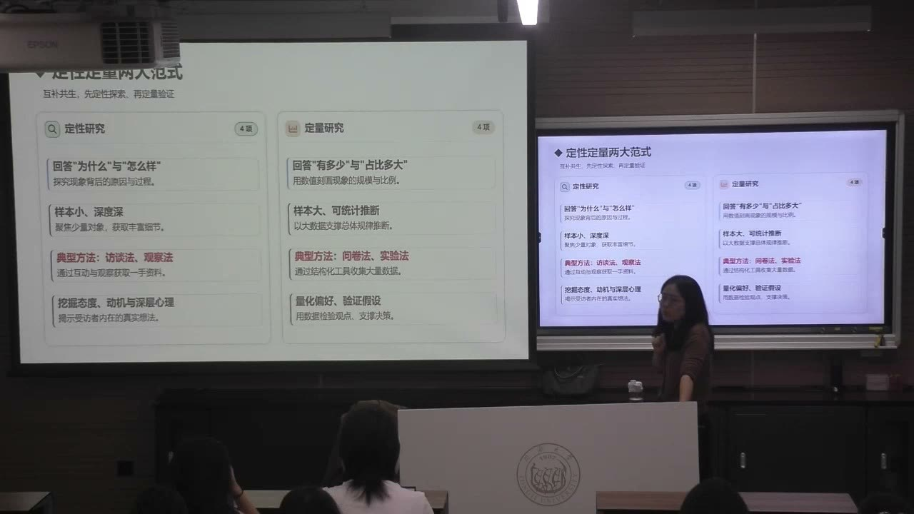

#### 四种常用方法各自提供什么资料

文献法获取政策、既有研究、统计资料等二手材料，帮助了解背景并为论证提供依据。问卷法通过线上或线下的标准化问题获得数量资料和一般分布。访谈法通过个体或群体的交流深入探查动因和机制。观察法记录现场、活动过程以及实际行为。

教师将它们概括为：文献给背景，问卷给数量，访谈给动因，观察给现场。例如在博物馆、图书馆、纪念馆，可观察公众在哪些项目前停留、哪些内容吸引注意。观察不是随意看一眼；流程和记录把控得当，所得资料也能成为论据。

#### 按问题定方法，还要判断能否执行

若主要想了解一般需求、满意度或消费分布，问卷可能较适合；若要深挖某种文化现象背后的原因和机制，访谈可能更重要。研究题目决定方法，不能先选一种熟悉的工具再勉强为它找题目。

理想的多主体取证不一定能直接执行。文化机构的工作人员、管理者可能受采访审批或报备规定限制，未必能随时接受学生采访。调查方案需评估接触渠道和许可条件，不能把无法进入的对象当作已经能够获得的资料来源。

#### 问卷法：用同一组问题收集可比较的信息

问卷法向研究对象发放一套标准化问题，收集其行为、认知、评价和意愿等信息。文化市场中的受众画像、需求测量、满意度和消费行为量化，都是常见应用。它通常能够较高效地获得较多样本，并为描述统计、推论统计、相关分析和回归分析提供资料。

突出局限是预设框架：所有人都回答同一套问题，保证了比较的可能，也限制了发现未预料问题的能力。样本多并不能自动补上问卷未设置的内容。课堂将严格抽样与普查区别开来，强调总体很大也未必需要逐一调查；样本能否反映总体，不能只看问卷数量，还要看抽样如何执行。

#### 问答式与自填式：成本、复杂度和质量的取舍

问答式由调查者提问并帮助记录，适用于需要阅读或理解协助的对象，如部分老人、儿童；电话访问、面对面访问属于相关形式。自填式由受访者自行作答，可通过现场、网络、邮件等渠道发放。教师在本课实操中不建议采用入户访问。

现场调查需要人员和时间，成本通常较高，但可以解释不理解的问题、确认填写是否完成，允许一定复杂度。线上发放方便、周期短、成本相对低，却容易因内容复杂或过长而中途退出，或在失去耐心后随意填答。发放方式需要与问卷长度、对象能力和质量要求一起决定。

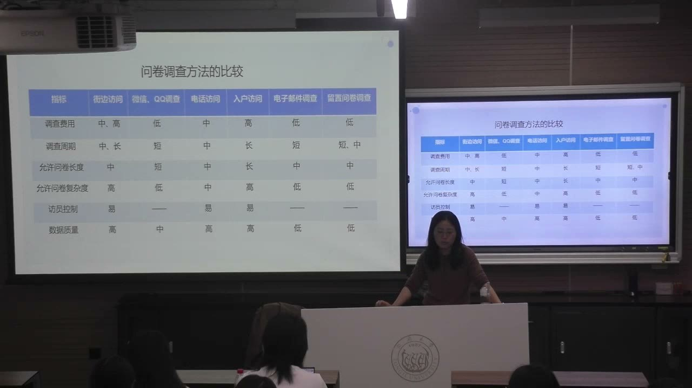

### 剧场观众案例：价格解释与文化机制

同一文化消费议题，从经济因素或社会文化机制切入，可能得到不同政策判断。案例用于理解方法与视角的边界。

#### 大规模问卷如何描绘剧场观众

课堂介绍威廉·鲍莫尔、威廉·鲍恩在20世纪60年代对专业表演艺术观众的调查。调查在表演艺术场所发放问卷：课件列出的有效问卷为美国29413份、英国伦敦2295份，关注“谁去剧场”及“他们为什么去”。

课件归纳的观众特征是受教育程度较好、收入较高，以青年后期和中年早期的职业人士为主；在所比较的艺术形式、城市和演出之间，观众构成表现出一致性。这种跨样本的一般结构是大规模问卷的优势，少数深入访谈较难在短时间内完成同样范围的描述。

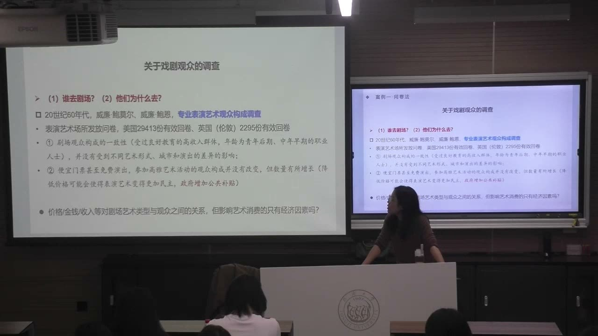

#### 价格降低与公共补贴的政策判断

该案例认为，降低票价甚至免费演出，观众的构成未必改变，但参加人数可能增加，由此提出增加公共补贴、扩大艺术参与的判断。课堂把它放在文化经济学的视角下理解：票价、收入与消费能力是主要解释因素。

这个案例也暴露问卷的边界。若题目主要围绕经济因素设置，社会关系、成长经历、审美习惯等因素便可能没有充分进入研究。案例的政策结论需要联系其对象、问题框架和资料范围理解，不能直接作为任何文化项目补贴的普遍答案。

#### 布迪厄：艺术消费还涉及社会与文化资本

教师以布迪厄对法国社会与文化消费的调查，说明访谈、观察等深入研究可以发现预设问卷以外的机制。文化消费不仅与经济资源有关，还涉及社会资本和文化资本；三种资本可以相互转化、相互影响。经济条件可能提供教育与文化接触机会，文化积累又可能帮助获得社会联系与经济机会。

文化资本可以是具身化的知识、技能、修养与审美，也可以是物质化的书籍、文物和文化设备，还可以是制度化的学历、资格证书等社会认可。家庭既能传递物品，也能通过从小的文化活动传递经验和能力。

#### 公共艺术补贴为何可能被提出另一种评价

在课堂介绍的布迪厄观点中，公共财政来自广泛公众，但若补贴主要支持更常由优势阶层消费的高雅艺术，文化接触与鉴赏能力较少的群体未必同样受益。因此，扩大高雅艺术的补贴也可能被从社会公平角度提出质疑。

两种研究对公共补贴给出不同判断，不能仅以结论相反判定一种方法正确、另一种错误。一个主要考察价格与参与数量，一个深入考察受益者及不平等机制；其学科视角、调查范围、问题设定都不同。方法的互补有助于把“增加多少参与”和“谁更能受益”放在一起考察。

#### 习性、场域与文化再生产

习性是个人在社会阶级与成长经历中形成的知觉、评价和行动方式，影响什么被认为有品位、自然或值得做。场域是具有自身规则和逻辑的社会空间，如艺术、学术、教育；不同场域中，各种资本的价值和转化条件不同。

文化再生产指优势家庭将文化资本传给下一代，而教育评价系统又可能更符合这些家庭形成的习性，使其子女较容易获得制度化认可，并延续优势位置。教师用这一理论说明：文化不平等既可能表现为阶层差异，也可能成为延续差异的隐性机制。

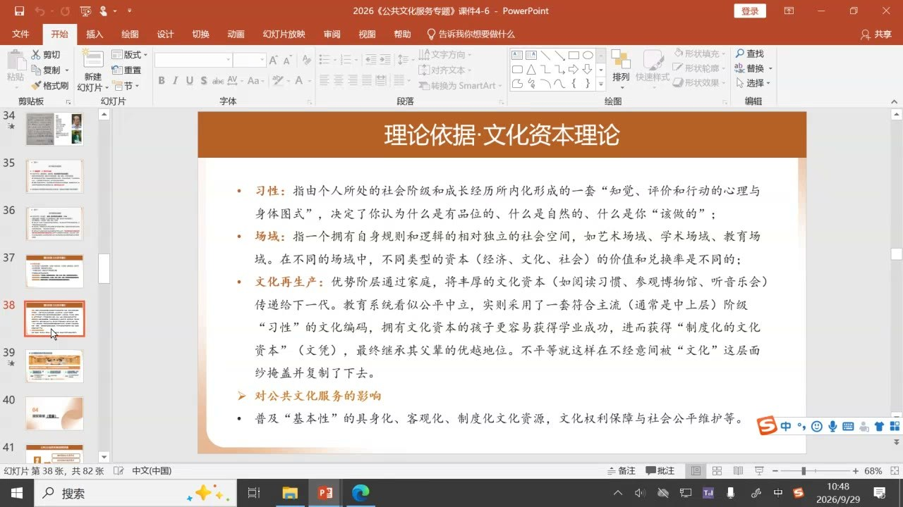

#### 公共文化服务的文化资本再分配功能

教师联系公共文化服务课程，提出公共博物馆、图书馆、文化馆、美术馆及基层文化站可以承担文化资本再分配的功能。当不同地区和家庭能够提供的文化资源不同时，公共服务为公众提供基本文化接触、学习和参与机会，成为文化权利与社会公平的一种制度支持。

课堂以公共文化场馆的一般免费开放与预约使用为例，特展等情形另作区分。这一解释关注的不只是降低一次消费的价格，也包括是否能够获得文化资源、积累知识和参与经验。

### 问卷结构：把研究概念变成可回答的问题

有效问卷要把研究者想知道的内容转化为受访者能够理解、回答和区分的题目。基本信息、行为、态度各有用途。

#### 引言、主体、结尾的不同作用

问卷一般由引言、主体和结尾构成。引言说明调查者身份、调查目的、填写方式及保密原则；主体设置实际问题；结尾可包含开放问题、感谢语和补充说明，并非一定需要。课件建议引言简洁，通常控制在200字以内。

教师经验是开放问题常被跳过或消极回答，会占用篇幅，能不设就不设；确有需要时应简短。研究者的学术题目可以保留在方案中，但面向受访者的标题应通俗，如把较专业的消费动机研究简化表达为消费情况调查。

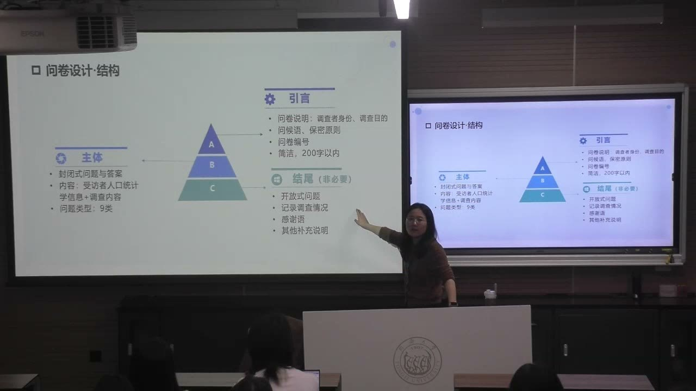

#### 说明与编号要方便理解和整理

引言可以说明研究需求、匿名或保密安排、答案没有对错及资料用途，并请求按实际情况填写。保密是研究伦理的基本要求。指导语应明确单选、多选或最多选几项，避免受访者猜测答题方式。

问卷数量较大时需编号。简单调查可以连续编号；跨地区调查可把地区代码与问卷序号组合，使研究者能够定位样本来源。编号的层级服务于资料管理，不需要把受访者不懂的专业术语放进问卷。

#### 人口统计题不是必须照抄的固定清单

年龄、性别、职业、学历等基本信息主要用于描述对象与分组分析。例如比较不同年龄的消费金额、不同群体的活动参与频率，或考察差异是否具有统计意义。每一个基本信息题都应对应研究中实际需要的比较。

政治身份或其他身份信息只在相关主题需要时设置；不能因为常见问卷有这一项，就机械加入。选项范围也应适应对象：研究老年人时，年龄段应细分老年区间；研究未成年人时，年龄和教育程度的分类也应相应调整。

#### 行为类问的是已经发生的事，态度类问的是心理状态

行为类问题包括是否购买过、买过哪些产品、购买次数、每次消费金额、到访频率、交通方式和信息来源等，指向实际经历。态度类包括认知、评价和行为意向，例如认为创意演出应具备哪些要素、如何评价设计与价格、降低票价后是否更愿意观看。

行为意向仍然属于态度，而不是已经完成的行为。“愿意去”与“已经去过”回答不同问题。主观评价常需要测量程度，不能仅用“是或否”压缩所有差异。小组问卷需要同时考虑行为和态度，以便连接消费现状与需求、评价。

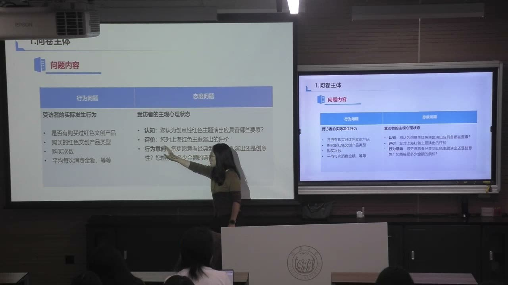

#### 封闭题：选项方式要与想了解的内容相符

封闭题提供固定选项，可分为是否题、单选、多项任选、多项限选、多项排序等。是否题只有两个基本答案；单选用于只能选择一个类别的内容；不限数量的多选容许较多选择，但当很多人全选时，不易看出主要差异。

多项限选可突出最重要的若干选择，例如手机使用偏好最多选三项。排序题进一步表达主次，例如观看演出的首要目的、次要目的。应根据研究需要决定是否限选或排序，而不是所有多选题都使用同一种规则。

#### 量表题把赞同、评价或意愿表达为程度

李克特量表是常见形式，可用五级或七级表达赞同程度。课件的五级示例从非常同意到很不同意对应不同分数。它可用于文化消费重要性、收入增加后的投入意愿、质量相对价格的重视程度等态度题。

评价演出时，可把内容、演出时间、演员阵容、舞美和音响等分开测量；评价服务时，可考虑信息获取、到达或观看便利性、场所和工作人员服务。分数应对应清楚的题意和等级，不能只写“请打分”却没有说明在评价什么。

每组都要设置量表题，是为了让后续分析练习有适合的测量资料；不同数据类型的适用分析方法不同，不能认为任意分类题都能承担同样的分析用途。

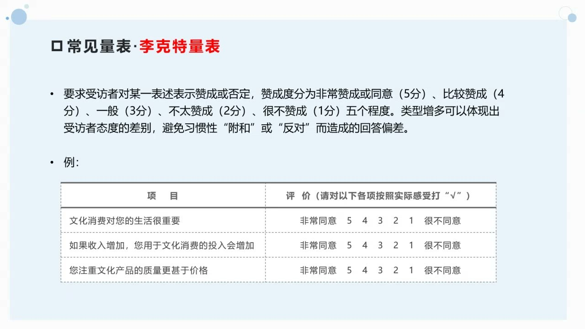

### 混合方法与量表：让抽象概念落到具体经验

问卷的题目不是概念的简单改写。通过具体行为、情感和参与情境，才可能让受访者回答研究者想测量的内容。

#### 剧场研究可以结合数量资料与长期深入调查

教师介绍约翰·塔罗齐的剧场观众研究，课件以《莎士比亚与契诃夫的制作与接受：剧场活动及其观众》（2005）为例。定量资料记录年龄、性别、类型偏好和观演习惯；定性部分观察观众反应，收集书面回答，并结合长期访谈、个案、焦点小组和追踪调查。

这些工具分别处理不同层面的信息：数量资料帮助比较，现场观察保留反应，访谈解释体验，追踪则关注较长期的变化。混合方法的意义是使资料互相补充，而不是把方法名称全部列进方案却没有实际作用。

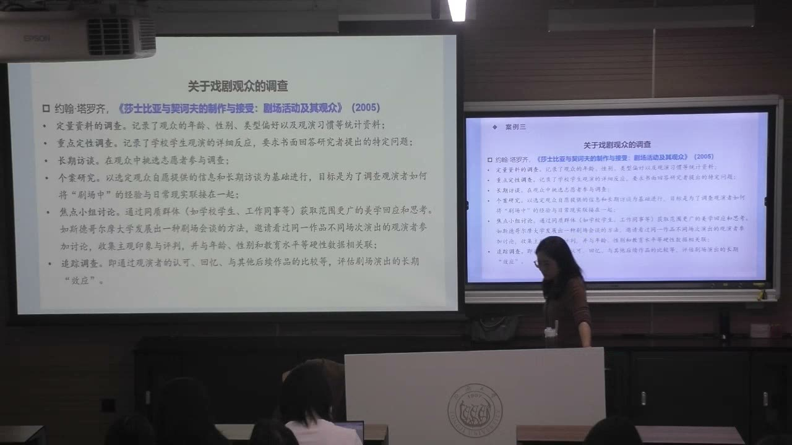

#### 测量兴趣：由总括态度进入具体参与

“我对戏剧感兴趣”是一项总括态度，但还可询问观演前是否查资料、是否关注演出信息、愿不愿意给他人建议、是否愿意花时间选择剧目等。不同题目从信息关注、准备行为、传播意愿和时间投入等角度，帮助具体化“兴趣”。

多道题可以共同触及一个概念，而不是仅凭一个抽象词判断。教师也用相关题目的答题一致性说明质量检查：若非常接近的题意得到相反回答，需要进一步检查。逻辑关系、量表表现及信效度都要结合后续分析理解，不能只看有没有把每道题填完。

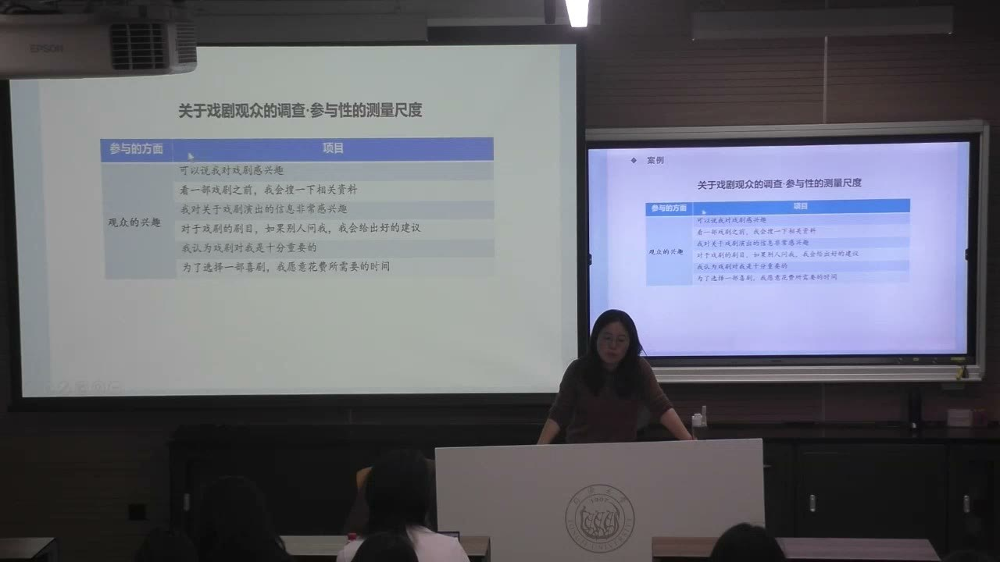

#### 测量情感价值：把专业术语转成生活语言

情感价值可以从放松、愉快、暂时忘记生活琐事、自我体验，以及与朋友一起出行或讨论等不同维度测量。问“去剧院是和朋友一同出行的机会”，比直接问“是否满足社交需要”更具体，也更容易理解。

文化消费动机不只有兴趣，还可能是社交、情绪调节、组织任务、旅游参观等。文博、建筑与文化娱乐情境中的动机可能不同，即使同属红色文化主题，也需要根据对象和活动形态设计条目。不能把一套动机选项直接套给所有文化消费。

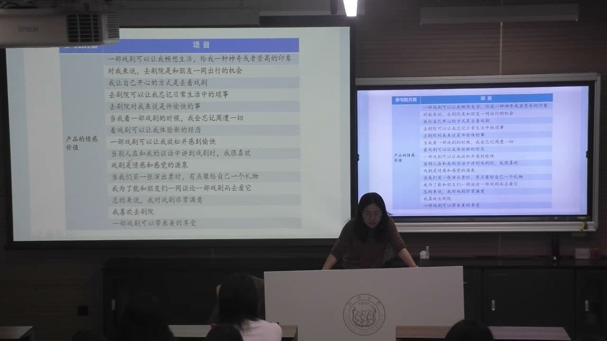

#### 先访谈再问卷，或先问卷再深访

以问卷为主时，可先进行访谈，了解可能存在的问题，把研究者未想到的内容纳入问卷，再扩大调查。以访谈为主时，可先用小范围问卷了解一般概况，再对个性化、复杂的问题深入交流。先后顺序服务于研究目的。

这种配合有助于克服问卷预设框架的限制，也有助于访谈在较长投入前把握对象概况。小组同时做两种调查，并不意味着问卷结果与访谈结果必须完全一致；它们可以互相解释，也可以指出尚需追问的差异。

### 问卷设计原则、操作技巧与访谈补充

设计质量不仅取决于题目数量，也取决于每道题的用途、措辞、选项和排列。可回答、可比较与可整理应当同时成立。

#### 一题只问一件事，措辞保持中性

设计应从目的出发，想清楚每道题的回答会不会影响研究判断或决策。一道题不要合并两个可能得到不同答案的问题，例如“功能和价格是否满意”中，功能可能满意而价格不满意，无法用一个答案准确表达。

也应避免诱导提问，如“是否认为我们的服务值得好评”已带入正面评价。研究者自己的期待不应写进问题，把受访者引向想要的结论。访谈同样需要保持中性，不能在提问时替对方作出判断。

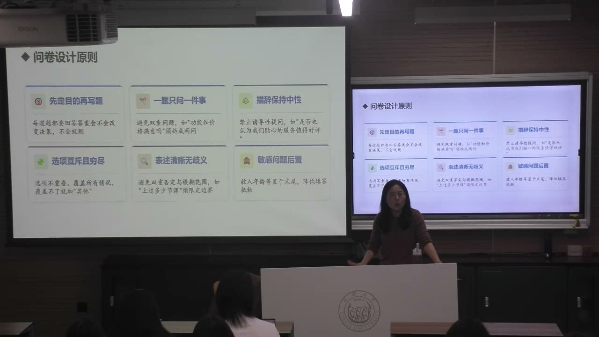

#### 选项互斥、尽量覆盖，题意没有歧义

同一分类题的选项不能重叠，如相邻年龄段不能都包含18岁，让18岁受访者无法判断选哪项。选项也应尽量覆盖研究对象可能出现的情况，确难穷尽时可考虑“其他”。类别边界应与实际对象相符。

措辞要通俗、明确，避免专业名词和模糊范围。“经常”“一般”等表达缺少边界时，不同人可能按不同标准回答。时间范围、所指文化活动或产品需要清楚，使答案能够比较。敏感信息尽量少问，确有研究需要时慎重设计并考虑放在后面。

#### 控制长度：保留必要题，删减占篇幅的题

初稿可把题分为必须有、有了更好、只是凑数三类，用来判断删减顺序。没有用途的题不应因“看起来丰富”而保留。教师建议纸质问卷尽量控制在一张纸正反两面；课件给出的填写时长参考为5—20分钟，要防止过长导致疲惫或随意作答。

线下发放时应提醒受访者填写反面，避免只完成一面而成为不完整资料。线上问卷也应控制长度，不能依赖必答设置迫使人填到底。线上、线下使用同一套问题，才便于将两种渠道的答案整合。

#### 问题顺序是经验建议，需要结合用途调整

通常先易后难、先行为后态度、先有趣后枯燥、先封闭后开放，把同类问题尽量放在一起。行为经历往往比较容易回答，态度则需要判断和思考。开放问题若确实保留，通常不宜过多。

这些是建议，不是不可改变的规定。若要检查回答的前后一致性，相关题可以适当分开放置。人口统计信息可在前，也可根据对象与调查体验放在后；重要的是问题必要、语言清楚、不会使受访者过度警惕或疲惫。

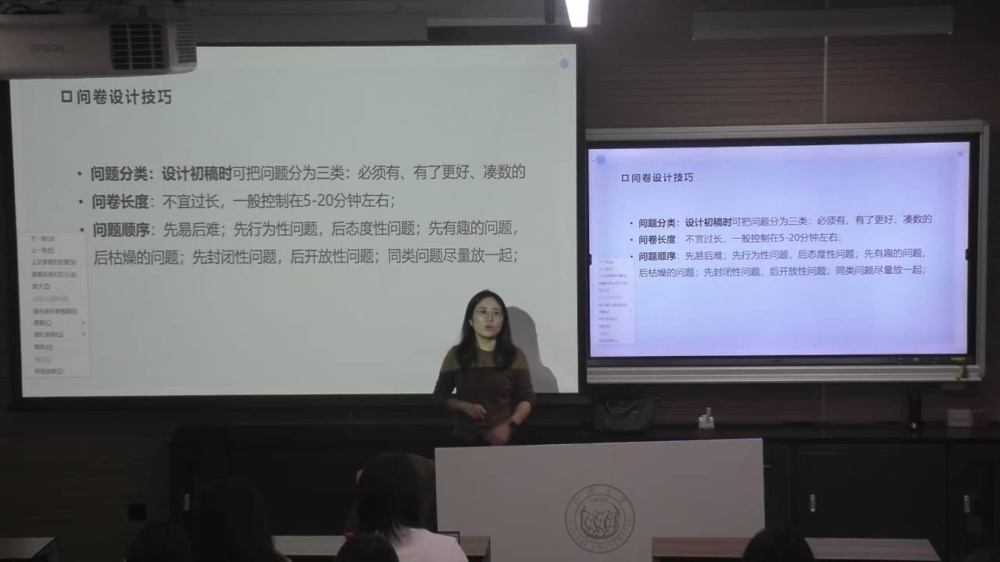

#### 社区书房案例：每道题连接实际服务决策

教师用创新社区书房的调查说明题目的用途。调查受众构成、信息来源、交通方式、到达时间、使用时段与频率，可以为是否推广、服务半径和开放安排提供依据；评价位置、开放时间、图书数量及工作人员服务，则帮助定位具体改进方向。

课堂也指出案例题目自身的问题：把“是否增加频率和兴趣”写在一起，仍然违反一题一事，因为频率和兴趣是不同变量。示范材料可以用来学习，也需要检查其设计。若主要使用者是上班族，开放时间的讨论就应联系其下班后能否进入，而不能仅问一个笼统的满意度。

#### 访谈补充复杂经验，也需要控制主观影响

访谈通过面对面或线上口头交流获得信息，对象可以是个人或群体。它适于复杂、个性化问题，可以根据现场回答调整提问并继续追问，发现事前大纲没有想到的现象，避免问题只停留在简单、表层的解释。

访谈也有成本：单人可能耗时较长，难以迅速扩大范围。对象遴选、交流方式、材料取舍及报告中的论证均可能受研究者主观性影响，需要以流程和论证尽量约束。教师在本课只介绍其基本优缺点，三种结构类型留待后续讲授。

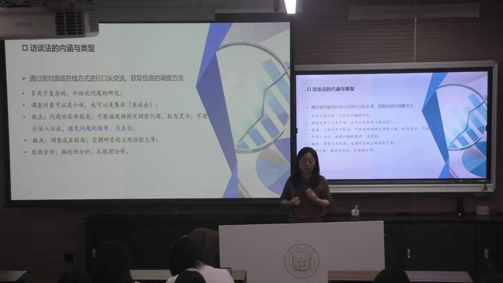

### 概念对照与自测

| 概念或工具 | 回答什么 | 需要注意 |
| --- | --- | --- |
| 调查方法／分析方法 | 如何获得资料／如何解释资料 | 先明确问题和资料需求，再决定工具 |
| 问卷／访谈 | 一般分布与可比较信息／复杂经验与背后机制 | 可先访谈再问卷，也可先问卷再深访 |
| 行为／态度 | 实际发生的事／认知、评价和意向 | 行为意向不等于实际行为 |
| 封闭题／开放题／量表题 | 在固定选项中选择／自由表达／表达程度 | 按照用途选题型，开放题不宜过多 |
| 价格与参与／文化资本与受益 | 消费成本和规模／习性、能力与公平 | 案例视角和范围不同，政策结论需保留限定 |
| 人口统计信息／敏感信息 | 描述对象和分组／可能提高答题顾虑 | 只收集研究真正需要的信息 |

#### 为什么不能先随意做一份问卷，再找一个研究题目？

问卷中的题目和数据类型需要共同回答研究问题。目的不明确，题目可能互不相关，得到很多答案却无法形成论证。应先确定问题，再选择方法与设计题目。

#### 问卷能够调查很多人，为什么仍然需要访谈？

人数优势不能消除预设题目框架的限制。访谈可发现研究者未想到的现象，并深入解释动机和机制；问卷则帮助了解这些现象的一般分布。

#### “降低票价后愿意来看”是行为题还是态度题？

属于行为意向，是态度类问题；尚未实际发生。是否看过、观看次数或实际支出才是行为资料。

#### “对功能和价格满意吗”为什么不能作为一个满意度题？

功能与价格可能得到不同评价。应拆成两个问题，分别作答，才能知道满意或不满意具体指向什么。

#### 怎样把“社交动机”转为更容易回答的量表题？

可以询问去剧院是否是与朋友一起出行的机会、是否为了能和朋友讨论一部戏而观看，用具体经验表达概念，而不是只问专业术语。

#### 两项观众研究对公共补贴的判断不同，能直接判定某一种方法错误吗？

不能。研究的学科视角、对象、范围与关注的问题不同：一种主要看价格和参与数量，另一种关注文化资本与谁受益。应检查各自证据及限定，并考虑互补。

#### 小组问卷有哪些明确要求？

每组线下30份、线上100份以上，线上线下用同一套问卷，按主题设置必要基本信息，并包含行为题、态度题和量表题；教师还建议每人至少访谈一人。

### 来源范围

原始转写含课堂互动，正文只整理教师讲授、解释、回应与课程任务。时间范围为两分钟音频分段边界，不是逐句对齐时间。
