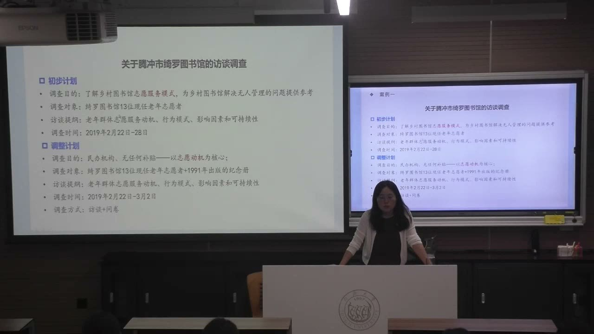
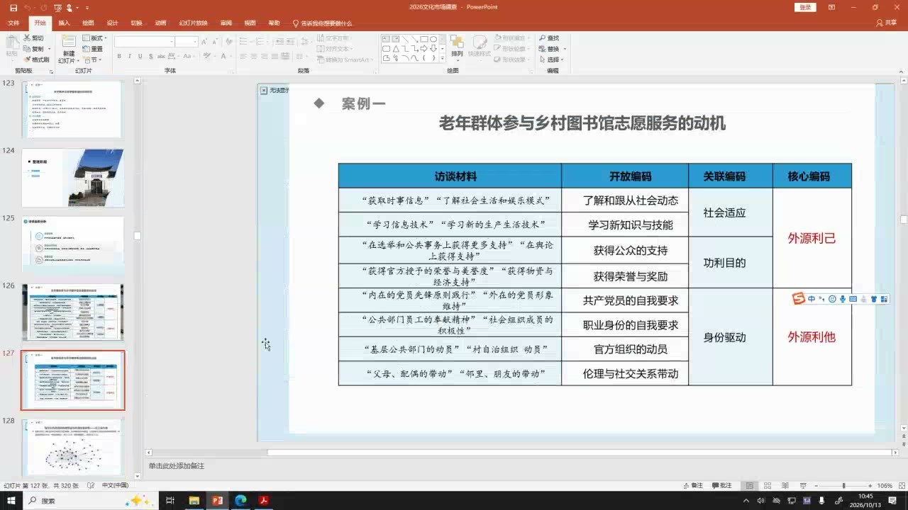
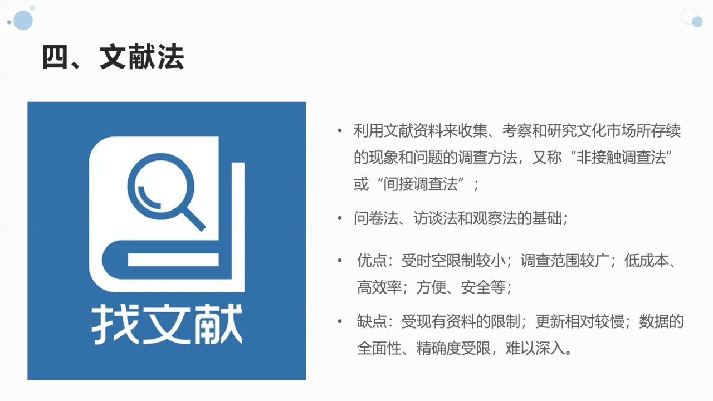

### 课程安排与任务

#### 下次课：小组调查方案、问卷和访谈提纲

以小组形式汇报，由组长或一位成员展示即可；不要求做PPT，用Word展示调查方案及围绕方案设计的问卷、访谈提纲。教师重点看选题、调查目的、主要内容、采用的方法，以及工具能否解决方案提出的问题。

每位组员应一起校对“目的—内容—问题”的衔接。课堂收到修改建议后自行调整，再开展调查；不要求再次提交修改稿。每组需有量表题，以便后续用自己的数据练习定量分析。

调查方案还须明确研究总体、样本对象及抽样方法，说明样本选择为何适合小组选题。

#### 第十六周：个人选题与研究框架

期末改为个人研究报告：在小组的大主题下选择更聚焦的方向，成员之间有交叉重叠也可以。第十六周汇报个人题目和大纲，说明分为哪些部分、每部分写什么，不要求PPT。

研究报告原计划第十六周提交，考虑专业课程较多，教师表示可以适当延后，具体提交日期以后商量。本课目标是训练调查和发现方案、问卷、提纲的问题，不要求每组取得特别创新的结论；不存在完美的调查，在实际研究中检验并改进工具也是进步。

### 调查目的怎样落实为问卷和访谈问题

方法会影响研究看见什么。调查方案、收集工具和分析方法需要围绕同一问题衔接起来。

#### 同一艺术补贴问题，为何会有不同结论？

教师用鲍莫尔团队与布迪厄的调查作对照：前者侧重经济因素和问卷，发现票价降低或免费演出可能吸引更多观众，因此支持增加艺术公共补贴；后者侧重访谈、观察与阶层差异，认为既有补贴模式可能延续不公平，并讨论文化资本和惯习。

这组对照说明研究视角、目标和方法会改变问题的切入点，不能直接判定哪一项调查更正确。问卷适合较大规模收集标准化数据，但受访者只能在研究者预设的问题和选项中作答；访谈和观察有机会发现未预料到的因素，却通常需要更长时间，难以快速覆盖大量对象。

#### 问卷的三个模块服务于什么分析？

问卷通常包括人口统计信息、行为类问题和态度类问题。行为指实际发生的参与、消费或使用；态度包括认知、评价和行为意向。把“做过什么”与“愿意怎样做”分开，才能避免把意向直接当成行为事实。

人口信息不必把性别、年龄、收入、学历、政治身份逐项照搬。若研究需要比较不同年龄的消费行为，年龄题才有明确用途；若研究红色文化活动参与与政治身份的关系，可以设置相应题目，再用数据检验群体是否存在差异。选择每项信息都应有分析理由。

#### 封闭题、开放题与量表怎样选择？

封闭题可采用是否题、单选或多选；量表适合表达认知、评价、认可和意向的程度。课堂介绍的常用形式是五分或七分李克特量表，选项表示程度递增或递减。

教师建议本次问卷以封闭题和量表题为主，开放题尽量少设，以免占据篇幅而得不到认真回答。每组须设计量表题，后续将用各组实际收集的数据练习多种定量分析方法。题型选择要回到研究问题，不能只为了让问卷显得完整。

### 访谈的结构、实施与现场调整

半结构式访谈保留主线，也给意外发现留出空间。研究者需要持续记录、追问，并根据现场信息修订计划。

#### 三类访谈：标准化程度决定怎样交流

访谈通过面对面或在线口头交流获取信息，适合复杂、个性化的问题和探索性研究。结构式访谈统一问题、顺序与记录方式，标准化程度高；非结构式访谈不预设统一提纲，话题自由但效率可能偏低；半结构式访谈有大致提纲和框架，问题与顺序可以调整。

教师通常建议采用半结构式访谈：既围绕调查目标，又沿受访者提出的新线索追问。访谈材料多用于定性分析，但结构式访谈中经过标准化处理的数据也可能进入定量分析，方法与数据类型之间并非绝对对应。问完提纲就停止，再把答案依次陈列，会浪费访谈能够深挖问题的优势。

#### 准备、实施与整理是一个连续过程

准备阶段确定访谈目的、提纲、对象和进度；较大规模的调查还需培训人员，减少不同研究者对同一问题理解不一造成的偏差。实施时尽量当下记录、当天整理，防止细节遗忘。

整理也会改变下一次访谈：当天发现的有价值线索，可以在次日继续深挖。因此调查不是把所有访问做完后才开始思考。访谈后选用内容分析、扎根理论或其他适当方法，若实际材料不适合原定分析方式，可以调整。

#### 绮罗图书馆：从运行模式聚焦到志愿动机

教师以2019年在云南腾冲绮罗图书馆的调查为例。基层书屋建成后出现缺乏管理、服务难以持续的问题，而这个民办乡村图书馆由本地老年志愿者长期运营，成为理解有效管理经验的案例。研究最初关注志愿服务和运行模式，以及经验能否推广。

到现场与馆长交流后，教师发现志愿者没有经济补贴，便把研究重心进一步收拢到“为什么愿意长期参与”。对象是13位现任老年志愿者，结合历史纪念册，分析动机、行为模式、影响因素和可持续性。现场新信息推动调查目的、提纲和时间安排一起调整，原定一周延长为约十天。

课堂还用实地掌握的纪念册校正宣传视频中的复建年份：教师依据1991年的重建十周年纪念册，判断复建在1981年。案例表明材料可以互相核对，宣传叙述不能自动替代调查证据。

#### 围绕个人、行为和态度设计提纲

个人情况帮助理解生活条件，但应避免直接触及对方不愿谈的创伤和隐私。行为问题可问服务何时开始、持续多久、是否中断、动因有无变化、团队如何分工，以及与村级组织和其他文化团队的关系；态度问题包括对图书馆、团队、自身服务及其价值的评价。

家庭照料、健康和角色变化可能影响服务持续性，不能只问“您是否愿意服务”。访谈与量表可以针对同一受访者进行对应核对：案例中13位志愿者人数较少，教师用补充量表比较其程度评价与口述材料是否出现明显矛盾。

#### 中立并不意味着放弃访谈主线

研究者要主导话题，也要保持中立，控制自身价值判断和预期对交流的影响。受访者可能理解困难，也可能大量发散；需要换一种问法、从不同角度沟通，并适时回到核心问题，确保问题得到充分回答。

口述之外，表情、动作和实际管理行为也属于观察材料。根据对象情况选择单次或重复访谈，对馆长等掌握整体信息的人员可以多次交流，也可用其说明核对其他成员提供的线索。案例中一般访谈约一至两小时，这是特定现场的安排，不能机械成为所有访谈的统一时长。

### 从经验材料构建解释框架

编码把具体经验逐级归纳为概念；新的问题意识也可能让既有案例产生新的解释。

#### 三级编码怎样解释志愿服务动机？

绮罗图书馆案例以扎根理论处理访谈材料，通过开放编码、关联编码和核心编码，从具体表达归纳出较抽象的框架。教师最终区分内源利己、内源利他、外源利己和外源利他：既看动机来自自身还是外部，也看其结果导向主要指向自己还是他人。

例如了解社会动态、学习技能、获得认可可以联系社会适应或功利目的；职业身份、组织动员和亲友带动与外部影响有关。退休后的角色适应、缓解孤独、获得尊重、自我价值和幸福感与心理需求有关；保持身体活动与生理需求有关；继承前辈事业、培养后代、集体主义和宗教信仰则可能指向利他目的。

编码需要保留“材料—概念—类别”的联系，使读者能够理解抽象框架如何产生。理论框架虽然简洁，调查中面对的仍是处境各异的具体的人。

#### 同一案例怎样回应新的问题意识？

教师的早期研究关注图书馆运行与老年志愿动机，后来的研究转向“乡村社群参与乡村文化振兴的行动逻辑”。后者的问题是：人口流出、传统文化连接能力减弱时，怎样把分散的村民重新组织起来，并衔接乡村精英主导和普通村民参与？

调查留下的材料显示，图书馆志愿团队、老年协会、学习小组、侨民同乡会、宗族与宗教社群、文教和文体组织之间存在联系。这些社群提供组织载体，使公共文化实践能够连接不同成员。原来为一个问题收集的材料，可能在新的问题意识下重新发挥作用。

研究的基本推进是发现问题表征、解释原因，再讨论策略。教师把旧案例看作观察自身知识框架变化的坐标：反复调查能帮助人从情绪反应转向追问原因，也能看到自己对同一现象理解的变化。

#### 红色文化空间：优化建议怎样获得论据？

课堂介绍的SITP项目把宏观的“城市红色空间品牌塑造和体验创新”落到具体纪念馆、博物馆和名人故居，结合访谈与网络材料，分析受众的体验评价。词频与情感分析将评价区分为积极、中性和消极，再围绕消极体验继续归纳问题。

情感类别的边界未必天然清晰，需要交代分类标准。三级编码进一步归纳到体验、服务和设施等维度，再把建议逐项对应到这些问题上。具体访谈中的需要和解释也可以作为论据；不能先写一套优化主张，再让材料勉强配合。

### 观察法和文献法怎样补充调查

观察获取正在发生的行为，文献帮助界定问题与提供资料。它们都需要与其他方法互相核对。

#### 观察的三种分类尺度

观察通过感官或仪器直接记录对象的行为。按研究者是否进入情境，可分参与式与非参与式观察；按程序、范围和记录是否标准化，可分结构式与非结构式观察；按手段又可分人员观察与机器观察。选择哪种形式应在研究中说明。

课堂以企业观察家庭生活以改进产品，以及文化机构借助技术记录观众关注点和停留情况为例。观察的优势是及时、直观地接触自然行为，局限则是现场和通勤耗时，且只能直接看到行为，不能仅凭行为完全解释深层动机、认知和评价。

#### 停留时间能说明什么，不能说明什么？

在某类展陈前停留较久，可以成为其吸引注意的线索；但为何停留、怎样评价、有没有理解内容，还需要访谈或其他材料解释。观察、访谈和问卷结合，能够把表层行为与主观说明对应起来。

同样，访谈对象的语言不是唯一材料。表情、动作和日常管理方式可能支持、补充或质疑其口述。不同方法各有局限，组合的意义在于相互核对，而不是简单增加方法数量。

#### 文献既用于形成问题，也用于提供论据

形成问题意识时，应了解学界已有研究、学科视角、理论框架和结论，判断问题是否仍有研究价值、是否出现新案例或新的延伸。文献也是取得背景数据和论据的方法，时空限制较少、覆盖范围较广，但受既有资料、更新速度和数据完整性限制。

课堂介绍的渠道包括国家与地方统计部门的公报、人口和经济普查资料，文化和旅游、文物、广电、电影、出版等相关部门资料，公共与高校图书馆、研究报告、蓝皮书和年鉴，以及企业、科研院所、行业协会的信息。研究地区文化需求前，可先查人口结构，再解释需求差异。

AI提供的文献、数字或看似完整的论述需要回到原始来源检查，防止虚构、误引或抄录。专业调查公司的核心资料可能收费，不能把未公开的数据假定为可直接获得。

### 概率抽样：让样本能够回答总体问题

节省成本只是抽样的起点。更关键的是明确总体、抽样框和样本选择机制，并限定推论范围。

#### 总体、抽样框与样本不能混为一谈

总体是研究对象的全体；样本是按照某种原则从中选取的部分；抽样框是用于实际抽取对象的名单或名录。调查方案需要说明对象范围、抽取方法和样本容量。

用样本推测总体要求关注代表性。若研究全国居民文化消费，只调查上海居民，就不能直接推论全国：经济条件、供给资源、教育和文化资本可能都不同。若题目写“全国大学生”，也应解释样本怎样覆盖目标群体，不能让题目范围大于材料能够支持的范围。

#### 概率抽样与街头“随机遇人”的区别

统计意义的随机指总体中的单位按概率机制有机会被抽中，并非随便遇到谁就调查谁。课堂区分等概率和不等概率抽样：各单位入样机会可以相同，也可以按设计不同。

街头拦访是常见的非随机抽样。上午在某条街上调查，可能主要遇到退休或没有上班的人；其他居民并没有同样机会被接触到。所谓“碰巧遇到”，不能代替概率抽取机制。

#### 简单随机与系统抽样怎样操作？

简单随机抽样从总体N个单位中等概率抽取n个单位。总体较小时可以抓阄；较大时先编号，再用随机数字工具。教师演示Excel的RANDBETWEEN函数生成编号，例如在1至100间生成随机整数，以选择相应文化空间。随机整数可能重复，实际选取不同单位时需检查重复编号与有效样本数。

系统抽样又称等距抽样：确定初始单位R和间隔K，按R、R+K、R+2K、R+3K等位置抽取。课堂将其作为方法简介；调查方案仍需说明起点与间隔如何确定。

#### 分层抽样：按哪些差异划分总体？

分层抽样先按特征或标准把总体分为若干层，再从每层中抽取样本。前提是总体能够按所选指标分类。收入、学历、地区、大学生的支出水平、受教育阶段或学科门类都可成为划分依据，但应与研究问题有关。

课堂例子：2万户居民中，高、中、低收入分别为4000、12000、4000户；计划抽400户，按20%、60%、20%等比例分配，得到80、240、80户。若某层人数很少，等比例分配可能使样本不足以分析该层，此时可考虑非等比例分配。比例选择的依据是分析需要和各层样本是否足够，不能机械套用一个比例。

### 非概率抽样与调查方案的说明责任

便利性、判断和关系网络可以帮助进入现场，但需要交代选择依据与材料能够解释的范围。

#### 任意抽样和判断抽样各依赖什么？

任意抽样按方便原则接触对象，如街头偶遇并愿意填写问卷的人。它可以用于实际调查，但要留意时间、地点导致的群体偏差；年龄和性别较均衡，也不意味着自动成为概率样本。

判断抽样由研究者依据经验选择能代表平均、常见或特殊情况的对象。若在不同类型的红色文化空间中各选一个案例，应说明为何选它、它在哪个方面有代表性，以及判断所依据的材料。

#### 配额抽样为何不等同于概率分层？

配额抽样也可能先考虑类别和数量，形式上像分层，但具体对象的选择更依赖主观判断或方便原则。仅有各类数量比例，不能证明各层内部已经按概率机制抽取。比较方法时，需要同时看类别如何划分和对象如何进入样本。

#### 滚雪球抽样怎样找到小众领域的对象？

滚雪球通过已有研究对象介绍新对象，逐步扩展调查网络。课堂以文创产品众筹经验为例：先找到有相关经历的学生，再请其介绍圈内其他参与者。这适合日常难以接触的小众议题或亚文化群体。

不同方法都可以根据问题与现场条件采用。下次调查方案必须明确采用哪一种抽样方法，并解释研究对象、样本的选择和预期能够回答什么问题。

### 概念对照与自测

| 比较对象 | 主要特点 | 需要检查的问题 |
| --- | --- | --- |
| 问卷与访谈 | 标准化覆盖／灵活深挖 | 预设选项遗漏什么；追问是否充分 |
| 观察与访谈 | 实际行为／主观解释 | 行为与口述是否互相支持 |
| 总体与抽样框 | 研究对象全体／实际抽取名录 | 名录能否覆盖题目所指的群体 |
| 分层与配额 | 概率分层抽取／按类别数量选择 | 层内选择是否使用概率机制 |
| 等比例与非等比例 | 按总体占比分配／按分析需要调整 | 每层样本是否足够 |

#### 为什么问卷和访谈提纲要逐项对照调查目的？

否则收集到的材料可能无法回答方案提出的问题。工具中的每个问题都需要对应调查内容或后续分析。

#### 半结构式访谈中的发散何时值得跟进？

新线索可能改变原先理解时应追问，但仍需回到研究主线，确保核心问题得到充分回答。

#### 动机编码的两个划分维度是什么？

动机来源是内源还是外源，结果导向是利己还是利他；二者组合成四类。

#### 80、240、80户的分层样本怎样得到？

4000、12000、4000占2万户的比例为20%、60%、20%，分别乘以总样本量400。

#### 街头随访为什么通常属于非随机抽样？

地点、时段和受访意愿限制了谁能进入样本，随便遇人不等于每个总体单位按概率机制被抽取。

### 来源范围

原始转写含课堂互动，正文只整理教师讲授、解释、回应与课程任务。时间范围为两分钟音频分段边界，不是逐句对齐时间。
