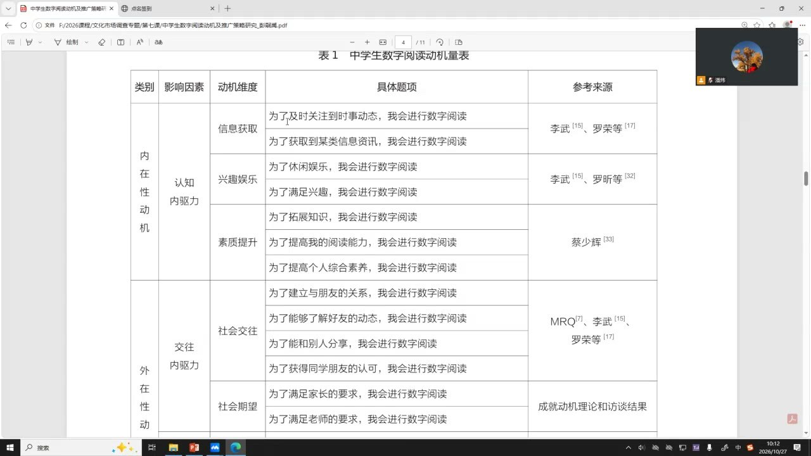
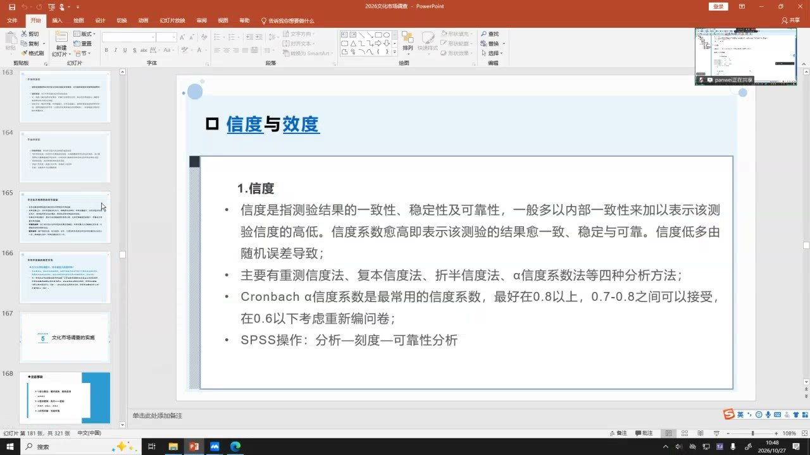
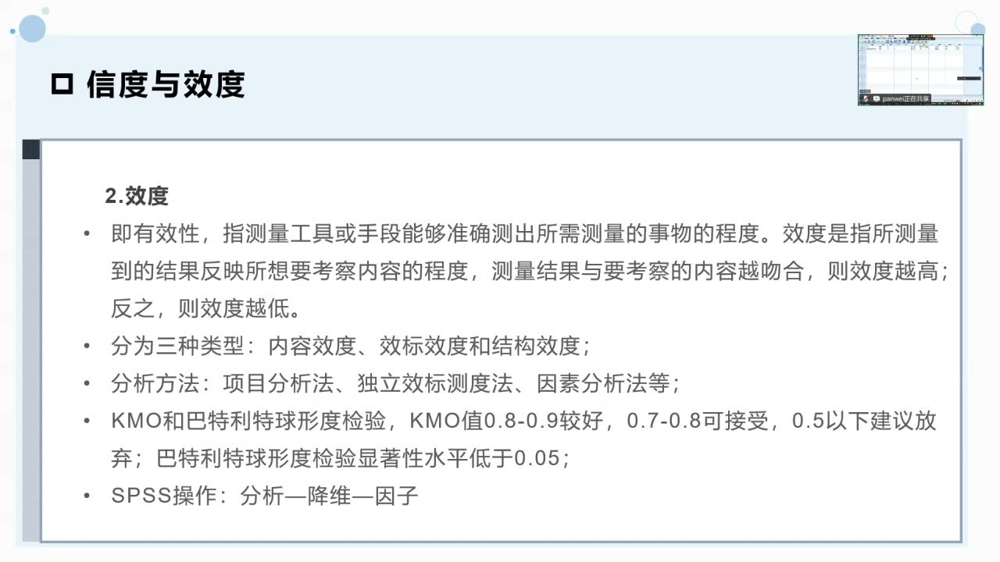
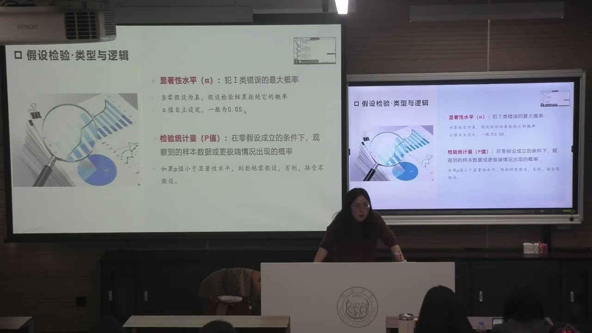

### 课程安排与任务

#### 先完善工具，再正式发放问卷
<!-- source: 0 -->
四组调查方案已经完成汇报，但问卷与访谈提纲仍需调整。教师要求这两周先结合信效度检验、假设检验的前置知识继续完善，不急于全面发放问卷。量表题既要找到理论、文献或前期访谈的依据，也要用预调研数据检验，再根据结果和受访者反馈修改。

每组要重新检查人口统计题：为什么询问性别、年龄、学历、职业或政治身份？预期这些群体在什么需求、行为或偏好上可能不同？没有服务于研究目的的问题需要重新考虑。研究可以以问卷为主、访谈为补充，也可以以访谈为主，用问卷提供数量层面的支撑。

#### 调研安全、知情同意与过程报告
<!-- source: 18 -->
调查对象应知情同意，研究过程和成果呈现都要保护隐私，不捏造数据、访谈记录或问卷。涉及未成年人等特殊对象时，需要遵守相应同意要求；教师说明当前四组不涉及未成年人。

线下调研尽量结伴，不要独自行动。小组外出前在班群说明由谁、何时、去哪里调查，组内协调分工；遇到临时问题及时联系教师。调查质量控制与人身安全都属于执行方案的一部分。

### 从文献走到可回答的问卷

定量模块以核心期刊调查研究为参照，学习研究流程与操作规范。示范文献不是拿来机械照搬，而是帮助解释每一步为什么必要。

#### 题目、综述与研究缺口要连成一条线
<!-- source: 2 -->
课堂以2022年《图书馆建设》中的中学生数字阅读动机、推广策略研究为例。题目需要交代研究对象、研究切入点与最终落脚点：调查谁、了解什么、结果服务于什么行动。引言可从政策背景、现实问题或学术问题进入，研究报告不必完全复制学术论文的篇幅结构。

文献综述要梳理已有研究如何讨论阅读动机、数字阅读和推广策略，再说明不足。示范研究指出，既有数字阅读动机量表尚不成熟，推广策略又较多从图书馆、学校等供给方出发，对未成年读者的需求重视不足。已有成果提供基础，“但是仍有什么不足”才把综述接到新研究的价值上。

#### 概念边界—理论框架—维度—具体题项
<!-- source: 8 -->
“数字阅读”包含哪些载体和方式，应先界定清楚；否则抽样对象和问卷覆盖范围都可能偏离研究目的。概念可以依据官方、学界界定，也可以提出有充分理由的操作性界定，关键是边界明确。

示范研究借鉴成就动机理论，把动机分为内在、外在等层次，再细化为信息获取、兴趣娱乐、素质提升、社会交往、社会期望、地位提高等维度。抽象维度还要转成受访者读得懂、理解较一致的句子。例如，以“为了及时关注时事动态，我会进行数字阅读”来测量信息获取的一部分，再使用1—5分的李克特量表表达认同程度。

题项不能因为看起来顺口就随意拼凑。每个维度与题项应有相应文献、理论或访谈依据。教师在结尾补充，示范研究在设计问卷前还访谈了十位中学生，让指标同时具有理论与实践来源。

#### 预调查与正式样本的说明
<!-- source: 14 -->
示范研究先以方便抽样进行预调查，获得一百四十余份有效问卷，用于信效度分析，再根据反馈调整措辞。这个步骤是在正式调查前检验工具，避免把大量资源投入到尚不合适的量表中。

正式调查需要说明地域、对象、发放方法和有效样本。课堂示例覆盖南昌的不同城区及周边县，回收960份，剔除无效后保留763份。样本结构还应交代性别、年级等分布；如果某个群体偏少，也要解释原因，如高三学生临近考试。数字的作用是让研究过程可理解，而不是只在报告里报一个总数。

### 问卷执行与数据质量

抽样、回收、审核和编号，决定最终数据能够支持怎样的判断。软件分析需要建立在可信的数据输入之上。

#### 区分“找不到”“整份未答”和“部分未答”
<!-- source: 22 -->
可查找率涉及抽中的对象能否找到；单位无回答涉及找到了对象或安排了发放，但整份问卷没有回收；项目无回答则是已经回收的问卷中，有些题没有填。三者发生在不同环节，不能混为一个回收率。

教师以计划发100份、只收回96份说明单位无回答的情况。对项目缺失，要看关键题是否仍能支持分析；课堂提出，重要问题回答率低于50%的问卷需要考虑作为无效问卷剔除。这是课堂质量控制的判断提示，执行时还要看题目的重要性与缺失情况。

#### 审核完整性、正确性与逻辑性
<!-- source: 24 -->
完整性关注是否漏掉关键题；正确性关注回答是否与题目要求对应；逻辑性关注前后作答是否矛盾。量表里方向不同但相关的题项，可帮助发现不认真作答的迹象，不过前后差异应作为审核线索，不能只凭单个异常立即认定乱填。

问卷应有便于追溯的编号。大范围调查可以按省、市、县等层级编码；跨校调查可按学校区分；当前小组也可按调研员和问卷顺序编号。编号把数据和调查过程联系起来，出问题时才能定位到具体问卷及其收集环节。

### SPSS数据结构与编码

变量视图先定义“问什么、如何表示”，数据视图再录入“每位受访者怎样回答”。线上平台导出的数据也需要核对这些定义。

#### 两个视图与变量的基本属性
<!-- source: 28 -->
变量视图设置名称、类型、标签、值、缺失及测量层次等属性；数据视图中，一行通常对应一份问卷，一列对应一个变量。名称可以使用简洁编号，再用标签保存完整问题。短题目也可以使用直观名称，但变量名要避开软件不接受的空格、冒号等特殊符号。

类型区分数值、字符串、日期等存储形式，测量层次则关系到能使用哪些分析方法。性别、物品类别等是无顺序的分类；认同或满意程度由低到高的1—5分有顺序。数字编码并不意味着所有变量具有相同的统计含义。类别编码一般无需显示两位小数，可以把小数位数改为0。

#### 单选一个变量，多选拆成多个变量
<!-- source: 32 -->
单选题把各选项作为同一变量的值标签，例如性别示范编码为1、2，并分别写清含义。量表中的每一道陈述题，也可在各自变量中定义1—5分别代表的程度。

多选题不能把所有勾选项连成“123”存入一个单元格，再当成普通数值分析。应为每个选项各建一个变量，表示它是否被勾选。课堂以公共文化参与目的、信息需求等题为例，每个选项分别记录“是／否”；演示使用1表示选中、2表示未选中，但编码数值不是唯一规定，必须保持定义清楚且前后一致。

#### 缺失值必须与有效答案分开
<!-- source: 40 -->
没有作答不等于选择了某个有效选项。可以用不与有效编码重合的数值标记缺失，例如有效选项为1—3时，另用-3，并在变量视图的“缺失”栏声明。只在数据格里填入-3而不说明其含义，会影响后续处理。

均值或众数插补属于进一步的数据处理方法，教师留到后面的推论统计环节再讲。当前重点是建立清晰模板、正确录入，并识别有效值、未勾选和未回答的区别。

### 信度与效度：量表是否合适

这次操作主要针对测量满意度、动机或认知等构念的量表题，不对性别、年龄这类基本信息机械进行信效度检验。

#### 信度看一致性，效度看是否测中了目标
<!-- source: 42 -->
信度是测量结果的一致性、稳定性与可靠性，课堂着重讲量表内部一致性。效度是测量工具能否准确反映所要考察的内容。打靶的比喻中，落点密集表示较稳定；落在靶心附近表示接近目标。落点集中但整体偏离靶心，可以帮助理解“信度较好而效度不足”。

效度又分内容效度、效标效度、结构效度等。指标来自已有研究、具有清楚的概念框架，是从内容上论证合理性；预调研后的数值检验提供另一层证据。二者需要结合，不能只凭看起来完整的问卷就宣称测量有效。

#### Cronbach α：可靠性分析的操作
<!-- source: 44 -->
SPSS路径为“分析—刻度—可靠性分析”。选入属于所检验量表的题项，课堂使用五个满意度题项进行演示，默认分析得到Cronbach α系数。示范数据的α为0.855，教师据此判断内部一致性较好。

课堂给出的经验判断是：0.8以上较好，0.7—0.8通常可接受；课件提出低于0.6时考虑重新编制问卷。教师同时说明研究中并非只有一个毫无例外的界限，不宜把阈值脱离研究条件当成绝对规则。

#### KMO与Bartlett球形度检验
<!-- source: 56 -->
SPSS路径为“分析—降维—因子”。将需要检查的同一组量表题放入变量框，在相关选项中勾选KMO和Bartlett球形度检验，再查看输出。课堂要求同时读显著性与KMO，不要只找一个数字。

课件给出KMO在0.8—0.9较好、0.7—0.8可接受、低于0.5时建议放弃或调整的判断提示；Bartlett检验的显著性通常要求低于0.05。演示得到KMO为0.815，教师结合输出认为这组量表的检查结果较好。

本课将这一步放在效度检验的操作环节，重点是学会对量表进行数据层面的检查。报告仍应交代概念、维度与题项的来源，并结合预调查反馈修改；不能把两个输出值当成量表全部合理性的唯一依据。

### 假设检验为问卷设计提供理由

抽样调查用样本认识总体。问卷中的分组信息不仅描述“调查了谁”，也为检验群体之间的差异或变量关系提供条件。

#### 人口统计题背后应有待检验的问题
<!-- source: 60 -->
问性别，可以是为了检验不同性别的观演意愿或实际消费是否不同；问年龄，可以是为了检验不同年龄的红色展陈、剧本杀等活动偏好；问学历或政治身份，也应说明它们与研究对象可能有什么联系。这些都是研究前的预期，不是已经被证实的群体特征。

设计选项还要考虑希望比较哪些人。例如大学生可以按年级、培养层次或学科划分，具体分法要服务于研究目的。不能为了“问卷看起来完整”而机械塞入一套人口信息，也不能把需要分析的变量在调查后才发现遗漏。

#### H0与H1：从预期转成可检验判断
<!-- source: 68 -->
零假设也叫原假设，常记为H0；备择假设常记为H1，二者相互排斥。课堂在群体差异的例子里，把“不同群体之间没有差异、变量之间没有关系”放在H0，把希望检验的差异或关系放在H1。

研究从假设、抽样和数据分析走向判断。教师用寻找反例说明反证思路：如果在H0成立的前提下，观察到的结果很不容易出现，就有理由质疑H0。具体采用什么检验，还取决于变量数量、测量层次和分布等条件，相关方法留到后续课程展开。

#### 两类错误、α与p值
<!-- source: 72 -->
Ⅰ类错误是H0实际为真，却把它拒绝，称为“弃真”；Ⅱ类错误是H0实际为假，却没有拒绝，称为“存伪”。护肤品的教学例子中，前者相当于新产品并未更好，却误判有效并投入推广；后者相当于新产品确实更好，却因样本判断而放弃机会。教师用不同后果帮助理解判断风险。

显著性水平α是预先规定的判断标准，课堂通常采用0.05，也提到部分研究采用0.1。p值是在零假设成立的条件下，出现已观察结果或更极端结果的概率。按课件的比较规则，p小于预设α时拒绝H0，否则保留H0；“保留”表示现有检验未能拒绝它，不应写成已经证明H0永远正确。

### 重编码与调查工具的修订

数据可以按明确规则重新组织，但调查时没有收集的细节，不能靠软件凭空补回。

#### 合并年龄类别，保留原始变量
<!-- source: 86 -->
如果原年龄分类太细，部分组样本过少，可以根据研究目的合并相邻类别。SPSS“转换”中有“重新编码为相同变量”和“重新编码为不同变量”：前者直接修改原列，后者生成新列。课堂演示后者，便于把新旧变量放在一起核对。

操作时选入年龄变量，在“旧值和新值”中逐项添加映射，例如旧1→新1、旧2→新1、旧3→新2，依次处理其他类别；给输出变量命名并确认变更，再执行。完成后同时检查变量视图和数据视图，确认新变量出现，且样本中的旧3、旧4等值已经按规则转成新2、新3等。

#### 合并能做到，已经丢失的细分做不到
<!-- source: 90 -->
如果调查时只问“18岁以下”，之后就无法仅凭这一答案区分12岁以下和12—17岁，因为原始年龄并未被记录。细类别可以合并成粗类别，粗类别却不能无依据拆细。调整分类要有实质理由，不能把重新编码理解为修改受访者的实际回答。

问卷修订形成两条互相配合的线：量表题以文献、理论和访谈为基础，用预调研检查后修改；人口统计题以待检验的关系或群体差异为依据，确保采集的数据能够回答问题。AI可辅助寻找文献，但引用和指标来源要逐一核对原文，不能把杜撰的文献或原文没有的观点放进研究依据。

### 概念对照与自测

| 概念 | 回答的问题 | 本课对应做法 |
| --- | --- | --- |
| 变量视图 | 每一列是什么、如何编码 | 设名称、标签、值及缺失 |
| 数据视图 | 每份问卷如何作答 | 一行个案，一列变量 |
| 信度 | 同组测量是否一致、稳定 | 可靠性分析与Cronbach α |
| 效度 | 是否反映了要考察的内容 | 内容依据及预调研检查 |
| H0／H1 | 无差异或无关系／待检验的差异或关系 | 在调查前明确变量与分组 |
| α／p | 预设标准／由检验得到的概率 | 比较p与α再作判断 |
| 重编码 | 如何按规则重组已有类别 | 新旧值映射并核对原数据 |

#### 多选题为什么不能把勾选1、2、3直接录为123？
123会成为一个新的数值，无法直接表示三个选项各自是否被选。应将每个选项建立为单独变量，分别记录选中与未选中，并写清编码含义。

#### α为0.855是否就足以证明问卷什么都测对了？
不足以。该结果支持演示量表内部一致性较好；是否测到目标内容，还要看概念、维度、题项依据及其他效度论证，不能把信度与效度混为一个判断。

#### 问卷里的性别、年龄题为什么也需要研究理由？
因为它们既描述样本结构，也可能用于比较群体差异。需要事先明确希望用它们解释什么行为、需求或偏好，才能保证后续分析有相应数据。

#### “不拒绝H0”意味着H0已经被证明吗？
不意味着。它表示当前样本与采用的检验，没有提供足够理由拒绝零假设。抽样判断仍可能出现错误。

#### 为什么粗年龄组不能事后拆得更细？
因为受访者的更细年龄没有被收集。重编码能重组已有信息，不能恢复原数据中不存在的个体细节。

### 课程时间线

00:00—08:00：进入定量模块，文献示范与研究缺口
08:00—14:00：概念边界、动机框架及量表题项来源
14:00—18:00：预调研、正式抽样与有效样本说明
18:00—22:00：知情同意、隐私、数据诚信及线下安全
22:00—26:00：无回答、问卷审核和编号追溯
26:00—32:00：SPSS功能、双视图及变量属性
32:00—40:00：单选、多选及量表题的编码演示
40:00—44:00：缺失值、信度与效度的打靶比喻
44:00—46:00：可靠性分析，Cronbach α为0.855
46:00—52:00：课间课程交流及软件使用问题
52:00—60:00：复习信度操作，KMO与Bartlett检验
60:00—68:00：人口统计信息为什么需要假设前提
68:00—74:00：零假设、备择假设与反证思路
74:00—80:00：两类错误、显著性水平与p值
80:00—86:00：以文献和预调查完善问卷，核查AI引用
86:00—92:00：年龄类别合并、重编码与新旧变量核对
92:00—95:49：访谈前置及定量、定性研究的主辅结合
