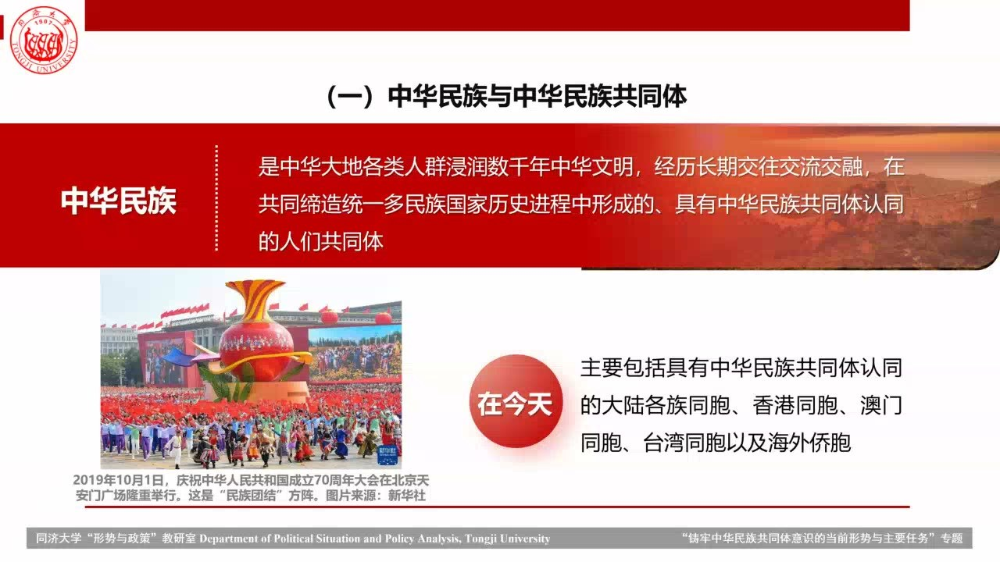
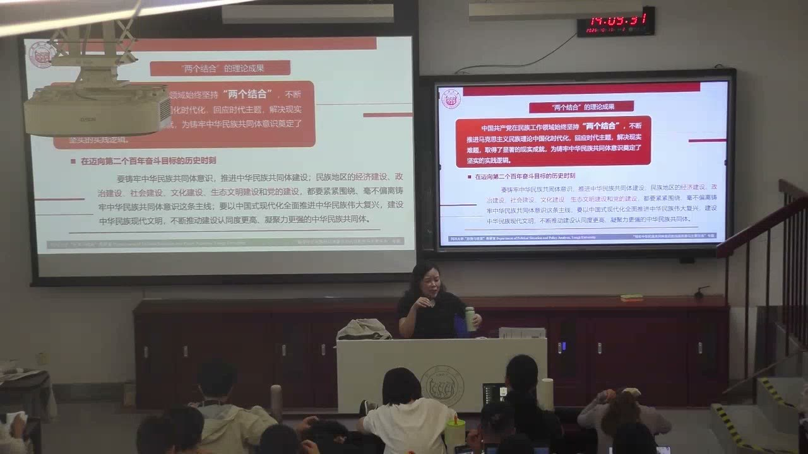
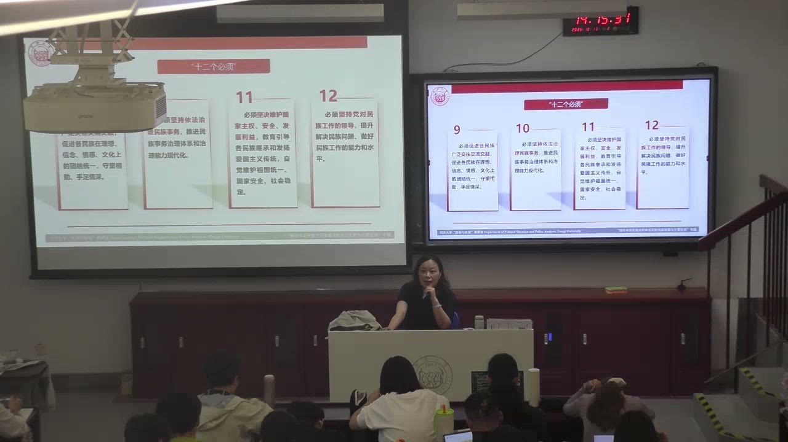
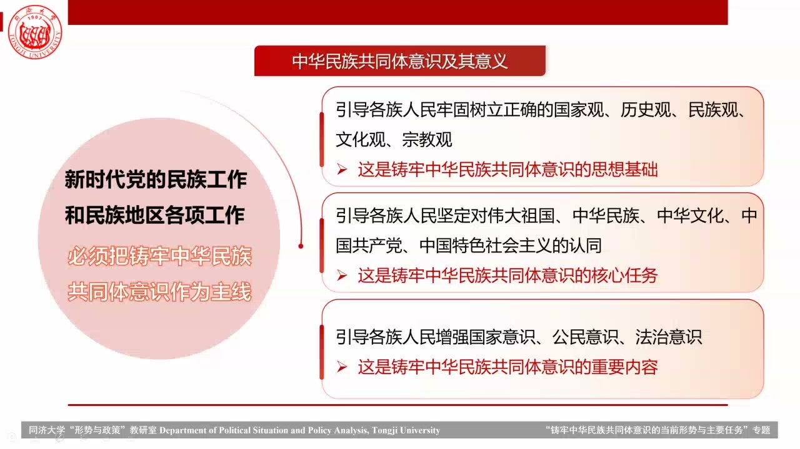
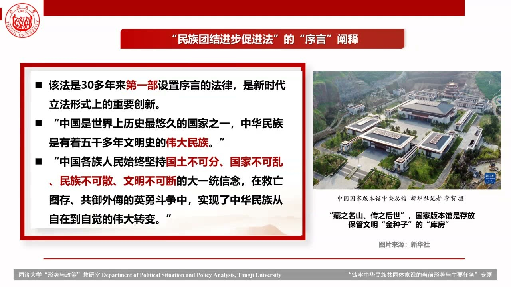
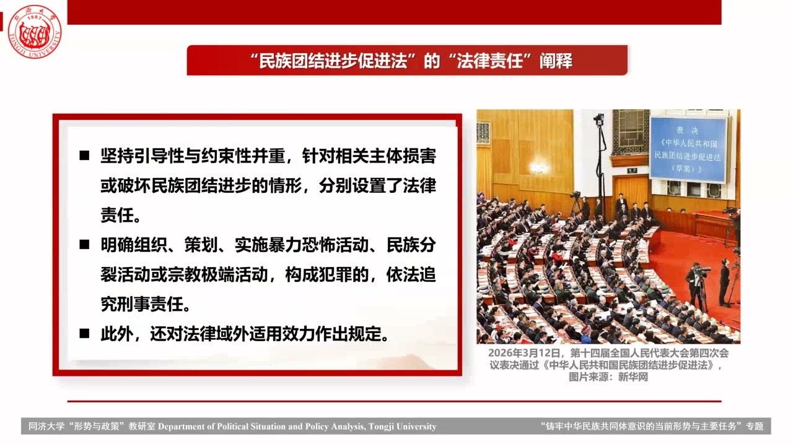

### 课程安排与任务

#### 课程论文与下一讲安排

教师说明论文沿用既有模板，要求两页A4；模板将通过对分易再次发送。若以本讲为论文主题，需先准确理解“铸牢中华民族共同体意识”及其概念关系，再展开讨论。具体排版仍按教师发放的正式模板。

本学期前两讲分别围绕全面从严治党和扩大对外开放，本讲讨论中华民族共同体意识，下一讲计划讨论中美关系。请假或课程问题可在对分易联系教师或助教。

#### 第二次过程性考核：介绍自己的家乡

前后排组成三至四人小组，最多不超过五人。每人约讲三分钟，共安排约十五分钟交流；介绍家乡近期变化或特色，食物、文化、经济、科技均可，能联系民族文化更好，但不强制。每个成员都需口头讲述，推举一人作纸面记录。

记录每位成员的学号、姓名、家乡和一至两个特色，可加简短总结，完成后交给教师。教师说明会逐份阅读，并在下一讲反馈。可以借AI查询家乡信息，但需要理解后讲给组员听，不能直接把AI内容抄到纸上代替交流。

### 共同体的含义与认同的形成

共同体连接历史、社会关系和主观认同。认识其建构过程，不等于否认其现实意义。

#### 中华民族是怎样的共同体？

课堂从民族概念的讨论进入中华民族共同体：它具有悠久文明传承，也在历史与社会发展中不断形成和凝聚。课件将中华民族界定为长期交往交流交融、在共同缔造统一多民族国家过程中形成，并具有共同体认同的人们的共同体。

共同体既包含大陆同胞，也包含具有中华民族共同体认同的港澳台同胞和海外侨胞。理解它需要同时看历史联系、现实关系和认同，不能用某一个民族代替整体，也不能只凭一种外在属性概括全部内涵。

#### “想象”为什么不意味着认同没有价值？

教师引入安德森《想象的共同体》，讨论民族认同如何形成。教师关注的追问是：即使共同体涉及主观认同，这种认同为什么仍然与人的生活休戚相关，并在纪念、仪式和历史经验中激发真实情感？

教师以升旗、阅兵和战争纪念的感受说明，认同可能同时包含对先辈苦难的理解、对当下的珍视和归属感。说明认同怎样生成，不等于把它说成可有可无；概念的建构性与现实的凝聚作用可以同时讨论。

#### 共同体需要怎样的文化载体？

教师回应课堂播放内容时，概括了语言、地理范围、博物馆、通俗表达和民族仪式等载体的作用：共同根源通过可以理解和接触的形式进入生活，个人也借此把自身经验放进更大的历史关系。

教师同时提醒，认同若走向狂热或狭隘，可能形成排斥与保护主义。共同体的凝聚需要与开放相结合，不能把归属感变成封闭自我的理由。

#### 《唐顿庄园》例子：团结怎样回应不平等？

教师讲述剧中贵族小姐帮助女仆寻找秘书工作的情节：两人拥有不同的家庭资源、成长经验和机会，面对失败时对“努力是否有效”的判断也不同。小姐并未否认对方成功更困难，而是通过实际支持帮助其继续尝试。

这一回应把“为什么要联合起来”落到具体关系：承认处境差异，再通过合作互相支持。共同体不要求假装每个人原来就一样，也需要规则、制度和方法，使联合能够持续。

### 从自在到自觉：历史中的凝聚过程

长期共同生活与近代共同抗争相互连接，认同也会从外在说明进入个人的主动理解。

#### 自在、自觉和“自生”分别指什么？

教师用“自在”说明历史上已经存在的民族实体和长期交往；用“自觉”说明人们逐渐主动意识到自己的归属，并在与外部力量的关系中增强共同认同。近代反抗侵略成为课堂强调的凝聚过程。

教师还用“自生”解释一种内在生出的认同：能够说明自己的由来，讲述家乡和共同体的故事，愿意为家庭、学校、家乡或更大集体做事。这里的“自生”是教师用于理解认同的补充表达，不能与课件“从自在到自觉”的历史论述混为同一个固定阶段划分。

#### 近代概念与共同抗争怎样联系？

课堂以梁启超1902年使用中华民族概念，以及后来关于多族融合的论述为线索，说明共同体并非简单等同于单一族群。孙中山强调团结统一，李大钊提出民族再造与复活，1935年的《义勇军进行曲》又以共同抗争唤起各族儿女的认同。

教师把1940年《新民主主义论》中建设中华民族新社会和新国家的目标，以及此后民族团结的实践，放在同一历史线索中理解。新时代以大家庭和家庭成员比喻整体与各民族的关系，并用“石榴籽”表达紧密联系。

#### 大一统传统与交往交流交融

课堂把马克思主义民族理论概括为开放、发展的体系，强调民族解放、团结、平等与融合：既反对奴役，也关注共同目标、平等权利义务和相互联系。中华民族共同体的理论渊源，是这一理论与中国历史和现实实践的结合。

教师以辽阔土地上的长期共同生活和大一统传统解释历史联系，并强调“交往—交流—交融”的递进：接触带来认识，交流形成共同活动，交融则进一步产生理解、支持与共同经验。

#### 交流怎样成为更深的共同经验？

教师借同学相处解释交融：仅仅见面、聊天还不够，共同完成活动、理解彼此目标、分享情绪和互相帮助，会使关系更深入。竞争与合作可以同时存在，竞争不必都是恶性的，合作也需要共同目标和规则。

这一日常例子把共同体概念落到差异存在的场域：不同成员仍可以形成相互支持的关系。只剩竞争容易带来持续焦虑，而完全排除竞争也未必有助于合作保持活力。

### 共同体建设的理论要点

共同历史、共同命运与处理差异的原则相互配合，并需要制度和法治支撑。

#### “两个结合”的成果怎样进入各项建设？

课堂把新时代民族工作的理论成果放在持续推进马克思主义民族理论中国化时代化的过程中理解，强调回应时代主题、解释现实难题。课件以“两个结合”概括这一理论推进的背景。

民族地区的经济、政治、社会、文化、生态文明和党的建设，都要围绕铸牢中华民族共同体意识这条主线，以中国式现代化推进复兴。它将概念认识与具体治理领域连接起来，而不是把民族工作孤立为单一的文化活动。

#### “十二个必须”怎样组织建设原则？

课堂介绍“十二个必须”，可按目标、主线、关系和保障理解：以中华民族伟大复兴为出发点和落脚点，推动各族人民共同奋斗；以铸牢中华民族共同体意识贯穿民族工作，确立正确的中华民族历史观。

关系与制度方面，坚持各民族一律平等、维护团结，坚持和完善民族区域自治制度，构筑共有精神家园，促进广泛交往交流交融；保障方面，坚持依法治理民族事务，维护国家主权、安全与发展利益，并坚持党的领导。

教师特别强调，单靠良好愿望、丰富情感或自律，不能保证行动持续。规则和法律为意志松懈、情绪变化时提供底线，使共同体建设拥有理性和制度支撑。

#### “共同”的历史贡献与“与共”的命运关系

“四个共同”包括共同开拓辽阔疆域、共同书写悠久历史、共同创造灿烂文化、共同培育伟大精神。教师指出，课堂还补充共同缔造统一的多民族国家，从而以“五个共同”理解各族贡献。重点是把疆域、历史、文化、精神和国家看作共同创造的成果。

“四个与共”则是休戚与共、荣辱与共、生死与共、命运与共，强调各民族相互依存、一荣俱荣一损俱损。前者着重共同建设的历史，后者着重共同面对苦难、危机与发展的关系，二者不可互相替代。

#### 四对关系怎样处理共同性与差异？

四对关系分别是共同性与差异性、中华民族共同体意识与各民族意识、中华文化与各民族文化、物质与精神。课堂强调以共同性为基础，同时理解差异的丰富性，避免把不同成员拆解为彼此孤立的部分。

教师以多民族村庄中风格各异的民居，以及日常文化中的融合为例，说明不同表达可以共存。共同体的整体位置不意味着必须抹去每一种地方文化，而是使各民族文化进入可以共享和交流的关系。

### 当前意义、认同任务与风险意识

共同体意识在民族团结、国家统一和个人归属之间发挥作用，也要求对差异和冲突作全面判断。

#### 思想基础、核心任务和重要内容

课堂把铸牢中华民族共同体意识放在新时代民族理论和民族政策的核心位置：整体共同体是各民族相互联系的重要依托，不能把某一个具体民族置于整体之上。共同体意识关系民族团结和国家统一，也使个人获得使命感、归属感与荣誉感。

思想基础包括国家观、历史观、民族观、文化观和宗教观；核心任务包括对伟大祖国、中华民族、中华文化、中国共产党和中国特色社会主义的认同；重要内容则是增强国家意识、公民意识和法治意识。三组概念分别回答怎样理解、认同什么和怎样进入公共生活。

#### 差异怎样被理解为风险，又怎样避免封闭？

教师以国际冲突和恐怖袭击材料讨论差异被激化的后果，并将外部干预、分裂主义、宗教极端思想及片面历史叙述等列为课堂讨论的风险。分析这些问题需要全面思考，不能只看到温情，也不能被煽动性的说法牵引。

在文化表达上，教师反对只销售民族新奇感、却不理解其文化内涵的做法。团结与稳定需要提前化解风险，也需要防止共同体意识被解释为狭隘、排斥或自我封闭。

### 把共同体建设落实到各项工作

民族地区的发展并非只有文化表达，也包括经济、政治、民生、生态和组织保障。

#### 经济发展怎样与共同体建设联系？

课堂强调以铸牢中华民族共同体意识为主线推进各项工作，也不能忽视经济建设。各民族共同富裕需要解放和发展生产力，以高质量发展改善现实生活条件。

教师以馕产业园的大规模生产为例，说明地方特色资源可以进入现代生产体系。资源的结合、产业发展和共同富裕相互联系，文化认同也需要现实发展条件支撑。

#### 政治参与、文化与社会建设各关注什么？

政治建设关注共同参政议政和各民族的意见、福祉；文化建设关注文化资源的发掘、理解与共有精神家园；社会建设关注民生保障，包括教育、医疗、养老、住房和对弱势群体的支持。

这些工作把共同体的理念转为可以体验到的公共生活：成员既能够表达意见，也能够共享发展和公共服务成果。理解民族工作时，不能仅停留在节庆、服饰或民俗的展示。

#### 生态治理与组织保障怎样贯穿其中？

生态文明建设强调山水林田湖草沙的一体化保护和系统治理。课堂把经济、政治、文化、社会、生态文明建设连接起来，并以党的建设统领。

政治、思想、组织、作风、纪律和制度建设需要贯穿各项工作，同时持续推进反腐败，为共同体建设提供领导、引领、组织和号召的能力。课堂将本讲与第一讲的全面从严治党联系起来，说明不同专题之间存在共同的治理要求。

### 民族团结进步促进法的课堂解读

课堂把法律作为共同体建设的制度保障，讨论共同认同、繁荣发展和法律责任如何相互支撑。

#### 立法为何与共同繁荣和法治联系？

教师介绍《中华人民共和国民族团结进步促进法》于2026年3月12日经十四届全国人大四次会议表决通过，并以此讨论本讲的法治保障。课堂强调的目的，是把民族团结、共同繁荣和共同体建设的要求落实到制度与法律中。

课堂把推进中国式现代化、促进民族地区融入国家发展大局和依法治理民族事务联系起来。“融入”不只指经济，也涉及空间、心理、社会和制度关系；宪法有关民族事务的原则，需要通过具体法律规范和保障机制转化为持续行动。

#### 七章结构怎样对应建设与保障？

课堂介绍该法为七章、六十五条，依次包括总则、构筑共有精神家园、促进交往交流交融、推进共同繁荣发展、保障和监督、法律责任、附则。这个结构把精神认同、实际交往和发展放在前面，再设置保障、监督和责任。

课件还强调序言对历史联系和大一统信念的表达。教师以国土、国家、民族、文明的连续性，连接此前“从自在到自觉”的历史论述。这里保留课堂的结构性解读，具体条文应回查法律原文。

#### 统一与差异怎样同时得到理解？

教师强调，推广国家通用语言文字并不意味着不保护少数民族语言文字，共同性与多样性需要同时理解。传统节日、民俗文化、体育赛事等活动，可以成为交往交流交融的载体。

共同发展还涉及帮扶和保障机制。推进整体联系与支持不同地区、不同成员的具体需要相互配合，不能把大一统简单理解为所有表达完全一致。

#### 引导性与约束性为何需要并重？

课堂对法律责任的概括是引导性与约束性并重：对于损害或破坏民族团结进步的情形设置相应责任；对构成犯罪的暴力恐怖、民族分裂或宗教极端活动，依法追究刑事责任。课件还提到域外适用效力。

这一部分回应了教师前面关于规则的解释：共同体建设需要情感认同，也需要明确底线、保障和监督。课堂最后把提高民族事务治理水平、高质量发展和每个人的实际参与联系起来。

### 概念对照与自测

| 概念 | 重点 | 不能混淆之处 |
| --- | --- | --- |
| 自在与自觉 | 历史存在／主动形成认同 | 历史实体与近代认同过程不是同一层面 |
| 交往、交流、交融 | 接触／交换与共同活动／深层理解与联系 | 递进关系不能只用见面次数代替 |
| 五个共同与四个与共 | 共同的历史贡献／相互依存的命运关系 | 共同创造与共同承担各有侧重 |
| 共同性与差异性 | 整体联系／多样表达 | 求同不等于消除各民族文化 |
| 思想基础、核心任务、重要内容 | 五观／五个认同／国家、公民、法治意识 | 分别回答怎样理解、认同什么、怎样参与 |
| 情感与法治 | 归属、支持／规则、保障和责任 | 良好愿望不能代替稳定制度 |

#### 中华民族共同体为什么不能由某一个民族代替？

课堂将其放在整体位置，各民族是大家庭的成员。历史贡献、现实联系和共同体认同需要在整体关系中理解。

#### 教师为什么把自在与自觉联系到反抗侵略？

长期共同生活构成历史基础，共同抗争进一步强化主动归属、历史理解和凝聚。

#### 五个共同有哪些内容？

共同开拓疆域、书写历史、创造文化、培育精神、缔造统一的多民族国家。

#### 四个与共强调什么？

休戚、荣辱、生死和命运与共，强调共同依存、共同承担，而不只是在同一个地域生活。

#### 为什么共同体建设既讲精神也讲经济与法治？

归属和认同需要现实发展、公共服务和稳定规则支撑，情感、物质条件及制度保障相互配合。

### 来源范围

原始转写含课堂互动，正文只整理教师讲授、解释、回应与课程任务。时间范围为两分钟音频分段边界，不是逐句对齐时间。
