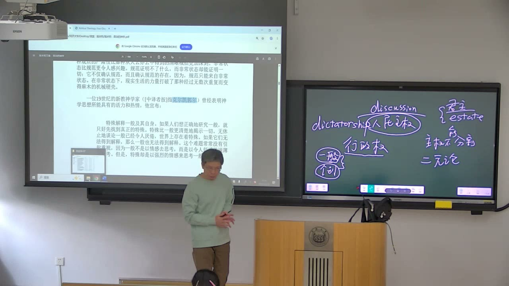
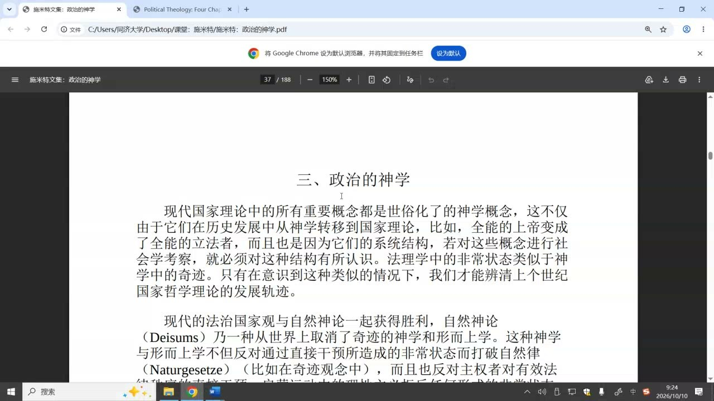
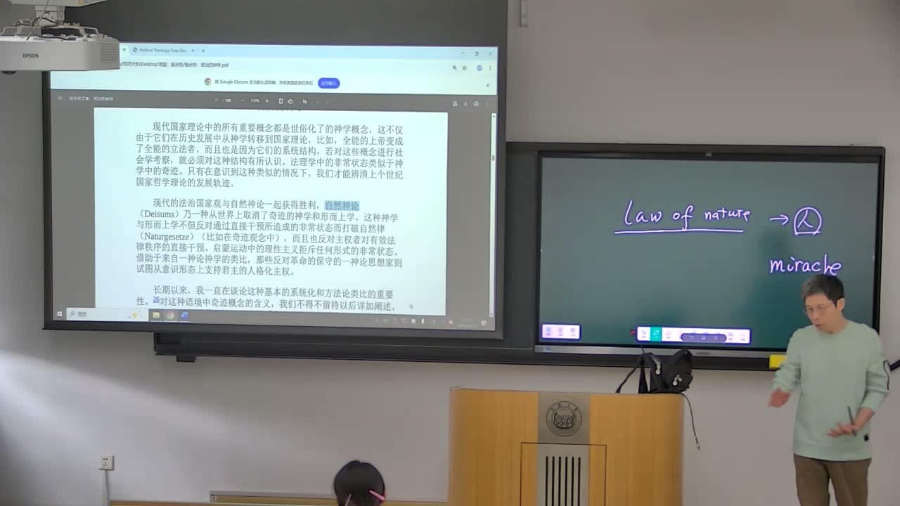

### 课程安排与任务

#### 阅读文本，并把作业集中在同一份文档

教师要求把作业放在**同一份文档**中持续整理，便于查看和使用，不要每次另建一份。课堂听讲不能替代自己阅读；需要通过阅读形成问题，再带着问题回看论证。

本书涉及翻译、论战对象和历史背景，初读不必强求每一句都读透。先抓住能理解的中心论证，再辨认围绕它展开的重复与补充。教师预计后续课程继续推进并完成本书讨论，课堂没有给出新的具体截止日期。

### 纯粹规范与法律中的人格因素

第二章追问：即使在正常的法秩序中，规范能否脱离具体的人自行发生效力？

#### “统一性”为什么意味着排除人的因素

教师把凯尔森的法律统一性解释为一种**单一性**的追求：以规范为法律体系的根据，排除社会学、个人意志等被视为不纯粹的因素。要理解施米特的批评，先看清对方想建立什么样的法学，而不只是把两位作者归入不同立场。

施米特则区分正常状态与例外状态，并把规范与决断共同放入法律秩序。二者不能简单化为“有秩序”和“无秩序”：例外中仍可能存在支配与秩序，规范的暂停不等于一切都陷入混乱。

#### 法律必须经过执行者的解释

条文不会自己处理具体案件。律师、法官及其他法律执行者，需要判断事实、解释规定，并把一般规范落实到具体处境。同一条文可以发生不同理解，也可能被误用。人的因素不是加在法律外面的偶然杂质，而是法律实际运作的组成部分。

教师用“法治包含人治”强调这个人格因素：法的实施离不开人。这句话在本课的理论语境中，不直接等于赞成个人随意统治，也不能据此抹去法律对普通裁判的约束。

#### 法律秩序与社会学描述的界线

凯尔森与施米特都谈到法学和社会学的区分，但划界的依据不同。前者希望把人的因素排除出纯粹规范；后者关注法律中的秩序、支配与决断，并不因为它由人作出就把它移出法学。

所以，阅读时不能只看到同样的“区分”字眼便认为两种主张一致。施米特要说明的是：法律的秩序性本身，就需要面对具体人的行动和权威。

### 判断的正确性与决断的效力

判断是否正确，与谁有权作出具有约束力的判断，是两个相连却不能相互替代的问题。

#### 错误裁判为什么仍可能具有效力

教师反复区分**判断内容的正确性**与**判断的法律效力**。一个裁判可能有错误，却因作出者具有相应职务和权限而在制度中发生效力。说明“它错了”，与具有改变它的制度权限，并不是同一回事。

如果可以上诉，改变裁判的效力来自相应程序与有权作出新决定的机关，并非只来自某个人认为自己更正确。上一级判断同样由人作出，也不能因此保证绝对无误。

#### 谁来判断判断者：正确性的递归

如果一种判断只有在“完全正确”时才算数，那么还必须指定另一个人判断它是否正确；接着又要问，谁保证后一位判断者正确？这个追问可以不断继续，却不能让正在发生的争议获得最终处理。

法律秩序因而需要某种结束争议的安排。教师借此指出：正确性的理想不能单独解释终局决定为何有效。终局性解决的是争议如何暂时告一段落，它并不把作决定的人变成永不犯错的人。

#### 行动需要在有限时间中作出选择

人拥有有限知识，也会犯错，但生活与政治行动不能总等到一切疑问消失再开始。是否按时上课这样的日常决定，也是在不能掌握全部条件时作出的；公共决策的错误可能带来更大后果，但有限性不会因此消失。

教师用迟疑不决的例子说明：对真理的无限追求与必须及时行动的处境存在张力。“正确、错误没有地位”等课堂表述，应放回这个决断效力的论题中理解，而不应被扩展成不需要理由、也不需要评价错误。

#### 终局判断与制度设计仍是两个问题

程序可以安排不同环节、不同判断者，却不能完全消除解释与裁断。若每次出现分歧都允许继续寻找一个更高的裁判者，法秩序就无法结束争议。教师以终局裁判为例，说明权威为什么不能仅由“我认为它不对”来撤销。

这不意味着现存制度无须改进。怎样设计更好的制度、怎样减少错误，是应当继续讨论的问题；只是它们不能取代本章对“谁能作出有效决定”的分析。柏拉图哲人王的理想，把知识与权威集中起来，也没有直接消除现实行动者的有限性。

### 普通裁判与例外中的主权决断

第一章从极端情形辨认主权，第二章把决断问题带回日常法律运作；两者相通，却有不同的权限边界。

#### 普通法官不因此成为例外主权者

正常法律裁判包含人格因素，但普通法官仍在既定规范和权限之内行动。例外中的主权决断，在施米特的理论中具有暂停正常规范的意义。共同点是都必须由人判断，区别是**判断所受到的规范约束和权限范围**不同。

因此，不能把“法律有决断因素”直接推成“任何裁判者都可以暂停法律”。从第一章走到第二章，论证扩展了人格问题，而不是把全部日常裁判都宣布为无限主权。

#### 规范依赖能够适用它的具体情境

一般规范总在一定社会情境中被制定、解释和执行。当原有情境发生重大改变，它不一定还能够处理所有新问题。人制定规范，又判断规范与处境是否相符；没有一套抽象规范可以预先穷尽一切未来情况。

正常状态中，这种判断表现为适用法律；例外状态中，则触及正常规范能否继续实施。这也是施米特从例外看规范的理由：极端情形把平日不明显的前提显露出来。

#### 权限与“能力”的翻译问题

教师提醒，书中 competence 一类词若译成“能力”，容易让人想到聪明才干或自然能力；在这里更接近**权限、权能**。问题不是谁最能干，而是谁有权作出有关例外的决定。

例外决断之所以被说成更完整意义的决断，是因为它在理论上触及规范的暂停，不能完全由正常规范推导出来。“无限权限”的表述本身具有张力，需要围绕正常与例外的关系读，而不宜解释成现实人物拥有所有领域的无限权力。

#### 主权潜在，不等于平时不存在

教师说明，平时没有发生例外，并不意味着主权直到紧急时刻才凭空出现。潜在的最终决断安排，可以在正常状态下不被突出表现；当例外来临，它才以更鲜明的方式显露。

谁在一个具体国家中具有这种地位，要结合实际制度与运行情况判断。本课讨论的是抽象的主权理论，不能只凭书中的定义便指定现实中的某一个职位。

### 权威、商议与最后的决定

多人可以参与商议，但商议如何转化为可执行的决定，仍需要说明。

#### 调解者的例子：争议为何需要共同承认的权威

教师用民间调解者说明，一场争议不总是靠搬出条文就会自动结束。处理者需要经验、说理能力和被双方承认的地位；若双方始终各持己见，争议可能转向冲突。

这个例子用来突出秩序中的人格和权威。它不是把民间声望直接等同于法官的制度权限，而是让我们看到：规则怎样由具体的人带入一个争议，又怎样获得承认。

#### 专业共同体与条文的实际落实

法律训练、律师的论证、法官的判断，使条文在具体案件中发挥作用。教师强调法律人员的重要性，是因为规范需要专业解释与执行，而非因为条文可以随意被人的意志取代。

“法官比法律重要”的课堂强调，指向的是法律运作不能仅靠纸面规定。阅读时应把它与普通裁判受规范约束放在一起，避免把重视专业判断理解成排除一切制度限制。

#### 商议不自动等于最后决定

很多人可以提供意见、展开讨论，但最后仍可能需要确定哪一个决定被执行。在施米特的主权定义中，如果一个决定还必须等待另一方同意，便要继续追问：谁能够最后批准，或者否决它？

教师用行政负责人和商议场景帮助区分**意见的参与**与**最终决定的权限**。不同机构在不同领域拥有权限，并不直接等于它们对同一例外决定拥有同等的最终主权。

#### 理论的不可分性及其未解决的风险

施米特强调最终决断不可分：如果并列的最终决定者发生冲突，谁的决定最终有效，仍需说明。但“人民主权”等一般原则与具体的例外决断之间，怎样建立关系，是课堂持续追问的问题。

不能由这个理论直接推出某个现实制度的全部权力结构，也不能把潜在例外权威理解成平时所有法律都被取消。例外权力的滥用、专政与独裁的关系，教师留待后续文本进一步讨论，本课没有把这些风险彻底解决。

### 一般规范与具体生命

法律中的人格因素，也关联一般与个别的哲学问题：行动者生活在具体处境中，而规范以一般形式表达。

#### 克尔凯郭尔为什么进入这个论证

教师以克尔凯郭尔对具体个人和生命的关注，解释文本中的一般与个别问题。一般规范能够概括，但正在生活、承担行动后果的是具体的人；个体并不只是一般概念的一个可替换实例。

因此，例外与具体处境不只是正常规则的边角料，它们会反过来揭示一般规范所依赖的条件。教师将其与更重视普遍理性、一般概念的哲学倾向作对照，用来说明施米特为什么不断回到人格与决断。

#### 生活不是抽象概念的直接替身

教师借“理论灰暗、生命长青”的比喻，强调理论无法完全替代生活。吃的是具体一碗饭，爱的是具体一个人；我们不能只依靠“食物”或“爱”的一般定义，就完成实际生活中的选择。

规范当然需要一般性，否则难以共同使用；问题在于一般性不能穷尽个别。Leben 的生命、生活含义在课堂中被并置讨论，帮助理解理论语言与实际生存之间的距离。

#### 评价论证，不能只贴思想标签

教师要求先分析作者提出什么理由，理由能否成立，以及它如何处理规范与决断的关系。给作者归类为某种主义，不能代替这个工作。

同样，指出人的有限性，不等于所有人的判断都一样；指出法的效力依赖权限，不等于判断的内容永远不值得批评。将这些层次拆开，才能对施米特的论证作出有根据的评价。

### 第三章：神学结构与国家理论

从第二章的人格与决断，进入第三章关于神学和现代国家概念的结构关联。

#### “政治的神学”关注什么样的结构

教师指出，神学不只涉及死后世界或一个抽象的神，也曾进入现实信仰、教会生活与社会秩序。第三章把神学中的秩序和权威结构，与国家理论中的概念结构联系起来。

章节开头的重要思路是：现代国家理论中的重要概念与世俗化的神学概念存在关联；这种关联不仅是词语在历史上的转移，也关乎体系结构。由此，神学的神迹与法理学的例外状态形成可比较的关系。

#### 自然神论：创设秩序，却不持续干预

自然神论承认上帝创设世界与规律，但把创设后的世界理解为能够按自身规律运转的秩序。教师用“上帝退到后面”的形象说明：这不是直接否认上帝存在，而是排除持续以神迹介入正常过程的方式。

这个世界观能够与强调规律、自主运行和可理解秩序的思路相接。课堂把它类比为不直接参与日常决定的君主形象，用来帮助理解结构；类比不能当作对所有现实君主制的制度描述。

#### 神迹与例外：正常秩序怎样被中断

神迹之于自然规律，类似例外状态之于正常法秩序：它使通常的运行方式被中断，显出一个不能完全由正常规则说明的干预来源。施米特据此分析自然神论与现代法治国家观共同排除例外干预的倾向。

教师也提示语言差异：外语的 law 一类表达可以关联自然之律和法律，中文通常把“规律”与“法律”分开。理解类比时，应把握它们都涉及秩序、规则与干预的结构，而不是把自然规律和法律当成同一种对象。

### 概念对照与自测

| 概念对照 | 前一项 | 后一项／区别 |
| --- | --- | --- |
| 正确性／效力 | 判断内容是否成立 | 谁有权限作出具有约束力的决定 |
| 普通裁判／例外决断 | 在既定规范内解释与适用 | 触及正常规范能否继续实施 |
| 商议／决断 | 参与讨论、提供意见 | 形成并执行最终决定 |
| 一般／个别 | 规范的普遍表达 | 具体人的处境、生命与行动 |
| 自然神论／神迹 | 秩序按自身规律运转 | 正常过程被特殊干预中断 |
| 思想归类／论证评价 | 说明作者所处的思想位置 | 检验具体理由与结论是否成立 |

#### 为什么不能只凭“裁判错了”解释它是否有效？

正确性评价与改变裁判的制度权限不同。效力需要在相应职务、权限和程序中理解；有权决定者仍可能犯错。

#### 承认法律中的人格因素，会把每个法官都变成主权者吗？

不会。普通裁判受规范和权限约束；例外中的主权决断在施米特理论中触及正常规范的暂停。

#### 为什么“再找一个判断者”不能彻底消除错误问题？

后一位判断者仍然有限，正确性的保证会继续被追问。秩序还需安排争议怎样结束。

#### 商议和最终决断的区别是什么？

多人可以参与意见形成，但还需说明最后谁能够批准、否决或确定被执行的决定。

#### 一般与个别的讨论怎样回到法律？

规范用一般形式表达，但适用它的是具体的人，处境不能被概念预先穷尽。

#### 神迹与例外状态的类比说明什么？

二者都让正常秩序被中断，显出无法完全由通常规则推导的干预；这种结构关系是第三章的入口。

### 来源范围

原始转写含课堂互动，正文只整理教师讲授、解释、回应与课程任务。时间范围为两分钟音频分段边界，不是逐句对齐时间。
