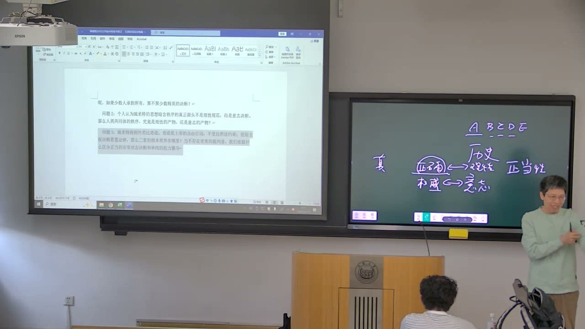
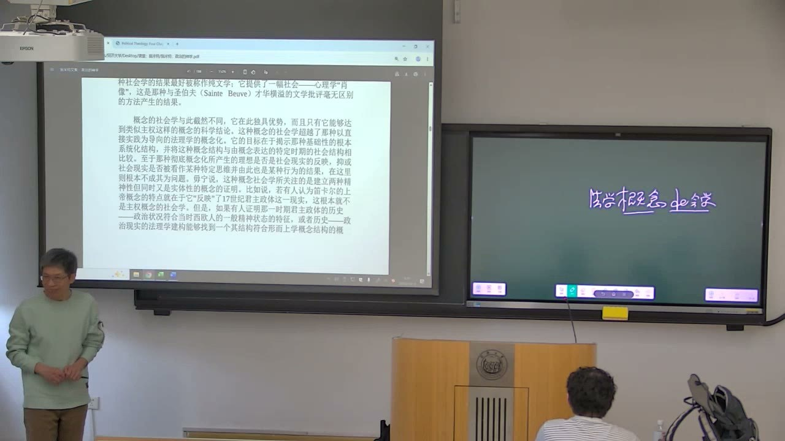
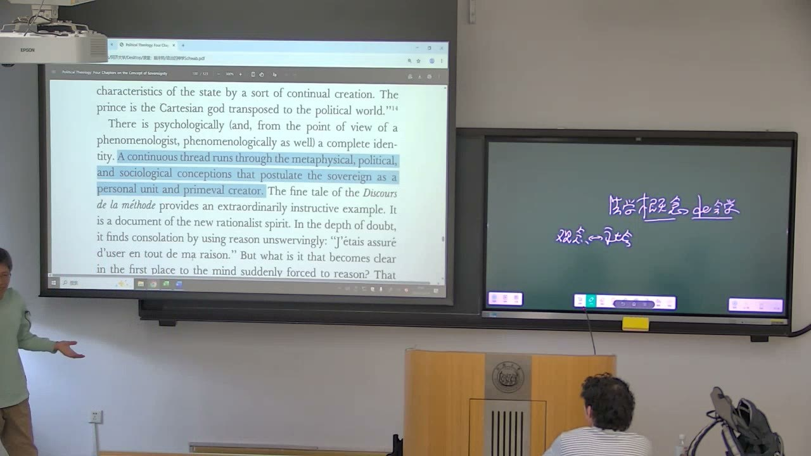

### 课程安排与任务

#### 阅读、提问与后续章节

教师强调哲学学习依赖主动阅读和对问题的兴趣，课堂讲解只能辅助理解。作业应体现自己的阅读、理解与疑问，不能用AI代写后交给教师阅读；不要求所有判断都正确。

继续阅读《政治的神学》第四章，并带着疑问交流。遇到译文不通或关键术语含混时，对照英文，辨认概念、句式及其在论证中的作用。

### 正确、有效与最终权威

真理判断和现实秩序的运行属于不同问题。判断可能错误，仍可能在制度中产生效力。

#### 错误的判决为什么仍可能有效？

教师以法官的错误判决说明：内容有误、造成坏处，与判决在制度中发生效力并不矛盾。它仍然完成裁判程序和社会机构运行的一部分。此处的“建构性”指参与现实秩序的形成和维持，不能直接等同于结论正确或结果值得赞同。

教师以“人都会犯错”的极端表述突出有限主体的处境。现实秩序不能以每次判断绝对正确为运行前提，否则共同生活会一直停留在争论之中。

#### “谁正确就听谁的”为什么没有结束问题？

假设十人共同作最高决策，“听正确意见”仍需回答由谁判定正确。多数意见并不自动等于真理；增设专家或另一个委员会，也会再次遇到谁判断其意见正确的问题。

可操作的程序最终需要确定具有判定权的主体。政治结构首先解决谁有权作决定、决定如何获得效力，而不可能保证这一主体永不犯错。教师借此区分正确性、理性判断与权威、意志的实际作用。

#### 追求真理为什么仍然有意义？

教师没有把现实与理念的区别解释为哲学全无作用。哲学追求正确和真理，可能以迂回方式影响人的思考与行动；现实制度则由有限的人组织和运作。

借柏拉图的理念世界与现实世界的区分，可以理解两种层次为何并存。概念分析需要辨认正在讨论的是理想标准，还是现实决定如何形成、如何发生效力。

### 理性与意志：神学和主权问题的联系

对上帝能力的讨论，与对最高权威的讨论在结构上相通。意志是否受理性限制，是课堂持续追问的线索。

#### 全能与理性约束怎样形成张力？

教师提出一个神学问题：若上帝只能按正确、善和理性的要求行动，这些要求是否限制其全能？若强调上帝可以超越理性和自然规律，则突出意志的自由。课堂用“理性主义”和“意志主义”说明这两种取向的冲突。

奇迹不符合通常规律，却在信仰中表现超越规律的能力。这一讨论不是把不同神学立场混为一谈，而是寻找规则与规则来源之间的结构关系。

#### 主权者变化，最高意志的结构会消失吗？

教师把君主主权与人民主权并置：主权主体由君主转为人民，并不意味着意志问题随之消失。课堂在卢梭的语境中讨论“人民所意愿的总是好的”，强调其作用是把人民意志置于最高来源的位置。

这里正在分析一种主权论证，不是用经验事实证明人民的每个选择都正确。教师以自由主体可能作出伤害自身的选择为例，说明意志自由与内容善恶不能简单相互替代。

#### “不想要恶”与“其意愿不被认定为恶”

教师对照英文指出，will不宜只译成日常愿望。在课堂解释中，相关段落着重说最高意志的规定性，而不是描述主权者心理上碰巧不想做坏事。把它读成一个好人的善良愿望，会削弱主权概念的论证。

读译文时要核对是谁在意愿、意愿和规范的关系是什么，以及文本在陈述事实还是界定概念。一个词的差别，会改变对主权和意志关系的理解。

### 政治神学与法学概念社会学

本章关注概念体系与社会政治结构的同构。它有别于解释“观念决定社会”或“社会决定观念”的因果理论。

#### 神学为什么能够进入现实生活的研究？

教师强调，神学虽谈超越性的存在，信仰和规定却作用于活着的人的行为；法理学同样组织和规范人的行动。理解政治神学，要穿过超越性表述，看这些概念怎样参与世俗生活。

同样，不能仅因为形而上学讨论抽象或终极问题，就把它当成与实践完全无关。它可能与一个时代实际接受的政治组织方式具有相同结构。

#### 公司和国家为什么既相似又不同？

教师承认公司、国家等组织在管理方式上可以相似，但其功能范围不同。公司只完成有限功能，如生产和经济活动；成员涉及其他公共事务时，公司不能代替国家处理。

在施米特的政治理解中，国家面向人的整体生活，最高权威具有不同地位。类比可以扩展，但不能因为组织形式相似，就把企业直接认定为主权主体。

#### 概念社会学研究的对象是什么？

“法学概念社会学”在这里是施米特用于自身研究角度的词。它把法学概念的系统结构与特定时代的社会政治结构比较，揭示神学、形而上学和政治组织之间的同构。

教师特别区分这一角度与观念、社会之间的因果解释。它并不回答某场革命为什么发生、为何成功或失败，也不是判断唯物主义与唯心主义谁正确；这些需要另一种因果性研究。

#### 同一性与“持续不断的一条线”

教师以笛卡尔的上帝概念与君主政体为例，说明不仅是某种观念被现实影响，而是两者能找到结构上的一致。文本将特定时代的世界形而上学形象，与该时代认可的政治组织形式对应起来。

对照英文时，教师强调complete identity的同一性，以及continuous thread所指的持续线索；thread不能误读成threat。贯穿形而上学、政治和社会概念的线索，是人格性的统一体与最初创造者的设定。

### 人格性的创造者与二元结构

规则的存在与规则的来源同时被讨论。强调决断，并不意味着法律规范全部消失。

#### 为什么强调“一个”创造者？

课堂讨论《方法谈》中单一工匠、建筑师和立法者的例子：统一的作品或秩序被联系到一个创造者。创造自然法则的上帝，与在王国中制定法律的君主，构成同一结构的两种表达。

重点在于最高统一性和秩序来源，而不是把神学中的上帝、现实君主或其他主体的具体身份简单混同。教师借此解释人格性和“最初创造者”的关系。

#### 二元结构为什么不能丢掉其中一端？

教师提醒，施米特并未否定法律，而是追问法律怎样被生成、怎样依赖更原初的意志与决断。规范和其来源是两个相关层次，不能把文本读成只有意志、没有规范。

同样，神学讨论中既有自然规则，也有创造规则或施行奇迹的主体。理解一种立场如何安排这两端，比单独重复“意志最重要”更能进入论证。

#### 从我思出发，为什么又谈到上帝？

教师回应笛卡尔“我思主体放在哪里”的问题：论证看似从我思出发，却进一步诉诸原初创造者。一旦上帝取得这一位置，其他主体在该体系中便具有派生地位。

要区分作者认为自己完成了什么论证，与这套论证是否成功。先理解其结构，才能评价其问题，不能把解释作者的意图直接当成同意作者。

### 自然神论、奇迹与例外中的干预

神只设立一般规律，还是对个别情况进行干预，与政治中一般规则和例外决断的关系相呼应。

#### 自然神论怎样处理奇迹？

自然神论在课堂解释中强调上帝创造一般规律，此后不再任意进行个别干预。若对同类情况不断作不同处理，人便难以认识稳定规则；规律性使认识和预期成为可能。

奇迹则是不符合通常规律的个别发生。教师把两种神学安排联系到主权问题：一端突出一般规范的运行，另一端保留超越规范进行干预的主体。

#### 解围之神怎样成为干预的比喻？

教师用希腊戏剧情节说明“解围之神”：当故事依自身逻辑无法继续时，引入神来解决困局。它不按原有情节的内部规律行动，而以外在力量介入。

政治神学的讨论借这种结构理解国家的特殊干预。课堂以特赦为例，说明一个行动可能相对于一般裁判结果构成突破，同时又在制度规定中取得权能。此处关注的是规则与例外的结构，不能把所有不合规则的行为都当成合法权能。

#### 一般治理和个别治理的两种取向

课堂把自然法则的一般性与法律的一般有效性联系起来。一般规则倾向于对同类情况作一致安排，个别干预则依赖特定主体针对具体情况作决定。

教师以法治与人治的对照帮助理解这种变化，同时要求保留二元结构：规范的普遍性与具体决断的存在，是施米特不断处理的两端。

### 人民主权的难题与理论阅读的边界

现代正当性意见转向人民主权，施米特却继续追问统一的最终决断如何形成。理解这种追问不等于接受其答案。

#### “公意”怎样成为一个意志？

教师指出general will在概念上被表述为一个一般意志，但人民包含许多个体与意见。“一个最高意志”如何从复数主体中形成，构成课堂对人民主权的追问。

施米特把人格性主权者的决断，与民族统一体的表现区分开。投票和制度设计可以产生结果，但不同设计可能产生不同结果；课堂据此讨论“谁代表人民”如何被确定。

#### 施米特的主张与教师的保留

在施米特的论证中，具体人格性的最终决定被认为能够创造国家统一，复数主体的统一则受到质疑。教师强调这是作者的理论判断，并明确表示其中存在问题。

教师不把理解危险的理论结论等同于在实践中赞同它。阅读需要敢于进入论证，先看它如何推进，再讨论自身是否同意；不要因为结论令人不安就跳过对论证的理解。

#### 正当性意见随时代怎样变化？

课堂把这里的正当性理解为一个时代的人认为理所当然的意见：君主制时代与民主时代认可的主权来源不同。它是历史中实际被接受的观念，不是已经证明永恒正确的标准。

下一章将讨论反革命思想家回应现代处境的方式。教师提到作者走向独裁的解决方案，并明确表示自己不同意；本课在理解问题与论证的层面展开，后续继续阅读第四章。

### 概念对照与自测

| 概念对照 | 各自关注什么 | 理解时的边界 |
| --- | --- | --- |
| 正确／有效 | 内容与真理标准／制度中的作用和效力 | 有效不能直接推出正确 |
| 理性／意志 | 一般规则与可理解性／主体的决定 | 说明决定来源不等于取消全部规则 |
| 同构／因果 | 结构一致／何者导致何者 | 概念社会学不直接解释革命成败 |
| 一般规则／奇迹或例外 | 同类情况的稳定安排／个别干预 | 保留规则及其来源的两个层次 |
| 理解／赞同 | 重建作者论证／作自己的评价 | 进入危险理论不等于接受其政治答案 |

#### 一个判决有错误，为什么仍可能有效？

正确性与制度效力是两个问题。现实程序可能承认该判决并使其参与社会运行。

#### 为什么增设“判断谁正确”的委员会仍不能消除权威问题？

委员会本身也由有限的人构成，还需确定谁有权判定其意见。可操作程序仍须设置最终判定。

#### 概念社会学和历史因果研究有什么区别？

前者比较概念与社会政治结构的同一性；后者解释具体变革为何发生以及如何产生结果。

#### 为什么教师反复强调二元结构？

既要看到规范，也要看到规范的来源和具体决断；把任何一端删去都会使论证变得过于单一。

#### 教师是否赞同本课谈到的独裁解决方案？

教师明确表示不同意，要求先理解作者如何论证，再区分自己的评价。

### 来源范围

原始转写含课堂互动，正文只整理教师讲授、解释、回应与课程任务。时间范围为两分钟音频分段边界，不是逐句对齐时间。
