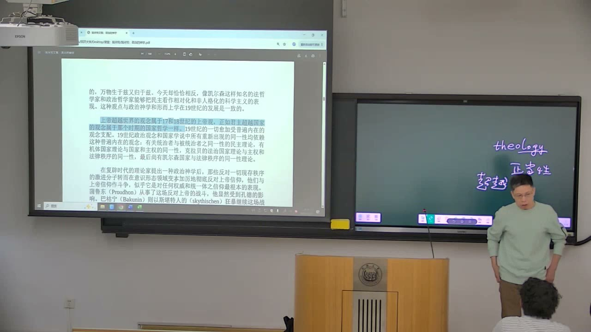
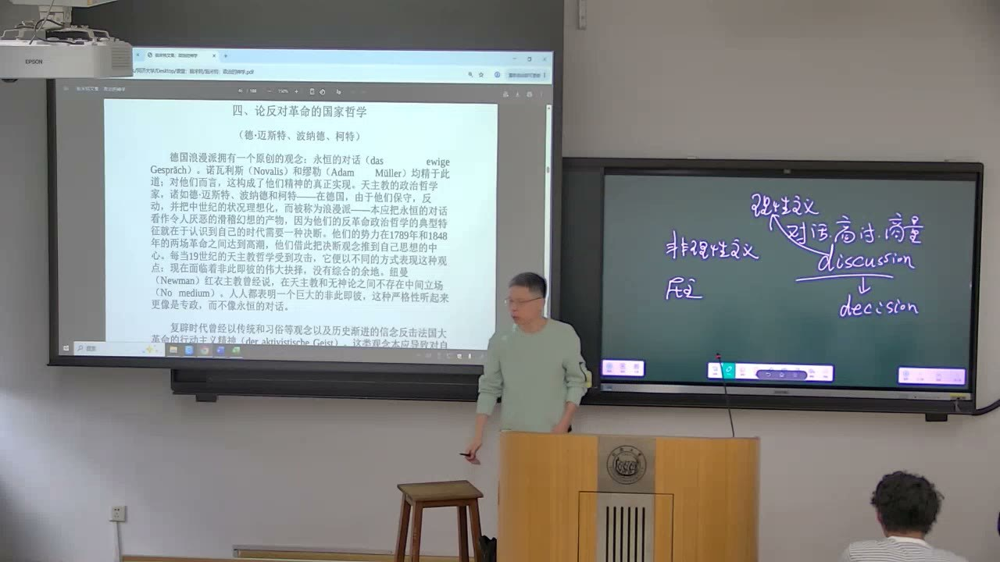
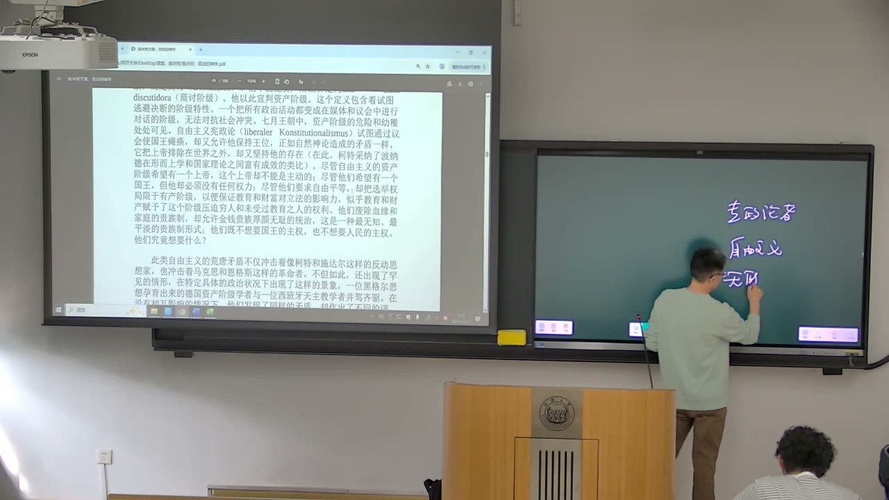

### 课程安排与任务

#### 预习和读书作业跟上课堂进度
<!-- source: 4 -->
教师要求持续阅读并及时完成读书作业，问题尽量跟随当前章节提出。课堂会选择具有普遍性的问题讨论；如果交来的问题已明显落后于讲授进度，就可能来不及再次展开。

难读不意味着没有收获，可以先找能理解的段落，逐步扩大理解范围；有能力时对读英文，不要求一次把全部内容都弄懂。教师把认真读书视为课程学习的核心，不能只到课而不读文本。

#### 第三、四章收尾后进入《政治的概念》
<!-- source: 92 -->
《政治的神学》第四章尚留少量尾巴，后续会继续。需要开始准备《政治的概念》，篇幅更长，计划使用的课堂时间也更久。作业应尽量跟上新进度，不能因补旧作业而持续错过当前讨论。

本节末提醒，此处“专政”和“独裁”对应同一个词，教师倾向使用“独裁”。这是对所读文本译词的说明，不能把所有语境中的两个汉语词都无条件视为完全相同。

### 神学与法学的“同构”怎样理解

以下首先重建施米特在本书中的论证及教师的解释，不能直接把它当成关于一切政治制度的无条件结论。

#### 神学不只是与理性对立的私人信仰
<!-- source: 8 -->
教师提醒，不要一见神学就把它等同于抛弃理智的信仰。在西方思想的长时段中，神学与哲学有共同的问题、概念及论证传统；对上帝存在的论证，就是课堂用来说明这一点的例子。

本节的重点不是判定某个宗教信仰真假，而是理解一个时代怎样想象最终权威、世界秩序和理性。这类结构与它的政治法学观念之间，构成施米特要揭示的对应。

#### 超越：上帝与世界，主权者与秩序
<!-- source: 12 -->
在所读文本对十七、十八世纪的概括中，上帝被理解为超越世界的存在，君主也被置于国家秩序之上。上帝与受造世界不是同一个层次，主权决断与被建立、被维持的规范秩序，也被区分。

教师把它与前章决断和规范的关系联系：决断不能完全由规范内部推导，它涉及建立秩序的最终主体。“同构”要抓住这种结构相似，而不是只找两个词在字面上像不像。

#### 内在：秩序的根据回到体系内部
<!-- source: 16 -->
内在性把最终根据放在世界或秩序本身。教师借泛神论、斯宾诺莎和黑格尔帮助理解，并说明文本中的“同一性”“统一性”常与这一思想方向相连。

在施米特列出的法学对应中，包括统治者与被统治者的同一、国家与主权的同一、国家与法律秩序的同一。这里对民主制的描述，是统治者与被统治者不再被想象为两个绝对分离的来源；讨论的是概念结构，不等于宣称实际社会已经不存在分歧或权力差别。

### 历史节点为何改变决断论的问题

同样谈决断，复辟时代与1848年之后的论证条件并不相同。

#### 从法国大革命、复辟到1848年
<!-- source: 20 -->
教师用1789年、1815年前后的复辟及1848年，说明革命与反革命力量的变化。复辟时期，君主制仍可作为一些保守思想家说明政治正当性的依据；在本书对1848年之后的概括中，人民主权成为难以绕开的正当性原则。

这是一条思想史论证线索，不能把“君主制正当性失去基础”机械改写为欧洲所有人同年改变信仰，或所有君主制度同年消失。关键在于政治权威的可接受根据发生变化。

#### 反革命哲学也随对手而强化
<!-- source: 26 -->
波纳德（Bonald）、德·迈斯特（de Maistre）与多诺索·科尔特斯（Donoso Cortés，课堂常简称“柯特”）是本章的重要人物。前两者与复辟时代的保守思路关联，后者则被用来说明君主制旧根据削弱之后，决断论怎样走得更远。

因此，“决断的强度提高”不能只理解为某个人说话更强硬。教师强调，它关联革命力量的激进化，以及反革命论证不能再原样依靠旧正当性的处境。这也解释为何从传统和君主走向独裁，是第四章需要分析的变化。

#### 人民主权不自动回答“谁来作最后决定”
<!-- source: 42 -->
教师反复提醒，第三、四章不能始终套用第一章“正常／非常状态”的区分。这时更多是在追问主权本身的归属：从君主转为人民以后，作为复数的人民，怎样形成能够行动的决定？

商讨、对话和一致意见的问题由此进入论证。这里不是简单要求忘掉例外状态，而是要辨认不同章节的问题重心，避免用熟悉的一条公式遮盖新问题。

### 永恒对话、理性与决断

教师围绕“能否通过讨论获得共同决定”解释第四章开头，同时区分不同浪漫派人物。

#### 不能把所有“浪漫派”当成同一阵营
<!-- source: 46 -->
诺瓦利斯、亚当·缪勒等德国浪漫派与保守的天主教政治哲学家，虽可能都被归入浪漫主义，却在“永恒对话”问题上方向不同。前者可以安居于持续交流，后者则强调他们的时代需要决断。

教师在概述浪漫主义时把它与对启蒙理性的反动相联系，但也指出，这种总标签放到具体论证中会遇到困难。在施米特这里，对话被归入讲道理、以理服人的一侧，与权威决断相对。不能仅凭人物被叫作浪漫派，就预先确定他在每个问题上的立场。

#### 讨论、投票与正确性是不同问题
<!-- source: 54 -->
教师借政治协商中意见难以一致的情况解释：讨论可以持续，却不必然得到所有人同意的结果。投票可以形成可执行的选择，但多数并不自动等于真理或道德正确。

施米特的决断论据此强调，公共事务具有时限，不能总以继续讨论来延后行动。课堂是在说明这套论证如何成立及其问题方向，并非据此完成对所有商讨制度的否定，也没有证明权威决断必然比程序产生更好的结果。

#### 虚拟语气关系到谁反对永恒对话
<!-- source: 60 -->
教师指出，译文把有关天主教政治哲学家的语气处理为“本应”，容易让读者误以为他们事实上没有反对永恒对话。课堂建议按“会把永恒对话视为……”理解，才能与这些人坚持决断的上下文衔接。

已有英文原文中相应表达为 would have considered。此处的学习重点是结合人物立场和整段语境理解语气，不是把所有英语虚拟结构都一律翻成“会”。译词若使主张与上下文倒置，就应回到原文核对。

### “非此即彼”与对立面的综合

理解不同思想家的“对立”，要先问他们是否允许双方在更高层次统一。

#### 综合与有机体不是可随意套用的词
<!-- source: 66 -->
教师用谢林、黑格尔及“正反合”作为进入材料的说明：对立面可以被理解为统一发展中的环节，后续综合不是简单选一边。有机体的比喻则帮助呈现事物从内部发展、不同部分彼此关联的图景。

这只是本课解释文本时采用的概括，并未完整讲授黑格尔体系。读到“有机体”，要看它在当前论证中说明哪种统一关系，而不是只把它译回生物学概念。

#### 反革命哲学中的道德对立不容“更高第三者”
<!-- source: 70 -->
书中对波纳德等人的讨论，强调善与恶、上帝与魔鬼之间的分离。它不是等待在更高层次被综合的辩证对立，而是要求作出抉择的非此即彼。

因此，教师说“没有中间立场”“没有综合余地”，是在辨认所读论者怎样组织对立，而非规定每一个实际公共问题都只有两个选项。若把“对立”一概理解为最后会统一，就会错过本章的决断要求。

#### 传统、自然理性与主动被动
<!-- source: 72 -->
在传统主义的语境中，个体理智被看作不足以独立认识真理，需要接受传统权威。因此，“道德被动性”“主动性”等词带有具体思想背景：被动关涉接受传统，主动可能关联革命与自主判断。

这些词不是直接评判某个人懒惰还是勤奋。把它们放回传统主义与理性主义的争论，才能理解为何极端传统主义可能排斥自觉理智的选择，而与强调个人理性的立场冲突。

### 人性论、有效性与独裁

本章最后的几个立场共享对权威的关注，却会因人性前提不同而得到相反结论。

#### 科尔特斯的人性恶论为何关联外部强力
<!-- source: 82 -->
教师把科尔特斯的论证概括为：若人被看作自身无法补救的恶，就不能只依靠教育或内部自我改善，需要外在力量进行统治和拯救。神学中外在于世界的上帝，与政治中的主权者，在这里再次形成对应。

这比笼统说“人会犯错”更强，是特定论者为其政治方案采用的前提。它不能不经论证就被写成关于全体人的事实判断。

#### 能形成秩序，不等于道德上必然为善
<!-- source: 84 -->
教师回应一个关键疑问：此前分析决断时，重视的是它如何有效地建立、维持或恢复秩序；现在神学论述又出现善恶，两者不能未经说明就直接等同。

即使在神学叙述中以上帝为善，也不能由类比直接推出某位君主或民主时代的独裁者必然为善。教师明确指出，需要区分施米特论证中决断的效力问题，与科尔特斯等人具体采用的善恶、人性前提。理解理论结构，不等于已经为统治者作道德辩护。

#### 三方关系：独裁、自由主义商讨与无政府主义
<!-- source: 90 -->
本节末用三方说明第四章的争论：强调必须作最后决定的独裁立场，以讨论、妥协和程序为重要方式的自由主义立场，以及反对政府和权威的无政府主义立场。

独裁论者和无政府主义者都可能不接受以永恒商讨取代行动，但理由和方向相反。前者要求建立权威，后者可以从“人是好的、政府使人腐化”等前提出发要求取消权威。两者共享某些描述，不意味着政治结论相同。三方关系的剩余部分留待下次继续。

### 概念对照与自测

| 术语或区分 | 本课中的解释方向 | 不宜作出的跳跃 |
| --- | --- | --- |
| 神学与法学同构 | 最终权威和秩序的结构对应 | 不等于两学科任何命题都相同 |
| 超越与内在 | 根据在秩序之外还是内部 | 不能只按日常“超越自我”理解 |
| 正当性与决断 | 被认可的根据，与最后决定 | 有决断不自动具有旧君主正当性 |
| 永恒对话 | 持续商讨与行动时限的张力 | 不等于任何讨论都毫无价值 |
| 多数与真理 | 形成决定，与内容是否正确 | 票数不能直接证明真理 |
| 非此即彼与综合 | 是否容许更高统一 | 不能把所有对立都预设为正反合 |
| 效力与善恶 | 建立秩序，与道德判断 | 不能从有效直接推出必然为善 |

#### 为什么阅读第三、四章不能只套“例外／正常”框架？
它们进一步讨论主权的归属、正当性与时代观念，尤其在人民主权被接受后，复数的人民怎样形成最后决定。

#### “决断强度提高”为什么与1848年前后有关？
按教师对施米特的解释，革命的激进化改变了反革命论证的条件，旧君主正当性不再能原样支撑其要求，科尔特斯因此走向更直接的独裁方案。

#### 为什么两个人都说政府具有绝对性，却可能一个支持政府、一个反对政府？
共同描述不等于共享人性前提和价值判断。对人、权威及政府作用的不同判断，可能导向建立权威或取消权威的相反结论。

### 课程时间线

00:00—06:00：阅读困难、英文对读与及时完成作业
06:00—08:00：课堂点名与互动，未纳入知识正文
08:00—14:00：神学、理性传统与法学同构
14:00—20:00：超越、内在及同一性的政治对应
20:00—28:00：1789年、复辟和1848年的思想史节点
28:00—38:00：革命反革命、内在论与正当性变化
38:00—46:00：权威和真理，第三四章问题重心的区分
46:00—56:00：人民主权、商讨与意见一致的困难
56:00—64:00：浪漫主义的差别、理性和虚拟语气译法
64:00—72:00：取舍、非此即彼、对立面与决断强化
72:00—82:00：传统主义、主动被动、有机体及教师引申
82:00—90:00：科尔特斯人性恶论，效力与善恶的区别
90:00—94:00：独裁、自由主义和无政府主义，下一本书安排
94:00—96:00：作业进度与“专政／独裁”译词提醒
96:00—99:37：课程结束，未识别到明确讲授文字
