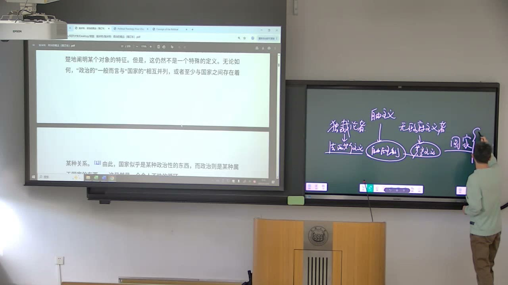
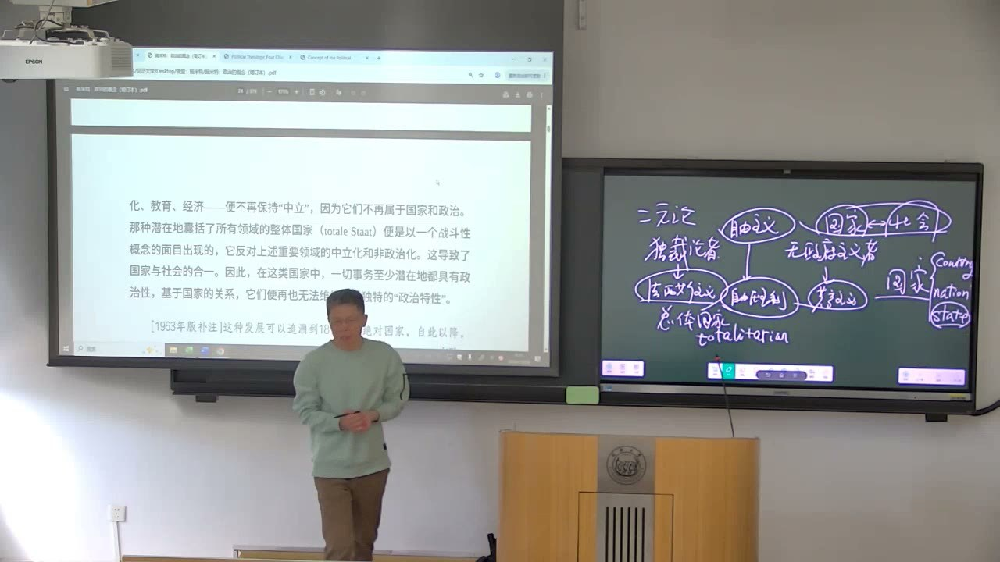

### 课程安排与任务

#### 《政治的神学》收尾，开始第二本书
<!-- source: 38 -->
本节完成《政治的神学》第四章的讨论，转入《政治的概念》。教师提醒，中文本为各章添加的标题不一定准确概括问题，阅读时应对照文本本身，必要时查看英文版，不能用编者标题代替自己的理解。

《政治的概念》开头的重点，是从“政治不是什么”进入国家与社会的关系。教师建议课后继续阅读、写读书作业；本节没有宣布新的具体提交日期。面对难读的文本，要先理解它的核心论证，再进行批评。

### 《政治的神学》的两个问题轴线

教师把四篇文章归到主权主题之下，区分“秩序如何可能”与“最后由谁决定”两个侧面。

#### 常规与例外：规范不是全部政治生活
<!-- source: 2 -->
第一条轴线是常规状态与非常状态。常规状态中，人们依据已有规范生活；非常状态则把规范如何建立、由谁决定秩序的问题暴露出来。施米特关于主权者决断非常状态的论述，应放在规范与决断的关系中理解。

这不是说正常生活中每一次决定都等于主权决断，而是追问：当现有规则无法自行回答局面时，谁具有最终决定的地位？规范的有效运转与规范本身的建立，不属于完全相同的层面。

#### 主权者问题：共享与最终决定的冲突
<!-- source: 6 -->
另一条轴线关乎主权的归属。教师把书中的论证解释为：如果数人必须相互同意才能行使最终权力，那么当他们不能达成一致时，还需要回答谁能结束争端。第四章对“永恒对话”的批评，与第一章关于主权归属的讨论因此相连。

教师将施米特的结论概括为强调由一个最终决断者终结冲突，并指出这套主张有争议。理解其推论，不等于已经证明多人商议必然失败，或独断决定必然正确。课堂的首要任务是认清论证从何种前提出发、如何走到结论。

#### “专政／独裁”须辨认具体用法
<!-- source: 4 -->
教师建议把当前文本的相关译词按“独裁”理解，并以dictatorship提示它的词义背景。但同一译词进入不同政治理论时，所指的权力主体未必相同：一个人、某个阶级或其他集体，不能只凭中文词形就混为一谈。

此处的学习重点是把译词放回施米特的主权论证。词语带来的熟悉感或情绪反应，都不能替代对具体主张的辨认。

### 决断论、无政府主义与政治神学

看似相反的立场，也可能共享某个判断，再因为其他前提不同而得出相反结论。

#### 人性前提怎样导向外在强力
<!-- source: 12 -->
教师联系科尔特斯的论证说明：如果人被设定为无法靠自身改好的恶，就可能推出需要外在强力建立公共秩序的结论。这里的主权者与臣民、创造规范者与受规范者，被放在一种超越性的关系中，并与神学的创造者和受造世界作对应。

君主制时代可以用君主的正当性支撑这套秩序；当人民成为正当性来源时，作为复数的人民怎样形成统一行动，仍是决断论追问的问题。教师用日常争执难以说服的情境帮助说明该论证，但个人冲突的例子不能直接替代政治制度层面的完整证明。

#### 共同拒绝协商，不意味着政治结论相同
<!-- source: 20 -->
在课堂所重建的三种立场中，决断论者、无政府主义者与自由主义的协商立场形成对照。前两者都可能批评通过对话、协调产生最终权威的设想，却因人性判断不同走向不同结论。

文本把无政府主义者的前提概括为人性本善、政府使人受压迫，因此应反对政府及其决断要求；与之相对的权威论则把强力看作秩序的必要条件。共同点在于某个对手与问题方向，而不在于最终政治方案相同。课堂中的思想史比较应按这些具体前提理解，不能把复杂传统简化为固定标签。

#### 巴枯宁悖论是文本的批评性设问
<!-- source: 32 -->
施米特把巴枯宁称为理论上的“反神学的神学家”、实践上的“反专政的专政者”。教师围绕这句悖论设问，要求理解为什么反对者仍可能处在同一种问题结构中。

随后教师解释“政治神学”在此并非把神学看成天然非政治的私人领域，而是强调神学体系与政治体系的对应，以及反神学也可能包含政治立场。文本的悖论式评价，需要与其论争对象和前提相连，不能直接当作一段已经证实的生平叙述。

### 政治的概念为何难以直接定义

《政治的概念》的入手处，不是列举一切政府事务，而是借助并列、对照和否定来寻找政治性的特征。

#### 先问政治不是什么
<!-- source: 40 -->
政治经常与经济、道德、法律、美学并列。说政治不是经济、不是道德，是从否定意义上作区分；这些区分提供一个入手点，却还没有给出政治自身的充分定义。

日常语言中政治似乎很熟悉，但一旦追问“什么使一个行为具有政治性”，问题就变得困难。不同领域有自己的判断标准，不能看到某个对象涉及国家或公共生活，就立刻认为已经解释了它的政治性。

#### country、nation与state不能无差别替换
<!-- source: 44 -->
中文“国家”可能对应country、nation、state等不同词。教师强调，本书政治学讨论需要特别辨认state，不能因中文常用同一个词，就把地理国家、民族共同体与国家组织层面的问题完全混同。

这一区分把阅读带向国家与社会：国家怎样被看成一种稳定、突出的统一体？社会中的其他群体和活动为何一度被看作与国家有别？这些问题比单纯说“政治就是国家事务”更进一步。

#### 政治与行政的区分有实践用途
<!-- source: 46 -->
教师用基础设施管理、竞选动员及选区争议等例子，说明同一个政府或政治人物的活动，也可以按行政事务与政治活动作区分。这里所展示的是不同活动如何在实践中被归类，以及这种归类如何关系到权限。

施米特将类似定义看作能够满足司法实践需要的“调和性定义”，但认为它尚未触及政治的一般定义。课堂举例服务于这一概念差别，并未据此完成对具体司法案件、选举结果或全部行政权限的外部事实核验。

### 国家与社会怎样互相渗透

把国家视为政治的垄断者，依赖国家与社会之间已经存在稳定边界。文本要追问的，恰恰是这个条件并不永恒。

#### 稳定分工是特定条件，不是永久本质
<!-- source: 56 -->
如果国家和国家机构已经是明确、稳定的对象，区分国家事务与其他社会事务便具有可操作性。课堂以绝对主义国家、自由主义中立国家等历史概括，说明国家高于社会，或国家与社会各有范围的不同构想。

困难在于，把某一稳定状态下的分工当成永远有效的关系。当国家与社会相互渗透，原先被视为非政治的活动也进入政治关联，“国家＝政治”的公式便不足以涵盖政治性的范围。

#### 社会关系也可能被生存冲突改变
<!-- source: 62 -->
音乐欣赏可以跨越国界，私人友谊也可以跨越国家；平常依照美丑、情感或个人选择建立的联系，不一定首先以政治为判断标准。教师用战争中的友谊和家庭关系作假设性说明：当生存冲突成为决定性的处境，原有社会关系可能被迫让位或重新组织。

例子中的重点不是要求读者在具体冲突中作某一种选择，而是理解“相互渗透”如何破坏领域的原有独立性。社会活动的政治化，使政治不再只局限于国家机关内部。

#### 中立、非政治化与潜在的政治性
<!-- source: 70 -->
在本段语境中，“中立”指某个领域仿佛处于政治斗争之外，并不首先意味着它没有价值判断。宗教、文化、教育和经济都可能一度被这样理解，但在特定关系中不再保持中立。

文本的整体国家、总体国家（totale Staat）概念，指向国家与社会合一、潜在政治性扩展到各领域的情形。“潜在”很重要：不是说所有事务每时每刻都表现为政治冲突，而是其当前的独立不能保证永远不受政治关系改变。教师也提醒，不能只用开篇的非政治领域清单就完成政治的定义。

### 民主、自由与国家权力的边界

教师在本节后段区分谁拥有统治权与统治权能够介入什么范围，借此解释民主与自由为什么不是同一个问题。

#### 人民统治不自动给出权力的界限
<!-- source: 80 -->
民主关涉人民作为统治主体的正当性，自由则在这里关涉个体或社会免受国家干涉的范围。即使承认人民是国家主人，也仍需问：国家权力能进入哪些事务，哪些范围不能进入？

教师结合布克哈特的讨论，强调民主的正当性与个人自由之间可能发生紧张。其分析对象是权力扩展的可能性，不能把“可能侵蚀自由”压缩成每一种民主安排都必然具有同一结果。

#### 自由主义保留不受干涉的空间
<!-- source: 86 -->
课堂借洛克的财产权、穆勒《论自由》等线索，说明自由主义如何把某些个人领域理解为国家无权任意干涉的范围。重点不只在于政府暂时没有做什么，而在于它是否被认为没有权利这样做。

因此，“暂时不干预”与“权力受到原则限制”并不一样。国家与社会边界能否保持，正是这套阅读关心的问题之一。相关思想家的名称用于辨认论证方向，并不意味着本节已经完整讲授了他们的全部学说。

#### 经济干预的例子指向权限变化
<!-- source: 92 -->
教师以经济危机时期对政府介入市场的不同观念作对照，说明一种社会原来可能被理解为不属政府权限的事务，后来怎样成为国家行动的对象。这里要抓住的是国家作用范围的变化，而不是把简略历史例子当成完整的经济史解释。

下课后的补充继续强调：民主与自由所回答的问题不同，二者可能形成需要处理的矛盾。《政治的概念》第一节由此把政治、国家和社会重新关联起来；后一节将继续追问政治自身的区分标准。

### 概念对照与自测

| 区分 | 当前文本的问题 | 易混淆之处 |
| --- | --- | --- |
| 规范／决断 | 已有秩序与最终决定 | 把主权决断等同每次日常选择 |
| 正当性／行动统一 | 谁被承认为主人，如何形成决定 | 认为前者自动解决后者 |
| 权威论／无政府主义 | 共享部分批评，前提及结论不同 | 将共同反对者当成同一方案 |
| 国家／政治 | 国家垄断政治需要条件 | 把两词无条件画等号 |
| 中立／潜在政治性 | 目前不表现为政治，是否永远如此 | 把稳定状态当成永久本质 |
| 民主／自由 | 统治主体与权力边界 | 把两个问题合并成一个口号 |

#### 《政治的神学》的两个核心轴线是什么？
一是常规、例外与规范、决断的关系；二是最后由谁行使主权。前者追问秩序，后者追问最终决定的归属。

#### 权威论与无政府主义为什么会既相反又有共同点？
它们可能共同反对通过持续协商产生最终权威的设想，但因为人性、政府及强力的前提不同，得到支持权威或反对政府的不同结论。

#### 为什么“政治就是国家事务”还不够？
它把国家已经稳定、且国家与社会边界明确当成前提。边界渗透、社会活动政治化时，政治性的范围会超过原有国家事务分类。

#### “潜在政治性”是否表示一切事情始终都在进行政治斗争？
不是。它表示某个领域目前的中立或独立，不能保证在不同处境下仍然如此。需要区分当前表现与可能发生的政治化。

#### 民主与自由分别追问什么？
民主在本节讨论中关涉谁统治、谁具有正当性；自由关涉国家可以干涉个人和社会到什么程度。统治主体的确定，不会自动完成权力范围的限定。

### 课程时间线

00:00—02:00：难读文本的学习态度
02:00—12:00：主权的两个轴线，译词及永恒对话问题
12:00—22:00：科尔特斯、人性前提、外在强力与正当性
22:00—24:00：权威论、无政府主义与协商立场
24:00—26:00：转写请求被服务拒绝，保留缺口
26:00—34:00：三种政治立场及巴枯宁悖论设问
34:00—36:00：课堂互动阶段
36:00—38:00：转写请求被服务拒绝，保留缺口
38:00—44:00：政治神学收尾，进入《政治的概念》
44:00—50:00：国家译词，政治与行政的区分
50:00—58:00：实践分类的例子及调和性定义的限度
58:00—64:00：稳定国家、社会分工及边界渗透
64:00—70:00：战争、友谊与家庭的假设性例子
70:00—80:00：中立、整体国家及潜在政治性
80:00—92:00：民主与自由的差别，个人权利的边界
92:00—96:00：国家干预范围的课堂例子及作业提醒
96:00—99:36：课后对民主与自由关系的补充
