### 课程安排与任务

#### 观看《寄生虫》，思考底层形成与犯罪动因

教师布置观看电影**《寄生虫》**，并思考：是什么驱动片中的犯罪？这一家人如何成为底层？把问题与本课关于社会转型、市场规则、个人责任和工作伦理的讨论联系起来。

课堂提及十一假期观看；本段未明确给出具体提交时间、字数或提交形式。

### 消费选择与自我肯定

劳动换来的金钱被连接到独立和自由；商品选择又让消费者感到自己能够塑造身份。

#### 为什么辛苦打工会被理解为获得自由？

教师从上一节布置的纪录片片段切入：流水线劳动本身辛苦，劳动者却把打工与自由联系起来。连接二者的是金钱——工资使人能独立消费，购买自己想要的物品，实践一种生活方式。逛商场、整理头发时的愉悦，呈现了这种连接。

本课沿用生产社会与消费社会的比较：前者以工作伦理鼓励人成为生产者、劳动者；后者还要驱动人成为消费者，使欲望、消费与资本周转连接起来。**工作不只是劳动的道德义务，也成为获得消费能力、追求自由和快乐的代价。**

#### 消费的个别性：买东西也是肯定自己

即使几个人结伴购物，也往往希望买到能体现个人风格的东西，而非与朋友完全一致。教师据此强调消费的个别性和自我肯定：选择的对象被理解为品味、人格、鉴赏力与个人意愿的表征。

教师回忆购买打折羊绒披肩的经历：结账时，营业员称赞她的品味。购物环境和服务并不只是在出售物品，还在肯定“作出选择的我”。这种体验可以满足自恋需求，让人把购买感受为身份建构与个人价值的确认。

这里的欲望分析延续上节内容：消费传播能够鼓动即时、退行的欲望；令人愉快的消费体验，不必然要求长期反思和能力积累。

#### 没有选择的消费义务，如何变成丰富的选择？

在课堂的批判性解释中，经济运行要求人持续成为消费者，这是一个被动条件；商品却提供大量差异化选项，使人体验到自己在掌控、在自由选择、在建构自我。

丝巾如果只用来保暖，需求可以相对稳定；当它还能表示品味、财富、个性和某种场合中的自我，选择就不断扩展。物品的使用功能与符号意义发生偏离，渴求与满足交替，推动下一次消费。

**“选哪件商品”的主动性，补偿了“必须持续消费”的被动性。**因此，商品种类多不等于人已摆脱整个消费规则；这正是本课追问选择与自由关系的起点。

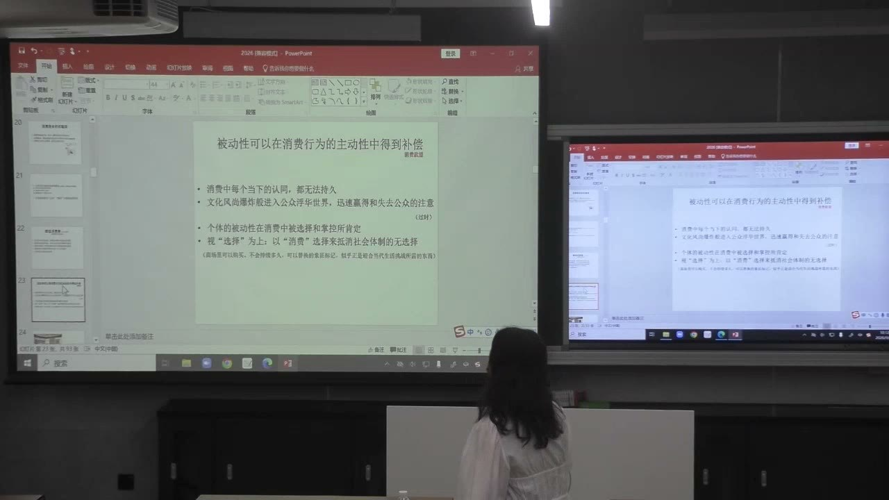

### 资本周转与灵活的职业角色

商品更新、资本流动与劳动力需求互相连接。职场上的被动变化，也会被解释成个人探索和新的机会。

#### 活跃的消费市场依赖快速投入与回收

教师把消费社会的积累逻辑概括为：资本快速投入，生产能驱动欲望的理念和商品，通过传播教育消费者，再由购买回收资金，进入下一轮投入。快时尚是课堂例子，符号、风格与产品需要不断更新。

课堂关注的重点不是“生产已经消失”，而是积累越来越依赖商品的快速周转：需求不只围绕缺少什么，还围绕想成为谁、体验什么、追赶什么新风格。丰富的商品选择背后，是短周期生产与不断变化的市场预期。

#### 全球化如何改变就业的稳定性？

资本可以在不同地区寻找较低的劳动力成本，把产品投向更广的市场。教师以制造业转移、软件开发外包说明：企业节约成本、调整投入地点和组织形式，会改变本地劳动者的就业机会。

对劳动者而言，雇佣、解雇和转岗不完全出自个人意愿，而与资本流动、经济波动和生产规则变化有关。所谓工作的弹性、灵活性、多变与失业，可能成为职业生活的常态。

因此，需要区分两种“选择”：有资源者主动选择尝试另一份工作，与普通劳动者被市场变化迫使转换职业。把二者都说成自由选择，容易遮蔽风险分配的差异。

#### 职业转换为什么伴随消费与形象更新？

教师以一位朋友的职业路径说明：从电视编导转向高端会所和餐饮推广，再进入中医会所、茶园等领域，变化与经济和劳动力市场需求相连。每次转换，还要通过服装和风格表达新的职业定位。

英式套装、民国风、中式装束、茶园中的自然或治愈风格，是不同身份的消费实践。职场人同时是消费者，需要借物品和形象在社会中重新定位自己。

这不只是换一套衣服。短暂的产品与服务周期，使职业身份也不断更新；被动转场可以被重新叙述为自我成长、个人探索和顺应新机会。

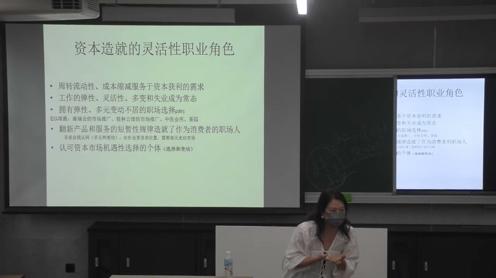

#### “下一个会更好”怎样成为消费社会的精神？

换手机或电脑时，人通常期待下一件更好，而非更慢、更差。教师把这种消费中的升级预期，与职业生活中“下一个机会会更好”的预期并置。

消费者被要求不断欲求、不断更新；职场人则被鼓励拥抱不确定性，把变化理解为挑战和潜在的风口。消费中的身份更新，协助把职业上的被动变化转成个人有能力、自主、乐观的故事。

市场被呈现为始终充满机会；个人需要证明自己能作出合适的选择。问题也因此转移：如果没有成功，似乎就要追问个人是否足够有能力，而不是先考察造成变化的经济规则。

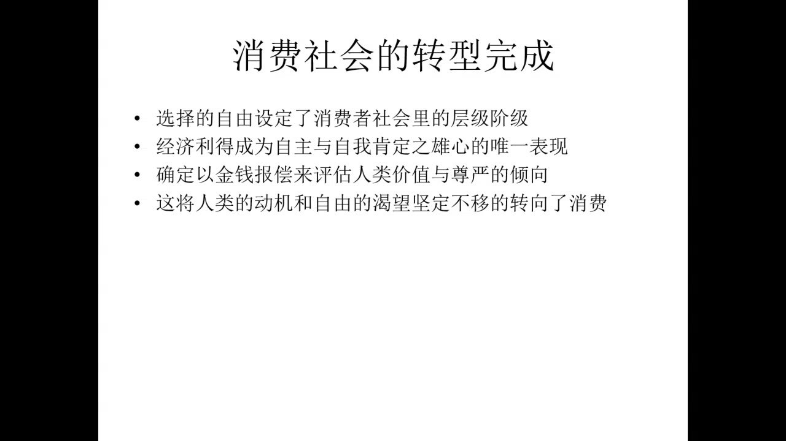

### 消费美学与工作评价的转型

审美化的体验让消费义务表现为自由和享乐；工作也逐渐被要求提供激情、探索与生命体验。

#### 这里的“审美”为什么更接近消费美商？

教师在回应中区分了两类审美：一类是通过长期学习、训练与积累形成的鉴赏和创造能力；另一类是消费社会传播、教育出来的体验性“美商”。本课讨论主要指后者。

餐厅不只出售味道，还出售环境、摆盘与体验；围巾不只保暖，还要配合多种形象。这些理念使原本有限的功能需求转向不断扩展的体验需求。人并不一定要长期训练，只要购买或参与，就能获得某种审美体验。

“审美维持资本扩张”的课堂命题，应放在这层解释里理解：消费义务借助美的体验，呈现为个人自愿选择和享乐。它不是说所有艺术创造都等于商品消费。

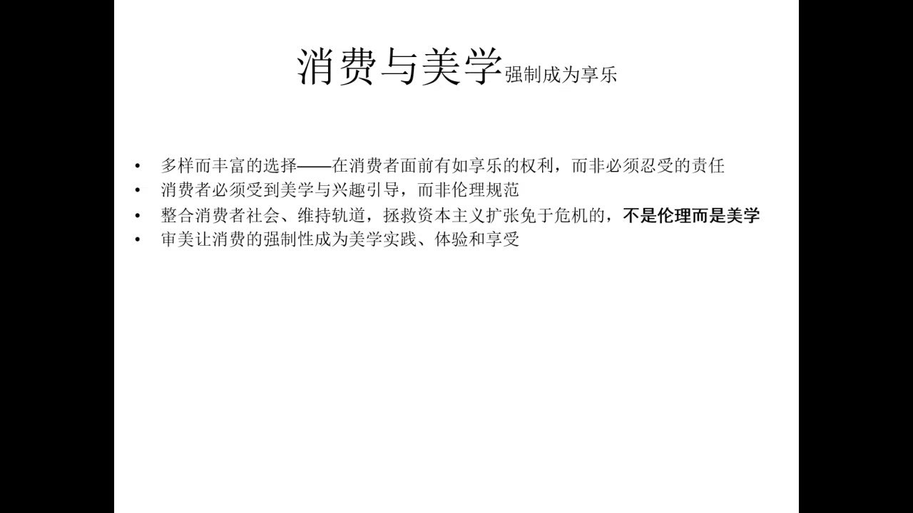

#### 长期积累与即时体验的时间结构不同

专业创造可能需要十年、二十年的学习和实践；消费社会提供的审美体验则强调即刻参与。新风格、旅游场景、装扮项目等不断出现，人很难预先决定下一次令人兴奋的经验何时来到。

因此，理想消费者需要始终准备进入新的情境。整个世界被组织成有待体验的机会，满足之后还要期待下一种经验。工作伦理中以长期义务和延迟回报为核心的逻辑，逐渐让位于体验和愉悦的评价方式。

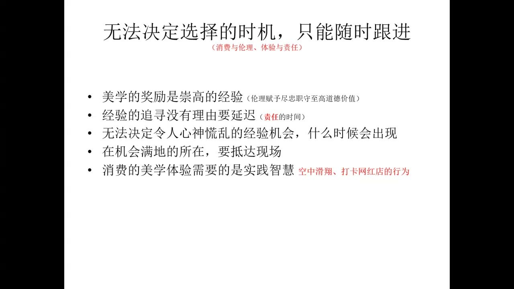

#### 工作也被要求成为探索生命的方式

工作的价值不再只由是否尽责、是否坚持劳动来表述，还要看它能否激发热情，提供愉悦、冒险、自我检验和生命探索。单调、重复、例行公事、缺少创新机会的工作，因而容易被认为不值得做。

教师比较两类示范者：生产社会通过勤勉的普通劳动者示范工作伦理；消费社会则更多展示能跨领域活动、不断挑战自我的成功精英。工作被包装成一场丰富的生命体验。

教师借稻盛和夫“在工作中修行”等话语说明这种理想的传播，但没有在本课展开其完整思想。这里讨论的是这些理念如何成为社会示范。

#### 精英的冒险条件，不能直接变成普通人的要求

精英拥有较雄厚的社会资源，可能承受跨领域尝试与失败；普通劳动者的长时间工作、变动和失业，往往是为了生计而被迫应对。两者即使同样勤奋，也不具有同样的风险承受条件。

教师以快递员等劳动者对照成功者形象：普通人未必有资格把工作当成生命探索，也未必有条件与工作建立稳定、热爱的关系。劳动市场的不确定性，不能只用“你应该拥抱变化”来解释。

**以少数成功者示范普遍机会，会把结构性风险转写成个人是否努力、坚强和善于选择的问题。**失败者由此受到谴责，工作伦理可能成为遮蔽劳动处境和责备贫困的工具。

### 福利保障、共同体与市场自由

福利制度既能维持劳动力重新投入生产，也表达共同分担风险的政治理念；课堂把它与个人化的市场责任相比较。

#### 福利制度为何能支持工作伦理？

自由市场存在波动，工作机会并非始终充足。教师说明，工作期间缴纳税费、失业时获得基本保障，可以让人免于匮乏，在离开一份工作后仍有恢复生活、重新进入劳动力市场的底气。

从生产体系看，福利制度有助于维持能够重新投入工作的劳动力预备军，承担劳动力再商品化的功能。因此，福利并非只能与工作伦理对立，也可以支持劳动者继续参与生产。

课堂同时提到争议：福利可能被解释为削弱竞争活力，或使多劳多得者承担支持他人的成本。本课据此讨论制度支持如何变化，没有把各国福利状况归结为一个统一模式。

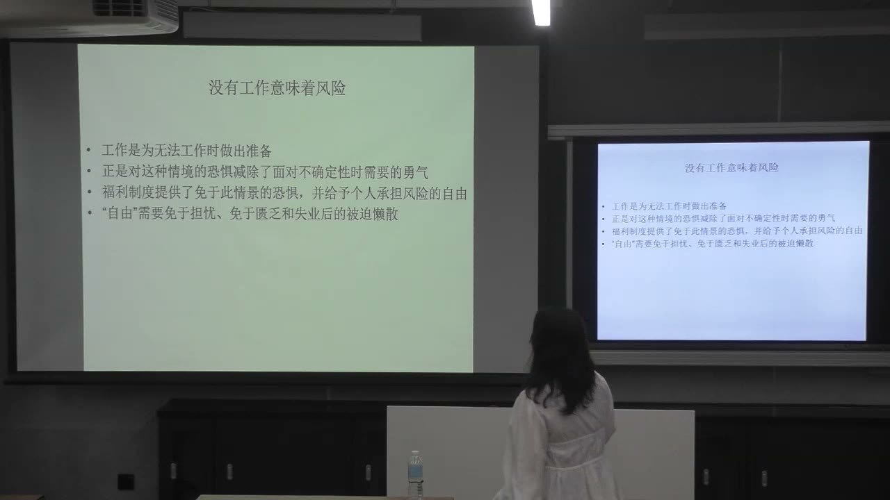

#### 福利也表达共同分担风险与生活尊严

从政治角度看，福利确认人不只是孤立的个体。今天工作、缴税的人支持暂时失业者；自己失业时，也由其他成员共同承担风险。这是一种共同体的关系。

生活尊严不应完全由当下经济贡献决定，是教师在此强调的政治伦理。福利因而不仅是经济效率安排，还涉及平等、公共性与社会成员的生活权利。

教师比较自由与平等：个人能够自由发展，并不意味着财富、身份或身体条件不同者就应享有不同的政治权利。民主协商的理想，是在自由和平等的基础上共同决定公共事务。

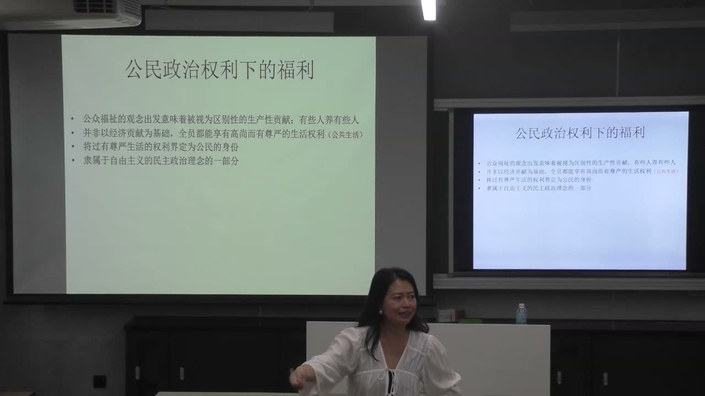

#### 从民主政治理想到市场竞争的讨论

教师从早期商人争取政治话语权谈起，说明经济利益团体的诉求与自由主义、民主政治理想之间的联系。亚当·斯密与“看不见的手”被用来说明：各主体追求自身利益，市场可能形成协调的理念。

课堂又谈到放任发展、经济危机以及国家介入宏观调控，引出自由主义如何回应危机的讨论。这里的重点是国家、市场和民主理想之间的张力，而非把不同思想与政策的历史阶段简单等同。

教师用“新自由主义”讨论国家维护市场竞争的解释路径：国家介入被表述为保障自由市场及其竞争力。需要抓住随后展开的价值变化——个人自由如何更多地被解释为进入市场、在市场上理性选择的自由。

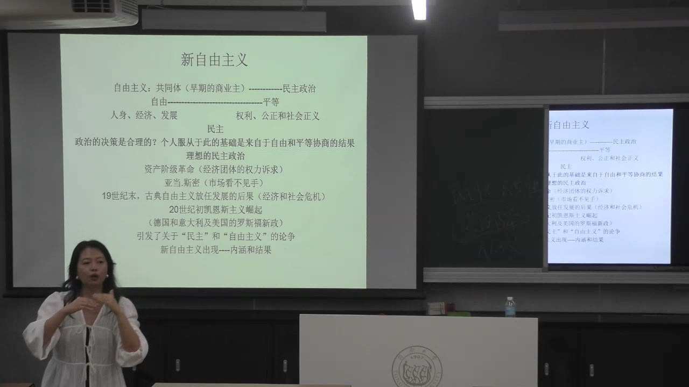

#### 市场机会平等，为什么会导向个人责任？

教师展示一种市场主体的理想假设：供应者与消费者都不能大幅操纵市场，所有人平等了解信息、自由进出市场，并能为自身利益作出理性选择。

如果把这些假设当成现实，失败就容易被解释为个体没有了解信息、没有理性决策或没有把握机会，而非市场本身或主体之间资源不平等的问题。

本课区分**政治与社会权利的平等**和**市场机会被宣称为平等**。个人主义、竞争与自我负责的逻辑，会改变福利的意义：共同分担社会风险，逐渐受到“为什么我要承担他人失败”的质疑。

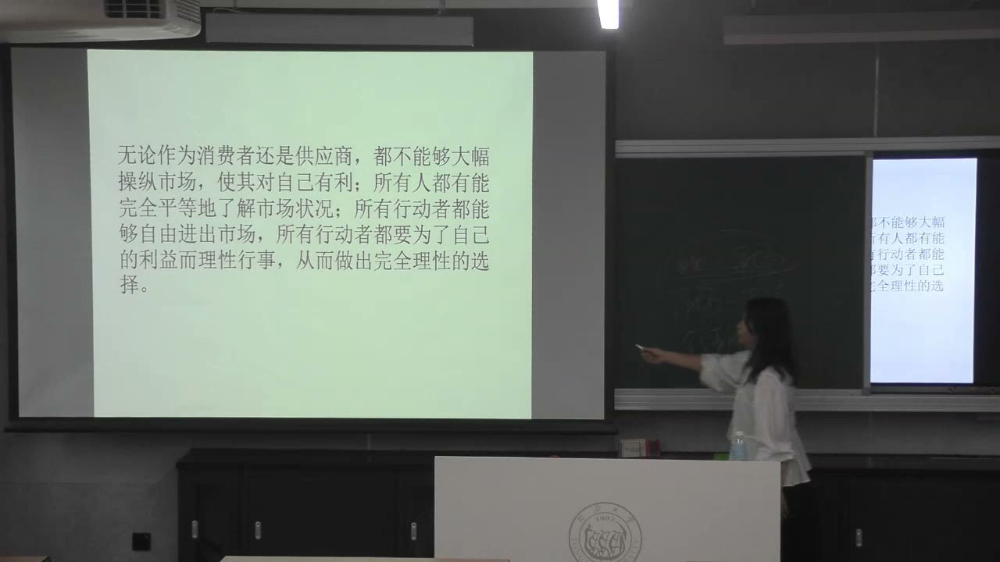

### 选择性福利与贫困的污名化

福利从共同保障转成针对少数人的援助时，可能形成成功者与失败者的区分；工作伦理又为这种区分提供解释。

#### 家境调查怎样把共同体分成不同的人？

福利理想上表达社会成员共同分担风险；执行时若通过家境、失业和收入调查，筛选出“真正需要帮助的人”，就会把共同体区分成贡献者与接受援助者。

这种选择性安排可能让接受者被理解为不能自主生活的人，让纳税者觉得自己在供养没有把握市场机会的人。教师据此讨论政治伦理与利益理性之间的对抗：是否应支持他人，与个人在竞争中如何计算利益，并不总能自然一致。

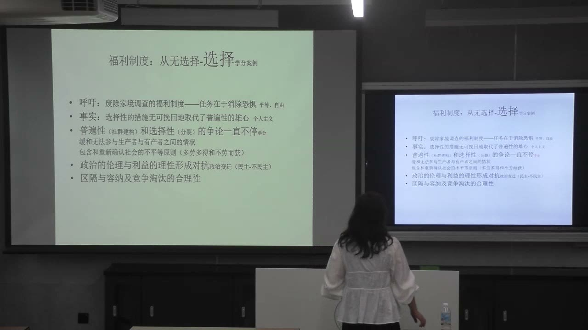

#### 资本和个人为何可能失去支持福利的意愿？

从企业角度，全球资本可以在不同地区采购劳动，对维持某一地区劳动者重新就业的依赖可能下降。教师用降低用工成本的例子说明：当地裁员与企业账面收益可以同时出现，生产者的损失并不自动等于资本的损失。

从个人角度，竞争机制把成果看成自己的努力与资源所得，就可能抵触将其用于支持他人。教师以“把较高绩点分给其他同学、服务专业长期共同目标”的假设，说明共同体愿景与个人竞争利益之间的张力。

这个例子的目的在于比较利益逻辑；并非把绩点平均当成实际提高专业水平的方案。

#### 成功者和失败者的对照如何被制造？

福利被局限于边缘少数人后，接受者可能被描述为懒散、失败、不负责任。富人与成功精英成为正面的示范，依赖福利者成为负面的参照。

多数人可以借这种对照确认自己的生活“成功”，相信自己照顾自己会更好。教师用工业城市转型说明：有人被新的经济与生产规则淘汰，并非只因个人缺乏努力；如果只以个人失败解释，会隐去产业、资本和政策变化。

这里讨论的是污名化的机制，不是在赞同这些针对福利接受者的判断。

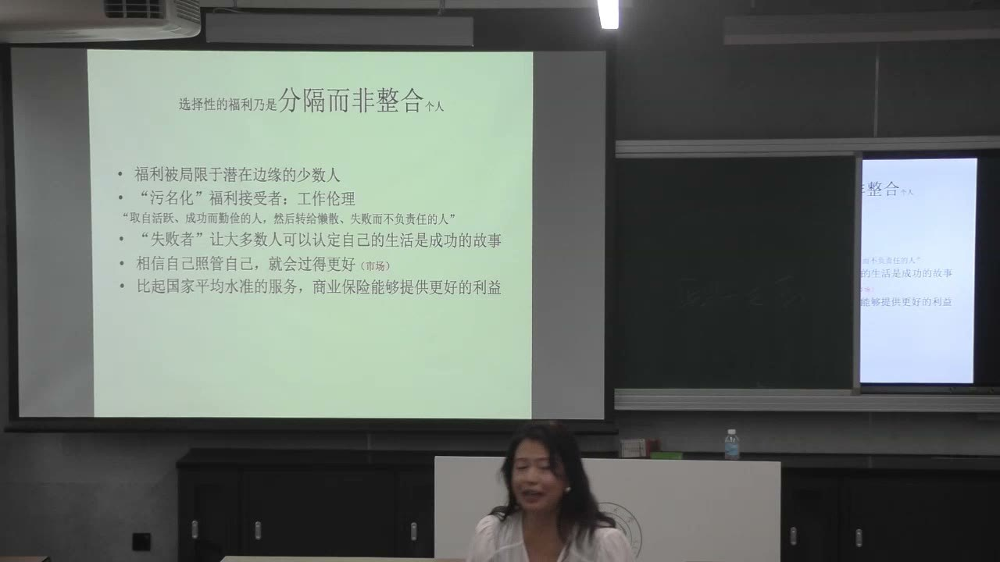

#### 福利为什么又被说成“失去选择”？

消费社会赋予“选择”本身以价值：选择表达能力、鉴赏品味与社会地位，也建立人与人的区隔。福利中的无差别对待和公共分配，则可能被理解为减少个人选择。

由此，福利的平等、共同保障与消费者追求差异、选择的心态发生冲突。制度不仅面对资金问题，也面对价值上的不认可。

教师的结论是：福利原本作为社会保障的平权工具，可能转成竞争负面后果的展示；工作伦理将这种转变正当化，把资本运行和规则变化造成的被动处境解释成个人能力与意愿的问题。

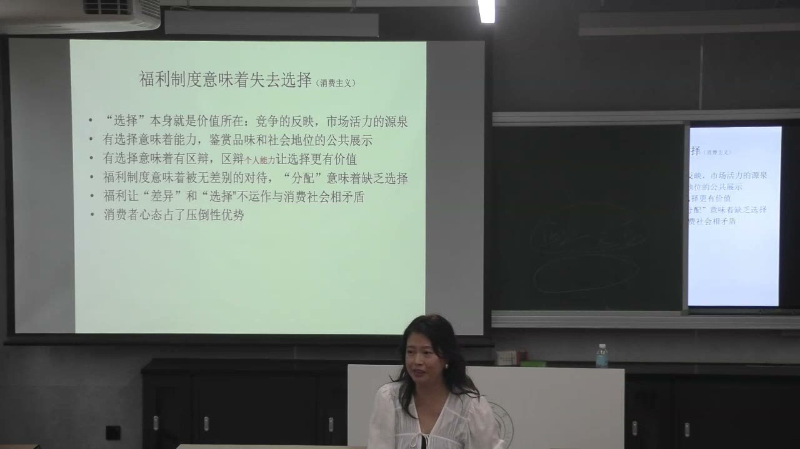

### 概念对照与自测

| 比较维度 | 生产社会的工作伦理 | 消费社会中的转型 |
| --- | --- | --- |
| 理想身份 | 勤勉的劳动者、生产者 | 不断选择和更新的消费者、职场人 |
| 工作价值 | 履行义务、贡献与延迟回报 | 激情、探索、愉悦和个人体验 |
| 职业变动 | 劳动稳定性与生产秩序 | 被动变化被叙述为机会与自我成长 |
| 福利解释 | 分担风险，维持劳动力重新投入 | 选择性援助可能被污名化为失败的标志 |
| 分析重点 | 工作如何成为社会秩序的枢纽 | 个人责任话语如何遮蔽资源和规则的差异 |

#### 商品选择丰富，为什么不必然意味着完全自由？

商品之间的主动选择，可以补偿必须持续成为消费者的被动条件；仍需考察谁生产欲望和选项，以及人能否改变消费规则。

#### 本课的消费“美商”与长期审美能力有什么区别？

前者强调传播理念后的即时体验和参与；后者依赖长期学习、鉴赏、训练与创造。

#### 为什么不能让普通劳动者直接照搬精英的冒险方式？

两者拥有的社会资本、风险承受条件和选择空间不同；被迫的工作变动不能直接等同于主动探索。

#### 福利如何从共同体保障变成少数人的失败标志？

选择性调查区分贡献者与接受者；市场机会平等的话语又把失败个人化，削弱共同承担风险的认识。

#### 如何用本课问题分析《寄生虫》？

考察角色的就业和消费处境、可获得的资源与选择、规则变化及贫困污名，避免只用是否勤奋解释其处境。

### 来源范围

92:00—94:00 的 StepAudio 请求被服务返回 risk blocked，此段未获得讲授转写。对应课堂截图保留，结论与相邻讲授核对。原始转写含课堂互动，正文只整理教师讲授、解释、回应与课程任务。
