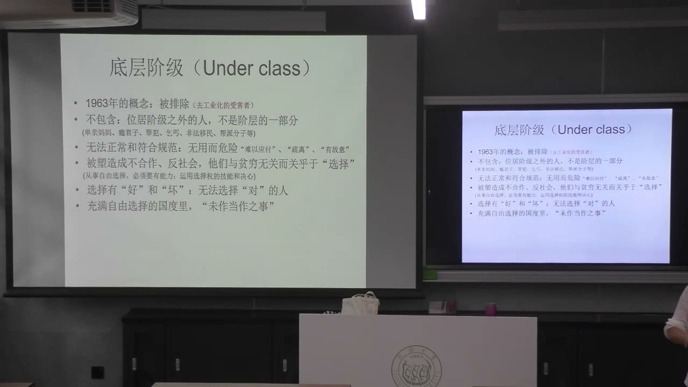
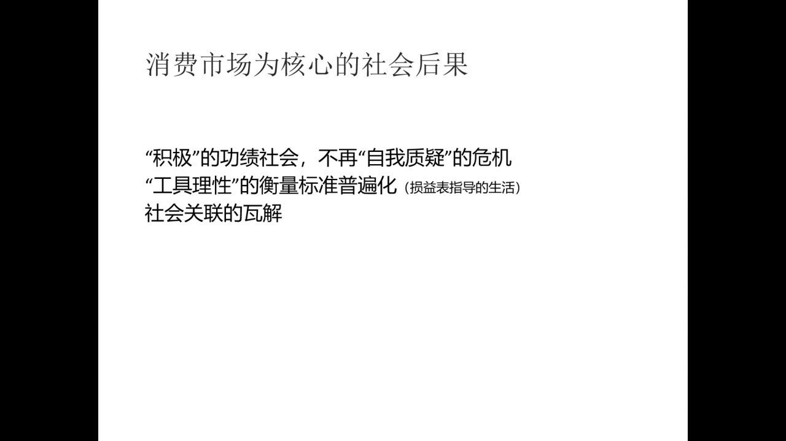
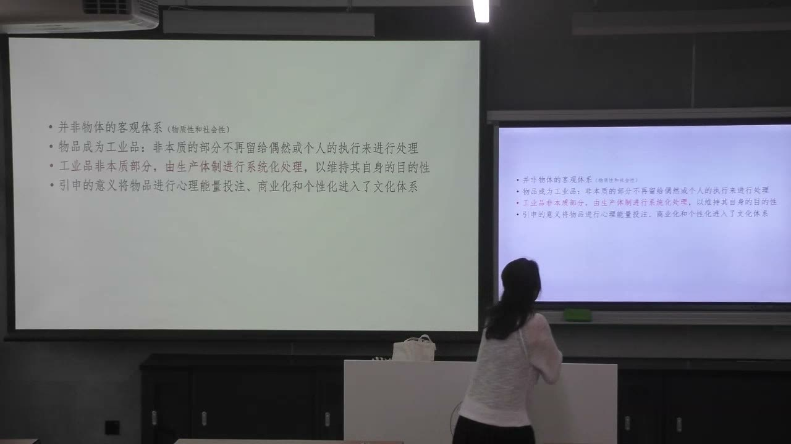
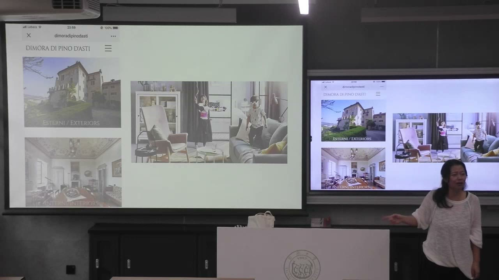

### 课程安排与任务

#### 课堂讨论与延伸阅读

教师推荐阅读韩炳哲《倦怠社会》，结合“功绩主体”反思努力、自我实现与人际关系。课堂还提到《燃烧》作为理解阶级差异和消费欲望的延伸影片。

本课以《寄生虫》提出“什么驱动犯罪、如何成为底层、谁在寄生”等分析问题；结尾比较不同居家空间，让大家说明愿意住在哪里，以及哪个空间让人感到解放、哪个空间要求特定的举止。居家物品的讨论留待下节继续，本课没有新增提交日期。

### 从福利衰落到“底层阶级”

消费社会的问题，不只是收入高低，而是哪些人被视为能够参与市场、哪些人被排除。

#### 工作伦理与现实保障之间的裂缝

教师承接上节的福利制度讨论：资本流转、产业转型与技术发展，并不必然以增加劳动密集型岗位为目标；外包、零散和灵活就业，也可能让工作的持续性难以保障。当社会保障同时减弱，人就可能面对工作与福利两方面的不稳定。

在课堂的批判视角中，工作伦理仍然要求人不断努力，并由成功精英示范“努力就应得到回报”。因此，伦理上的承诺与能够获得的实际机会之间形成裂缝。这里讨论的是一种结构性趋势，不是为所有产业或每一个人的就业结果作同样预测。

#### 下层阶级与底层阶级的区别

“下层阶级”仍在阶层结构内部，尚被认为能够通过工作和流动进入其他位置；“底层阶级”（underclass）则被描述为在阶层之外、不能正常参与既有规则的人。关键差别是**是否被包含在社会的正常成员关系中**，不只是收入更低。

教师沿着概念的发展说明：被排除的去工业化受害者，后来可能被归入危险、无用、不合作等负面形象。课堂是在分析这种分类怎样形成，而不是把被归入其中的人天然等同于罪犯。

#### 从“不够努力”转向“没有作对选择”

市场机会被说成平等时，个人便被要求具备理性选择的能力。成功被解释为把握机会，失败则被解释为没有作出应当作出的选择。这样，贫穷的解释从劳动的努力程度，进一步转向个人是否符合市场要求。

教师指出，这套话语把复杂的经济与制度处境压缩成个人选择题，容易遮蔽不同人实际获得的资源、信息和机会并不相同。形式上的可选择，不等于人人都具有相同的选择条件。

#### 结构性问题怎样被改写为刑法问题

缺少工作机会与保障，本来需要追问产业转型和制度安排；当底层被直接连接到犯罪，贫穷便被作为治安、刑法和社会危险问题处理。原先需要共同面对的责任，转而落在被排斥者的个人品格上。

教师比较不同社会中穷人被赋予的“用途”：宗教社会中的救助与修行，生产社会中的劳动动员，到消费社会中的负面示范。比较要说明社会怎样安排与解释贫穷，而非证明某种贫穷状态本身具有固定价值。

### 《寄生虫》：欲望、阶级与“寄生”

教师用电影分析消费符号的普遍传播，怎样与满足欲望的机会不均等相互碰撞。

#### 符号的传播广泛，兑现的机会有限

消费社会让某些物品和生活方式呈现为美好的目标。欲望并非只在能够购买的人中流通：商品要让更多人认识它的象征意义，溢价与身份区分才会被理解。即使买不起，人也可能熟悉品牌代表的地位。

但知道这些象征，不等于具有满足它们的经济能力。教师由此解释贫穷与欲望之间的张力：符号教育能够广泛传播，真正按诱惑行事的条件却集中在少数人手中。

#### 把电影中的犯罪放回机会与欲望的关系

教师把电影中的冲突放在贫穷、消费欲望与机会差异中分析：当一套社会持续展示应当追求的生活，而一部分人难以通过正常渠道获得参与资源时，欲望与现实之间的失衡可能转化为冲突。

课堂以“消费社会的副产品”表达这种结构关联。这是解释影片和批判消费机制的思路，不能据此说所有贫困者都会犯罪，或把违法行为的全部成因化约成一个因素。

#### 同一场雨，两种生活处境

电影中同一场暴雨，对贫穷家庭意味着狼狈逃离和生存损失，对富裕家庭却可以成为雨后安排聚会的背景。教师用这个对照说明：移动、选择和支配空间时间的自由，本身也是消费社会给予合格消费者的承诺。

因此，贫穷不只指吃不饱、穿不暖，也具有社会和心理层面：无法达到被反复展示的消费标准，被看作“不合格”的人。影片对气味的处理，成为教师分析阶级区隔与屈辱的重要入口。

#### 谁依赖谁：从家政服务到经济结构

表面上，雇员靠富裕家庭提供薪水生活；但富裕家庭的体面日常同样依赖他人的劳动。教师进一步把“寄生”的问题放到产业升级中：创造新财富的过程，也可能淘汰原有岗位，使一部分人失去稳定参与的机会。

教师因而反对只把依赖归咎于穷人。需要同时追问：新的财富怎样形成，谁承担转型的代价，受益者与承担代价的人之间是否存在责任关系。

#### 成功示范如何抬高消费与伦理的门槛

精英既被用来证明“选对了就能成功”，也展示成功以后值得羡慕的生活。财富因而容易成为被尊重的对象本身，消费体验与生活标准不断抬高。影片中对富人的崇拜，在课堂中被用来说明这一机制。

教师还以直播销售中责问消费者是否好好工作的言论为例：对价格的异议被转化为对个人努力的检验。这使得市场结果被当成评价个人的伦理尺度。

### 工作伦理的责任转移与功绩主体

消费社会不只规定应该买什么，也可能规定应该怎样努力、怎样解释自己的失败。

#### 责备穷人，也免除了谁的责任

工作伦理强调奋力求生者应承担的责任，却可能不谈富裕者对他人劳动和社会安排的依赖。一旦贫穷被解释为个人没有选对，成功者就容易把自己的地位视为完全理所当然。

教师将这个结果概括为功绩主义的道德盲区：复杂的经济、政治、文化机制，被简化成单一竞争逻辑；失败者受到污名，共同体对公平、公正和相互责任的理解则受到侵蚀。

#### 工具理性的标准怎样进入生活

功绩社会鼓励生产、积累和自我提升不断加速，容易让“既要、又要、还要”成为无须解释的目标。工具理性不再只用于一项工作，也被扩展到家庭、关系和时间安排，以投入与回报衡量越来越多的事情。

教师以花钱购买照料时间、再把时间用来增加收入为例，说明关系可以被改写为效率计算。问题不在于一切安排都不可计算，而在于计算的标准是否已经排除了其他生活价值。

#### 被消除的否定性：为什么连停下来也困难

在过度积极的功绩逻辑中，人被不断要求跟上变化、更加努力。停下来问“为什么努力”“这个目标真是我需要的吗”，也可能被视为阻碍加速的因素。教师用“否定性被消除”说明这种反思空间的收缩。

真实关系具有不确定性，并不一定按照投入时间就获得对应回报。若只选择可预先保证效果的体验，人便更容易成为封闭的自我效能主体：不断增加自我体验，却减少与不能被自己完全控制的人发生关系。

#### 他者不能只是扩展自我的体验选项

教师区分另一位真实的人，与为了满足自身期待而购买、安排的体验。前者可以带来无法预先控制的回应，改变原有自我；后者则可能始终在同一套自我期待里扩展，并没有真正接受他者进入生活。

由此，功绩主体可能同时面临人际关联的匮乏与存在感的匮乏。教师把不能实现被许诺的自我价值、转而责备自身的处境，与《倦怠社会》的问题联系起来；本课是在作社会理论分析，不将它转写成对个体心理状态的诊断。

### 进入《物体系》：工业品怎样进入文化

新的章节关注生产出来的物品怎样与人建立关系，而非对自然界物质进行客观分类。

#### 研究对象是生产物与人的关系

鲍德里亚《物体系》的入口不是树木、动物等自然对象的分类，而是**生产物怎样进入人的生活和文化体系**。教师用汽车区分两层：发动机等关联技术运行的部分，以及外形、内饰、座椅、皮饰等与体验和社会身份发生联系的部分。

课堂称其为本质与非本质部分，并不是说后一层毫无作用；恰恰是后一层，帮助物品在技术用途之外获得心理和社会意义。

#### 偶然性：使用者根据处境开发用途

教师以木桩搭晾衣杆、给孩子当座位为例，说明过去使用者可以根据物的形状与当下需要“就地看着办”。这种用途没有完全被统一的生产程序预先规定，包含个人经验和偶然情境。

手机可以被拿来夹书，但商品宣传往往不愿把它这样呈现，而更愿意联系高科技、连接世界等意义。例子区分的是**实际能够怎样使用**与**生产和传播体系希望它怎样被理解**。

#### 非本质部分也被生产体制系统化

工业品的非本质部分，不再完全留给个人的偶然处理。生产体制通过设计、广告、商业化和个性化，为物品安排较稳定的意义与使用想象，维持其自身目的性。物品因此获得心理能量的投注，进入文化体系。

这意味着，意义并不是购买之后才由每个人自由添加的；商品在到达使用者以前，就可能已经带着一套被组织的生活方式和身份承诺。

#### 技术必须被讲成“为了你好”

教师设想一个一分钟同时处理剃须、美容等事情的装置。单看技术处理过程，它可能让人不安；通过效率、生活质量和关怀等意义，它才被包装成值得尝试的东西。这个装置是课堂虚构例子。

在这种过程中，人也可能成为被技术处理的对象。使用物品不一定持续增加主动开发能力，有时反而让人更依赖已被安排好的功能和意义。技术的目的性因此需要通过文化表达获得接受。

### 三个理论基础与居家物的“解放”

从物与人的实践关系、日常生活策略和符号选择，理解传统秩序怎样转化为功能化体系。

#### 马克思：通过具体的物实现人与世界的关系

教师联系《1844年经济学哲学手稿》说明：人不能只靠精神想象创造世界，需要作用于具体对象，在实践中形成自身。农民与锄头、写作者与书写工具的关系，都使物成为人和世界之间关系的实际承载。

在这个视角下，物的商品化与异化，也会回照人的关系及其变化。因此，《物体系》分析物时会不断转向人，不把物的设计变化当成与人的生活无关的技术事件。

#### 列斐伏尔：日常生活也成为策略的场所

购买、使用和销售物品占据日常生活的重要位置。教师借列斐伏尔说明，消费的引导不一定表现为粗暴命令，也可以采用照顾、关怀和“提升你的生活质量”的方式，使新的约束以亲近的面貌进入生活。

因此，物品不是孤立的小工具，它们可能进入全面性的经济、政治和文化策略。研究需要问：谁在安排日常生活，安排通过什么话语被接受。

#### 罗兰·巴特：符号只选择物的一部分

橙子可以被联系到清新、多汁等想象，但实际剥皮、进食的经验还包含粗糙、纤维及其他感受。符号展示的，只是物的某些方面，不能与完整的使用经验完全重合。

一旦物被某个象征锁定，人想到它时便只想到这一部分；这种固定想象还可能反过来约束物的设计与生产。教师以此解释为什么不能把“物品具有的功能”与“物品被赋予的符号意义”混为一谈。

#### 从拟人的物到功能组件

教师借莫斯《礼物》及传统服饰、礼俗的例子说明：在既有道德和等级秩序中，物常与人的身份、礼仪、关系相连，并非决然中性的客观对象。颜色、材质和用途受到特定场合的约束。

当物从这种秩序中被“解放”，它才能被广泛生产、重新组合，并发展多样功能。此处“解放”首先指关系和限制的变化，不能预先理解成所有变化都更好。物与人的关系也会被交给更严密的技术逻辑和生产程序。

#### 手工经验与标准化生产的差别

手艺人根据草的粗细、软硬和手感编织，需要让每一次动作与材料配合。这种经验不容易完全转交给任意一个人。机械化生产则通过规格和流程，使产品具有可重复的宽度、尺寸和形态。

教师用这个对照说明：原先人与物相互投注、彼此限制的关系，被纳入标准化的生产体系。逻辑更严整、效率更高，也意味着个人经验在使用和生产中的位置发生改变。

#### 居家空间：即使无人，也能感到谁住在这里

教师比较起居室与书房：中心位置、灯光、桌子、书与画的安排，会让人感到某种家庭秩序，甚至要求进入者穿着正式、保持特定举止。即使人不在场，物与空间仍能表现主人的“临在感”。

相比之下，一些高度功能化、可替换的陈设容易呈现样板间的感觉。课堂用这个区别开启居家物如何脱离旧有道德秩序的分析。问题不是简单选择哪个房间漂亮，而是物、空间与个人之间怎样形成关系。

### 概念对照与自测

| 对照 | 前一项 | 后一项／关键区别 |
| --- | --- | --- |
| 下层阶级／底层阶级 | 仍被纳入阶层和流动的结构 | 被描述为无法正常参与、处在结构之外 |
| 形式机会／实际条件 | 人人被要求作理性选择 | 资源、信息与选择能力并不相同 |
| 结构责任／个人归责 | 考察就业、福利与产业转型 | 把失败化约为没有选对或不够努力 |
| 自我体验／真实他者 | 扩展可安排、可购买的体验 | 接受不完全受自己控制的人际关系 |
| 物的功能／符号意义 | 实际使用的技术与身体经验 | 被选择、固定并传播的某些特征 |
| 偶然用途／系统化用途 | 个人根据处境开发 | 生产与传播体系预先安排目的和意义 |
| 传统居家物／功能化物 | 身份、礼仪与个人临在的关联 | 可替换、可组合的功能组件 |

#### 为什么“底层”不只是“比下层更穷”？

课堂强调包含与排除的区别。底层被描绘为不能按照正常规则参与的人，其位置还伴随道德与危险性的污名。

#### 消费符号怎样制造欲望与现实的张力？

符号意义要广泛传播以形成溢价与身份区分，但满足被鼓动欲望的经济条件并未同样普及。

#### “谁在寄生”为什么不能只看谁给谁发工资？

富裕生活依赖服务劳动，财富形成还涉及产业转型和机会分配，需要同时考察双向依赖及责任。

#### 功绩主体为什么会缺少反思空间？

不断提升的目标把暂停、怀疑和不确定性当作加速的障碍，使努力的理由与生活关系较难被重新评价。

#### 《物体系》是在做自然物分类吗？

不是。它关注生产物怎样通过功能、设计和符号进入人的生活、心理与文化关系。

#### 怎样理解“物从秩序中解放”？

物的材质、颜色和用途脱离原先固定的礼仪身份限制，成为能够大众生产、组合和多样使用的功能物；同时人与物的关系也改变。

### 来源范围

原始转写含课堂互动，正文只整理教师讲授、解释、回应与课程任务。时间范围为两分钟音频分段边界，不是逐句对齐时间。
