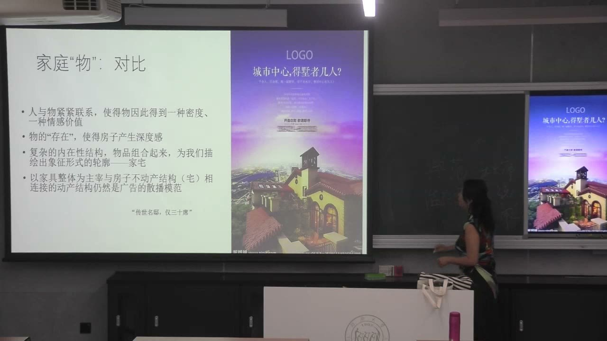
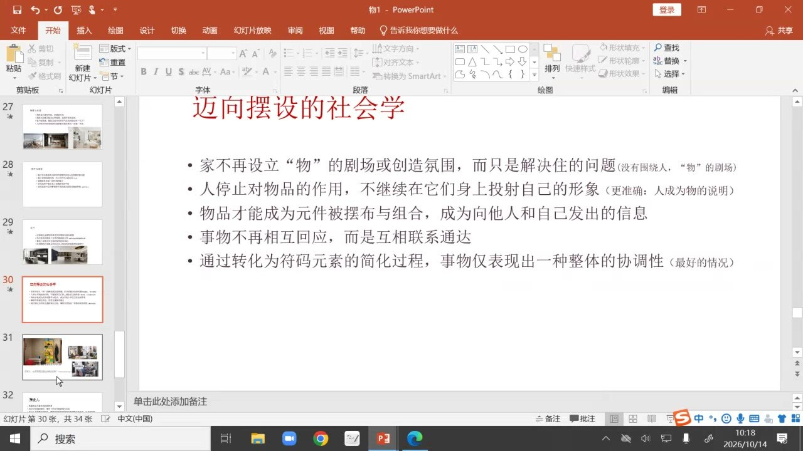
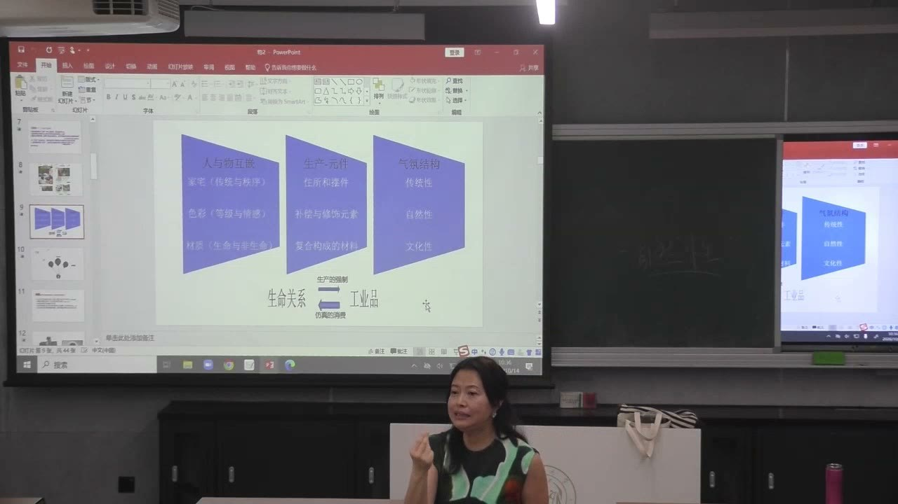
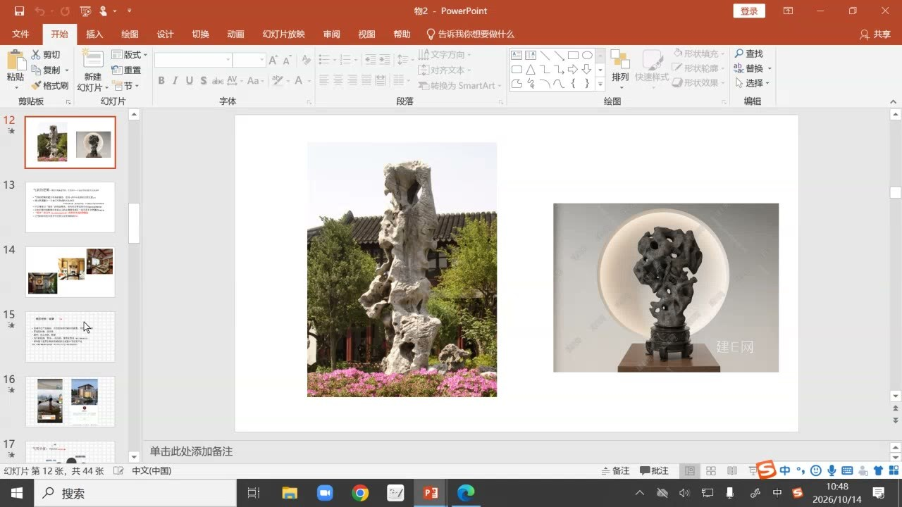
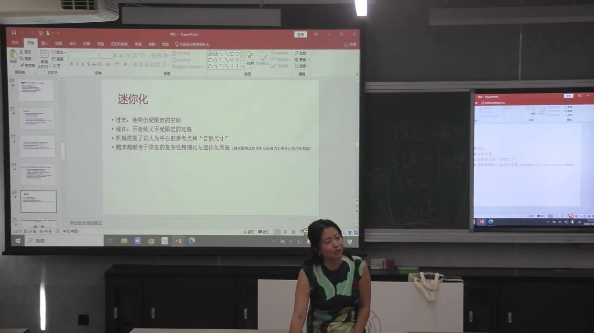

### 课程安排与任务

#### 课堂比较：传统劳动与小家电视频

按小组比较两段视频中手势与体域参与的异同，并回答小家电视频弥漫着怎样的气氛价值。结合课程使用的《物体系》PDF第48—49页“传统手势与劳力”段落阅读。

教师课末建议有时间继续阅读鲍德里亚《物体系》。理解本课时，可以围绕家宅、色彩、材质与技术物，追踪同一个“关系解离—元件化—仿真组合”的过程。

### 家宅的物的剧场与功能性居所

空间中的物既可能承载长期生活，也可能作为能够替换的商品元件。两种“家”的组织方式不同。

#### 传统家宅为什么围绕一个未出现的主人？

课堂延续起居室比较：旧式宅邸有较完整的空间结构，灯光、桌子、壁画和陈设形成朝向内部的聚集中心。即使主人不在场，书画、器物和生活痕迹仍围绕他组成“物的剧场”。

墙壁与窗户区分内外，使空间具有封闭和内省的特征。教师提醒，这里讨论的是传统家宅的典范，并非断言过去同一时代所有人都能拥有这样的宅邸。

#### 宜家图像中的人为什么更像一种说明？

在现代居家宣传图中，若去掉人物，空间往往接近样板间；人物能够随目标群体替换。家具的色彩与搭配也可以变换，而不必依赖一个家庭的长期生活史。

传统家宅中的人和物反复相互投射，形成临在感、传承和秩序。现代大众居所则更突出功能和流动性。开发和宣传仍借用旧家宅的温馨、归属和传承形象，这是课堂引入“仿真”的入口。

### 解离、重组与摆设人的位置

功能化先使物脱离原来的象征关系，再以新的气氛组合回到人的生活。“解放”并非只有一种含义。

#### 解放的功能为什么又需要模仿传统？

教师把物的功能化联系到现代生产规则：旧有物品、资源和人的劳动力需要重新进入生产和使用。家宅变为功能性居所，物品成为可以重新组合的元件，人的自由也主要表现为生产者和使用者的自由。

这些元件又被赋予气氛价值，通过仿真旧有结构、传统和自然性，让商品重新呈现温馨、归属或个性。课堂因此追问：被解放的是功能，还是人与物原来具有的生活关系？

#### 照明、镜子与画像的功能怎样改变？

传统空间的照明强调中心和聚焦，镜子、画像也可加强内部关系及主人的存在。现代空间更常使用分散光源、开放和连通的布置，减少中心聚焦，让较小的居所显得延展。

镜子转向衣帽间、洗手间等实用位置，画像等陈设也失去旧宅邸中的固定地位。结构仍可能仿照传统家居，但这种模仿服务于新的组合，不等于完整复原传统生活。

#### “个性化”怎样成为新的组合方式？

教师用居家广告说明，色系、复古摆件和人物衣着可以共同营造潮流感；换一种色系、陈设和人物，又能形成另一种风格。表面上属于自己的家，实际上可能在表达接受到的流行信息。

教师用自己以时髦行李箱替换父母旧皮箱的经历说明：旧物曾承载生活和传承，更新却可能由“不够时尚”的判断推动。消费系统先促成归属关系的解离，再将新组合描述为个性与温馨。

“摆设人”能够操控空间和陈设，却不必与每件物有长期生活关系。气氛组合的背后是可流通、可变换的信息。

### 色彩的解放、妥协与自然性的仿真

色彩从等级、情感和礼俗中被解离，成为修饰与补偿的变量；所谓自然色也进入商品的气氛生产。

#### 色彩为什么仍带着道德和秩序感？

课堂指出，服装和家电等商业领域对高饱和、强烈色彩的使用往往谨慎。传统色彩原先与等级、仪式和情感相联，如不同身份的服色、婚丧中的颜色安排；它们并非纯粹中性的视觉变量。

功能化使这些关系松解，但商业色彩也作出妥协，转向粉彩、较柔和的自然色等，而不是简单无限增加情感的强度。

#### 亮色怎样成为材质或空间不足的补偿？

教师以经典座椅与复制品为例：当皮质、材料或质感退让时，鲜明色彩可以使产品看起来更突出，减少廉价或单薄的感觉。色彩在这里进入商品搭配和气氛的组织。

这一解释针对课堂举出的组合逻辑，不能把所有鲜艳产品一概判断为低质。研究重点是颜色怎样与材料、空间和风格互相配合，而不是给单一颜色固定的高低评价。

#### 自然色为什么不等于真正进入自然？

亚麻色衣物、草帽、草编包可以让正在通勤的人产生休闲或度假的感受，但生活处境并未因此改变。课堂用这个例子说明，工业品借自然色提供自然性的仿真。

教师还以商业露营和阳台露营宣传批评：自然被转为可以购买、组合和观看的气氛。所谓松弛、假期或回归自然，需要区分实际的生命处境与商品带来的象征感受。

### 材质与玻璃：文化记号的提取和组合

材质原有的生命痕迹和文化位置，被转换为消费层级与气氛记号。组合可以不断变化，未必恢复原来的关系。

#### 材质的区别怎样进入消费体系？

教师把会随使用和时间变化的木、石、皮、玉等，与工业合成材质比较，讨论材质的生命感和象征关系。这里的“生命”是人与物关系及材料痕迹的表达，不是生物学分类。

新的消费体系将不同材质放进可购买的层级、系列和价格关系中。原先与特定身份、文化秩序相连的材质，也可通过商品形式进入其他人的空间。

#### 树脂太湖石为什么是双向操作的例子？

树脂可以模拟太湖石的外观，把原先与园林等文化空间相连的造型转化为摆件；也可以把这类记号提取出来，放进茶社、养生馆、中式或混合风格的空间。

一端是模仿旧物，另一端是抽取旧物所代表的文化关系，再与不同元件组合。只要气氛的逻辑能够协调，就可形成新中式、混合风格等不同表达，但它与旧有生活并非同一种关系。

#### 记号怎样被回收，玻璃怎样组织气氛？

课堂以不同年代的摆件、未来主义造型和重新流行的千禧风说明，文化记号可以重新组合、回收、再使用，而不是沿一条风格线永久前进。

玻璃被特别分析为一种具有隔断、凝固和抽象作用的材质：它让风景、天空等成为可观看的背景，并将外部世界以剧场方式纳入消费空间。这里的“零度”指课堂讨论的象征倾向，不是说现实玻璃完全没有物理性质。

### 传统手势与技术物：谁在把握世界？

减少体力参与确实带来便利，同时改变经验、工具与场景的联系。便利和经验关系的变化需要一起理解。

#### 传统手工劳动为何需要连续的判断？

教师解释第一段制作视频时指出，操作者需要在现场感受热力、火候和材料状态，连续判断不同步骤。人的动作、工具和操作对象共同组成完整场景，经验在操作中发挥作用。

课堂用工具的“不应手性”说明未被严密规定的余地：工具不能自动完成所有判断，人的能动性不断补足和调整。这种关系使人通过工具实际把握世界。

#### 专用小家电为什么既精细又限制用途？

技术物通常将功能预先分类和设定，使用者通过按钮、语音或少量操作让机器运行。蒸蛋、烘鞋等专用设备使需求处理更加方便，也减少对内部构造、热力和过程的直接理解。

教师把它概括为两个方向的区别：传统场景中人操控对象并取得经验；技术系统中机器处理人的需求，人可能成为被处理的对象。不能只用“都在服务人”概括全部关系。

#### 为什么不能把传统劳动直接当成唯一答案？

教师也指出，旧有关系中人受制于物，物的使用又受人的能量和劳力限制。若始终停留在这一关系，生产力和生活条件难以充分发展。

因此课堂的分析不是要求取消机器、退回农业社会，而是考察解放过程中同时发生了什么：劳动减省、场景切割、能力变化与气氛生产并存。判断技术物时，要把便利与关系的改变一起看。

### 按钮、洗衣机与迷你化的气氛价值

简单手势可以承诺控制感，但实际参与可能越来越少。功能的便利也可能变成制造细小商品需求的理由。

#### 按钮为什么还要象征人的威力？

有些技术系统已可自动运行或声控，却仍保留按钮、遥控器或可见的操作。教师解释，这些手势能召唤旧有的人与工具关系，让使用者感到自己仍在控制环境。

这种参与可能更多是形式性的担保：机器运行未必需要使用者对过程有深度经验，但手势仍传达“是我作用于外部世界”的感觉。这正是技术物的一种气氛价值。

#### 手洗到机洗，改变的是什么场景？

手洗包含浸湿、用皂、搓洗、冲净、晾晒等连续动作，也伴随水、太阳、身体和共同生活的场景。机洗则将许多环节压缩为放入衣物、关门和操作按钮，把人从原来的完整关系中分离。

省下时间可以做其他事情，但人也更多通过说明书与技术物相处，而非直接经历工作过程。课堂以此讨论不连续、不及物的关系怎样被“效率”和“解放”的语言呈现。

#### 迷你化怎样把细小动作发展成商品？

精巧、轻松、独立、方便、效率与简约，构成技术消费物反复承诺的气氛价值。迷你化也不仅是一个尺寸或技术问题，而可成为不断细分需求的生产方式。

教师用剥蛋器等例子追问：原本能够完成的细小生活动作，是否都需要新设备？当商品增加而生活又被说明书、操作条件和计时围绕时，“便利”的承诺与现实的繁琐可能同时存在。

### 概念对照与自测

| 对照 | 旧有关系 | 消费体系中的变化 |
| --- | --- | --- |
| 家宅与居所 | 长期生活、传承、聚集中心 | 功能、流动性和可替换组合 |
| 色彩 | 等级、礼俗和情感 | 修饰变量、补偿和自然性仿真 |
| 材质 | 使用痕迹、文化位置 | 商品层级、可提取的文化记号 |
| 劳力和手势 | 身体参与、连续经验判断 | 简单操作、预设功能和控制感 |
| 解放 | 人与物互相束缚 | 便利增加，也伴随场景和经验的分离 |

#### 现代家居为什么既解放功能，又模仿传统？

功能化使物成为可生产和重组的元件，仿真则把传统、归属与自然性转为商品的气氛价值。

#### 教师为什么用旧皮箱说明摆设人的处境？

旧物承载生活与传承，但消费更新可能以时髦的信息替换这种关系，再将更新描述为个性化。

#### 树脂太湖石的双向操作指什么？

既能模拟旧物，也能抽取其文化记号，放入其他场景与不同元素重新组合。

#### 按钮的存在是否总意味着人深度参与工作过程？

不一定。它也可能主要提供控制感和形式参与，技术系统仍自主处理需求。

#### 课堂是否要求放弃便利、返回传统劳动？

没有。教师同时承认旧有能量关系的限制，分析的是便利与经验变化如何并存。

### 来源范围

原始转写含课堂互动，正文只整理教师讲授、解释、回应与课程任务。时间范围为两分钟音频分段边界，不是逐句对齐时间。
