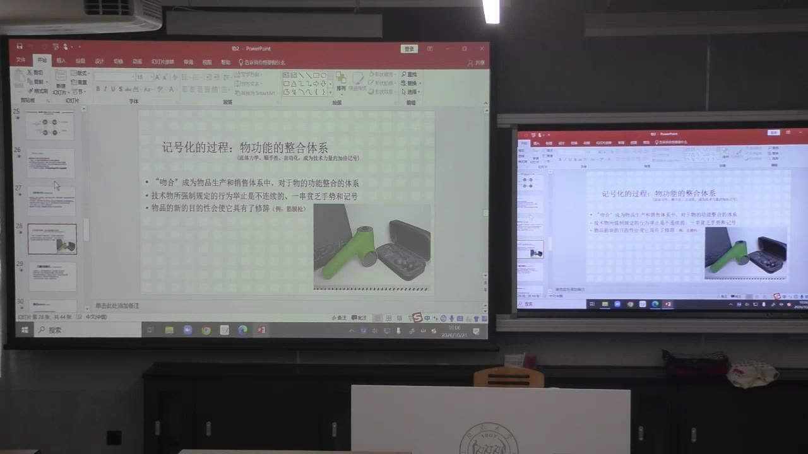
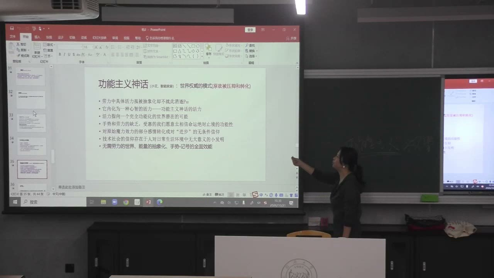
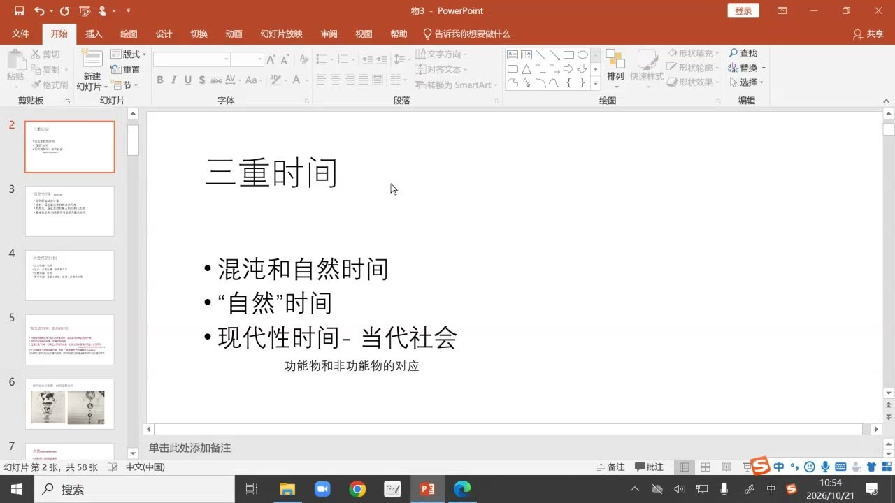
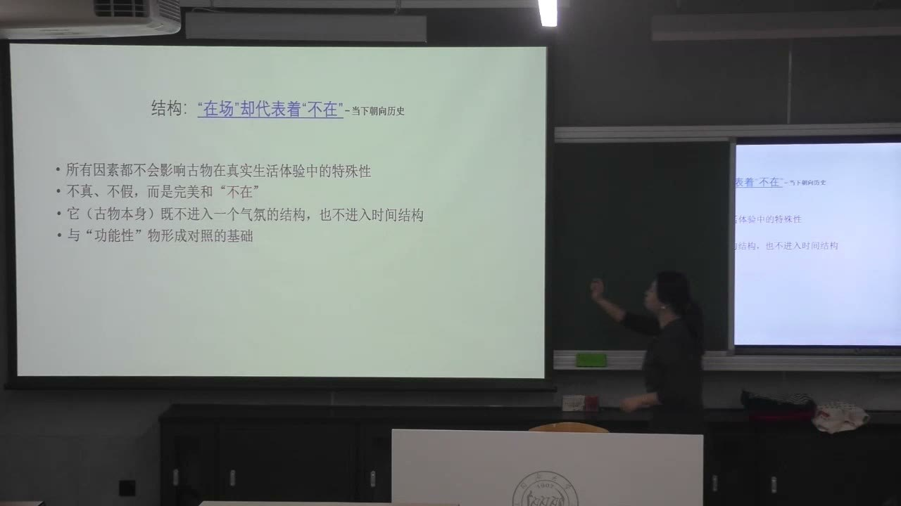

### 课程安排与任务

#### 阅读农庄改造案例，辨认古物的作用
<!-- source: 74 -->
课堂要求阅读《物体系》本版第88—90页“时代的错乱”案例，后续口头提醒可看到91页。问题是：这座农庄保留了哪些古物，它们发挥什么作用？分析要同时说明现代设备怎样提供舒适，旧房梁、砖石及废弃暖炉又怎样使住宅具有不同于普通新建别墅的叙述。

这是本节的课堂阅读与讨论，没有另行宣布明确的书面提交期限。此前关于汽车、打火机的案例，本节继续用来练习一次度与二次度功能的区分。收藏物、典范与系列的关系，以及爱马仕包的案例，被预告为后续内容，本节未完整展开。

### 功能物为何还要留下人的记号

技术使物品形成越来越自足的操作系统，气氛价值却仍要让使用者感到物品与自己有关。

#### 从实践关系转向顺手性的记号
<!-- source: 0 -->
传统劳动中，人借工具进入对象世界，投入体力并逐渐掌握材料和环境。教师以锄地举例：人、工具、土地之间构成有经验深度的关系。会使用工具，意味着知道怎样处理实际问题，而不只是知道开关在哪里。

在自动化功能物中，工具与对象之间的过程越来越由装置独立完成。物品仍保留顺手、流线、触感、声音或操作手势等记号，使人觉得“它仍需要我”“它为我设计”。这种联系可能更多具有象征性，不能仅因产品强调人体工学，就断言使用者还完整参与了生产或劳动过程。

#### 手势被分解，连续经验被缩减
<!-- source: 4 -->
教师用筋膜枪说明，揉、按、拧等原来连续而有身体热力参与的动作，可以被分解为不同接头和机械动力。使用者的参与变成选择、点按、启动，手势更简化，也更不连续。

产品又通过“放松”“舒适”“自己的按摩管家”等修辞，把这些简化操作重新组织为一种完整体验。技术减少实际劳动，气氛系统则为减少后的动作赋予意义。这是对物与人的关系的分析，并不等于否认设备提供便利。

### 一次度功能怎样被二次度功能扩展

一次度功能回应直接用途，二次度功能则把用途与人的想象、欲望和自我叙述联系起来。

#### 汽车的节省力量与“翅膀”的象征
<!-- source: 12 -->
汽车替代部分体力，使人更省力、更快地移动，这是直接的功能满足。翼状车门却不会使汽车真的飞行，也不必然提高运输速度。它借飞鸟、飞翔和征服空间的形象，使省力被理解为自由、力量和掌控世界。

因此，不能把二次度功能简单理解为“多了一个实用功能”。它深化的是心理上的象征满足，使基本用途、造型和其他边缘特征形成一套气氛论述。用“更方便”解释全部设计，就会遗漏这些差异。

#### 打火机：点火与取火想象并不相同
<!-- source: 34 -->
普通打火机已经可以完成点火的直接任务。课堂展示石形、高度设计化的打火机，用天然石材般的外观、触感和顺手性，关联原始取火、自然和征服的想象。象征意义与是否更容易点火，是两个分析层次。

拥有一件暗示野外生活的产品，不等于实际愿意面对野外环境。教师把这种差别联系到自恋性的自我表述：物品使人能够说“我向往这种生活”“我是这样的人”，却可能替代真实的实践。个别品牌和价格只是课堂例子，不是判断二次度功能的必要条件。

#### 功能主义神话：省力也可以带来权威感
<!-- source: 24 -->
人可能在操作中失去经验，同时相信技术让自己获得更强的开发、控制和创造能力。教师把这一关系放在现代进步信仰中讨论：劳动和手势的减少，不一定被体验为能力减少，反而可能转为对技术威能的心理认同。

自动化设备围绕使用者，好像只要一个手势或一句指令就有“仆从”响应。由此形成的支配感，不等于使用者实际掌握了装置怎样工作，也不等于他仍具有处理对象世界的完整经验。这里讨论的是消费关系中的想象结构，不是要求人放弃洗衣机等现代用品。

### 《物体系》怎样把需求推进为欲望

本课将功能物的分析放回生产与消费之间的关系，追问物品为什么持续需要新的象征意义。

#### 基本用途之外，生产还要持续启动欲望
<!-- source: 38 -->
教师把结构概括为三个相连层次：物的基本功能，人的初始需求与原欲，以及连接两者的二次度功能。气氛系统不只提供一个可用的物，还不断使它的象征关系超过直接用途。

在这一理论解释中，若只满足有限的直接需要，生产与消费可能较早达到某种饱和；技术和效率的提高却推动持续生产。消费体系因而借物品开发、刺激欲望，使人不断追求新的体验、差别和身份。欲望不是被动等待产品满足的一张固定清单，也在物的关系中被组织。

#### “自然性”的符号与真实自然资源的张力
<!-- source: 44 -->
翼状车门借用飞鸟，石形打火机借用天然材料的形象，餐食摆盘又可借贝壳、珍珠等图形暗示新鲜和天然。自然成为技术产品和气氛设计反复取用的符号资源。

教师指出其中的悖论：生产越来越多“自然”的符号，也可能消耗真实材料与自然资源。餐食摆盘的例子用于揭示这一张力，不能据一张照片就计算其生态代价，也不能把“看起来天然”直接等同于环保。自然的形象与真实自然的处境应分别判断。

### 时间：为何“最新”总是不稳定

古物的意义，要放在现代消费时间的对面理解；不能只用“东西很旧”解释它。

#### 区分自然过程、人的尺度与社会时间
<!-- source: 54 -->
教师先区分未经人类活动中心化的时间、以人的观察和尺度理解的自然时间，以及宗教、哲学和现代生产生活中的社会时间。日、年等划分以自然过程为基础，但人对这些过程怎样计量、解释和安排，是另一个层次。

课件把现代性时间突出出来，是因为它与生产、消费关联紧密，并非否认它属于社会时间。亚里士多德、康德和海德格尔在课堂中作为不同理解时间的简略参照，不宜把这几句概述当成完整的时间哲学论证。

#### 效率、流转与有计划的商品废弃
<!-- source: 58 -->
现代生产时间强调效率，以更短时间完成流转、积累和空间移动。教师把商品加快淘汰、由有形物转向服务，以及预售压缩库存等现象，作为理解这种时间的例子。

在此结构中，“最新”不是永久身份。刚拥有的新款，很快又会被尚未到手的下一代产品超越，消费者必须不断追赶。课堂用新车与未来概念车的比较说明：即使当前拥有昂贵物品，也不一定得到稳定的确认。例子分析的是时间竞争，不是对所有电商交易方式作无例外的事实判断。

### 古物如何提供另一种确定性

功能物不断面向将来，古物则以已经发生的诞生、经历和来源，成为与其相对的时间记号。

#### 过去已经“完成”，所以可以用来抵抗追新焦虑
<!-- source: 62 -->
新商品的价值容易被下一代动摇，而一件被确认具有特定来历的古物，其过去不能像产品迭代那样继续更新。人由此想象一种传承、起源和稳定的归属。

教师并非把古物说成消费之外的自由出口。恰恰是在功能物变化加快的条件下，古物的恒定感更突出，物体系既可以刺激追新的欲望，也可以回收寻求不变之物的欲望。两种看似相反的追求，能够在同一个消费体系中共存。

#### 古物的来历独立于当前拥有者
<!-- source: 70 -->
拿破仑指挥刀的课堂设例，意在说明古物具有“在我之前已经存在”的经历。名匠制作的古小提琴，也可以把物的诞生与某位制作者联系起来。当前拥有者并未创造那些历史，却能借拥有物品，把自身与历史相接。

这里的真确性不只是外观做旧，更涉及来源、诞生、过去经历和归属。在消费者的叙述中，这些信息使物品拥有不同于普通当代产品的位置。例子用于解释结构，没有把任何未经核实的收藏故事当成实际鉴定结论。

#### 复古书店的灯是时间记号，不是完整复原
<!-- source: 66 -->
教师比较商场书店与汉源书店的复古空间。旧式灯、地面和沙发纹理，可以使人感到停顿、安宁，形成对外部快速变化世界的暂时逃离。

这不意味着一个灯就把整间书店变成原来的历史现场，也不意味着所有陈设都是真古董。灯可以作为时间的文化标志起作用，周围空间并未完整复制其原先年代。理解气氛，要看物怎样在当下形成对照，而不只追问场景是否逐项复原。

### 真确性怎样被用于现代空间和身份叙述

古物的历史与其当下消费方式并非同一回事。它既有自己的来历，又被现代生活重新安排。

#### 农庄中的真迹为舒适住宅提供“宅邸”叙述
<!-- source: 84 -->
农庄改造保留旧房梁、砖石和废弃暖炉，住宅同时使用现代功能物来获得舒适。这些古物并不都继续承担原来的实用任务，却能使复古装修与现代设施获得一个“有来历”的中心。

教师把它称作某种象征性的拯救：本可被看成普通新建别墅的空间，因为真实遗存而被叙述为可传承的宅邸。这种叙述也可关联身份、再出售的价值和对未来继承的期待。古物的作用不等于重新恢复原来的农庄生产生活。

#### “在场”代表“不在”，不是把真伪鉴定取消
<!-- source: 92 -->
古物作为实物出现在现代房间里，但它所指向的过去并不在这里。摆放指挥刀，不会使整间住宅真的成为当年的历史环境。它保持某种异质性，正因不能完全归入周围功能物的时间，才构成鲜明对照。

课堂所谓“不真、不假”的表达，讨论的是物与气氛、时间结构的关系，不是说赝品与真迹在鉴定上没有区别。复古仿品也能提供时间符号，但不能因而获得真迹的来源和历史经历。

#### 拥有的故事成为关于自己的信息
<!-- source: 86 -->
人可以通过“这件东西从哪里来”“我怎样获得它”叙述自己，即使作品并非由自己创作、历史行动也不是自己完成。物品因而成为身份表达的媒介，把拥有者与某种品味、能力、门第或历史关联起来。

教师以《红楼梦》中妙玉与器物材质的关系提醒：借物确认品性，并非现代消费社会才有。差异在于，现代古物体系面对一个持续淘汰、竞争和令人焦虑的功能物时间；古物作为稳定参照和象征性拯救的作用，需要在这种对照中理解。

### 概念对照与自测

| 概念 | 主要作用 | 不应混同的判断 |
| --- | --- | --- |
| 一次度功能 | 省力、移动、点火等直接用途 | 不等于物品全部的消费意义 |
| 二次度功能 | 将功能、形式与欲望相连 | 不等于又多了一项实用性能 |
| 功能主义神话 | 将省力转为进步和掌控的想象 | 不证明使用者具有完整技术经验 |
| 自然性符号 | 借自然形象形成气氛 | 不等于真实环保或自然资源增加 |
| 现代消费时间 | 流转、追新、淘汰和竞争 | 最新地位不能永久保有 |
| 古物的真确性 | 起源、来历、传承和历史存在 | 不只是外观做旧 |
| 复古气氛 | 在当下制造过去的时间记号 | 不等于完整复原历史现场 |

#### 翼状车门为什么适合说明二次度功能？
它不使汽车变成飞机，却把实际省力与飞翔、自由和征服空间相连，深化的是心理上的象征满足。

#### 古物为什么不一定意味着退出消费体系？
它可以回应同一消费者对稳定、起源和归属的欲望，与功能物不断更新的体系互为对照；体系能够同时组织追新与怀旧。

#### 农庄保留旧暖炉，为什么不只是保存一项旧设备？
旧物即使不再发挥原来的实用功能，也可凭真确来历使现代住宅获得历史叙述，并影响空间气氛、身份和传承想象。

### 课程时间线

00:00—08:00：功能物的气氛价值、人的记号与手势的抽象化
08:00—18:00：汽车、省力与一次度和二次度功能
18:00—24:00：传统工具经验与象征关系的变化
24:00—34:00：功能主义神话、进步信仰和自动化的支配感
34:00—40:00：打火机案例，功能、原欲与二次度的关系
40:00—44:00：生产、有限需求与持续刺激欲望
44:00—48:00：自然性符号与资源消耗的悖论
48:00—50:00：课间，未识别到明确讲授文字
50:00—58:00：非功能物与三重时间的区分
58:00—64:00：效率、商品废弃、追新竞争与焦虑
64:00—70:00：古物的时间记号及复古书店案例
70:00—76:00：古物的起源、诞生和历史，农庄阅读安排
76:00—84:00：课堂阅读与零散互动，未编入独立知识正文
84:00—90:00：农庄古物的真确性，拥有故事与身份
90:00—94:00：与传统器物关系的差异，“在场”与“不在”
94:00—97:14：功能物和古物的双重回收，课堂总结与结束
