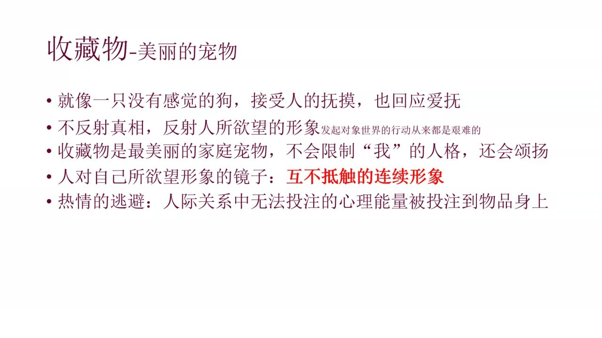
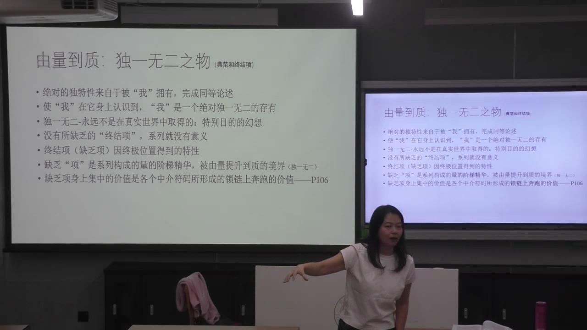
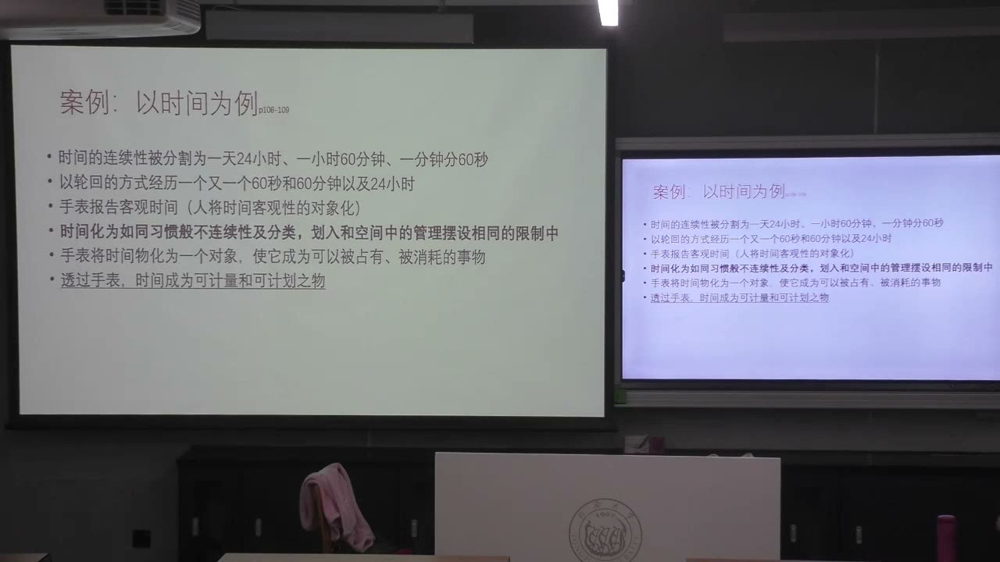
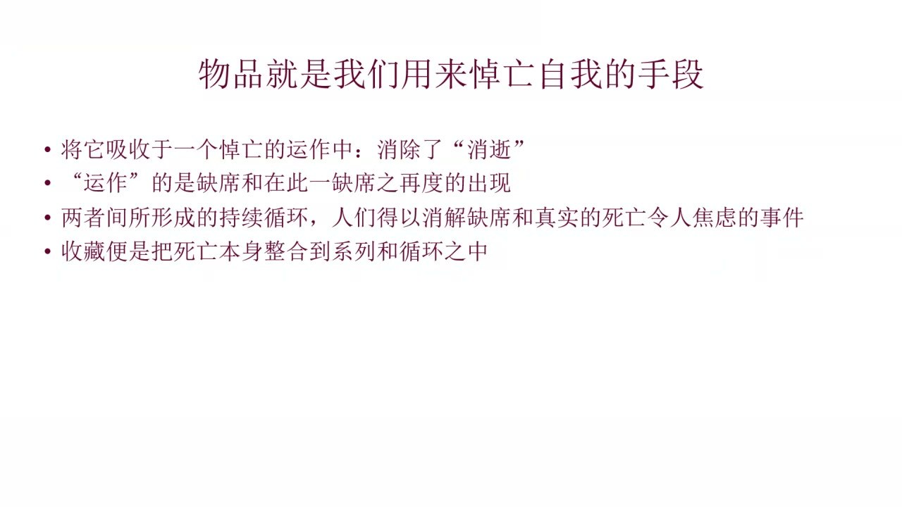
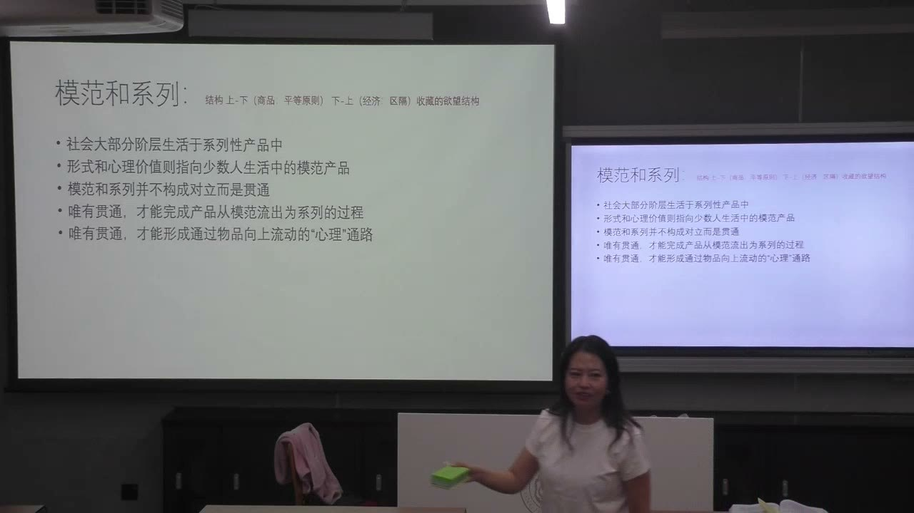

### 课程安排与任务

#### 小组汇报可以采用两种讲法
<!-- source: 0 -->
文本讲法要说明所选章节如何提问、采用什么分析结构，并与其他讨论相同对象的文本比较。例如讲广告，不能只复述鲍德里亚这一章，还要通过对照确定他的独特视角。案例讲法则从章节中找出一个分析角度，选择合适案例，运用文本的理论结构解释它。

教师计划下次课收束《物体系》，五个小组从第9周开始汇报，预计至第14周左右完成。准备汇报的小组需要建群，并把教师拉入群中。这是课堂提出的进度安排，具体分组场次继续随课程协调。

#### 用非功能物机制分析品牌故事
<!-- source: 26 -->
阅读班群中的爱马仕品牌材料，结合古物、收藏物及此前学过的概念，分析品牌故事如何组织“拥有一件物品”的心理意义。课堂安排阅读与小组讨论，再由教师讲解人格化、诞生、手工印记、系列及缺乏项等结构。

### 使用一件物与拥有一件物

本课讨论《物体系》中特定的人物关系与欲望结构。收藏的交流、研究、交易等其他功能，并不都包含在这一分析范围内。

#### 从古物的历史感进入收藏的个人经验
<!-- source: 0 -->
上节课的古物，与不断革新、竞争和淘汰的现代时间相对，提供回溯的历史感和真确性。教师补充，渴望与当前生活不同的物，并非只可能表现为怀旧：在物质生产方式不同的环境中，机械性、先进性的物也可能成为欲望对象。重要的是物在参照体系中的位置。

收藏不必以古物为对象。火柴盒、玩具、乐高或其他日常物，都可能与个人生存经验建立联系。教师借弗洛伊德的原欲概念解释，功能化、自动化压缩实际劳动和手势后，相关心理能量未必消失，也可能转入物品的象征性关系。这是课程的理论解释路径。

#### 同一个杯子，可以被使用，也可以被拥有
<!-- source: 6 -->
杯子能喝水，属于功能性的一面。假设它是孩子第一次用工资赠送的礼物，即使坏了，仍可能被保留，因为它联系着一段不可替代的经历。这里的“拥有”，强调从直接用途中抽离出来的个人关联，而不只是法律意义上的财产归属。

作为工具，物把人带入对外部世界的实践；作为收藏对象，物可以围绕主体展开叙述。人能够反复讲述它如何到来、为什么重要、与自己有什么关系。两种维度可以存在于同一件物上，不能按物品名称预先决定它只能属于哪一类。

#### 滑板爱好与滑板收藏的分析区别
<!-- source: 10 -->
滑板爱好者可能按使用场景、轮子、耐用程度或动作需求选择不同滑板。收藏则可能重视联名、设计者、限量版本、某次技术创新的首批产品等。差别不在于五块还是五十块，而在于它们主要服务于实际活动，还是被组织成关于自己的论述。

同一技术特征也能进入不同关系：为了更好滑行而购买，与为了拥有“首次使用这种技术的那一款”而购买，并不完全相同。收藏者对每一项的说明，也在说明自己希望成为怎样的人。

### 系列、镜像与缺乏项

收藏不是没有结构的堆积。物品被分类、寻找、排列和控制，构成围绕收藏者展开的系列。

#### 收藏物反映的是欲望中的自我
<!-- source: 14 -->
课堂用盲盒陈列说明“个人城堡”的含义：不同造型、性格和系列，分别承载主体想象中的某些面相。这面镜子未必促使人认识真实的自己，而可能不断确认“我希望自己成为的样子”。

课件将收藏物比作“美丽的宠物”：它不像真正的交谈者那样反驳和限制主体，而是服从排列与支配，反映彼此不抵触的连续形象。教师据此讨论人际关系中难以投放的心理能量如何转向物品；这是对特定关系模式的解释，不是对所有收藏者作心理诊断。

#### 独一无二来自位置，不必来自最好品质
<!-- source: 20 -->
课堂阅读《物体系》本版第105—106页，讨论系列如何由数量积累走向“独一无二”的质变。当其他物品逐渐齐备，只差最后一项时，缺乏项便获得特殊位置。它未必材质最好、价格最高，却因为难以得到、尚未在场而成为系列的终结项。

这种独特性与主体的自我论述相连：获得它，似乎就能完成“我”的独特性。课件强调，缺乏项集中了系列中各个符号相互连接、累积的价值；不能只用某一件物的独立使用价值解释它。

#### 缺乏既使人痛苦，也延续收藏激情
<!-- source: 24 -->
寻找、摆弄与排列，使个别物品进入一个面向整体的系列。缺乏项的缺席令人不满足，却也使欲望继续运作。若最后一项被找到，这个系列便可能终结，围绕它的欲望也可能暂时结束。教师用“象征性死亡”解释这种终结，指的是欲望结构的停止。

因此，收藏的动力不只是得到更多东西，也包括对尚未完成的整体的想象。缺乏在这一结构中不是偶然障碍，而是维持循环的重要条件。

### 品牌怎样运用非功能物机制

爱马仕案例用于分析商品叙事。课堂着重解释故事如何起作用，不以此确认材料中每一项品牌传说、材质说法或市场价格。

#### 人格化的诞生与手工印记
<!-- source: 40 -->
教师把Birkin包与人物相连的故事解释为人格化：商品仿佛有自己的诞生、来历和“母亲”，人物的形象与生活态度被吸收到商品之中。购买因此不再只是得到一个容器，也像是在接近一种人格和生活方式。

工匠、纯手工、编号和制作标记，又使物品呈现出可追溯的诞生过程，呼应上节课关于真确性与“父亲之手”的讨论。这些讲法共同把普通商品叙述成“不只是随意生产出来的一件物”。

#### 系列把缺乏组织成持续升级的欲望
<!-- source: 42 -->
普通款、不同颜色和材质、被叙述为格外稀有的款式，可以组成一条上升路径。即使已经拥有某款，新的差异仍能提出下一项欲望。课堂以所谓顶级款说明，商品体系会把收藏中的缺乏位置，与价格、材质、装饰和稀有性重新结合。

这一逻辑并不限于奢侈品。教师让大家把手机、电脑、鞋、服装和住宅等商品放在系列中思考，追问：现在拥有的这一项为什么仍可能被下一项否定？分析对象是差异与欲望的组织，而不是给具体商品划定真实、永久的等级。

### 收藏怎样把时间对象化

古物和收藏物都处理时间，却面对不同的参照。古物回应现代生产不断向前的竞争时间，收藏物更直接联系个人生命经验的不可逆。

#### 习惯和手表：把连续流动分成可安排的单位
<!-- source: 52 -->
生命从出生走向衰老，过去的经历不能照原样重来。教师以固定时刻做某件事的习惯说明，人会在无法控制的时间流中，为自己设立重复的定位点。

课堂阅读第108页关于手表的段落，课件标示第108—109页。连续时间被分为小时、分钟、秒，再以循环形式经历；拥有和操作手表，让时间成为可计量、可配置的对象。这里讨论的是人组织时间经验的方式，不是物理时间真的因此停止。

#### 纪念物保存的是可被重新进入的经验
<!-- source: 60 -->
杯子、照片或与童年相关的物，能把一次经历抽象成可反复调用的记号。人无法让孩子重新成长一次，却能通过礼物和照片回到有关这段关系的记忆。收藏由此把时间纳入可反复寻找、排列和控制的环境。

教师还以旧歌与演唱会类比这种回溯：一首歌可以像“时间隧道”，把人带回某段生命经验。类比解释的是记忆与欲望，不意味着所有听歌、收藏或保存纪念品的行为只有同一种动机。

#### “悼亡自我”仍不能取消真实时间
<!-- source: 64 -->
收藏把消逝、缺席和再次出现纳入系列循环，仿佛能消解失去与死亡带来的焦虑。课件把它表述为将死亡本身整合到系列与循环中。主体在每一个现在反复回到过去，却没有真正逆转生命时间。

教师在此重申分析范围：收藏也可以促进交流或具有市场流通价值，但《物体系》这里主要关注个体以物品组织自我欲望的维度。不能把这一局部理论直接替代收藏活动的全部社会意义。

### 模范与系列：商品和欲望的双向通道

“模范”也可理解为典范。它与系列的关系，不是两个彼此隔绝的区域，而是消费体系需要维持的贯通结构。

#### 商品从上向下扩散，欲望从下向上攀升
<!-- source: 72 -->
教师以身份物品与现代商品作对照：在所讨论的前工业等级关系中，贵族与其他阶层的物品可能象征难以跨越的出身鸿沟；消费体系则把模范与系列组织为相通的路径。普通消费者在现实中购买系列产品，在形式和心理价值上却朝向少数人的模范生活。

商品的设计、样式和符号从模范向系列扩散，形成从上到下的过程；消费者则被许诺可以从系列参与模范，继续向上。这条心理通道需要贯通，但购买者真正能够进入哪一层，仍受经济能力和社会位置制约。

#### 选择与个性化背后的不满足
<!-- source: 80 -->
物品的基本功能差别未必足以说明所有价格和身份差异，二次度功能与符号生产会进一步组织交换。色彩、材质、造型、技术配置等差异形成系列，让购买被体验为选择自由和个性表达。

但参与模范的过程也不断产生否定：已经拥有某项，仍被更高一项超越。教师把这种结构与机会平等、个人选择和阶层流动的价值想象联系，指出商品体系不只销售物质，也在传递社会整合的观念。课堂是在作理论批判，而非证明选择越多就必然带来真实社会地位的上升。

#### 模范是一种理念，不等于最贵或最新的一件
<!-- source: 90 -->
模范依赖被积极体验的差异及其所代表的理念，未必固定为某一个实物样本。课堂用未开封旧手机的收藏例子提问：它的功能不如新产品，为什么仍可能成为某种模范？重点在于它如何代表特定的科技与时代想象。

汽车也可以按速度、尊荣等不同理念确立不同模范。由此不能把模范机械化为“永远最新”“永远最贵”，应追问当前系列所朝向的是什么理念，以及哪些符号使某一物品能够代表它。

### 概念对照与自测

| 概念 | 本课的关系重点 | 不能直接等同于 |
| --- | --- | --- |
| 使用 | 物品参与实际活动 | 所有个人意义 |
| 拥有 | 从用途中抽离出的个人经验与叙述 | 单纯数量或法律归属 |
| 系列 | 个体、分类及局部向整体的组织 | 任意堆积 |
| 缺乏项 | 因终结位置而凝聚欲望的未得之物 | 品质最好或价格最高 |
| 古物时间 | 对现代生产时间的历史性回溯 | 个人生命时间本身 |
| 收藏时间 | 把生命经验分成可重复进入的记号 | 真实时间倒流 |
| 模范 | 系列朝向的差异化理念 | 固定的最贵、最新样本 |

#### 杯子坏了仍保留，怎样体现使用与拥有的区别？
喝水用途可能已经消失，但它与某段关系、经历的联系仍在。拥有的意义可以脱离直接功能，继续支持个人叙述。

#### 为什么最后缺的一项会比已经得到的许多项更令人渴望？
它处在完成系列的终结位置，凝聚了此前各项累积的意义。特殊性来自关系位置，不一定来自它自身更好的品质。

#### 收藏能否真正消除生命时间的不可逆？
不能。物品提供可反复回到记忆的方式，把时间对象化，却不能让经历原样重来。循环的满足与真实时间的流动之间仍有张力。

#### 商品体系里两条方向相反的通道是什么？
设计与样式从模范向系列扩散；消费者的心理欲望则从系列向模范攀升。二者的贯通，使可参与的许诺与现实购买能力同时进入体系。

#### 为什么不能只用“贵”解释模范？
因为模范还代表特定理念。速度、尊荣、科技先进性或历史开创性，都可能形成不同的典范方向，需要放回具体系列判断。

### 课程时间线

00:00—04:00：文本与案例两种汇报方式，古物时间及原欲的补充
04:00—10:00：收藏、使用与拥有，杯子的个人经验例子
10:00—14:00：滑板爱好与收藏的关系区别
14:00—20:00：盲盒、镜像自我及系列组织
20:00—26:00：第105—106页阅读，缺乏项与由量到质
26:00—30:00：爱马仕材料的分析任务
30:00—40:00：课堂阅读与小组讨论
40:00—46:00：品牌人格化、手工诞生、系列升级及汇报安排
46:00—50:00：课间
50:00—58:00：收藏分析的范围、生命时间与手表阅读
58:00—66:00：纪念物、照片及个人记忆的回溯
66:00—72:00：悼亡自我及古物、收藏物的时间比较
72:00—80:00：模范与系列贯通，商品和心理的双向通道
80:00—86:00：符号交换、欲望否定及二次度功能
86:00—90:00：选择、个性化与阶层流动的价值想象
90:00—96:00：模范的理念及手机、汽车的课堂例子
96:00—99:24：课后阶段
