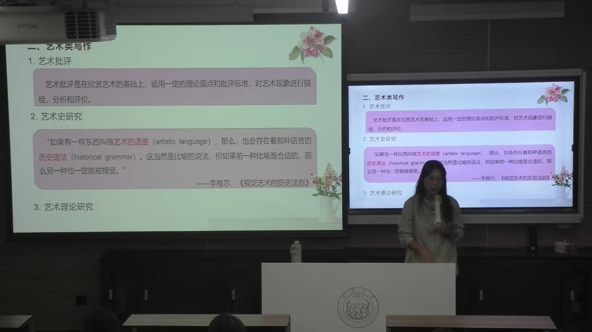
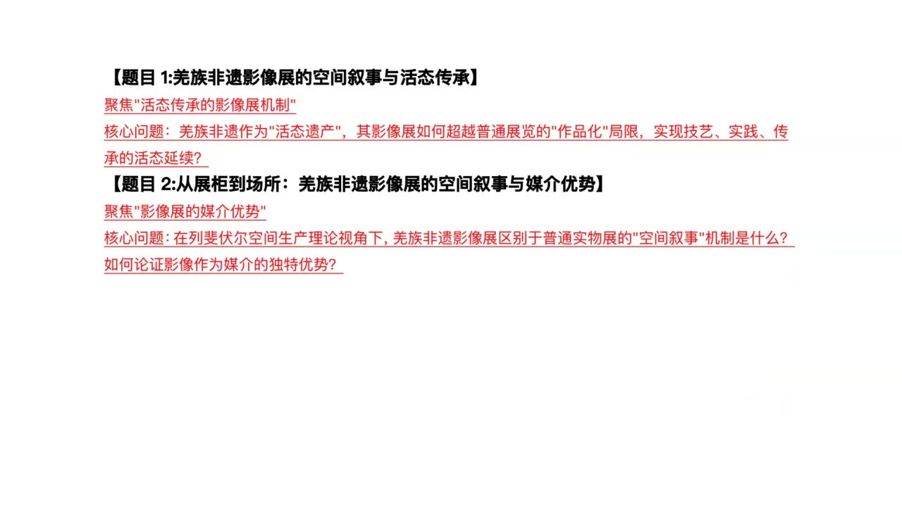
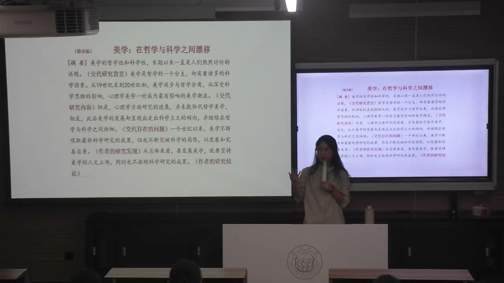
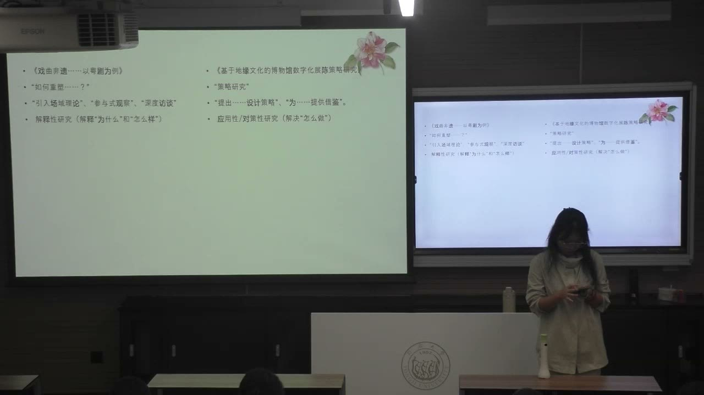

### 课程安排与任务

#### 阅读教材，并练习辨认问题与研究结构

教师请大家课后阅读推荐教材《艺术写作简明指南》，了解不同艺术写作方法，再回看艺术批评、艺术史研究、艺术理论研究的区别。若选择艺术史方向，也可以进一步阅读相关写作参考；课堂未要求所有人完成全部延伸书目。

课堂将《韩熙载夜宴图》用于三种写法练习，又发出两篇期刊文章，要求先读摘要、各部分小标题和论证逻辑，不必逐字阅读全文。下节继续练习文献查找和数据库使用，本课没有宣布新的提交期限。

#### 选题与格式：以阅读和导师沟通持续修订

先形成自己的题目、思路和摘要，再主动向导师询问意见；选题通常需要多次修改。教师建议学年论文先把一个案例或问题做清楚，再考虑扩展，具体安排仍应结合导师指导。

学年论文与毕业论文的字体、目录、长度、引文等要求，按群内分享的学院手册和相应规范执行。课堂展示的摘要字数和案例数量，是讨论写作的示例与建议，不能代替正式的具体要求。

### 同一作品，三种艺术写作

《星空》的三段文字用来区分情感评价、视觉分析和理论方法，不同写法有不同的落脚点。

#### 艺术批评：描述、分析并作出评价

课堂示例 A 侧重作品带来的情感氛围与观众体验。教师把它归入艺术批评：在欣赏基础上运用观点和标准，对艺术现象进行描述、分析、评价。说一幅画令人印象深刻，需要进一步指出哪些细节支撑这个评价。

这一分类用来区别当下几段文字的写作目标。不能因此把一切带评价的研究都排除出学术，而应问：这段文字是在表达欣赏与判断，还是正在用证据回答一个可讨论的研究问题？

#### 从视觉细节到论点：B 段怎样形成论证

示例 B 分析曲线、色彩对比和笔触方向，再提出画面呈现向上运动趋势的结论。前面的观察不是装饰性的描写，而是被用来支撑最后的判断。由此可以看到**证据、分析与论点**之间的关系。

教师说明它可以形成论文，但艺术史研究还常需要历史语境。仅指出图像具有何种形式，是一个入口；进一步解释为什么在特定时代、地域形成这种语言，才能把视觉分析与历史问题连接起来。

#### 理论研究：能否形成可迁移的方法

示例 C 的重点，是讨论一套研究方法如何抽象出来、是否能够用于其他对象。它也可以成为学术论文，但落脚点与对单幅作品的具体分析不同，更接近艺术理论研究。

教师强调三分法不是机械对应。具体研究可以交叉使用方法；真正需要辨认的，是文章最终想说明作品本身、解释它的历史形成，还是提出可再次使用的概念和分析方式。

#### 艺术语言与历史语法

作品可能使用相似或不同的艺术语言，背后的历史条件则可以帮助解释为何如此。教师借“历史语法”说明：时代与地域的特点，会对创作方式和发展方向产生规范性的影响。

研究应先看清视觉材料，再分析它为什么这样出现，而非先拿一套理论，随后只寻找能证明理论的画面。形式与历史可以彼此解释，但都需要落实到具体材料。

#### 《韩熙载夜宴图》练习：改写语言就是改写问题

教师用笔触、器物细节、人物面部和画面尺寸安排，示范如何支撑对作品的评价；如果转向艺术史研究，则要把具体细节与背景联系；若转向理论研究，还需要把分析提升到可以迁移的方法层面。

课堂允许暂时设想背景来练习表达，这只是寻找话题、辨认写法的训练。真正写论文时，背景与证据必须核实，不能把练习中的假设当成已经证实的历史。教师建议对艺术史感兴趣的同学，先从较具体的材料分析着手。

### 把兴趣收缩成可做的选题

一个感兴趣的领域，只有经过文献和材料的检验，才能成为范围适合、具有新意的论文问题。

#### 兴趣、材料与可行性需要来回检验

兴趣由自己决定，但论文是否可做，不能只凭兴趣确定。需要阅读前人研究，确认已经回答了哪些问题，自己是否能够使用新的证据、数据或角度继续推进。简单重复既有结论，不能成为自己的原创贡献。

这个过程是循环的：寻找材料、提出疑问、检索文献，再修订疑问。选题、格式、行文规范与原创性，是后续课程将分别训练的四个方面；标题、摘要、正文和参考文献，也会逐步练习。

#### 题目太大，往往意味着还没有充分阅读

“唐代女性绘画的发展”这样的范围，可能已经由大量专著和长期研究覆盖。短篇学年论文既难完整总结前人成果，也难在同样的大范围中提出新意。教师建议先下载并阅读几篇相关论文，用已有研究反过来检验自己的范围。

收缩题目不是随意删几个字，而是确定一个能处理的对象、时段、现象或问题。越具体，越容易知道需要什么证据，也越容易说明自己究竟增加了什么认识。

#### AI 可以帮助检索，但自己要有判断的基础

AI 可能省去寻找材料时的一些步骤，但提供的内容是否可靠、完整，要由研究者判断。如果自己不了解主题，就很难发现遗漏、误解或不相关的材料。

因此，课程仍训练传统数据库检索与文献阅读。掌握这些方法，才能判断工具提供的信息。即使使用 AI 生成文字，引用、规范和自己的原创参与也不能由工具自动保证。

#### 综述的作用与学年论文的贡献

文献综述需要交代：前人讨论了什么，这些研究与当前问题有什么关系。它是任何研究的重要前提，但只汇总前人成果，会让自己的贡献很少。

教师说明，本专业学年论文应侧重批判性文章或原创性实证研究，而不是仅以综述作为最终成果。具体选哪一类，要看问题和可获得的材料，不能只因某种文章看起来容易写便选择它。

### 标题要展示理论、对象与案例的关系

好标题不只是罗列关键词，而应让读者知道研究核心是什么、用什么路径处理它。

#### “空间叙事与活态传承”为什么不清楚

教师分析羌族非遗影像展的题目：空间叙事与活态传承，都可以各自发展成很大的问题。并列摆放后，读者难以知道哪一个是核心，也不清楚影像展是在帮助传承，还是展示传承的过程。

“空间叙事”本身也需要说明：用空间叙事，还是叙事在空间中展开？教师建议避免未经解释的“什么与什么”式标题；若确实并列，必须让二者的逻辑关系清楚。

#### “媒介优势”稍有落点，但仍需说明关系

另一题目将空间叙事与媒介优势并列。“媒介”至少比较明确地指向影像展，因而比将非遗传承过程直接并列更接近研究对象；但它与空间叙事怎样相关，标题仍没有交代。

如果只是说影像展有视频、VR，所以更好，就又回到了一般的好坏评价。研究需要说明以什么标准、通过什么分析，才认为它具有某种优势。

#### 理论分析对象，案例让对象落地

教师示范一种更清楚的关系：在空间生产理论基础上，分析影像展的叙事优势，再以羌族非遗作为具体案例。此时，理论是分析路径，影像展是研究对象，羌族非遗是有限篇幅中用来展开论证的实例。

论文重点便不再是把“羌族”“非遗”“空间”“媒介”等词都覆盖一遍，而是通过一个案例回答影像展的问题。主标题与副标题可以分别承担问题和案例，但不是给任意标题附上一个“以……为例”就会自动清晰。

#### 解释现象与提供策略：两种常见路数

本专业常见的第一种方式，是用理论分析一个现象；若现象范围很大，可选择具体案例展开。第二种方式，是描述和分析现实问题，再提出解决策略；同样需要明确问题和案例范围。

后者也不能只写“现状和对策”。需要知道什么现状构成问题，证据怎样支持它，策略为何能够回应它。两种路数的论证目标不同，但都要让理论、问题、对象、案例各自有明确位置。

### 摘要修改：突出问题、方法与发现

摘要应在有限篇幅内交代论文做了什么、如何做，以及得到什么；语序与指代直接影响读者能否看清逻辑。

#### 敦煌旅游演艺：先让观演关系成为主角

教师以文旅融合背景下旅游演艺观演关系的论文为例，辨认其背景、对象、问题和案例。研究重点是观众与演出之间的关系怎样演变，敦煌是展开问题的具体实例；政策背景说明的是研究处境，不应淹没核心对象。

调整摘要开头的语序，可以先突出观演关系及其研究意义，再说明文旅融合背景。修改前后未必是“错误”和“正确”的绝对差别，但能让重点更容易被读者把握。

#### 研究维度和时间范围要写得直接

“从什么维度研究”可以清楚放在句子前部，帮助读者理解分析路径。若讨论演变，时间范围也应尽量明确：不同年代段落可能对应不同问题，不宜只用笼统的“按照时间顺序”让读者自行猜测。

教师还指出，冗余词句即使不导致事实错误，也可能遮住逻辑。没有增加信息的修饰应删去；阅读清楚的论文，再编辑自己的文字，是形成学术语言的重要训练。

#### 书店样书取用机制：不要让主语消失

书店案例使用日常生活实践的理论视角分析样书取用现象。教师指出，一段话从“它”开始，再接空间秩序、权力主体的意志等概念，很容易让读者忘记究竟在谈书店、服务机制还是理论。

开启一个新段落，应重新说明研究对象。每一句怎样从上一句推进，比堆叠抽象词更重要；若突然从服务跳到权力意志，需要交代这个转换的依据。

#### “该”“其”太多，不能代替说明关系

一段文字连续出现“该机制”“该秩序”“其”等指代，读者可能无法确定每个代词指向哪一个概念。教师建议直接说出对象，必要的重复比含混的代词更有效。

中文语序也需要自然。把“服务体现某种秩序”写清，比绕成多层“是什么的体现”更容易读懂。摘要越短，越要精确安排主语、动作和概念关系。

#### 重庆博物馆文创案例：问题与策略要具体

这一案例采用现状、问题、策略的路数。摘要先说明更广范围中的问题，再收缩到重庆的情况，最后以具体博物馆展开。案例数量取决于论文体量：学年论文可先集中一个，毕业论文可以通过两到三个案例增加比较和讨论层次；这是课堂建议。

教师指出，摘要不能以“还需各方努力打造品牌”这样笼统的愿望收尾。应直接写出发现了哪些问题、从哪些方面提出回应，让读者知道这篇论文新增了什么内容。

#### 研究发现和结论必须进入摘要

课堂展示一个约 250—350 字的美学摘要，辨认研究背景、已有研究、问题、作者发现与结论之间的逻辑。这个题目范围较大，只用于观察写法，不建议照搬为学年论文选题。

顺序可以调整，比如先指出问题再交代背景，但研究发现与结论不能缺席。论文正文即使已有充分发现，如果摘要只讲背景和准备做什么，读者仍看不到完成后的成果。

### 论文训练的能力、材料与研究路径

论文是收集材料、提出问题、分析和表达的结果；研究能力来自反复实践，而非一次写出完美文本。

#### 选择理论，要知道它从哪里来

教师介绍贡布里希、沃尔夫林等艺术史研究，以及文学理论和艺术批评的参考材料。阅读它们的目的不仅是模仿语言，更是理解如何分析图像、理论怎样形成、作者怎样使用例子。

如果用某套理论解释现象，需要知道它承接了什么、改变了什么，也能够回答为什么选择它而不是另一套。艺术、文学和美学理论存在相通的问题脉络；随意取一个有名理论的术语，并不等于已经建立研究方法。

#### 科学精神表现为材料处理和问题意识

课堂把科学精神落实为收集和处理材料、分析和解决问题，而非将它限定在理工科。创新思维则是发现还未被说明、未被讨论或没有说清楚的问题，再尝试把它讲清。

课程论文与学年论文为毕业论文作准备，也训练语言表达和协作能力。教师鼓励勤思考、勤表达：若过度依赖自动生成，自己迅速组织观点、说明计划的能力可能缺少锻炼。

#### 调查研究：有些信息必须在现场获得

研究当代平台内容，可能需要收集帖子并处理资料；研究个人体验，可能需要访谈或问卷；研究博物馆、非遗，可能需要到现场观察、取得当地材料并与人交流。方法由问题决定，不能统一用一种工具代替。

教师强调田野中的观察、接触与互动，能够产生网络检索没有预先呈现的新问题。AI 可以辅助处理资料，但不能代替研究者当下的现场经验。问卷如何设计、访谈如何问问题，后续课程会继续介绍。

#### 先搭框架，再在写作中调整框架

论文准备可以先与导师沟通任务书、摘要和章节目录，再把内容放入框架。写作时发现原有安排不合适，可以继续修改。框架不是一旦写下就禁止变化的承诺。

教师把论文看作持续训练，提醒不要因为想一次写好而迟迟不开始。答辩则是在完成研究以后说明为什么做、做了什么、怎样做；课堂提到五分钟陈述，但目前无需用尚未完成的论文提前为所有细节焦虑。

#### 展览与图书馆资源怎样转化为研究材料

教师以课堂列举的上海博物馆、上海图书馆、中华艺术宫、上海当代艺术博物馆、浦东美术馆及西岸等机构，说明图像、藏品、展陈、善本、数据库和现场观察可以成为选题的入口。不同资源支持不同类型的问题。

只说明一家博物馆为什么形成某类收藏，容易停留在介绍和综述；进一步问这一背景下怎样数字化、面临什么挑战，才有机会形成具体问题。课堂口述的当期展览、票价和预约情况属于阶段信息，实际访问时需另行核对。

#### 两篇文章：解释“为什么”与解决“怎么做”

戏曲非遗案例引入场域理论，并结合参与式观察和深度访谈，体现用理论解释现象的路数。理论与实地方法可以共同使用，不是互相排斥的选择。

博物馆数字化展陈案例从数字化中的同质化等问题出发，提出以地缘文化促进独特性的设计策略，体现应用性、对策性研究。评价文章时，要先看清它承诺回答什么，再检查摘要与章节是否沿着这个问题推进。

### 概念对照与自测

| 写作层次 | 核心问题 | 课堂提示 |
| --- | --- | --- |
| 艺术批评 | 作品怎样呈现、怎样评价？ | 评价要有具体细节与标准 |
| 艺术史研究 | 视觉形式为什么在此语境形成？ | 从视觉材料进入，并联系历史条件 |
| 艺术理论研究 | 方法或概念能否抽象、迁移？ | 不能只有一个作品的感受 |
| 解释性研究 | 为什么出现某种现象、怎样理解？ | 理论、案例和材料形成解释关系 |
| 应用性／对策性研究 | 问题是什么、如何解决？ | 策略要对应已经证明的问题 |
| 标题 | 究竟研究什么？ | 展示理论、对象、问题和案例的关系 |
| 摘要 | 完成了什么、怎样做、发现什么？ | 明确主语、范围、方法及结论 |

#### B 段为何比单纯“令人感动”更接近论文论证？

它把曲线、色彩和笔触等观察作为证据，分析它们怎样支撑画面运动趋势的判断。

#### 选题缩小为什么必须依靠文献阅读？

只有了解前人回答过什么，才能确定自己的范围、证据和可能增加的新认识。

#### 标题中的两个概念可以并列吗？

可以，但须交代逻辑关系和研究重点；仅用“与”连接容易制造两个竞争的核心。

#### 理论、对象、案例分别承担什么作用？

理论提供分析路径，对象是要回答问题的领域或现象，案例使有限篇幅中的论证落地。

#### 摘要为什么不能以“还需各方努力”结束？

它没有交代具体发现和策略。摘要应让读者知道研究完成后得到什么，而不只是表达愿望。

#### 为什么代词多反而不一定更简洁？

代词需要明确指向；当多个概念并存时，“该”“其”会增加猜测，直接写对象往往更清楚。

#### 研究框架中途发现问题，能否修改？

应当修改。材料分析、写作与框架之间需要反复调整，这也是与导师持续沟通的内容。

### 来源范围

原始转写含课堂互动，正文只整理教师讲授、解释、回应与课程任务。时间范围为两分钟音频分段边界，不是逐句对齐时间。
