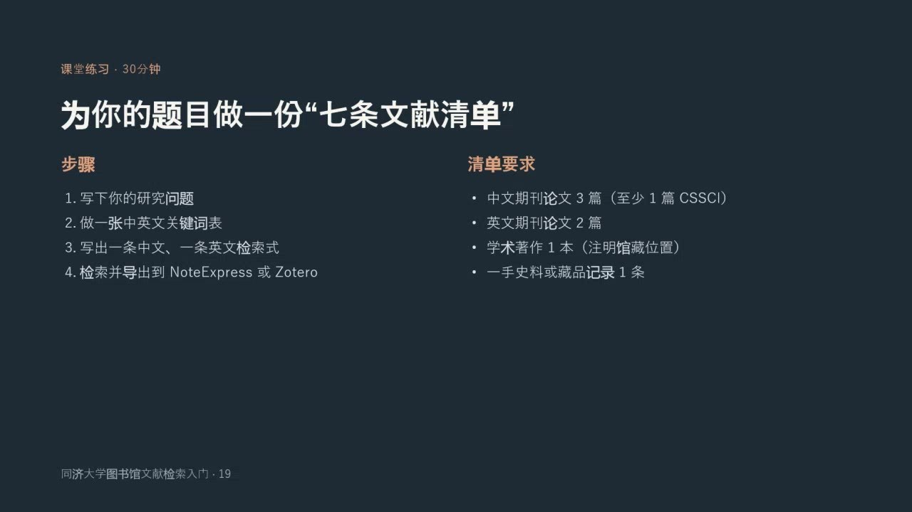
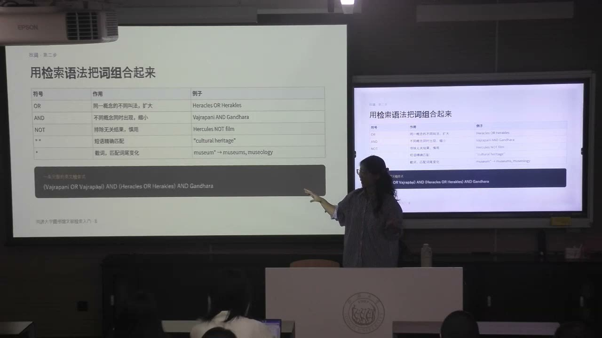
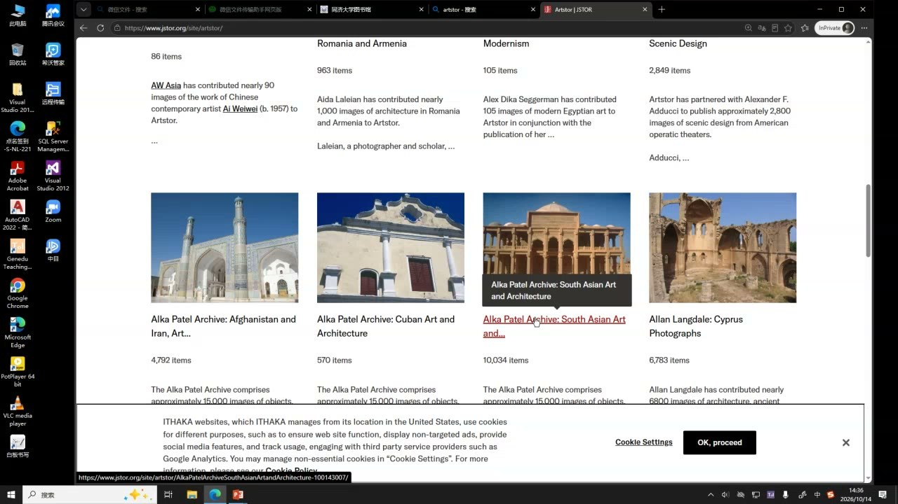

### 课程安排与任务

#### 为自己的题目准备七条文献
<!-- source: 90 -->
选任意一门课正在考虑的题目，写下研究问题，制作中英文关键词表，并各写一条中文、英文检索式。清单包括：中文期刊论文三篇（课件要求至少一篇 CSSCI）、英文期刊论文两篇、学术著作一本（注明馆藏位置），以及一手史料或藏品记录一条。最后一项是二选一；艺术对象可用高清图像及其完整出处，历史题目可用原始报刊或史料。

课件列出将检索结果导出到 NoteExpress 或 Zotero 的步骤。教师要求下节课准备好清单，用于后续练习。引用规范、脚注与参考文献的写法将在下节课展开；本节重点是把资料找出来，并保留其出处。

#### 形式分析的预习
<!-- source: 92 -->
预读群内《艺术写作》教材的“形式分析”一章。下节课将结合莫兰迪静物画讨论形式分析，并逐步介绍图像学等艺术研究方法。本节开场虽提出形式分析，但实际授课集中在文献检索，不把尚未展开的方法当成已经讲授的知识。

### 一、研究问题与检索词一起形成

研究选题不是一次确定后原样执行，而是在检索、阅读和观察材料中逐渐收窄。

#### 从宽泛兴趣收窄到可以查证的关系
<!-- source: 2 -->
“丝绸之路艺术”可以是兴趣范围，却还不是充分明确的课程论文问题。把范围收窄为“犍陀罗佛教雕刻中的希腊因素”，就形成地域、对象和文化因素三个概念。继续观察作品和阅读研究，还可以把问题推进到赫拉克勒斯与金刚手两个人物形象的关系。

问题细化后，原来找到的材料也要重新检索。第一次检索并非无效，而是在帮助确定下一步真正需要什么。几个备选题可以分别尝试，比较阅读兴趣、可用材料和研究价值，不必要求第一个想法立即成熟。

#### 把提问拆成概念，而不是只输入完整句子
<!-- source: 4 -->
数据库更依赖明确的检索字段和概念组合。一个问题可拆成数个关键词，分别检索，再看它们相交时留下哪些资料。结果太宽，需要增加限定；结果太少，也要检查是否把概念叠加得过窄。

检索结果的前几条不必然最适合题目。判断资料要同时考虑研究对象、期刊或出版社、年代、地域及学科。经典旧著可以重要，但用它独自代表此后几十年的研究，文献综述就不充分；还要寻找后续修正和讨论。

### 二、把同义词与概念关系写进检索式

检索词的准确性既包含拼写，也包含名称之间的逻辑关系。

#### 名称、译名和拼写变体都要考虑
<!-- source: 20 -->
同一对象可能有多种中文译名、外文拼写与转写形式。教师以金刚手 Vajrapani、赫拉克勒斯及其 Heracles、Herakles、Hercules 等名称为例，说明只搜一个名称可能漏掉另一传统中的研究。历史地名、人名和概念尤其需要列出变体。

研究外来艺术对象时，不能只因中文更易读，就把检索范围限定为中文研究。先找到相关原文文献，再选择原文阅读或辅助翻译；引用仍应落实到实际文献。AI 可以帮助提出名称变体和翻译，但不能替代对搜索结果及引文原文的判断。

#### OR 扩大同一概念，AND 缩小概念交集
<!-- source: 24 -->
OR 连接同一概念的不同名称，扩大可检索范围；AND 连接不同概念，要求它们共同出现。例如，将金刚手与犍陀罗用 AND 连接，指向某一地域中的人物形象，而不是所有地区的金刚手。

NOT 排除无关结果，但要慎用：初步研究时尚不了解相关性，过早排除可能漏掉材料。双引号用于短语精确匹配，如“cultural heritage”，避免两个词分散出现却被当成目标短语。课件还列出截词符号用于匹配词尾变化，具体支持方式应按使用的数据库确认。

复合检索可以先用 OR 归并每个概念的变体，再用 AND 连接不同概念组。关键在于表达研究对象之间的关系，而非一次堆入尽可能多的词。

### 三、资料类型决定从哪里开始找

数据库不是一个统一的资料袋；先判断要找理论、研究应用、原始材料还是图像。

#### 著作、期刊、学位论文与报纸各有用途
<!-- source: 10 -->
理解一位理论家的完整论述，通常应从其著作进入；研究某理论怎样解释当代文化现象，期刊论文往往更直接。学位论文可以帮助了解较完整的论文结构、体量和写作规范，但不能把它当成不经判断就照搬的模板。

报纸传播周期较短，适合寻找事件报道与特定时代的社会信息；研究历史问题时，当时的报刊也可能是一手材料。图书馆的一站式学术搜索适合摸底，图书或馆藏目录适合确定著作和借阅位置，具体数据库则适合有目的地筛选论文等文献。

#### 知网与读秀：判断重要性并继续细分
<!-- source: 36 -->
知网、万方是本节介绍的常用中文论文入口，读秀、超星用于图书、章节和部分插图检索。结果可按被引、下载等线索排序，但不能机械地把高数值等同于最适合当前问题。早期论文有时间积累优势；讨论生成式 AI 等新议题时，年代也影响其解释范围。

教师以海上丝绸之路为例：同一检索词可能得到大量当代贸易、政治经济研究，而艺术史题目需要考古与艺术遗存。利用学科、主题、地域等筛选，可逐步从宽泛话题推进到沉船、瓷器、玻璃珠、东南亚联系或古钱币证据。

“阅读空间”也会因学科不同指向文学作品中的空间、舞台设计或公共阅读设施。检索时要检查书名、主题、目次、简介等字段，不把文字相同误当成问题相同。

#### 建立持续阅读习惯，理解馆藏编号
<!-- source: 52 -->
人大复印报刊资料可作为观察重要议题和筛选研究的线索；日常浏览推荐文章的题目与摘要，有助于积累判断能力，不必等到交论文才开始找资料。

中图法把馆藏按学科组织。教师举出 I 文学、J 艺术、K 历史地理、H 语言文字、G 文化科学教育体育等类别，说明索书号的字母、数字和辅助标志携带不同层次的信息。理解分类能帮助定位书架，也能看出同一主题被放在何种学科语境。具体编号应以实际馆藏记录为准。

### 四、一手材料、图像与二手研究互相支撑

资料的身份与研究问题有关。已有研究提供解释，当时留下的记录和作品则提供需要重新分析的证据。

#### 历史研究不能只有后人的论文
<!-- source: 54 -->
研究近代艺术家、博物馆现象或某次博览会，除了读后人的论著，还要查当时报刊、历史文献和图像，考察事件怎样被报道、哪些信息进入公众视野。全国报刊索引中的晚清民国期刊、《申报》等数字资源，是课堂提到的查找方向。

古籍检索还涉及繁简字、异体字、地名和名称变体。教师以《大唐西域记》中的地名为例，要求在检索前整理不同写法，避免把没有找到某一写法误判为没有材料。原始文字的版本及上下文需要保留。

#### 图像不仅插在文章里，也能带来问题
<!-- source: 58 -->
Artlib 世界艺术鉴赏库、Artstor/JSTOR 图像资源和博物馆数字藏品，可按艺术家、作品、时期、流派、国籍或机构查找图像。对艺术史研究来说，高清图像的细节可能使人发现仅靠文字描述看不到的问题。

从图像发现疑问，再检索是否已有相关研究，构成新的检索循环。下载图像应保留作者、作品名称、创作年代、收藏机构和图像出处等可得信息；“能下载”不能代替对引用和使用条件的确认。

### 五、外文检索与开放资源也能成为研究对象

工具既帮助获取材料，其组织方式和发展过程也可能构成文化研究的问题。

#### 外文数据库沿用同样的收窄逻辑
<!-- source: 78 -->
JSTOR 可检索期刊论文、书籍章节等内容；EBSCO 等是课堂补充的外文入口。使用高级检索，仍需结合题名、作者、摘要、文献类型与学科，不能只把中文宽泛问题翻译后原样输入。

找到二手文献中的引文后，可以反向用准确题名和作者检索原文，确认引用究竟说了什么。教师提醒关注过刊和学校订购范围；具体刊物的可访问年份需查实际页面，不能把课堂举例的年限当成所有期刊统一规则。引文索引与全文库也有区别：查到书目信息不等于能在同处下载全文。

#### 从数字敦煌、国际敦煌项目到 Getty AAT
<!-- source: 84 -->
数字敦煌的洞窟展示与国际敦煌项目中的写本、文物资源，既可提供艺术史材料，也能引出数字遗产、用户体验、跨国合作和资源组织的问题。研究者可从“使用数据”进一步转向“研究数据库如何形成与运作”。

Getty AAT 是课堂介绍的艺术与建筑术语规范工具。博物馆数字藏品也能补充作品图像及记录。遇到学校未收藏的资料，可咨询图书馆，了解馆际互借、文献传递等途径；不应仅以一次搜索无结果就放弃。

### 概念对照与自测

| 区分 | 前者解决什么 | 后者解决什么 |
|---|---|---|
| OR 与 AND | 合并同一概念的不同名称，扩大范围 | 求不同概念的交集，缩小范围 |
| 理论著作与应用论文 | 理解较完整的理论论述 | 观察理论怎样解释具体问题 |
| 一手材料与二手研究 | 提供作品、当时记录等分析对象 | 提供后人的研究与解释 |
| 被引线索与研究适切性 | 帮助判断学术关注与讨论情况 | 判断是否真正回答自己的问题 |
| 引文索引与全文资源 | 查文献及引用关系 | 获取实际正文，是否可用还看权限 |

#### 为什么精确题目确定后还要重新检索？
题目改变了所需证据的边界。先前阅读帮助形成问题，新问题则要求补查更具体的人物、地域、对象与研究。

#### 为什么搜索到很多“海上丝绸之路”论文仍可能不够用？
文字匹配不等于研究语境相同。需要继续限定历史时期、学科、地域与材料类型，使结果回应艺术和考古问题。

#### 七条文献清单的最后一条一定是历史文献吗？
不是。一手史料或藏品记录二选一；图像和艺术对象题目可提供高清图像及可回查出处。

### 课程时间线

00:00—06:00：课程安排、检索入口与文献质量判断。
06:00—10:00：从丝绸之路艺术收窄到具体人物形象。
10:00—20:00：学术搜索、著作、期刊、学位论文与报刊。
20:00—24:00：译名、原文名称与拼写变体。
24:00—28:00：OR、AND、NOT、短语匹配与课堂练习。
28:00—36:00：检索练习与课堂转换；部分区间未识别到文字。
36:00—42:00：知网演示、被引与下载线索、阅读和导出。
42:00—52:00：读秀、检索字段、学科主题与地域筛选。
52:00—58:00：人大复印报刊资料、一手史料与近代报刊。
58:00—68:00：艺术图像库、高清图与观察问题。
68:00—76:00：引文索引、中文资源总结与中图法。
76:00—84:00：古籍名称、原始材料与外文数据库。
84:00—90:00：数字敦煌、国际敦煌项目、术语与馆藏服务。
90:00—93:04：七条文献清单、形式分析预习与下次课安排。
