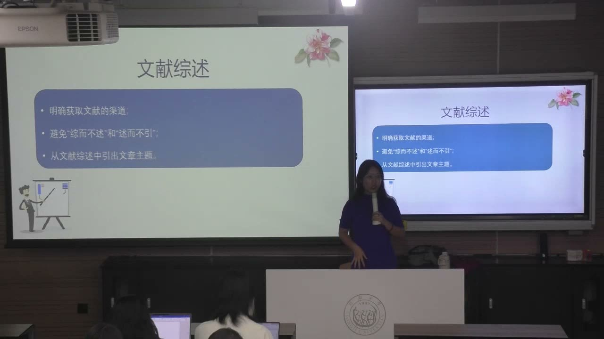
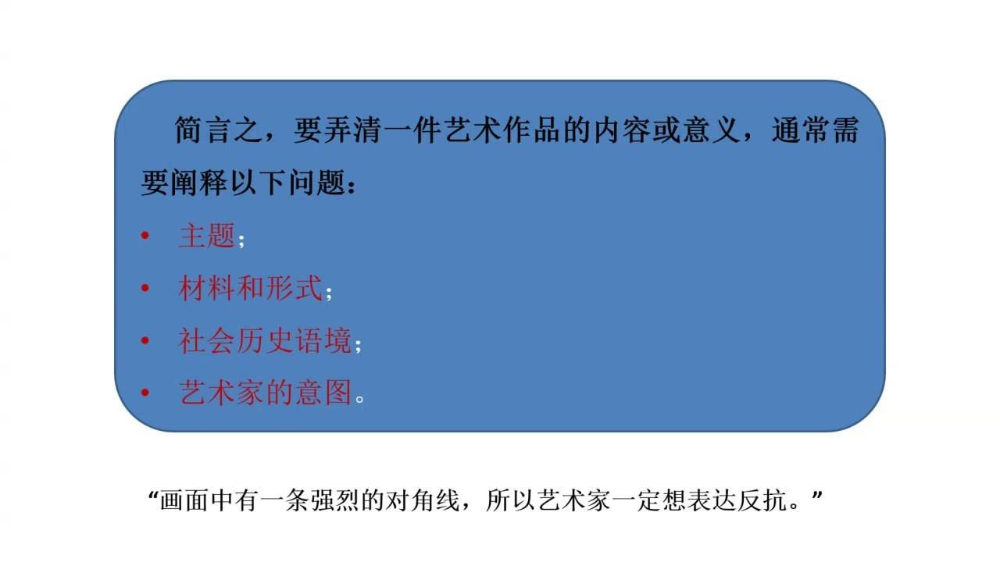
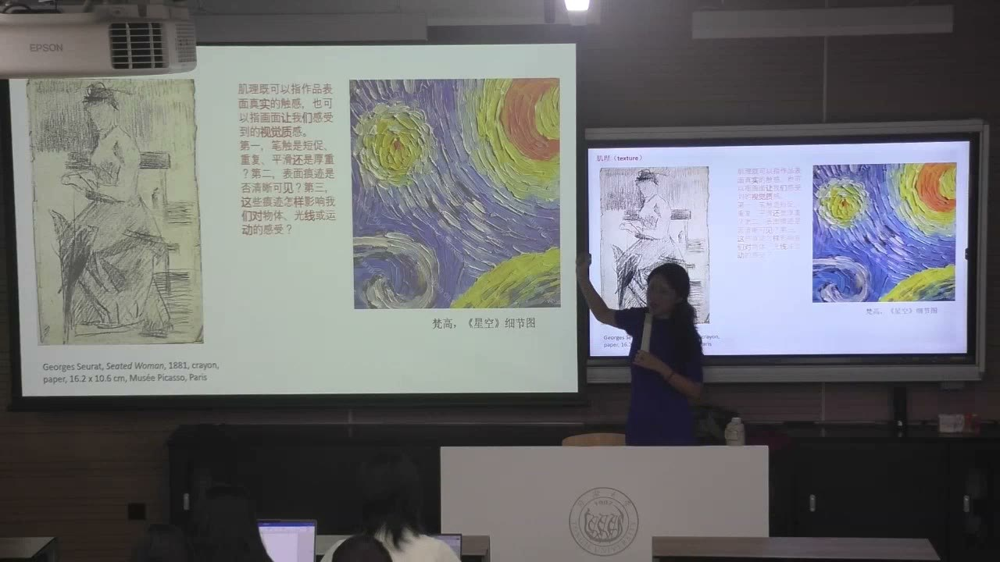
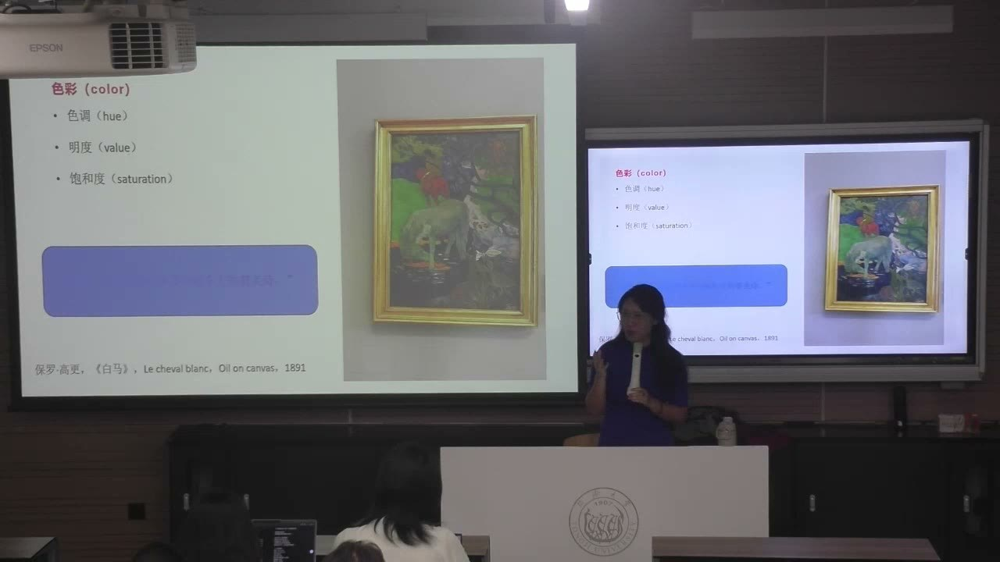

### 课程安排与任务

#### 下周课前准备约300字摘要
<!-- source: 94 -->
下周上课前准备一份约300字的摘要，供课堂练习、分享和小组讨论。可以先用已有课程题目练习，也可以利用这一周考虑学年论文方向，并与导师交流。摘要练习允许从现成题目入手，不等于正式课程论文可以与其他课重复提交。

摘要应说明具体问题、研究动机、方法、结果和结论，而不只是写一段背景介绍。题目尚未成熟时，可以先建立临时版本，再随着研究推进修改。

#### 期中综述与期末论文可以在同一研究方向上衔接
<!-- source: 0 -->
期中文献综述不是在第七八周的期中考试周单独提交。教师本节说明，等最终题目确定后，可与期末论文一并交，两份材料分别保留。综述可以服务于期末论文，不必人为做两套互不相关的题目。

训练用综述的范围和阅读量，应比最终论文中压缩使用的综述部分更充分。课堂提到的文献数量只是体量说明，不是新的统一最低篇数要求。最后可选择艺术或文化产业方向，不能因为前段课堂例子偏艺术，就被迫把最终选题限制在艺术史。

#### 学年论文方向与正式写作格式
<!-- source: 2 -->
课程论文应尽可能发展为学年论文的雏形。先提出感兴趣的方向，再与已分配的导师沟通；方向可以调整，但越早开始越能积累材料。正式提交的本课程论文不能直接使用同学期另一门课程的论文。

格式以群内文科论文规范为准，本节强调章节层级使用相应汉字编号，注释用当页脚注，不用集中放在文末的尾注。参考文献不同类型有不同格式，教师后续还会发出并说明，不把本节未展开的细则当成已经公布。

### 标题首先要让读者看清研究关系

标题是一种逻辑训练，修辞可以后加，研究对象、范围和关系要先成立。

#### 四种标题形式与主副标题的层次
<!-- source: 6 -->
课堂介绍陈述式、主题式、问题式和带文学性的标题。陈述式直接说明做什么；其他形式可以增加主题框架、提问或吸引力，但如果删去修辞部分完全不影响信息，就要判断它是否值得保留。

标题可以只有主标题，也可有主标题和副标题，避免同时堆入冒号、破折号等而产生不必要的三级结构。教师建议先用简单明确的表述说清问题，再考虑文采；AI偏好的装饰性句子不能代替实际信息。

#### “与”“和”不能替代关系说明
<!-- source: 10 -->
把两个名词并排，不会自动告诉读者二者是并列、比较、包含还是因果。教师以丝绸资源在汉代外交中的用途说明：把材料叫作“资源”，把作用叫作“治理”，若概念和实际研究范围不符，即使调查做得不错，也会让标题妨碍理解。

更清楚的写法是让名词和动词建立关系：研究什么材料，它怎样进入什么活动，要解释哪一过程。标题也可以在摘要和正文写出后反复改，不必第一次就追求最终版本。

### 摘要要交代研究做了什么

摘要不是概念陈列，也不是用宏大背景和价值口号替代具体发现。

#### 五个信息位置与结果、结论的区别
<!-- source: 14 -->
需要清楚交代研究对象或问题、为何值得研究的动机、采用的方法、得到的结果，以及由结果能够推出的结论。教师先用目的、方法、结果、结论概括，再特别展开问题陈述和动机，因此重点是信息是否齐全，而非机械套五个句子。

结果说明本研究发现了什么；结论说明这些发现对问题和更广范围意味着什么。结论可以引申，但要有研究支撑，不能从一个局部分析突然跳到泛泛的当代启示或文明交流价值。

#### 有背景、有理论，不等于有研究
<!-- source: 16 -->
数字化展示的反例列出多个理论，声称发现“深刻变革”，却没有解释怎样变、理论如何作用、具体得到什么。这种摘要虽然出现了几个必要词语，仍可能只有套话。

动机可以从问题的重要性切入，也可说明既有研究的空缺和不足。方法不一定是某位理论家的名字，还可以是调查、比较、分类等具体操作。理论数量多，不会自动使论证更好，关键在于怎样回答问题。

#### 按段检查信息，而不是接受“看起来像论文”
<!-- source: 24 -->
课堂比较艺术、电影及产业摘要，要求检查目标、方法、发现是否可辨认，题目、摘要、关键词是否指向同一工作。只有目标与背景，最后接一句无需研究也能说出的“大道理”，并没有完成摘要。

有些写法在报纸艺术批评中可以成立，却不适合本课程训练的学术论文。文体要求不同，不能仅因文章已经发表，就认定它的结构值得照搬。教师也展示了按要求生成的AI例文，用来观察结构完整度，并明确提醒细节可能错误，不能把示例当成已完成的实证研究。

#### 句子、指代和动词影响逻辑
<!-- source: 36 -->
把整段摘要写成一个长句，容易使研究问题、背景和结果混在一起。“这”“其”等代词若没有清楚的前项，主语就会漂移；词语看似华丽，读者却不知道谁在做什么。

教师要求用分析、比较、探讨、总结等合适的中性动词说明研究操作，并能具体解释一个摘要哪里不好、如何改好。产业摘要中“有数据分析”与“提出应用路径”若缺少推导，仍可能像两篇文章拼接。

### 关键词与文献综述共同暴露研究的核心

关键词决定怎样被找到，综述则说明问题从哪里来。两者都需要取舍和判断。

#### 关键词通常3—5个，既看检索也看核心论点
<!-- source: 28 -->
关键词一般与题目和摘要对应，以3—5个为宜，使用能够指向对象、范围、方法或关键概念的名词性词语，不把整句描述塞进去。排列通常由大到小，从较大领域进入具体对象。

犍陀罗例题中，“希腊化”有助于接入既有研究，但如果真正论点是形象在叙事中做什么，“叙事”就不能轻易被删除。某个具体人物可以是比较材料，而未必就是最核心关键词。取舍不是把摘要中出现过的名词全部罗列。

#### 综述要归类、评价并引出自己的问题
<!-- source: 50 -->
“综”包含较充分阅读后的搜集、归纳和整理；“述”需要比较研究角度、方法、材料和结论，指出贡献及未解决的问题。教师示范按研究路径归类：同样讨论一类图像，有人主要整理材料，有人辨认风格年代，也有人解释传播与历史原因。

归类之后还要评价：材料是否充分，研究是否忽略发现地点或具体语境，方法能回答什么、不能回答什么。最终论文问题应接续综述中识别出的空缺，避免综述与研究主题成为“两张皮”。

#### 不“综而不述”，也不“述而不引”
<!-- source: 54 -->
综述既要有判断，也要有可回查的来源。文献获取渠道、期刊质量及被引等线索可以帮助筛选，但具体文章仍需亲自阅读，不能只凭外观或权威标签判断内容。

AI可以帮助抓取结构、处理简单工作；评价研究好坏和建立问题的能力，仍需先通过阅读训练。教师尤其要求先学会分析，再去指导工具，而不是把最能锻炼逻辑的判断环节全部让渡。

### 形式分析与形式主义理论要区分

形式分析训练把看见的东西说清楚，但不意味着其他层次的解释都不重要。

#### 主题、材料形式、历史语境与艺术家意图
<!-- source: 58 -->
理解作品可以分别询问主题、材料和形式、社会历史语境、艺术家意图。只说莫兰迪画了很多瓶子，是主题描述；只讲作者不善交际，是生平叙述；颜色、形状、构图和媒介，则进入形式分析。

观察到强烈对角线，不能立即推出作者“一定在反抗”。前者是形式特征，后者是意图判断，中间还需要相关材料。描述能提供信息，也有自己的责任边界。

#### 方法可用，不必接受排他性的理论
<!-- source: 66 -->
形式分析方法与形式主义理论不同。课件中的形式主义强调对作品自身的纯粹、直接分析，弱化语境、故事和观念；把这种立场推到极端，可能排斥其他解释。

课程训练使用构图、材质、造型、线条和色彩等观察方法，不要求预先承诺只有形式最有意义。沃尔夫林、罗杰·弗莱、克莱夫·贝尔等代表研究被列为延伸阅读，教材第三章也可用于预习和复习。

### 肌理：从“看着有感觉”走向可讨论的描述

肌理包含表面真实触感，也包含图像使人感到的视觉质感。

#### 真实肌理与视觉肌理
<!-- source: 72 -->
真实肌理（actual texture）涉及作品表面本身的触感，视觉肌理则涉及观看时呈现的粗糙、平滑、柔软、厚重等质感。通过图像讨论触感时，需要知道自己依据的是可见痕迹，而非已经触摸了原作。

描述可以从笔触入手：短促还是连续，重复还是疏落，痕迹是否清楚，怎样指向某个方向。词语要适合媒介，不能因为一组词方便，就把纸本素描与厚涂油画都用同样的“平滑／厚重”概括。

#### 从局部证据走向画面效果
<!-- source: 74 -->
修拉纸本坐像的背景重复竖线，与人物轮廓的较短线条，可以分别描述。梵高《星空》的可见厚涂、短促而重复的笔触，以及沿弯曲、环状方向组织的线条，则使天空呈现运动感。

从笔触方向和重复关系说“画面不平静”，仍是在说明可见形式造成的效果；进一步断言作者内心焦虑，则已进入需要其他证据的解释。教师在示范中明确指出这条界限。

### 尺寸不只是作品标签上的数字

真实尺度决定人与作品怎样相遇，屏幕中被统一缩放的图像会掩盖这种关系。

#### 大幅绘画组织观看距离和身体移动
<!-- source: 82 -->
课堂展示的《拿破仑加冕》标注为布面油画，尺寸约621×979厘米。如此大的画面，需要观者退后看整体，再靠近观察局部，尺寸直接影响身体位置与观看过程。

描述时先说看到什么、构图和色彩怎样安排，暂缓用“神秘”“优雅”“崇高”等解释性词语代替观察。教师让大家在教室中想象近十米宽、六米高的画面，目的就是把数字还原为空间经验。

#### 手机复制图像会丢失原作的尺度关系
<!-- source: 86 -->
巴内特·纽曼的大幅作品、《自由引导人民》和《蒙娜丽莎》被用于比较不同尺度。若手机中都显示为差不多大的图片，原作与人的比例、包围感及近看远看的变化，就很难被保留。

复制、宣传与再创作还可能主动改变尺寸。形式分析因此不只看屏幕上出现了什么，也应查阅原作尺寸和媒介，避免把复制图的观看经验直接等同于现场经验。本节没有展开纽曼作品题名的完整文学解释。

### 色彩：同一种颜色内部仍有差别

“这件衣服是白色”只是起点，还需要分析色彩怎样表现光线与空间。

#### 色调、明度、饱和度与具体区域
<!-- source: 90 -->
高更《白马》用于说明色调（hue）、明度（value）和饱和度（saturation）可以分别讨论。画面具有鲜明颜色，不等于全部区域都高明度；色彩丰富，也不能替代对具体关系的描述。

惠斯勒“白色交响曲”系列中的白衣和白色帘幕，因受光、阴影和空间位置不同，出现不同层次的白。分析要指出哪些地方更亮、更暗，如何与光源对应，而不是只把所有区域归为白色。

### 概念对照与自测

| 项目 | 要回答的问题 | 常见偏差 |
| --- | --- | --- |
| 标题 | 研究什么，概念之间是什么关系 | 修辞堆叠、主副标题层次过多 |
| 摘要 | 为何研究、怎样研究、得到什么 | 理论名单取代方法，口号取代发现 |
| 关键词 | 核心是什么，怎样被检索 | 比较材料挤掉真正论点 |
| 文献综述 | 既有路径、贡献、空缺在哪里 | 罗列不评价，评价无引文 |
| 形式分析 | 可见特征怎样组织观看 | 从线条直接跳到作者意图 |
| 肌理 | 表面痕迹和视觉质感如何形成 | 不分媒介，套用感受词 |
| 尺寸 | 人与作品的比例和距离怎样变化 | 把手机复制图等同于现场 |
| 色彩 | 色调、明度、饱和度怎样配合 | 只说颜色名字，不看受光关系 |

#### 摘要的“结果”和“结论”怎样区分？
结果交代研究实际发现什么；结论说明发现对问题或相关领域意味着什么，引申应受材料和分析支持。

#### 为什么一条强烈对角线不能直接证明画家要反抗？
对角线属于可见形式，反抗属于意图解释。二者之间需要语境、作者或其他材料支撑，形式本身不能完成全部推理。

#### 为什么比较画作时还要查尺寸？
复制图统一缩放后会掩盖人与原作的比例。实际尺度影响观看距离、身体移动、整体与细部的切换。

### 课程时间线

00:00—04:00：期中期末衔接、导师交流与学年论文雏形
04:00—10:00：标题的四种形式、层次和修辞取舍
10:00—14:00：丝绸资源例题，概念与逻辑关系
14:00—20:00：摘要要素、研究动机与方法
20:00—28:00：摘要例题、AI示例及文体差别
28:00—36:00：关键词选择、范围排序与拟题练习
36:00—46:00：长句指代、方法和发现的衔接，产业摘要评析
46:00—50:00：课间，未识别到明确讲授文字
50:00—58:00：摘要练习安排，文献的归类评价与问题引出
58:00—66:00：脚注规范、作品解释的四角度与形式推断边界
66:00—72:00：形式主义方法和理论，媒介及分析维度
72:00—82:00：真实与视觉肌理，笔触和画面效果
82:00—90:00：大型绘画、复制图和观看尺度
90:00—95:50：色彩三维度、白色的受光层次及课后300字摘要
