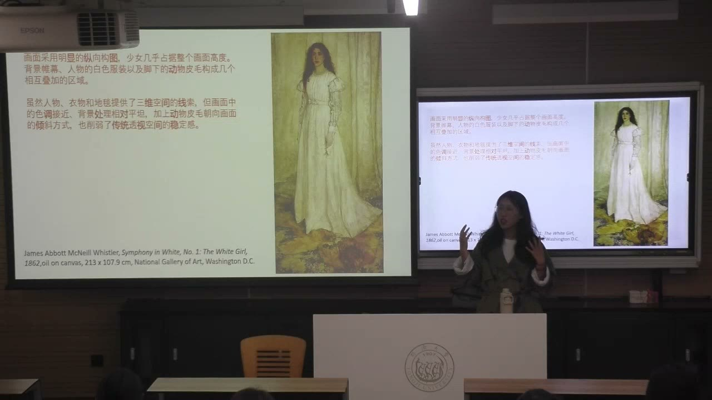
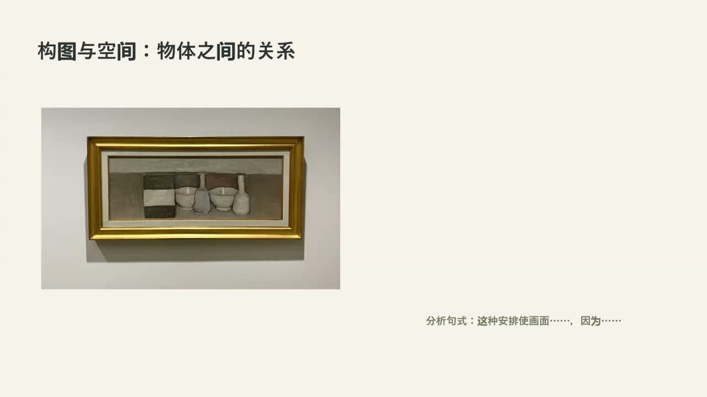
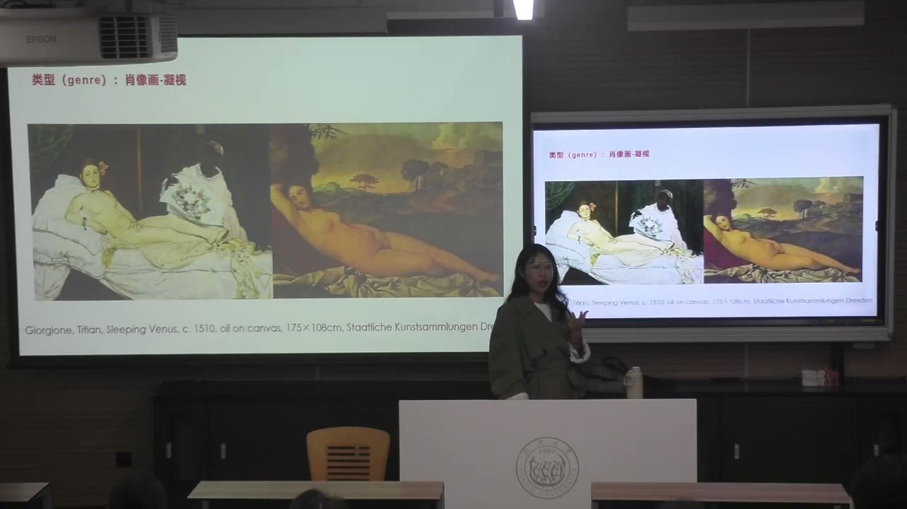

### 课程安排与任务

#### 检查文献清单与300字研究计划
<!-- source: 0 -->
课堂检查此前的七条文献清单，以及上节课布置的约300字研究计划摘要。两位同学互看，人数不便时三人一组；尚未写完的在课堂继续写。重点是判断核心信息及其关系是否清楚，不必一开始就追求文字完美。

计划应涉及主题、已有研究的问题、准备做什么、预期结果，以及可能扩展的意义或应用。可以先按这些方面列出提纲，再组织成段落。教师建议大体沿上节课的次序展开，允许根据论证需要调整；最后的意义提升也要看具体题目，不能为凑足五项而空写。

自己收集并核对文献仍有必要。AI生成的条目可能出错，文献管理工具可以帮助整理，但不能代替来源确认。

#### 用已有论文练习，继续发展自己的研究
<!-- source: 16 -->
已经写过课程论文的，可以为它重写摘要、修订结构，或把它继续发展为学年论文。未来仍可更换主题，教师不要求每次都沿同一选题，但持续积累通常比每次另起炉灶更顺畅。

课后继续观察作品、阅读文献并与相关教师交流。下一次将结合图像学、历史知识进一步分析作品；本节末展示夫妇像作为后续讨论线索，没有要求当场给出关系与年代的结论。

### 研究问题在阅读与观察中形成

研究计划不是预先拥有全部答案，而是帮助判断一个问题是否值得做、能否做，以及还缺什么材料。

#### 提案与完成后的摘要处在不同阶段
<!-- source: 16 -->
proposal是在研究尚未完成时整理思路、说明意义与可行性；完成论文后的摘要，则概括已经开展的研究和结果。两者篇幅可能相近，但不能把尚待检验的预期写成已经证实的发现。

写作本身也是研究的一部分。通过组织主题、问题、方法与可能结果，可以发现信息缺口，再返回阅读和材料搜集。计划不是一次填完就不再变化的表格。

#### “别人已经写过很多”不等于没有问题可做
<!-- source: 16 -->
找问题通常需要持续阅读，而不是想到一个题目就立刻完成研究。先从感兴趣的艺术家、现象或理论进入，读到自己不明白、现有解释不足或不同材料相互不一致的地方，再逐渐缩小问题。

课程论文不要求一开始就“前无古人”。可以把本课当作试验，边读边写、不断精确话题。艺术研究还可以从作品之间肉眼可见的差异进入：同一作者为什么在不同时期改变颜色、媒介或构图？此时问题来自观察，解释则需要进一步查证。

### 构图如何改变观看与意义

构图涉及画面中物体的安排、比例、方向及空间关系。分析不能停在“横向还是纵向”，还要说明这些关系怎样影响观看。

#### 惠斯勒：白色层次与人物比例
<!-- source: 36 -->
《白色交响曲第一号：白衣少女》以接近的白色组织背景帷幕、衣服等部分，但光线、质感和色调仍有层次。颜色还可能带有文化象征，不能把一种文化中的白色含义自动套到另一种历史情境。

画面采用纵向构图，人物几乎占满高度，因而成为核心。如果仍是纵向画幅，却把人物缩小、让背景占据更多空间，观看重心就会变化。比例和位置不仅是外形描述，也在安排观众首先看什么。

#### 兽皮、倾斜方向与空间的不稳定
<!-- source: 40 -->
少女脚下不仅有地毯，还有动物皮毛。加入这一对象，会让画面不同于单纯的室内少女形象。教师由此区分“画面给出的效果”与“猜测艺术家的意图”：可以先描述兽皮带来的感觉，再寻找材料解释它为什么出现。

背景相对平坦、人物与背景色调接近，削弱了纵深；下方皮毛的倾斜又与人物姿态形成动态关系。上部的平面感与下部的不稳定，可以同时存在于一幅画中，不能只用一个“静”或“动”概括全部构图。

#### 对称、对角线、水平线与环形关系
<!-- source: 42 -->
对称与稳定、重心是否偏向一侧，是观察构图的角度。对角线常打破四平八稳的安排，水平关系可以强化平静感；环形并非一定要出现一个正圆，也可能由人物姿态、背景或色彩连续形成。

课堂以马远集中于一角的安排、马蒂斯《舞蹈》及蒙克《呐喊》比较运动感。《呐喊》中人物和背景的波浪形，与桥的笔直斜线又构成不同的不稳定关系。线条作用需要结合整幅画判断，不是“看到斜线就能直接读出唯一情感”的公式。

### 媒介、肌理与类型

画面内部安排之外，材料和制作方式也会影响观看。作品类型则帮助确定需要补充哪一类历史与文化知识。

#### medium不只指传播媒体
<!-- source: 54 -->
绘画分析中的媒介，涉及墨水、水性颜料、炭笔、粉笔等材料及其运用。不同媒介形成不同肌理、笔触和表面效果，不能只把medium理解为电视、手机或流媒体。

拼贴可以把纸张、报刊图像或日常材料组合在画面上。教师以马克斯·恩斯特的作品说明，剪贴之物与描绘之物可以错位，纸面色差、材质、层叠和故意偏斜，也会让观众停下来观察。作品看起来像“画了什么”，不一定能直接告诉我们它实际用了什么。

#### 类型有共通名称，表现传统却可能不同
<!-- source: 60 -->
课堂列举历史画、肖像画、风俗画、风景画与静物画。类型并不只是贴标签，它提示需要关注的对象与证据不同。

鲁本斯表现玛丽·德·美第奇抵达马赛的历史画，将历史人物、地点线索和神话形象放在一起；中国历史题材绘画也会表现事件，但未必采用同样的图像组织方式。不能因为同属历史画，就预设不同文化、时代的绘画拥有相同细节与意义。

### 用莫兰迪练习从描述到分析

形式分析不只是列物品清单，而是解释可见形式如何运作。观察、描述、关系分析与效果阐释需要衔接。

#### 描述：说清看到了什么
<!-- source: 62 -->
先观察数量、形状、高矮、距离、横纵关系、空白区域和色调。物品名称不确定时，可以描述为长方形、椭圆形或柱状，不必为了显得专业强行命名。

课堂的静物例子中，器物紧靠、横向展开，部分顶部高度接近桌面边界；色彩对比有限，桌面留白较窄。这些是后续分析的依据。仅说“有两个碗、两个瓶子”，还没有解释画面怎样产生效果。

#### 分析：关系为什么带来这样的效果
<!-- source: 66 -->
进一步看物体有没有分组、重心在哪里，形状与体积是否稳定，边缘是清晰还是柔化，光线和阴影如何处理。课堂把弱化阴影、物体与背景接近等现象，联系到空间深度被压缩、前后关系不易辨认的效果。

可以用“这种安排使画面……，因为……”组织分析。例如，器物紧密排列、色调区分有限、顶部与背景边界接近，共同加强紧凑与平面化感。结论需要由看见的关系支持，不能先写一个情绪词，再任意寻找附会。

#### 比较：同一题材中的变化能产生新问题
<!-- source: 70 -->
比较莫兰迪同名或相近题材的作品，可以观察黄色布幔的明暗、器物重叠、白色八瓣瓶的位置和媒介变化。一幅更突出中央瓶子，另一幅更强调整体关系；有的明暗明显，有的趋于平面化，比较需要逐项指出差别。

这些差异可以引出问题：某件反复出现的物为什么重要？同一母题在不同阶段为何变化？晚期作品与水彩或其他绘画传统看起来相似，是否就存在影响关系？教师明确把相关联想作为待查问题，而不是现成结论。视觉相似可以提出假设，不能独自证明历史影响。

### 让图像问题接上证据

形式观察帮助找到问题，作品资料、收藏记录和研究文献则帮助解释它。二者不能互相取代。

#### 作品信息与数据库怎样使用
<!-- source: 84 -->
教师示范从收藏机构页面查作品的媒材、尺寸、制作年代、收藏与流传信息，再进入研究文章或艺术家专题数据库的技术描述。媒介是否变化、画面实际多大等问题，应尽量通过作品记录核对。

国家艺术馆、艺术图像数据库、大都会博物馆和大英博物馆等资源，被用于展示检索路径。除了输入艺术家姓名，还可以按地区与年代，通过时间线缩小对象。先看实物及图像，再找自己真正想了解的差异，比空想一个宏大题目更具体。

#### 外部知识要帮助解释观察，不能代替观察
<!-- source: 74 -->
艺术家生平、博物馆目录和已有研究，可能解释颜色、题材或媒介为何变化。但在材料有限时，要先说明能观察到的关系，以及尚不知道的部分，不能把自己猜想的动机写成事实。

课堂以画家自画像、莫兰迪的重复母题等说明这一路径：观察差异，提出问题，寻找传记和研究材料，再判断解释是否成立。好的问题可以在调查后得到支持，也可以发现没有足够证据，研究不应为了保住预设答案而编造影响关系。

#### 肖像画中的凝视与日常女性
<!-- source: 92 -->
教师将马奈《奥林匹亚》与《沉睡的维纳斯》的传统形象比较。横向、半卧的安排相近，人物是否直视观众、背景、侍者及现实身份等线索却改变了观看关系。分析由相似构图推进到差异及其历史意义，需要相应知识支撑。

卡萨特在剧院中观看演出的女性形象，又把注意力转向日常生活中的人物。课堂借这些作品说明：形式分析仍然适用，但人物、社会角色和观看传统会增加新的分析层面。下一课将继续结合图像学与历史展开。

### 概念对照与自测

| 层面 | 要做的工作 | 主要证据 |
| --- | --- | --- |
| 研究计划 | 说明想研究什么、为何值得、如何可行 | 问题、阅读与已有材料 |
| 描述 | 明确看见的形状、位置、色彩等 | 画面细节 |
| 关系分析 | 说明形式如何共同运作 | 构图、距离、边缘、光线等关系 |
| 效果阐释 | 解释关系带来的观看效果 | 与观察相连的推论 |
| 历史解释 | 讨论变化、影响、意图及意义 | 作品记录、传记、目录与研究 |
| 媒介／类型 | 材料与制作方式／题材与表现传统 | 作品资料和文化情境 |

#### 为什么“画了瓶子和碗”还不够构成形式分析？
因为它只列出对象。还要讨论物体的安排、色彩和空间关系，以及这些关系怎样形成紧凑、稳定、动态或平面化等具体效果。

#### 对物品名称没有把握，怎样继续观察？
可以描述可见的形状、位置、高度和相互遮挡，不必猜出名称。形式分析首先需要可靠的观察。

#### 两幅画相似，能否直接证明一位画家受另一传统影响？
不能。相似性可以形成研究问题，影响关系需要进一步查找作品信息、艺术家经历和相关文献。

#### 研究计划能否把尚未开展的研究写成已经发现了结果？
不能。计划用于梳理问题、预期与可行性，完成后的摘要才概括实际研究及其结果，应分清两者所处阶段。

#### 直视观众与闭目沉睡为什么属于值得比较的差异？
它们改变人物与观众的关系。再结合身份、背景和绘画传统，才能继续讨论这种安排的历史意义，而不是只比较人体姿势是否相似。

### 课程时间线

00:00—04:00：文献清单、300字计划与同伴互看要求
04:00—16:00：课堂写作、互看阶段
16:00—20:00：proposal与摘要，阅读中形成研究问题
20:00—36:00：课堂练习阶段
36:00—42:00：惠斯勒的颜色、人物比例、兽皮与空间
42:00—46:00：对角线、水平与环形构图的例子
46:00—50:00：课间
50:00—54:00：已有论文的发展路径及《呐喊》的线条关系
54:00—60:00：媒介、肌理与恩斯特拼贴
60:00—64:00：历史画的文化差异及形式分析的步骤
64:00—70:00：莫兰迪静物的描述、空间与关系分析
70:00—76:00：黄色布幔等作品的比较与问题形成
76:00—82:00：重复母题、媒介变化及待查的影响关系
82:00—86:00：从描述升级为分析，连接研究证据
86:00—92:00：收藏机构、艺术家数据库与地区年代检索
92:00—96:16：肖像、凝视与日常女性，预告后续图像学分析
