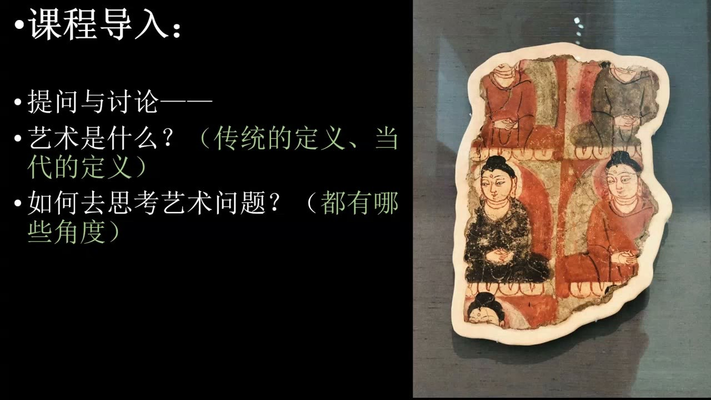
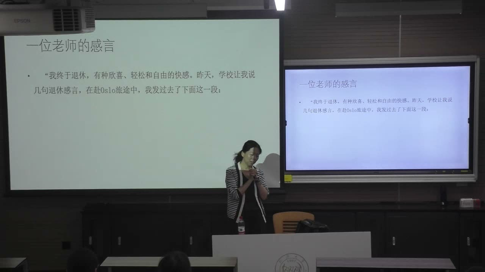
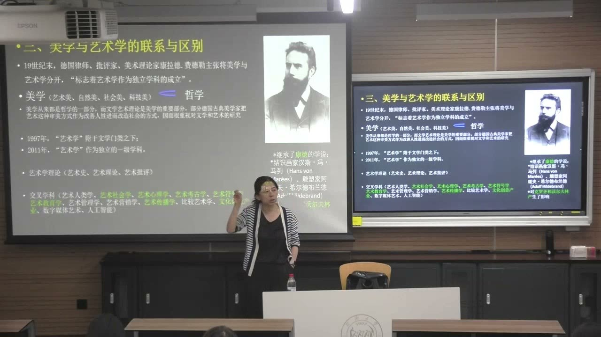
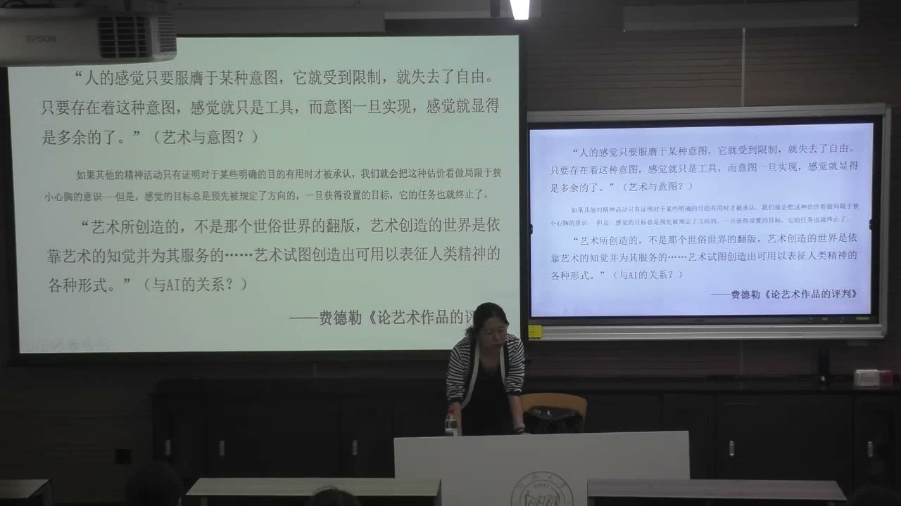
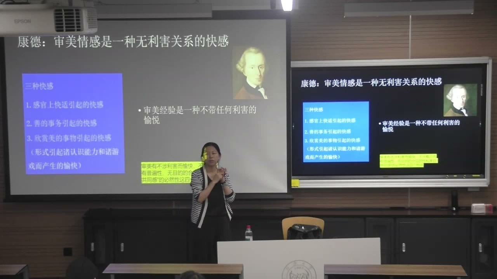
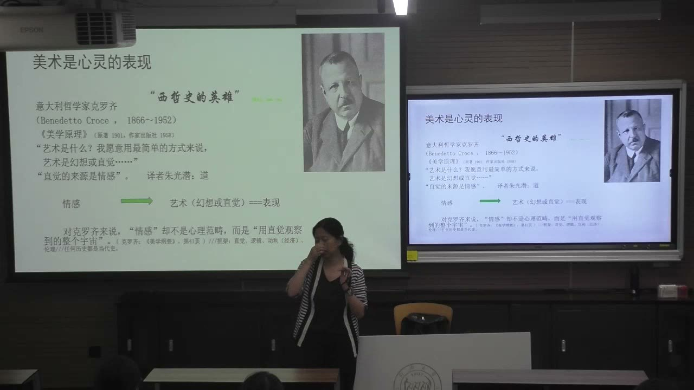
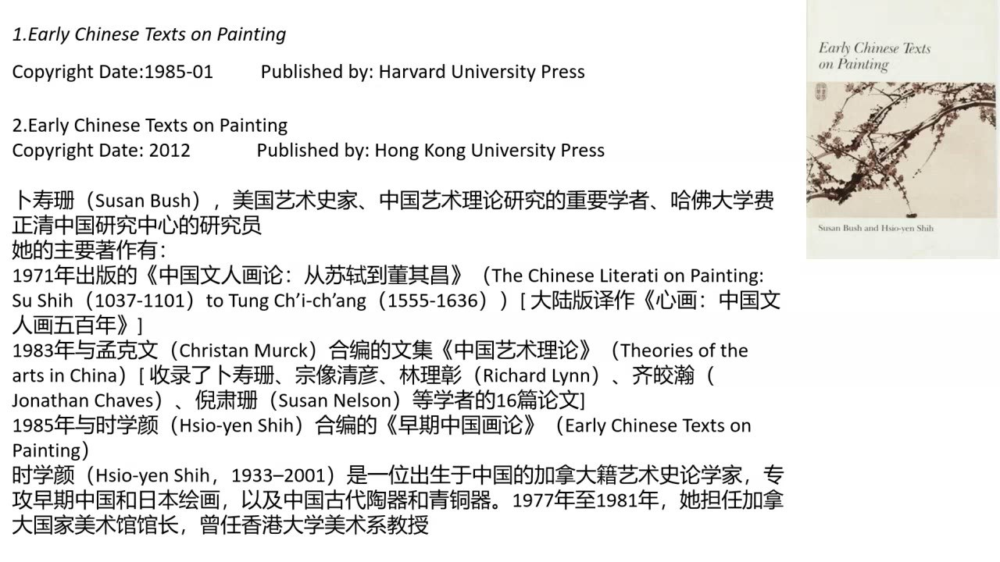
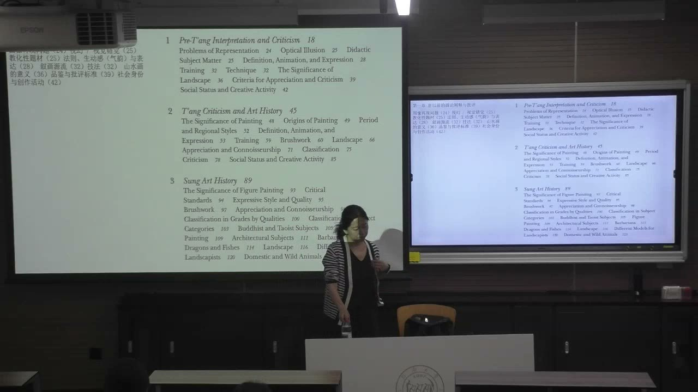
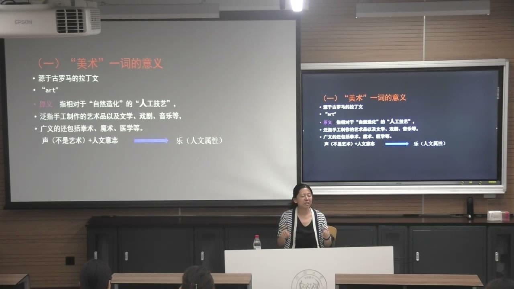
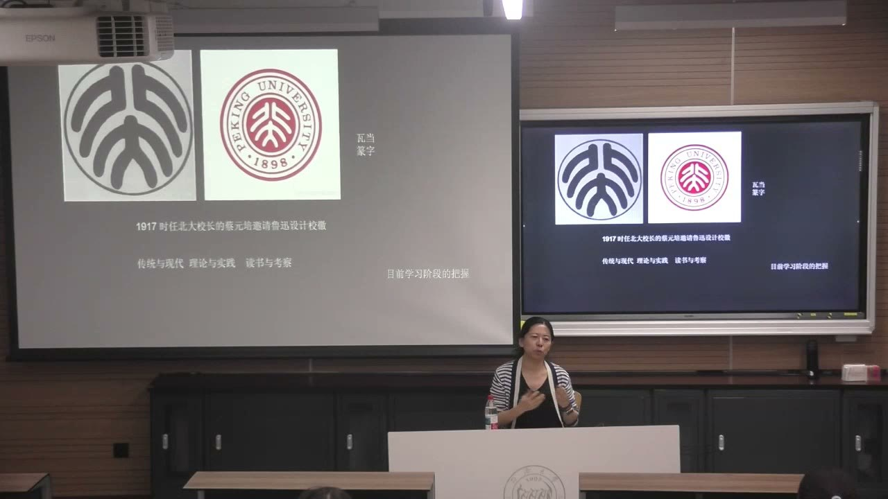

### 课程安排与任务

#### 学期成绩构成与写作要求

学期总成绩由四部分构成：平时考勤 10%，过程性考核一 10%（一份心得作业），过程性考核二 20%（期中作业），期末考核 60%（期末论文）。平时应参加课堂讨论；请假需提前说明并按学校要求提供相关证明。

文字表达应做到概念清晰、条理清楚、层次分明、观点明确、表达合理、书写规范。期末作品要呈现对经典著作的细读、理解与评介，并注明所读版本的信息。

#### 精读一本经典：先调研，再确定书目

每人选择一本艺术学范围内的经典著作，贯穿一学期精读，最后提交对该书或其中核心理论的评解。应选有观点、有思考深度的著作，避免只选教材或通俗读物。课初可以用一两周调研并比较候选书目。

课后答疑中，教师要求学生先根据兴趣自行检索、翻阅，再带候选书目或调研结果请教师把关。朱光潜《谈美》虽然表达简洁，教师认可其经典性与理论基础；电影理论等具体门类也可以选择，关键是通过著作学习理论和分析方法。

#### 心得只交一次，期中与期末可以沿同一线索推进

心得作业整个学期交一份，字数不限。可以从课堂内容中选一个小问题，也可以讨论所读著作的阶段性观点，避免泛泛而谈。若计划某周提交，应在该周周日前交给教师，以便在下一次课前交流和点评，并非每周都必须交一篇。

期中作业需要提交文本，可以在心得基础上继续推进，也可以形成期末论文的阶段成果。三次写作不必不断更换题目，可以围绕一条论题逐步深化。期中的具体形式和可能的小组讨论，教师表示稍后再布置。

### 导论的问题：艺术与艺术学

课程围绕艺术是什么、如何思考艺术，以及艺术学的研究对象与意义展开。

#### 艺术是什么，是一个持续开放的问题

教师把艺术概论组织为阅读式、研究式的学习。关于艺术是什么，传统与当代有很多不同定义；不同学者的视角、领域和问题意识，也会改变他们的表述。课程并不以背下一句固定定义为终点。

学习的过程，是比较各种回答、理解其推理，并逐渐使自己的认识更清楚。一本经典著作可以成为持续学习的线索：带着作者的思考方式听课，再与课堂中的其他观点对话。

#### 艺术与艺术学：对象和研究不能混同

教师以历史和历史学、物理与物理学的关系作类比：艺术活动和作品可以存在于研究之外，艺术学则是研究者对艺术进行考察、论述，并逐渐汇集成的学问。带上“学”字，意味着进入研究对象、方法和知识组织的问题。

艺术的门类与形成方式不同，不能仅用“表达情感”概括所有作品。某些工艺创作受到严格规格、赞助者要求或用途的制约；解释艺术时，需要说明所讨论的对象和条件，避免把一种创作经验扩展为全部艺术的定义。

#### 定义的角度不同，回答的问题也不同

教师提出本质论、功能论、认识论和形式等思考角度。本质的讨论追问艺术最根本的特征；功能的讨论关注艺术产生什么作用；认识的讨论关注艺术如何使人体验和理解世界；形式的讨论则重视艺术呈现的组织方式。

这些回答不必都挤进一句话。理解一位学者的定义，需要辨认它从哪个角度提出、针对什么问题，并考察它解释了哪些对象。艺术理论中的概念和判断，应经过阅读、体验和推演形成。

#### 研究艺术理论的意义也要落到具体关系

教师说明，艺术理论研究可以指导艺术创作、规范艺术批评、构建艺术学研究体系，并参与哲学社会科学研究。这些宏观意义还需要通过课程中的具体对象和推理逐步理解。

艺术并非只是一幅挂在墙上的画或随手的笔墨。教师从艺术与人的感知、精神力量和社会生活的关系出发，说明它值得深入研究。提出问题、排列问题之间的关系，再寻找回答路径，构成导论的学习主线。

### 经典阅读的方法：文本、作品与感知

经典思想与经典杰作分别提供理论和艺术经验，二者共同帮助形成理解世界的方式。

#### 艺术可以被理解为一种智性模式

教师引用一位长期研究艺术的老师的感言，把艺术解释为人类体验、理解和建构所生活世界的一种智性模式。这个定义把艺术的意义放到人与世界的关系中，而不只把它看成装饰或附带娱乐。

教师从自己的经验补充，艺术中的节奏可以与生活、工作及研究发生共鸣。她把这一表述放在功能和认识的角度理解：艺术能够参与人的感知与思考，但一个个人定义仍需要不断体验和推演，不宜随意宣称为唯一答案。

#### 艺术与其他学科交叉，需要相应的知识基础

教师以贡布里希的研究说明，艺术的发展可以与技术、观看和心理机制联系起来讨论；艺术与科学并非互不相关的领域。这也为艺术心理学等交叉研究提供了问题。

同时，交叉研究不能只借一个名称便开始作判断。教师以艺术与心理问题的研究为例，强调需要心理学方面的基础，或与有相应知识的学者合作。艺术素养与其他专业知识之间的交流，应进入具体的方法和能力。

#### 经典思想的价值，不等于所有结论都永远正确

经典著作承载了长期仍能启发思考的思想。教师以古今哲学文本说明，阅读经典不是因为其中每一句话都必须被认同，而是因为可以从其问题和推理中汲取智慧。

与为当下需求服务的短时效信息相比，经典阅读需要进入较长的思想过程。它的难度也意味着不能只从摘要迅速取出结论；逐行阅读、辨认概念、理解作者怎样组织问题，才能建立理论思考的模式。

#### 接触真实作品，培养与理论相连的艺术经验

除了读理论，也应真切地接触音乐、绘画和其他经典作品。教师用听古典音乐、看书画和阅读古老版本的经历，说明感知能力会在长期接触中被培养。理论与作品经验需要互相支持。

原作、印刷品和数字图像会带来不同的体验。数字媒介便于快速接触材料，但教师提醒不要完全以屏幕经验替代原作观察；纸张、书写、画卷与展示方式，也会影响观看和阅读的感受。

#### 读原文、说明版本，并保留谦卑的研究态度

外文著作若有中译本，应将译本与原文结合阅读，重要概念和主要观点要留意原来的表达方式。所读版本、出版与翻译信息也是阅读的一部分，不能把一个方便的译法当成无需追问的概念。

教师把经典阅读同敏锐感知、创造智慧和谦卑态度联系起来。积累知识是为了扩展理解与交流，而不是以知识压倒别人。自己的解释需要有依据、有推演，也要允许随着阅读而修正。

### 美学、艺术学与艺术理论的关系

相近的学科名称并非完全同义，区分它们需要看研究对象、出发点和方法。

#### 美学的范围，不只包括艺术美

教师把美学放在哲学的内部理解。美学不仅关注艺术，也涉及自然、社会、科技等领域中的审美问题，因此不能把美学的全部范围直接等同于艺术。

艺术与美学有紧密关系，但这不意味着艺术研究只能作为美学的附属部分。教师强调，两者之间需要进一步辨认独特性，简单画一个包含关系，还不足以说明艺术学怎样展开自身研究。

#### 费德勒主张艺术研究具有独立性

教师介绍费德勒主张将美学与艺术学分开，强调艺术理论有自身的独特对象和研究方式。这一主张与他同画家、雕塑家的交往，以及对视觉艺术的关注有关。

德国古典美学曾高度重视艺术改善人性、影响社会的作用。教师又联系蔡元培的美育思想，说明这类认识怎样进入教育讨论。艺术研究的独立性与美学对它的影响，需要同时看到。

#### 艺术学理论的范围，大于其中的艺术理论

教师在本课的区分中，将艺术史、艺术理论和艺术批评放在艺术学理论的大范围内。艺术理论是其中的一部分，不能因为名称相近，便把两个范围完全视为同一个。

艺术美学与艺术哲学更靠近美学、哲学的视角和理论推演；艺术理论则更贴近作品、创作经验和相关文本，从艺术本身的问题出发形成解释。这是教师提出的理解路径，两者并非截然分开。

#### 交叉学科改变的是问题和观察方法

艺术可以与人类学、社会学、考古学、符号学、心理学以及数字媒体、人工智能等领域发生交叉。教师以艺术人类学、艺术社会学等说明，跨学科关系提供了新的观察角度和研究材料。

理解这些名称，要回到它们怎样解释艺术，而不只是把学科名称连在一起。艺术与考古的联系尤其紧密，时间范围、实物材料和作品问题可能互相交织，不能仅用一个固定的年代界线划分研究。

### 一条理论线索：自由、审美与直觉

教师以康德、费德勒、克罗齐和沃尔夫林，展示不同学者如何突出艺术的特殊经验。

#### 费德勒：感觉不只是完成目的的工具

费德勒在《论艺术作品的评判》中讨论感觉与意图：当感觉完全服从一个预先设定的用途，它就受到限制，目的实现后也可能被当成多余之物。教师由此解释其关于艺术自由的主张。

在这一路径中，艺术创造并非只是世俗世界的翻版，而是依靠艺术知觉形成能够表征人类精神的形式。它重视艺术经验本身，反对只用实用目的衡量艺术。这是特定的理论立场，不能简单推广为所有作品都没有用途或创作安排。

#### 康德：审美快感与感官、道德快感的区别

教师区分三种快感：感官快适引起的快感，善的事物引起的快感，以及欣赏美的事物引起的快感。吃到可口食物和做一件善事带来的愉快，不能直接等同于审美经验。

康德在这里的关键表述，是审美情感作为无利害关系的快感。教师用比较帮助理解：审美欣赏不只是满足一个直接的欲望或完成一个道德目的，而有自身的愉悦方式。

#### 四个审美判断特征，需要细读而非只背术语

教师概括康德审美判断的四个特点：不涉利害而愉悦，不设概念而有普遍性，无目的的合目的性，以及来自共通感的必然性。这些简短说法各自有长篇论证，还需回到文本进一步理解。

教师以浑然天成、不显刻意痕迹的艺术效果帮助说明“无目的的合目的性”：作品含有人的创造，却呈现自然协调的感觉。她同时提醒，凸显人工痕迹、追求冲击感也可以是另一种审美，不能把一个学者的主张直接当成全体艺术的标准。

#### 克罗齐：艺术作为幻想或直觉与表现

教师介绍克罗齐在《美学原理》中，把艺术解释为幻想或直觉，其来源与情感有关；课件进一步将情感、艺术的直觉与表现联系起来。这里的“幻想”不能误解为病理意义上的幻觉。

在教师的解释中，克罗齐把直觉、逻辑、功利和伦理区分为精神活动的不同层次。直觉处在艺术理解的前端，不等于论文中概念性的逻辑推理；艺术研究对作品作推论，与艺术自身的直觉经验并不是同一件事。

克罗齐放大了直觉的意义，甚至将心中已经直觉到的画面视为艺术的形成。教师提示，这种观点可以帮助认识人的精神能力，但仍应作为一种理论去分析，而非无需讨论的最终结论。

#### 沃尔夫林：用形式构成一条艺术史

教师用“没有艺术家名字的艺术史”概括沃尔夫林突出形式的研究取向。它把线条、色彩、光和形式组织置于前景，尝试从作品形式的变化构成历史，而不是始终从人物传记或社会背景出发。

这一方法放大了艺术自身的特殊性，却不是所有学者共同采用的解释。它与研究艺术的社会关系、创作背景等路径形成比较：不同方法关注不同问题，应看清每种方法的起点与能说明的范围。

### 经典示例：《早期中国画论》的研究方式

画论研究把文献、历史阶段和艺术问题结合起来，展示从作品与相关文本进入理论的路径。

#### 了解一本书，也要了解它的版本和作者

教师介绍卜寿珊（Susan Bush）与时学颜（Hsio-yen Shih）合编的《早期中国画论》（Early Chinese Texts on Painting），展示 1985 年哈佛大学出版社版本和 2012 年香港大学出版社版本。它提供了进入中国绘画理论问题的阅读入口。

阅读经典之前，应了解作者的学术经历和研究方法。教师也提到卜寿珊的《中国文人画论：从苏轼到董其昌》及其中译本《心画：中国文人画五百年》，用于说明研究者持续关注的对象与线索。

#### 按历史阶段组织，仍然是在处理理论问题

教师通过目录说明，画论研究可以沿唐前、唐代、宋代等历史阶段组织，但各阶段中讨论的是表现、训练、技巧、山水、鉴赏、批评与创作活动等具体问题。历史框架与理论问题可以互相结合。

它不是只描述一幅画画了什么，而是考察怎样理解绘画、作品如何受到评价、创作与社会身份之间有什么关系。理论的形成与时代和材料有关，不能把问题从它的历史语境中完全抽离。

#### 人品、诗画、自然与道，都是可继续论证的问题

教师从目录引出工匠与士人、人品与画品、诗与画、自然与绘画，以及山水与道等问题。一个看似熟悉的判断，如“字如其人”或“诗中有画”，也需要进一步辨认它的含义和成立条件。

诗与画既可以被讨论为相关的表达，也有各自不可替代的方式。教师提到钱钟书关于诗画关系的论述和莱辛《拉奥孔》，强调这类问题已经有长期的经典讨论，不能只坐着想象便宣布答案。

#### 从文献学习分析方式，再形成自己的评价

这类研究把早期文献拿出来，进行翻译，并加入研究者的分析。阅读时要区分原文说了什么、译者如何表达、作者又怎样解释，逐步形成对理论问题的判断。

经典作者的分析未必都必须接受，但它们本身提供了可学习的方法。逐行、逐篇阅读后，再分析和评议，比仅取得一个现成结论更能提高理论能力。教师也提到不同作者的材料可以对读，以比较他们的选文和理解。

### 美术的词义：人工技艺、传统与现代

概念的含义会随语言和历史变化；理解艺术，还要辨认人的创造如何进入自然材料。

#### 不要把今天的词义直接套在过去

教师以“美术”一词说明，概念的历史范围可能不同于今天的习惯理解。美术曾有更广的含义，不宜一遇到这个词，就立即只把它理解为当代所说的视觉艺术。

课堂从 art 所关联的人工技艺出发，说明文学、戏剧、音乐以及其他技艺曾被纳入较广的讨论。阅读旧文本需要看当时的用法和语境；语言帮助表达，也可能成为理解的障碍。

#### 自然形态好看，不直接等于艺术作品

教师用野柳自然风化的岩石举例。它可以呈现优雅的人像形态，也能引起美感，但因其形成没有人工技艺，她将它与人的艺术作品区分开。

这个例子把自然美与艺术创造的问题分开：可以欣赏自然，但本课所讨论的艺术还要关注人的成分。与“浑然天成”的审美标准结合来看，作品含有人工创造而又不显刻意，并不等于完全没有人参与。

#### 声、音与乐：自然声音怎样进入人文表达

树叶作响等自然声音，不因悦耳便直接成为艺术。教师借《礼记·乐记》的思路解释，声音与人心、情感及人文意志发生关系，并经过组织，才进入音乐的讨论。

声、音、乐不能一概混用。演奏古琴或小提琴，也不是只让器物发出声音，还涉及人的感受和表达。中国早期文本已包含这些关于艺术的思想，阅读时可以同其他理论比较，但不能只凭相似词句便取消二者各自的体系。

#### 近代“美术”的传播，与美育思想相联系

教师从日本的美术学校和相关团体谈到近代“美术”概念的传播，并通过王国维、蔡元培与鲁迅的论述，说明这个词与想象力、情感、信仰、道德和人的修养发生的联系。

这些例子显示，艺术的意义不只在技能训练，也在感知和思想的培养。阅读近代文字时，需要注意“美术”所指的范围，并辨认作者讨论的是作品、教育还是社会作用。

#### 北大校徽：传统形式可以进入现代设计

教师以鲁迅设计的北大校徽说明传统资源的作用：篆字“北大”与瓦当的圆形组织相结合，形成简洁的现代标志。理解这一设计，需要认识文字、器物和中国文化中的形式资源。

教师据此强调，学习西方理论的同时，也应了解中国本土文化。传统与现代、理论与实践、读书与考察之间的关系，都需要继续思考。它们的先后与相互支持如何安排，是教师留给后续课程的问题。

### 概念对照与自测

| 概念或路径 | 本课的区分 | 阅读时要追问什么 |
| --- | --- | --- |
| 艺术与艺术学 | 艺术活动和作品；对艺术展开研究的学问 | 是在讨论对象，还是对象的研究？ |
| 美学与艺术学 | 美学不限于艺术；艺术研究有自身特殊问题 | 范围、对象和方法有什么关系？ |
| 艺术学理论与艺术理论 | 较大的学问范围；其中贴近艺术问题的部分 | 名称指向整体还是其中一个分支？ |
| 艺术美学、艺术哲学与艺术理论 | 偏重哲学推演；更多从艺术与相关文本出发 | 论证的起点是哲学问题还是艺术材料？ |
| 感官、道德与审美快感 | 康德将三种愉快区分开，突出无利害关系 | 愉悦是由欲望、善的目的还是审美引起？ |
| 直觉、逻辑与艺术研究 | 克罗齐重视艺术直觉；研究需要概念和推理 | 是体验艺术，还是解释与论述艺术？ |
| 原文、译文与研究解释 | 材料本身、语言转换与学者的论述 | 哪些内容属于作者，哪些属于译者或研究者？ |
| 自然美与艺术创造 | 自然形态可以美；艺术问题还涉及人的创造 | 人的技艺、情感和表达怎样进入其中？ |

#### 这门课为什么要求精读一本经典，而不只背艺术定义？

艺术的定义是开放问题。持续阅读能理解作者提出问题和形成判断的方法，再与课堂上的其他路径比较，逐渐形成自己的认识。

#### 心得作业是否每周都要交？

不是。全学期交一份；若选择某周提交，应在那周周日前交，以便下一次课交流。期中和期末可以沿同一论题推进。

#### 美学为什么不能直接等于艺术学？

美学还关注自然、社会、科技等审美领域；艺术研究又有作品、创作和相关文本的特殊问题。二者相关，但范围和方法不完全相同。

#### 费德勒为什么强调感觉不能只是实现意图的工具？

在这一路径中，艺术经验有自身的自由和价值。如果完全按预定用途衡量感觉，达到用途后感觉就被当成多余，艺术的特殊性会被忽略。

#### 康德在本课被概括出的四个特征是什么？

不涉利害而愉悦，不设概念而有普遍性，无目的的合目的性，以及来自共通感的必然性；每项仍需回到其文本细读。

#### 《早期中国画论》为什么是艺术理论研究的例子？

它把历史阶段、原始画论与艺术问题结合起来，通过翻译和分析讨论表现、鉴赏、批评、社会身份等，并非只描述画面的内容。

#### 阅读画论时，为什么需要区分原文、翻译和解释？

三者分别承担材料、语言表达和研究判断的作用。区分层次，才能检验解释怎样建立，并形成自己的评价。

#### 自然形成的“女王头”为什么在教师的例子中不算艺术作品？

它虽能引起美感，却由自然风化形成。教师以此说明自然美与含有人的创造、技艺和表达的艺术作品之间的区别。

### 来源范围

原始转写含课堂互动，正文只整理教师讲授、解释、回应与课程任务。时间范围为两分钟音频分段边界，不是逐句对齐时间。

转写缺口：72—74 分钟。具体原因见来源清单；对应课堂截图保留。
