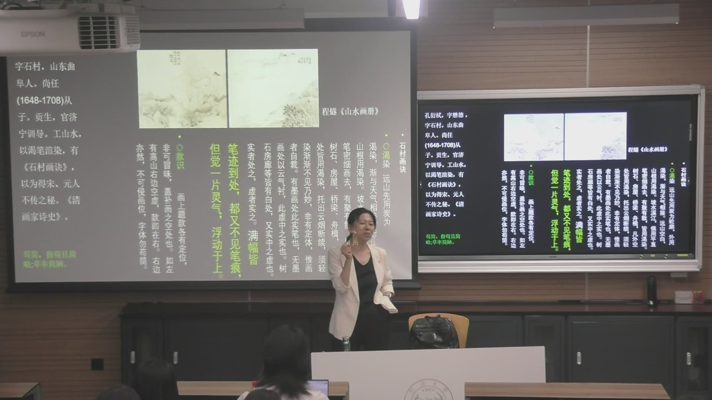
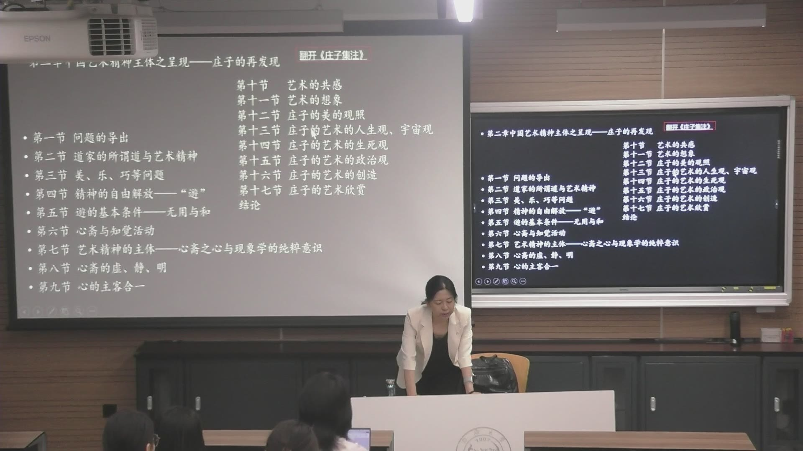
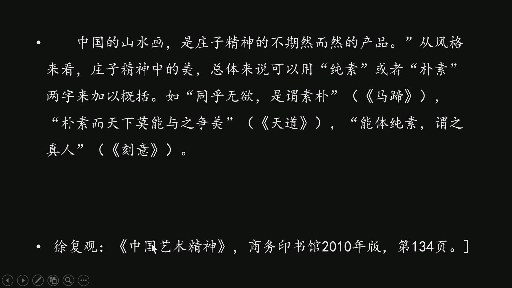
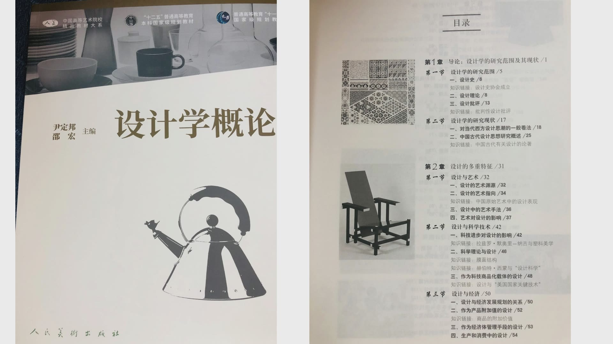
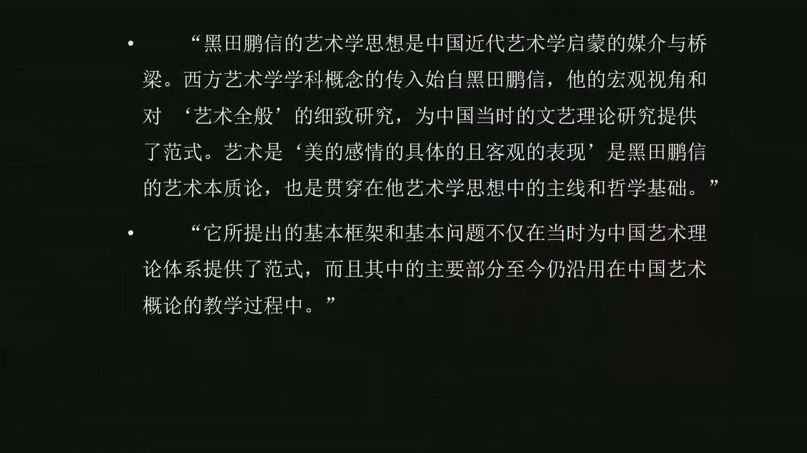

### 课程安排与任务

#### 经典阅读心得：选书、版本、目录与问题

至第三次课，应已找到计划阅读的经典。心得需要了解版本、不同版本的关系、全书目录及关键概念；外国著作应寻找原文，与中文对照，概念或段落不清楚时可标注原文。

教师对课间提问说明：字数没有统一要求，可围绕一个问题不断讨论，像小论文一样推进，完成后交邮箱。课上提供的书供参考，选书不必限定为其中某一本。

#### 延伸阅读与概念追溯

可以继续追溯“灵气”的出现、意义变化及物质与精神的关系。本课未给出标准答案，应把它作为问题保留下来。阅读《庄子》时，教师建议至少进入内篇，再结合注释理解。

课上发放的《艺术概论》《美术概论》《设计学概论》等，可先浏览脉络和参考书目。经典阅读应辨认作者的问题与推理，逐句理解，反复修正自己的判断。

### 从概念复盘进入经典阅读

记住概念之外，还要追问词的来源、文本的版本与论证的路径。教材、工具书和经典著作承担不同作用。

#### 文化与美育：概念需要回到具体语境

教师复盘文化、美、艺和真正艺术的关系，强调早期文化中的文治教化：不只靠武力，而借礼乐、德行影响人的生活。课堂把“绝地天通”等观念联系到神性与政治性的历史语境，说明古代文化与今天的通常用法并不完全相同。

孔子的“兴于诗，立于礼，成于乐”被用来解释艺术教育的潜移默化。六艺与西方七艺也各有历史脉络，现代学科建制不能直接当成古代中国已经具备的同一体系。

#### 经典著作为什么需要反复读？

教师以《中国艺术精神》的多个版面和不断再版说明，经典会持续被阅读，但经典与畅销并非同一概念。畅销可能来自一时趣味，经典则在不同时代和阅读阶段继续产生问题。

阅读不仅看正文，还要了解版本、目录、形成过程、写作动机和周边资料。一个概念看似已经懂了，也应反复核对句子和推理；通过猜想、反驳和修正，理解才能不断深化。

### 张彦远的自然论与作品品评

“自然”处在一套复杂的品评结构中，不等于照相式模仿，也不能简化成一张机械分级表。

#### 自然为什么高于谨细？

《历代名画记》讨论画体功用和品评，提出自然、神、妙、精、谨细五等，以自然为最高。这里的谨细是一等，不能拆成谨、细两等。教师从“不留痕迹、自然天成”的效果解释这一排序。

文本对过度精致、拘谨和只关注形状的警惕，并不等于绘画可以不训练。它关心技巧怎样进入整体表现，最终形成气韵，而不是让技巧本身成为目的。

#### 五等如何“包括六法”？

六法中最重要、要求记住的是气韵生动；其余包括骨法用笔、应物象形、随类赋彩、经营位置和传移模写。教师把张彦远的五等放在与前人六法对话的关系中理解。

课堂提出一个阅读问题：五等与六法是一一对应，还是每等都含六法？教师倾向于后者，即每等都包含这些要素，但比例不同，如自然可能更多体现气韵，应物象形则可能在谨细中更加突出。这是对文本关系的解释，不是把它改成固定的评分公式。

#### 数百等与“知画”的困难

文本在立五等之外，又说其间权量可能有数百等，提示作品之间还有微妙差异。鉴赏需要经验、敏锐性和对具体作品的理解，不能因为有五个名称就认为判断已经简单。

教师将“神迈识高，情超心慧”放回前面的论证：鉴赏困难，所以要求理解者具有相应能力。对它作批评前，需要先说明“画”的概念范围和作者正在面对何种作品，避免把不同范围的艺术直接混为一谈。

### 不见笔痕、灵气与原创

自然效果有具体的材料与感知问题。提出问题、区分解释和保留尚未解决的概念，是本课的阅读方式。

#### “笔迹到处”为什么又“不见笔痕”？

教师介绍孔衍栻《石村画诀》中“笔迹到处，都又不见笔痕，但觉一片灵气，浮动于上”的表达，并与真正艺术不露人为痕迹的理想比较。

画面由笔迹构成，却不让人只注意刻意操作的痕迹，这是一种整体审美效果。这里的“自然”需要努力和训练，不是偶然画出来或天生就能做到。

#### 灵气是否有一个现成答案？

教师把“灵气”保留为进一步研究的问题，要求追溯它何时进入古代文本、意义怎样变化，并辨认它与物质、精神和感知的关系。本课没有给出一个统一定义。

张彦远在理论之后回到具体画家与同题材作品的比较，教师据此讨论摹写和原创的差异：模仿形状、结构，并不保证复制原作的整体表现。课堂还提出可比较中国画论的灵气与本雅明讨论的灵韵，比较仍需回到不同文本的语境。

### 徐复观怎样从庄子理解中国艺术精神

《中国艺术精神》以传统文本和艺术实践相互解释。读它需要同时进入《庄子》，而不是只接受一句结论。

#### 全书怎样进入艺术精神的问题？

教师介绍徐复观《中国艺术精神》，强调它是理解中国艺术核心精神的重要著作，也不容易读懂。全书从音乐与孔子进入，再讨论庄子、气韵生动、玄学与山水画等问题。

第二章“中国艺术精神主体之呈现——庄子的再发现”尤其重要：道与艺术、精神自由、游、无用、心斋、虚静、主客合一、共感、想象及人生和政治等观念，形成彼此连接的论述。不能把“自然”与这些前提割裂开来。

#### 为什么阅读庄子要看版本与注解？

教师以王先谦《庄子集解》和方勇的导读、整理说明怎样进入经典。课堂介绍《汉书·艺文志》著录五十二篇，郭象整理后流传为三十三篇，分内篇七篇、外篇十五篇、杂篇十一篇。

内篇传统上被认为与庄子本人的手笔关系密切，教师建议至少阅读内篇。《庄子》与“南华真经”等名称、注释传统和不同解释，也构成阅读时应了解的周边问题。注释可以帮助理解，仍需要自己对照文本。

#### 自由、自然与文学的审美境界

教师通过庄子拒绝仕途束缚的叙述、齐物与生死观，说明自由和自然的思想线索，同时提醒这些观点有可以吸收之处，也有需要分析的地方。

《逍遥游》的大鹏打开想象空间，《秋水》的河伯带来画面感，《养生主》的庖丁解牛把动作描绘得近乎音乐舞蹈。望洋兴叹、得意忘言等语汇也提示，日常使用的词有其文本来源；追溯来源可以让学习进入研究。

#### 庄子精神为什么与山水画相连？

教师借徐复观的论述，将中国山水画联系到庄子精神，并以纯素、朴素解释其美的风格：不着痕迹、自然天成，与前面的画论互相呼应。它不是把一切作品都简化为清淡外观，而是追問艺术精神的主体与内在境界。

课堂也以叶朗对老庄美学的解释补充：游体现超功利、超逻辑而高度自由的精神境界。读《中国艺术精神》要反复回到《庄子》，理解这些论述如何从文本中形成。

### 现代教材的艺术知识框架

概论教材提供结构和研究入口，课程围绕重点问题展开。参考书目又帮助判断怎样进一步阅读。

#### 艺术本质论为什么是课堂重点？

教师介绍王宏建《艺术概论》的六个板块：本质、门类、发展、创作、作品、接受。本质论讨论艺术的社会、认识与审美本质，是本课集中而缓慢推进的部分。

门类、发展、创作、作品和接受也重要，但较容易借教材了解；其中与核心问题有关的内容，会回到本质论一起讲解。审美教育可以与认识、审美等问题结合，课程不逐页照搬教材。

#### 艺术与设计为什么适合对照阅读？

尹定邦、邵宏《设计学概论》以研究范围、艺术、科技、经济等关系提出问题，又涉及历史、分类、设计师和批评。教师建议与《艺术概论》相互参照，观察共同问题和不同重点。

这些教材及其参考书目为进一步研究提供入口。课堂介绍设计与艺术专业阅读材料，但不能因为列进书目，就把所有书一律当作同一种经典。

#### 工具书、教材和经典怎样区分？

文论、画论、音乐史料等类编帮助检索材料，概论教材提供学科脉络，经典著作则需要进入作者自身的问题与论证。教师明确提醒，不能只用工具书替代本次经典阅读。

参考路径可以从具体问题出发：诗与图像的关系可读莱辛《拉奥孔》，造型比例与线条可读霍加斯《美的分析》，图像和视觉经验可联系贡布里希《艺术与错觉》，艺术与社会关系可关注豪泽尔的研究。它们是课堂提供的阅读入口，仍应辨认版本与问题。

### 近现代艺术概论的框架与艺术功能

丰子恺译介的黑田鹏信《艺术概论》帮助课堂观察学科框架的历史连续性，以及艺术怎样与真、善、美相联。

#### 旧教材与现代教材怎样构成连续性？

课堂介绍黑田鹏信著、丰子恺译《艺术概论》，以1928年的出版版本为例，比较艺术本质、分类、材料、内容、形式、起源、制作、鉴赏与效果等框架。现代教材已有变化，但仍可看出基本问题的延续。

艺术分类根据自然、实用、美、样式、感情或空间、时间、综合等不同标准展开；材料则涉及感官、物质以及不同门类的表现。分类标准不同，得出的门类划分也可能不同。

#### 艺术是情感的表现，为什么还要具体和客观？

课堂概括本书的艺术本质论为美的感情的具体且客观的表现。情感并非停留在完全私人的感受中，而要获得能够外化、成为作品的形式。

教师解释目录中的“虚伪假象”和“无关心”：艺术真实不等于现实的直接真实，美的感情需要脱离功利性的利害关系。不能按现代日常贬义，把“假象”直接读成欺骗，把“无关心”读成对任何事情冷漠。

#### 内述品与外述品怎样表现创作过程？

艺术品在作者心中、尚未表现于外部时称内述品，具体表现到外部时称外述品。教师以郑板桥眼中之竹、胸中之竹、手中之竹解释：胸中的构想与已经画出的作品处在不同阶段。

材料、形式、经验、记忆、模仿、独创和推敲，都可以进入创作过程的研究。形式与内容的区别也不能仅停留在目录名称，需要回到正文理解作者怎样解释。

#### 艺术的效果怎样与真善美相连？

课堂把教材中的“艺术的效果”联系到功能论，包括认识、道德、快乐、向上、理想实现和亲和力等。科学追求真、道德追求善、美欲追求美，三者有区别，也能共同促进人的理想。

艺术让人置身其中、触景生情，使生活和思维不只被认识任务及道德要求占满。教师借旧教材与新教材的对照说明，艺术学与美学、本质与门类等问题具有学科发展的连续性。

### 概念对照与自测

| 对照 | 重点区别 | 本课的阅读提醒 |
| --- | --- | --- |
| 自然／谨细 | 整体气韵／拘谨和形状细节 | 不露痕迹仍依赖训练 |
| 五等／六法 | 品评等级／评价要素 | 教师倾向每等包含六法，比例不同 |
| 原创／摹写 | 自身创作的表现／形状结构的模仿 | 相似外观未必复制整体气息 |
| 经典／教材／工具书 | 作者论证／学科脉络／材料检索 | 不能用一个类型替代全部阅读 |
| 内述品／外述品 | 心中构想／外部具体表现 | 对应创作过程的不同阶段 |
| 真／善／美 | 认识／道德／审美 | 有区别，也可共同促进人的理想 |

#### 五等为什么不是自然、神、妙、精、谨、细六等？

谨细合为最低的一等，与自然、神、妙、精共同组成五等。

#### 教师怎样解释五等与六法的关系？

每一等都可能包含六法，各要素比例不同；这是一种阅读解释，不能简单一一对应。

#### 本课是否给“灵气”一个统一定义？

没有。教师要求追溯文本、意义变化以及物质和精神的关系，将问题留待研究。

#### 为什么读徐复观还要读庄子？

其艺术精神论来自对庄子等传统文本的深入理解，需要核对心斋、游、朴素和自然等前提。

#### 胸中之竹与手中之竹分别对应什么？

前者是尚未外化的内述品，后者是具体表现到外部的外述品。

### 来源范围

原始转写含课堂互动，正文只整理教师讲授、解释、回应与课程任务。时间范围为两分钟音频分段边界，不是逐句对齐时间。
