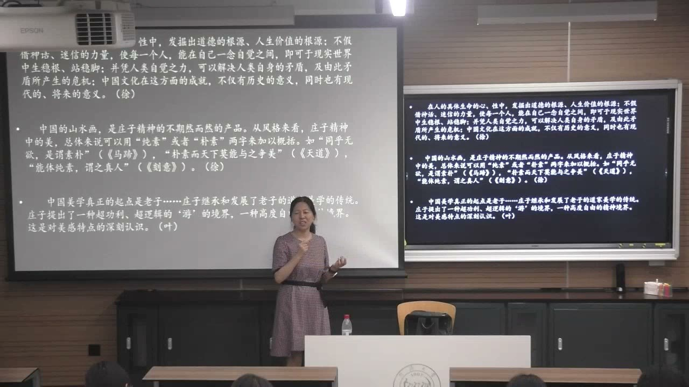
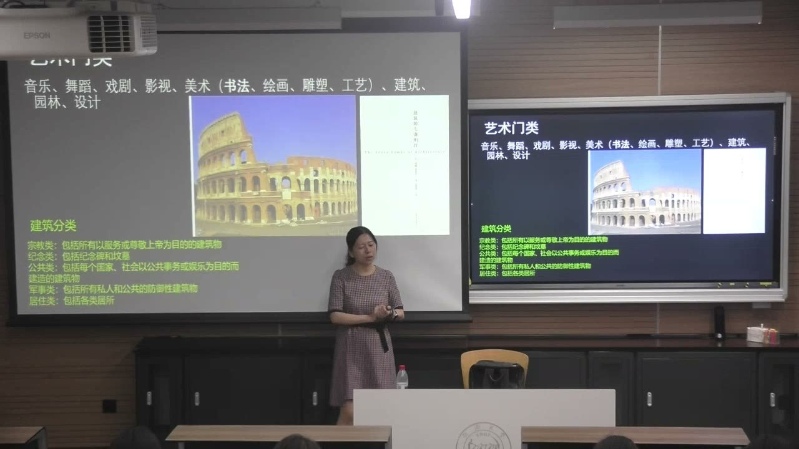
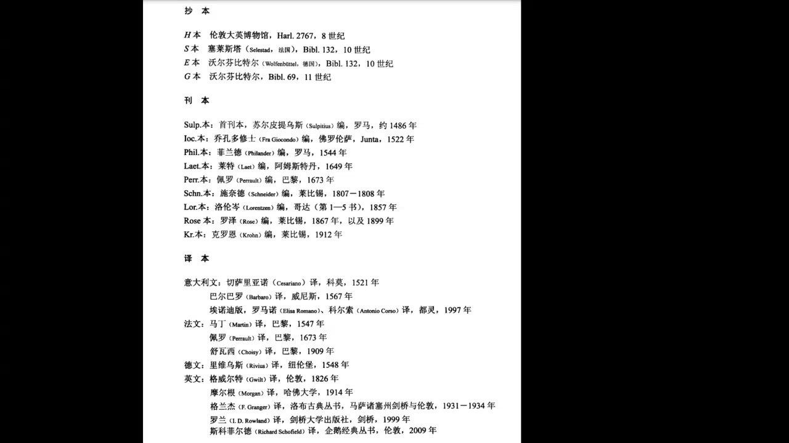
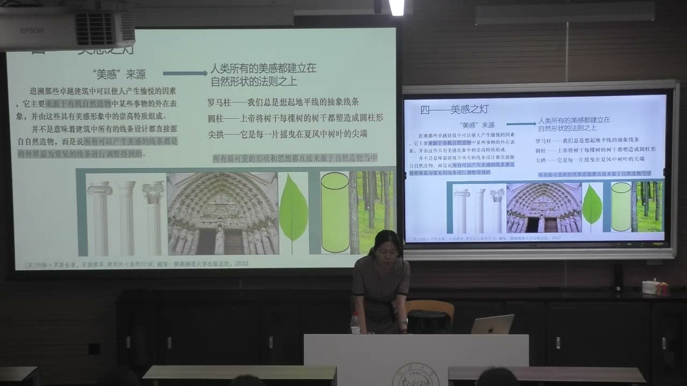
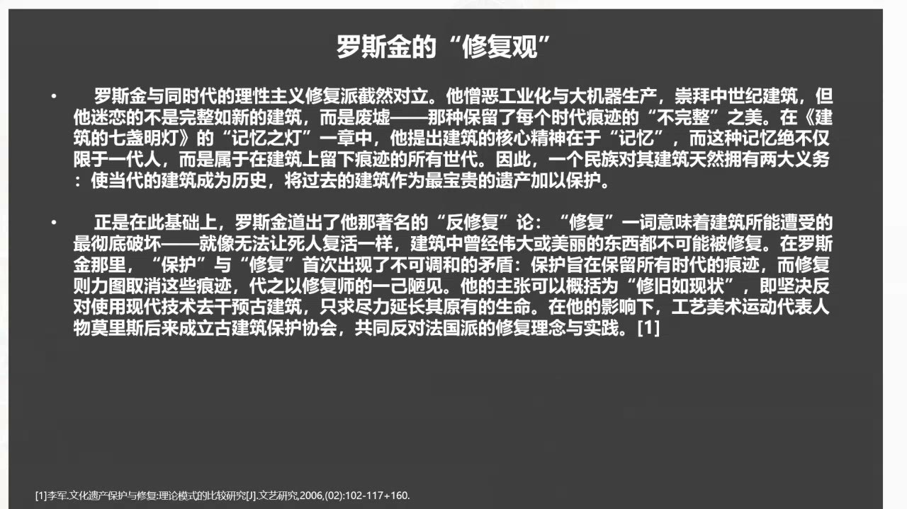
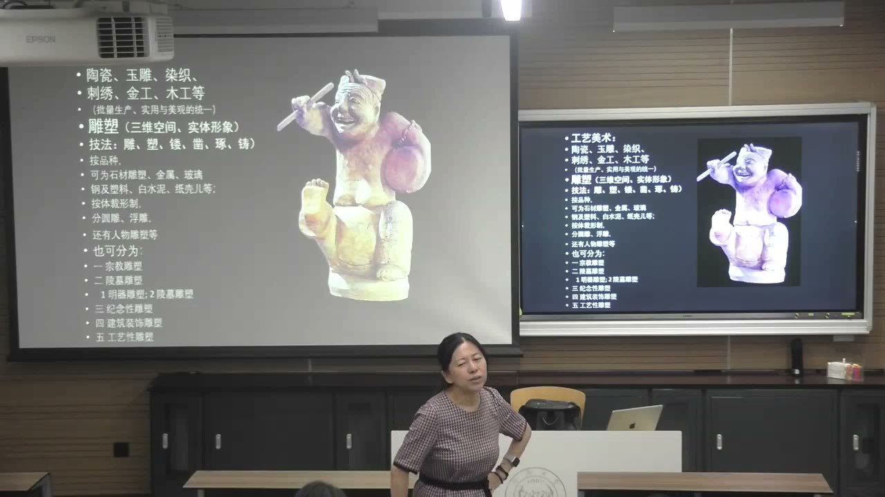
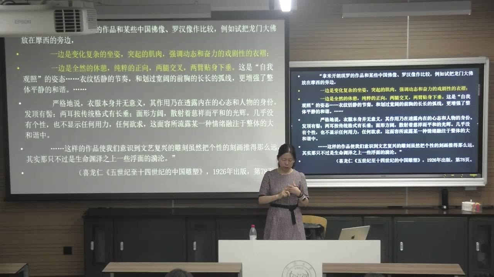

### 课程安排与任务

#### 期末阅读作业：呈现版本信息和个人理解

教师要求在期末阅读作业中，尽量收集所读著作的各个版本。能找到电子版的可收集电子版；暂时找不到全文，也应尽量呈现封面、扉页和出版信息，了解原著、重印与译本之间的关系。可以从现在开始逐步查找，本课没有给出新的具体截止日期。

作业不只呈现“我读了一本书”，还要说明它的框架、论点从哪些文献形成，关键概念怎样被界定。教师强调研究与文本细读不要使用 AI，应把心思放在实际阅读和自己的理解上。

#### 难书的阅读安排：少量细读，也要读透

选书前先广泛翻阅资料、整理可能感兴趣的著作目录，再确定重点文本。遇到《中国艺术精神》这样的难书，一个学期难以全部细读是正常的；可以先了解全书，再集中阅读一到两个章节，根据具体难度安排进度。

外国著作若有中译本，教师建议与原文对照阅读；深入研究需要处理原文中的概念和表达。普通阅读与研究的要求不同，不必只追求阅读速度，而应把概念、观点和它们的来路真正弄清。

### 艺术研究：看结论，也要追问来路

作品的名称、断代、经典著作的论点，都不是看到一个现成答案便停止思考的问题。

#### 名称和断代仍然可以继续推敲

教师以传为《明皇幸蜀图》的作品回顾研究方法：作品的名称、解释和年代判断，都可能继续被追问。论文往往只解决一部分问题，不能因为某个名称已印在书中，就把它当成无需检验的最终答案。

研究应提取证据中的要素，说明怎样得出推论，并保留推论的条件。提出一个有依据的新解释，能够扩展观察和思考的路径；这种推进本身，就是研究没有固定终点的原因。

#### 理论著作可以有文采，但框架必须严谨

教师用罗斯金和柏格森说明，理论、学术与文学表达并非绝对隔开。一部著作可以论证思想，也可以有很强的语言感染力。理论研究中的阅读经验，有时还能转化为创作的灵感。

但对刚开始论文训练的人，先从文学性的感受转向清晰的框架与严谨逻辑，仍然必要。不能因为句子动人，就不再追问概念是否准确、论据能否支撑它。

#### 不要随意使用一个没有来路的词

精读要求追根溯源：一个词从哪里来，作者用它时是什么意思，后来的读者是否改变了它的含义？概念界定不是在文章开头补一句定义，而是理解整个论证的基础。

教师以研究者为处理材料而学习相应语言的经历说明，研究进度有时需要服从材料理解的深度。语言训练、对译和文本细读，是为了避免把方便的译法误当成概念本身。

#### 建立相关文本目录，才能看清论点怎样形成

研究一篇文章或一件作品，应先把相关文本做成目录，再辨认将使用哪些文献。题跋、历史材料、画论和前人研究，可以提供不同层次的证据，不能只凭看到作品时的一次感受展开全部论述。

教师以《待渡图》的研究过程说明：画后的题跋可能在不同时间累积，题跋者与所处环境也需要逐一查认。画面中的渡人与待渡、书画作为精神承载的意义，是由作品、文字和处境相互关联而提出的解释。具体判断仍需保留证据和推论的区别。

#### 读经典，也要分析它依据哪些经典

《中国艺术精神》不同章节有相应文本基础：孔子的讨论与《论语》相连，庄子的讨论从《庄子》展开，气韵生动涉及谢赫《古画品录》，其他章节又进入具体画论。全书不是先有一个大结论，再把历代材料随意排在后面。

读者因此要同时把握作者的框架、文献依据和推演过程。教师要求重视“怎么来的”，不只是记住“说了什么”；这也适用于本雅明等外语理论著作的概念、形成背景和思想来源。

### 自然论与中国文人艺术精神

徐复观以老庄思想解释中国艺术，为课堂理解自然、山水与素朴提供入口；这个解释也有适用范围。

#### 《中国艺术精神》的阅读基础

教师把徐复观《中国艺术精神》与黄宾虹、邓实编纂的《美术丛书》联系起来：在大量历代艺术论述的阅读中，作者形成了自己的论点与框架。经典理论也有阅读、积累、提炼的过程，不是凭空出现。

徐复观强调老庄精神，课堂由老子“人法地、地法天、天法道、道法自然”回到自然论。自然不是偶尔加入艺术的题材，而关联人的生活、精神状态与创作所追求的境界。

#### “中国艺术精神”不能不加区分地涵盖全部创作

教师认为，老庄精神的解释与**中国文人艺术**尤其贴合。艺术的范围很大，文人以外还有工匠群体；壁画、楼阁等创作有时要求精确呈现，是否都能直接归入同一个老庄框架，仍可继续研究。

因此，应既理解经典观点的解释力，也识别它更适合哪些对象。评价经典不必在全盘接受和全盘否定之间选择，可以从它尚未完全处理的问题继续推进。

#### 山水为什么能够承载文人的精神生活

课堂以“山水以形媚道”说明，山水的形象在文人理解中可以显现道，不只是供人欣赏的外在风景。人在失意、矛盾或力量有限的处境中寄情山水，也把书画当作安顿精神的载体。

教师以书画船为例：书画、人和山水进入同一空间，观赏、阅读与自然经验相互作用。这个空间让人与作品、人与自然的关系变得更具体，不是把“自然”只当成一个抽象词。

#### 素朴与纯素：审美如何关联人的状态

徐复观从庄子的论述中提炼艺术观念，课堂关注“纯素”“素朴”等词及其与山水画风格的关系。美并不只能由繁复装饰和显露技巧体现，也可以来自超越功利的观照，以及人与自然相处时的精神境界。

教师强调，读者与经典、作品的反复碰撞，会逐渐生成自己的真实感受。它未必一开始就完全正确，却需要在持续阅读和分析中发展。理解审美，因而不能只复制现成的描述。

### 艺术门类与建筑理论的分类依据

分类可以让研究入门，但每个门类都要继续追问形式、功能、材料与理论依据。

#### 门类不是只列一串艺术名称

课堂列举音乐、舞蹈、戏剧、影视、美术、建筑、园林与设计。美术又可包括书法、绘画、雕塑、工艺等视觉形式。分类需要看到感官的参与：有的主要依靠视觉，有的依靠听觉，有的共同使用多种感官。

艺术概念的范围还可以继续扩展。教师用“静止画面如何表现不同花香”的问题说明，即使作品通过一种媒介呈现，也可能尝试唤起另一种感觉。门类因此是理解作品的入口，不能替代对具体表现方式的分析。

#### 同一种建筑，可以从用途和形式两方面观察

建筑按用途可分为宗教、纪念、公共、军事、居住等类型。罗马圆形竞技场则让课堂看到形式分析的另一条路径：反复的圆拱形成节奏，不同层次的柱式和装饰又带来变化。

教师把多利克式、爱奥尼亚式、科林斯式等柱式放在具体建筑中比较。判断一个作品时，既要知道它服务什么功能，也要看它怎样通过比例、重复和装饰形成视觉经验。

#### 维特鲁威三原则：不能把“坚固”换成“经济”

《建筑十书》提出的三个基本原则是**坚固、实用、美观**。它们分别关联建筑能否稳定存在、满足用途，以及形成审美和居住体验，对后来的建筑理论影响深远。

教师借一篇书评指出，有研究把它写成“经济、实用、美观”，是把后来出现的建筑观念带回了古代文本。原则的字面替换会改变理论来源；经济、节约等观念在何时加入，需要另行说明，不能都归到维特鲁威名下。

#### 抄本、刊本、译本：一本书的文本并非只有一条路径

《建筑十书》经历手抄传承、刊印和不同语言的翻译。课堂展示不同年代与馆藏的抄本、刊本及译本，说明读经典不只是找到一个现代版本，而要了解今天所读文本怎样传到这里。

中译本也可能依据不同语言的转译本。教师以陈平译本及较早的译本为例，要求读者留意译本所依版本。暂时无法参与全部校勘，也应知道抄本、刊本、译本这几层关系。

#### 建筑经典也可以讨论绘画

《建筑十书》有关装修的部分进入绘画讨论，以实际存在或可能存在的事物为图像的依据，并批评某些不合真实的装饰组合。这里呈现出模仿、写实与装饰趣味之间的理论分歧。

所以，一部以建筑为主题的书，也可能为绘画、装饰和艺术理论提供材料。教师借这个例子强调，经典的知识范围和内部结构，需要实际翻阅才能发现，不能只凭书名判断。

### 罗斯金：自然、记忆与建筑保护

《建筑的七盏明灯》把建筑的形式美、材料真实性和历史记忆放在一起，并对改造与修复提出鲜明立场。

#### 七盏灯所指的七种建筑原则

课堂采用的译名为：献祭之灯、真实之灯、力量之灯、美感之灯、生命之灯、记忆之灯、尊崇之灯。它们以具有文学性的表达提出建筑原则，罗斯金借哥特式建筑展开讨论。

献祭强调建筑中对神的敬意和奉献，不能只理解成建造一个功能容器；真实强调建筑应有崇尚真实的精神。教师提醒，哥特式与西方古典建筑的概念不能随意混用，讨论理论时仍要辨认具体对象。

#### 材料真实：不要伪装成另一种材料

教师以木头涂上金饰、让它看起来像金子为例，解释罗斯金对材料真实性的重视。真实之灯不只追问表面是否漂亮，还追问材料与呈现出来的形象是否相符。

这种观点又联系遵从自然法则、历史文化和地域传统，反对仅为突出个人风格而忽视已有关系。判断设计时，因此不只比较新奇程度，也需要看材料、环境与传统之间怎样相处。

#### 师法自然，是体悟和调整，不是机械照搬

美感之灯将美的形状与自然形式的法则联系起来：圆柱令人想到树干，尖拱的形态可以与树叶的尖端相比较。自然形态成为艺术感受和造型思考的重要来源。

但罗斯金并非认为建筑中的每条线都原样复制自然。他强调外界常见线条经过调整形成能够引发美感的形式。教师由此联系中国的师法造化：观察自然与学习传统相互配合，作品仍然包含提炼和创造。

#### 记忆之灯：建筑保存了不止一代人的痕迹

面对工业化和成批量生产，罗斯金强调古代建筑的力量。建筑中凝聚的不是一个人的回忆，也不只是一代人的生活，而是曾在其中留下痕迹的不同世代。

为了规划整齐广场、道路和码头而推掉旧建筑，会抹去这种时间累积。课堂把记忆之灯与两个责任联系：让当代建筑能够留存、成为历史，并把过去的建筑作为珍贵遗产保护。

#### 保护与“修得像新的一样”之间的冲突

罗斯金重视带有时代痕迹的“不完整”之美。若修复者去掉这些痕迹，用自己的想象重造一个所谓原貌，保护与修复便发生冲突：建筑表面可能更整洁，历史的生命却被改变。

课堂把他的主张概括为“修旧如现状”，尽力延长原有生命，反对随意用现代手段改造古建筑。教师用旧佛像被水泥覆盖的例子说明，求新式修补可能使原有细节和研究材料受损。这是在解释罗斯金的立场，不把它等同于所有保护实践必须采用的唯一方案。

#### 现场经验，使理论中的“力量”变得具体

教师用吴哥建筑与遗迹的现场体验，说明宏大的空间、雕刻、环境与历史痕迹共同形成感受。图片能够提供形象信息，但人在现场经历的尺度、光线、位置和氛围，并不容易全部由一张照片替代。

回到分类的目的，研究需要同时了解作品的创作主体和背景、语义与文化关联、内容渊源和影响，并用理论方法加深解释。分类应当为这些问题提供结构，而不是给作品贴完标签就停止。

### 雕塑：分类维度与具体作品的审美比较

从材料、体裁和用途辨认雕塑，再看姿态、衣纹与神态怎样支撑对作品精神状态的解释。

#### 工艺美术与雕塑的不同分类维度

工艺美术包括陶瓷、玉雕、染织、刺绣、金工、木工等，涉及实用与审美的关系。雕塑可以从技法、材料、体裁形制、题材和用途等角度分类；这些维度回答不同问题，不能互相代替。

技法可见雕、塑、镂、凿、琢、铸等；材料可以是金属、石材、玻璃、塑料、水泥、纸壳等。教师以纸壳制作作品的课堂经历说明，雕塑不只限于传统石膏或石材。材料的丰富，也会改变人对创作可能性的理解。

#### 圆雕与浮雕：形体怎样存在于空间

圆雕具有相对独立的三维实体形象，可以从不同方向观察。浮雕依托一个平面，一面与基底相连，另一面突出形成形体；突出较浅的，可称浅浮雕。

题材还可分人物、动物等，用途又可分宗教、陵墓、纪念性、建筑装饰和工艺性等。一件雕塑同时有材料、形制和用途，不必只从这些类别中选一个名称。汉代说唱俑的手舞足蹈，也让课堂看到动作怎样表现生活气息。

#### 宗教雕塑的尺度与观看位置

龙门石窟卢舍那大佛的巨大尺度，使观看者通常处于仰视位置。教师说明，形体比例需要考虑实际观看：上部若按普通近距离比例处理，远处仰视时可能显得过小，因而需要相应调整。

这种思考让我们区分雕像实际尺寸与观看中感受到的比例。讨论大体量作品，不能只以平面照片测量外形，还需要知道观众的位置和作品设置的环境。

#### 《摩西》与卢舍那大佛：比较从形式证据出发

教师引入喜龙仁的比较：米开朗基罗《摩西》的坐姿变化、突出的肌肉、动态衣褶，强化行动、力量与戏剧性；卢舍那大佛的正向姿态、恬静衣纹与前胸弧线，则被解释为平静和谐。

课堂同时辨认“曹衣出水”与“吴带当风”：前者突出衣纹贴合身体的感觉，后者强调衣带随风飘举。衣服在作品中不只代表一件服装，还可以传达内在心态、身份与姿态。

#### 喜龙仁的评价：个性之外还看到了什么

喜龙仁关注两件作品不同的精神表达，把中国佛像的神态、衣纹和整体关系，与“自我观照”及大和谐联系起来。他对文艺复兴雕塑个性刻画的评价，体现了这位研究者自己的审美取向。

教师借此说明，海外学者对中国艺术的观察，不只提供作品著录，也提供另一种解释方式。喜龙仁同时研究西方与中国艺术，著作涉及中国雕塑、绘画、建筑与园林；比较仍要回到具体作品与具体论述，不能从两件作品直接概括全部中西雕塑。

#### 陵墓雕塑与明器：位置和用途不能忽略

陵墓雕塑既可指墓外神道等空间中的人物、动物石像，也涉及墓内作为随葬物的明器雕塑。二者虽都与陵墓有关，设置的位置、使用方式和原有语境不同。

教师以神道石像和明孝陵图像为例，鼓励仔细看姿态、身份和成组关系，而不只把它们看成相同的石雕。将传统形象用于设计时，也应了解它原先是否与随葬、宗教等用途相连，避免只取外形而抹去语境。

### 概念对照与自测

| 比较对象 | 区别 | 分析要点 |
| --- | --- | --- |
| 普通阅读／深入研究 | 了解文本／处理概念与论证来源 | 阅读范围和语言要求应与目标相符 |
| 版本／理论观点 | 文本的传播路径／作者的主张 | 译本依据会影响理解，不能只记结论 |
| 用途分类／形式分析 | 建筑或雕塑服务什么／如何形成感受 | 两个维度可以同时作用于一个作品 |
| 维特鲁威／罗斯金 | 坚固、实用、美观／七种建筑原则 | 辨认时代、对象和概念来源 |
| 师法自然／直接复制 | 体悟、提炼并调整／照搬外在形状 | 自然的来源不抹去艺术创造 |
| 保护／求新式修复 | 延续已有痕迹／可能以修复者想象取代痕迹 | 理解罗斯金的反修复立场及其对象 |
| 圆雕／浮雕 | 独立的三维形体／依托平面并突出 | 材料、体裁与用途分别分类 |
| 墓外石像／明器雕塑 | 陵墓外部空间／墓内随葬 | 应用图像之前辨认位置和原有用途 |

#### 为什么作品已有名称，仍可以继续研究？

名称和断代是由证据形成的判断，不是永远不变的终点。需要说明推论的依据和条件。

#### 期末阅读作业为什么要呈现不同版本？

原著、抄本、刊本和译本有传承关系。版本信息帮助说明实际读了哪一种文本，以及理解可能经过哪些转译。

#### 老庄精神能否直接解释一切中国艺术？

教师认为它更贴合文人艺术。工匠创作、精确的造型要求等，仍需具体辨认，不能不加区分地套用。

#### 维特鲁威的三原则是什么？

坚固、实用、美观。不能将后来加入的经济、节约等观念直接改写成这三个古代原则。

#### “师法自然”为什么不等于复制一片叶子？

自然提供形态和法则，艺术还需要观察、体悟、调整和提炼；罗斯金明确讨论了这种调整。

#### 罗斯金为什么反对把旧建筑修得像新的一样？

建筑包含不同时代的记忆。求新式修复可能消除痕迹，用修复者的判断取代原有历史生命。

#### 怎样让雕塑比较超出“更生动”和“更安静”的感受？

指出坐姿、肌肉、衣纹、面部神态与空间尺度，再解释这些形式如何形成动作、个性或整体和谐。

#### 雕塑的材料、形制和用途是否必须三选一？

不必。它们是不同维度，一件作品可以同时是石质、圆雕、宗教用途的雕塑。

### 来源范围

原始转写含课堂互动，正文只整理教师讲授、解释、回应与课程任务。时间范围为两分钟音频分段边界，不是逐句对齐时间。
