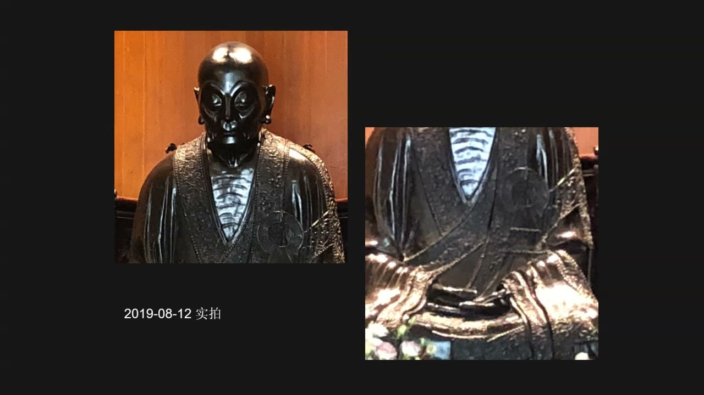
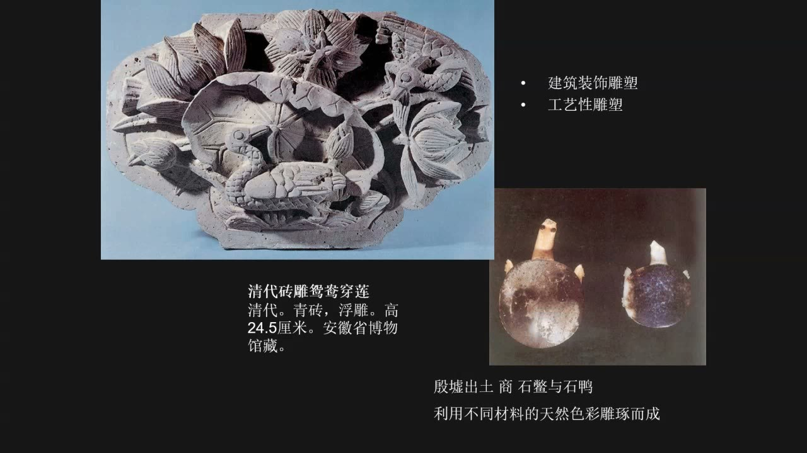
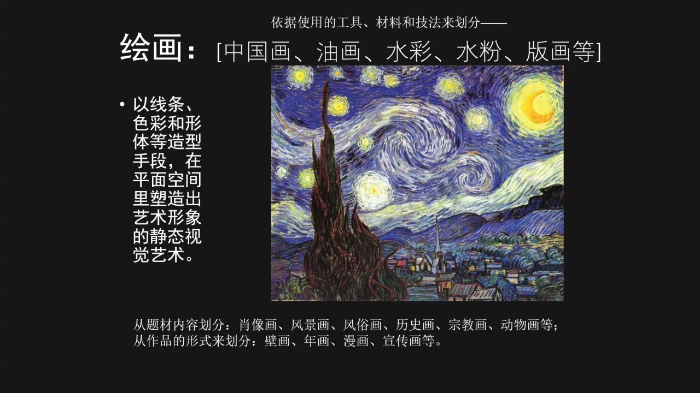

### 课程安排与任务

#### 心得可以从一篇好论文入手
<!-- source: 46 -->
心得选题可从经典阅读、读到的有趣文章或有冲击的现实文化现象入手，不限于固定题材，但应与艺术对象或相关文化实践建立联系。教师提醒尽早准备、提交，便于课程中安排交流；本次没有给出明确的日历截止日期。

课后回应中，教师建议尚难形成独立见解时，先选择一篇较有分量、较高水准的论文，学习它怎样确定对象、提出问题和展开分析，再寻找自己可以继续追问的点。不必强求第一次心得就解决一个成熟的研究问题。

### 一、把对象选清楚，分类才能帮助论证

分类不是背诵名单，而是把混杂的问题转化为可讨论的研究范围。

#### 地域、传统和材料共同限定问题
<!-- source: 26 -->
教师点评研究写作时指出，笼统讨论“乞巧节”或“传统文化”，范围太大。限定到特定地域、特定历史时期及具体仪式，才能辨认当地实践与其他地区的区别；进一步确定照片、绘画或文献等材料，论证才有着落。

艺术门类的分类同样影响题目的准确性。以“视觉艺术”为题，却只讨论油画性质的图像，没有涵盖雕塑、中国画、版画等对象，就会使题名的范围大于实际证据。研究应说清自己讨论的是哪种媒介、材料或类别。

#### 照片与绘画的相似用途，不取消媒介差异
<!-- source: 28 -->
照片可以成为档案、历史记录，也能承担形象传播和权力表达。教师以历史人物的照片与肖像画为例，说明图像的使用方式也是研究问题的一部分，不能只把图像看成透明地记录人物的窗口。

分析主体、客体和权力关系时，要把人物放回具体背景。一个人在某一关系中受到排斥，也可能在另一关系中剥夺他人的权利。教师借文学与殖民语境的例子强调：角色和作用常是多重的，不能只用单一身份解释所有行动。

### 二、艺术门类的功能可以引向经典理论

从“这是什么艺术”追问到“它发挥什么作用”，会逐步进入作品的历史与理论。

#### 建筑三原则与《建筑十书》
<!-- source: 36 -->
维特鲁威《建筑十书》中的三原则是实用、坚固、美观。教师再次纠正把“实用”误记成“经济”的说法。了解建筑功能，并不只是在看技术操作，也是在接触长期影响艺术理论的经典讨论。

古罗马建筑实例、马赛克与室内空间被用来说明实践成就与理论思考之间的关系。《建筑十书》也涉及绘画等问题，不能只凭书名预先把它的讨论范围理解得很窄。阅读经典时，可以先了解全书结构与主要观点。

#### 《建筑的七盏明灯》中的美感与记忆
<!-- source: 38 -->
教师回顾拉斯金《建筑的七盏明灯》，列举献祭、真实、力量、美感、生命、记忆与尊崇等原则，特别讨论美感与记忆。美感与自然、比例相联，记忆则使建筑与人如何面对过去的问题相联。

对传统和过去的思考并不只面对遥远的历史，人的日常经验也不断成为过去。这是教师把建筑讨论接到文化记忆问题上的思路，而不是把经典书目孤立列在作品之外。

### 三、雕塑的功能分类与纪念对象

雕塑可按宗教、陵墓、纪念、建筑装饰和工艺等用途讨论，不同类别并非完全互斥。

#### 同一对象可以同时具有宗教和纪念功能
<!-- source: 40 -->
宗教雕塑、陵墓雕塑、纪念性雕塑、建筑装饰雕塑和工艺性雕塑，是本节继续使用的功能分类。陵墓外的石像生与墓内明器在位置、尺度和作用上有差别，观看时应回到具体使用环境。

以明孝陵石像生为例，教师强调近看同类形象的具体差别：成对放置不等于完全一样，脸型、形态和神情仍值得比较。分类只是观察的起点，不能替代对作品本身的细看。

#### 慧能坐像：从衣褶、袈裟进入人物与传承
<!-- source: 50 -->
慧能坐像作为纪念性雕塑，也具有明确宗教含义。其袈裟、衣褶、装饰、手势和端坐姿态，应与人物身份及传法故事一起理解。教师从这件塑像引出《坛经》，说明作品如何成为进入经典和思想史的线索。

教师后文将慧能定位为禅宗六祖，并区分南宗的开创与整个禅宗的祖次，笔记采用后文较明确的说法。与坐像地点等口述细节相关的信息不作未经核对的扩写。

### 四、渐修、顿悟与艺术感悟

教师借《坛经》的故事说明两种修行方式，并把它们连接到文学艺术的理解。

#### 从两首偈子理解渐修与顿悟
<!-- source: 52 -->
神秀“时时勤拂拭”的表述强调持续修行、避免蒙尘；慧能“本来无一物，何处惹尘埃”的表述，则被教师用来解释顿悟。两者的区别在于逐步积累与突然领悟的路径，而非简单地把努力理解为没有价值。

教师同时提醒，具有特殊悟性的人是少数，不能把等待灵感代替日常学习。每日阅读经典更接近一种持续积累的训练；高妙作品能否被理解，也与观察和感悟能力有关。

#### “迷时师度，悟了自度”与学习中的主动性
<!-- source: 60 -->
《坛经》中送别与渡船的对话，以“度”的双重含义连接师长引导与自我觉悟。教师用“迷时师度，悟了自度”解释：他人的帮助与主体自己的理解不是同一件事，领会之后仍需由自己承担实践。

搬柴、运水等日常行动也可进入修行的讨论。教师以此说明，思想并不只发生在固定的仪式或读经形式中；这一理解随后被连接到中国文人的文学与艺术感受。

#### 禅宗语境与绘画南北宗论
<!-- source: 68 -->
教师谈到王维与禅宗人物的交往，以及其诗歌与自然、性灵、感悟之间的联系。随后通过两类山水画，比较精细经营、富丽工整的表现与较重文人意味、整体感悟的表现。

董其昌的绘画南北宗论被作为受到禅宗分宗影响的艺术理论例子。这里的重点是理论如何借用已有思想概念解释绘画，不应把“南北宗”当成所有作品都能机械套入的简单地理表格。

### 五、材料、目光与姿态如何传神

形象生动与否，不完全取决于细部数量；材料和造型的取舍也表达艺术观念。

#### 《鸳鸯穿莲》：建筑功能与呼应关系
<!-- source: 72 -->
清代砖雕《鸳鸯穿莲》属于建筑装饰：它是建筑上的部件，同时以青砖浮雕形成具体形象。浮雕依托平面凸起，圆雕则可从周围观看；功能分类与造型方式是两组不同的分类尺度。

教师特别分析两只鸳鸯的视线关系：一只回首，另一只只露出头部，两者对视产生呼应。巧妙之处不只是雕刻精密，而是通过姿态、方向与目光，使有限的形体呈现生命感。

#### 抓住整体神貌，不只追逐细毛
<!-- source: 78 -->
教师以“谨毛而失貌”提醒，若只追求局部精细，可能丢失最重要的整体面貌。人或动物的眼睛、视线、姿态，往往关系到形象是否有神；把毛发画得漂亮，并不能保证对象看起来有生命。

顾恺之关于“手挥五弦易，目送归鸿难”的讨论，被用来区分外在动作的描绘与目光所传达的内在活动。这里关注的是如何通过形象表达心灵活动，而非主张所有作品都应放弃细节。

#### 顺应材料，与泥塑的制作过程
<!-- source: 80 -->
商代石鳖、石鸭的例子强调利用材料自身的天然颜色和形状，经过取舍形成对象，教师将它联系到自然观。艺术效果也来自怎样顺应和处理材料。

罗汉像的分步图片则展示另一种制作逻辑：先有木质骨架，再结合绳索、泥土逐步塑出身体、衣褶与装饰。从完成的佛教造像倒看工序，可以理解“塑”的过程，避免只把雕塑想成从整块材料上减去部分。

### 六、绘画的多重分类与作品比较

绘画的定义、分类、风格和具体作品，需要放在不同层次上讨论。

#### 平面中的造型艺术，以及三种分类尺度
<!-- source: 84 -->
绘画以线条、色彩、形体等造型手段，在平面空间中塑造艺术形象，是静态的视觉艺术。“视觉艺术”比“绘画”更宽，不能因作品可见就把二者当作同义词。

按工具、材料、技法，可讨论中国画、油画、水彩、水粉、版画；按题材，可讨论肖像、风景、风俗、历史、宗教、动物等；按作品形式，又可讨论壁画、年画、漫画、宣传画。这些分类标准并不互相排斥，一件作品可以同时具有不同层面的归属。

#### 比较作品时区分观察、解释和推测
<!-- source: 86 -->
《星月夜》被用于观察线条、色彩与旋涡形态，教师还将它与天文学图像作比较，并提出可能联系。这是课堂中的比较和解释线索，不据此断言已经证明直接影响关系。

金农《月华图》提供另一种月亮图像；马蒂斯剪纸作品则引出创作者在身体条件和材料方式变化后如何继续表达的问题。比较不只是判断“像不像”，还要看不同作品怎样处理对象、媒介与观看经验。

#### 园林绘画、艺术家观念与价值认识
<!-- source: 90 -->
高居翰《不朽的林泉》及园林图像，说明中国画内部还可以细分出与园主、建筑、历史人物活动有关的研究对象。图像中的空间、人物和生活事件可互相解释，不能只当作无名的山水景观。

教师以潘天寿对材料、民族性和中西绘画规律的认识，以及若干拍卖报道作结，说明门类与个案研究还会连到艺术家观念和价值认识。课堂所列拍卖数字属于历史例证，不作为作品当前价格。

### 概念对照与自测

| 区分 | 观察尺度 | 本课用法 |
|---|---|---|
| 视觉艺术与绘画 | 上位范围与具体门类 | 题名范围应与实际研究对象一致 |
| 功能分类与造型方式 | 宗教、纪念等用途；圆雕、浮雕等形态 | 同一件作品可在两组尺度上分类 |
| 渐修与顿悟 | 持续积累与突然领悟 | 理解感悟路径，不取消日常学习 |
| 细部精密与整体神貌 | 局部描绘与生命感、呼应关系 | 鸳鸯的视线和姿态比单纯加细节更关键 |
| 图像观察与影响论证 | 形态相似与历史联系 | 相似是问题线索，不自动证明直接影响 |

#### 为什么不能只用“视觉艺术”概括一篇主要讨论油画的论文？
因为题名承诺的范围包含更多门类，而证据只覆盖其中一部分。应收窄题名或补足对象与论证。

#### 《鸳鸯穿莲》怎样同时体现功能与审美？
它作为建筑部件承担装饰作用，又通过回首、露头和对视形成呼应关系，表现形象的灵动。

#### 为何从一件纪念性雕塑会讲到《坛经》和绘画理论？
作品关联人物、服饰与思想传承；理解这些联系，可以把具体形象接到经典和艺术理论的讨论，而不只记住一个分类名称。

### 课程时间线

00:00—25:00：课堂分享与交流；学生发言不编入教师讲授正文。
25:00—34:00：教师点评对象限定、地域传统、图像媒介及多重角色。
34:00—40:00：分类方法、《建筑十书》与《建筑的七盏明灯》。
40:00—44:00：雕塑功能分类、陵墓雕塑与石像生观察。
44:00—50:00：人物辨识、课间与心得提交提醒。
50:00—56:00：慧能坐像、袈裟传承、渐修与顿悟。
56:00—64:00：《坛经》故事、师度与自度。
64:00—72:00：感悟、日常修行、王维及绘画南北宗论。
72:00—78:00：建筑装饰雕塑《鸳鸯穿莲》。
78:00—84:00：传神、材料自然色与泥塑制作过程。
84:00—90:00：绘画定义、分类、《星月夜》与作品比较。
90:00—96:00：园林图像、艺术家观念与拍卖例证。
96:00—99:48：部分区间未识别到文字；课后教师回应心得写法。
