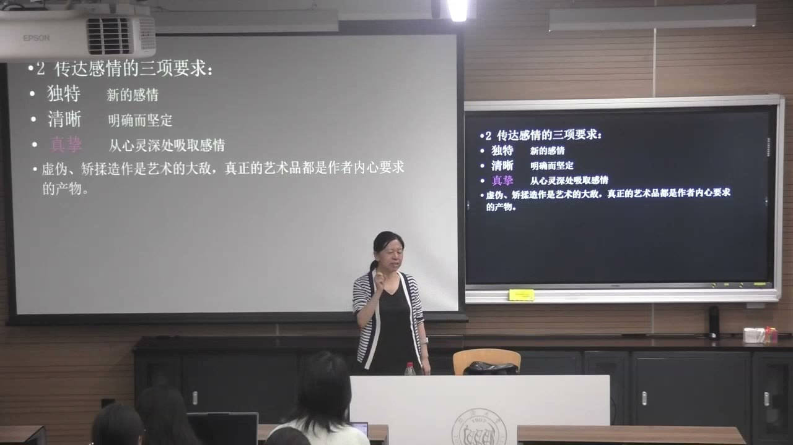
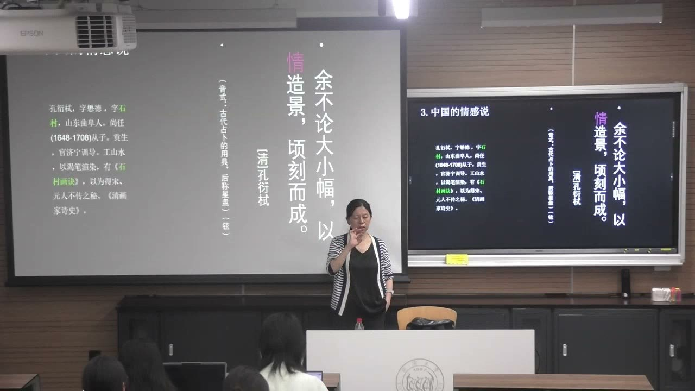
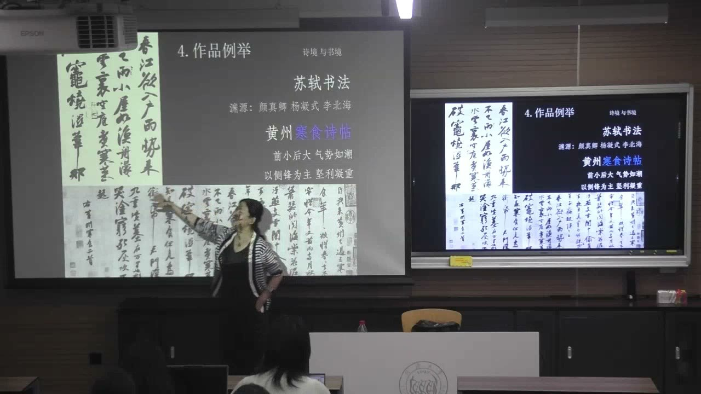

### 课程安排与任务

#### 分享材料要标明具体出处，选题从问题进入
<!-- source: 22 -->
教师在课前分享后的点评中要求，PPT引用文本时尽量标出来源和具体页码，可放在页面下方，使每段材料能够回查。介绍一个基础文本，可以作为继续发现问题的入口，不必用过于复杂的理论遮盖对象本身。

后续研究要从文化现象中提取差异和疑问，联系地域、历史、仪式功能及跨文化交流，而不只介绍器物好不好看。教师推荐以地域为线索的艺术研究资源，并强调文字、文本、建筑遗存和古典作品都是理解文化记忆的材料。开头的学生分享及互问未编入教师知识正文。

#### 经典阅读与概念研究
<!-- source: 40 -->
托尔斯泰《论艺术》（也译《艺术论》）被推荐纳入经典阅读；克罗齐的相关美学著作可作为理解直觉说的入口。遇到“礼”“乐”等看似抽象的概念，可以围绕其中一个概念细读原文、注释和版本演变，不要求一次读尽整个传统。

研究古代音乐的观念，与完整复原当时的演奏，是不同层次的任务。后者还涉及乐器、乐谱、乐理和历史知识，不能仅凭图像或概念就宣称已经复原。本节未另行宣布新的书面提交期限。

### 研究艺术时，先说明自己的角度

分类可以帮助进入对象，理论则需要解释自己的范围和限度。

#### 从图像走向文本，把对象说准确
<!-- source: 26 -->
欣赏或研究作品时，应把图像与相关文本联系起来。慧能雕像可以引向《六祖坛经》，绘画南北宗的讨论又可联系董其昌的相关论述。视觉对象不只是供人观看，也可能成为了解思想、文化和历史的入口。

描述作品要明确分类尺度。例如《清明上河图》可以从中国画、绢本、风俗题材和作品形式等不同层面说明，不能只说“这是一幅画”，也不能把不同尺度混成互相排斥的选项。

#### 从主体出发，不等于得到唯一答案
<!-- source: 30 -->
本节从美术家或创作主体解释艺术。教师列出情感传达、心灵表现、本能欲望、游戏以及自娱等思路，分别关联托尔斯泰、克罗齐等学者、弗洛伊德、康德与席勒、倪瓒。本节详细讲情感说，并在末尾引入直觉说，其余只是后续框架。

任何理论都有解释优势和难以覆盖之处。分类便于认识作品，但有的理论又会反对把艺术严格分类。学习不只是把定义当成口号，而要问：它从哪个角度出发，如何论证，能解释什么，又可能遗漏什么。

### 托尔斯泰：艺术是人与人之间的情感交际

“情感”在这一理论中不只是个人心情，还联系社会处境、普通人的生活和人与人的团结。

#### 从少数人的享乐转向共同生活
<!-- source: 36 -->
教师把《论艺术》放在托尔斯泰所处的俄国社会语境中理解：他关注贫困、资源分配与艺术享受之间的不平衡，反对把艺术仅作为少数人的享乐工具，强调艺术是人类生活条件和相互交际的手段之一。

兄弟般的情谊、对他人的爱与同情，是这一讨论的重要伦理方向。若只看到“传达情感”四个字，而不读具体语境，就容易把他的主张误解成只要作者有任何情绪就可以。

#### 思想与情感能否截然划开
<!-- source: 40 -->
托尔斯泰用语言传达思想、艺术传达情感来突出艺术的独特作用。教师同时介绍普列汉诺夫的异议：艺术也能够传达思想，并不只传达感情。

两种观点形成可讨论的张力。学习时应保留论者之间的差别，而不是把不同表述拼成一个没有冲突的定义。它们争论的不是艺术是否与人有关，而是怎样说明艺术交流的内容与独特性。

#### “唤起”使个人感情成为艺术活动
<!-- source: 50 -->
艺术家在内心重新唤起曾体验的感情，再通过动作、线条、色彩、声音或言辞形象表达，使别人也能体验到相应感受。作者自己有所感，并不自动完成整个过程，关键还在表达能否传到受众那里。

教师把“唤起”视为桥梁，并用“共鸣”概括它。情感需要分享和流通；在托尔斯泰的定义中，感染性是区分真正与虚伪艺术的重要标准。这是特定理论的判断原则，不能省略其语境，直接用来否定所有暂时未被自己理解的作品。

### 感情传达的三项要求

情感说不仅解释艺术是什么，也提出了作品怎样获得感染力的问题。

#### 独特、清晰与真挚
<!-- source: 54 -->
独特意味着表达自己的、非千篇一律的感情；清晰意味着明确、坚定，使感受能够传达；真挚则要求感情来自内心，而不是矫揉造作的姿态。教师特别强调真挚的基础地位。

复杂构图或精巧技法不能自动替代这三项要求。作品如果只有现成腔调，可能看似符合艺术形式，却缺少真实的内在要求。这里的“清晰”讨论传达的明确性，不是把所有艺术都限定为字面意义一眼可懂。

#### 书信为什么成为课堂的例子
<!-- source: 56 -->
教师举《傅雷家书》、梁启超书信、梵高与亲人的通信等例子，说明写给具体他人的文字可以自然呈现心境，使读者感到交流对象就在眼前。相较于刻意摆出文学姿态，直接而真诚的表达更能说明感染力。

书信例子强调情感表达的发生方式，不意味着所有书信必然真挚，或论文构思一定妨碍情感。分析仍需回到实际文字、表达对象及其情境。

### 中国文本中的情感传统与比较阅读

寻找对应表达有助于理解理论，但相似概念不自动证明历史影响关系。

#### 从“以情造景”到梁启超的情感论
<!-- source: 58 -->
孔衍栻《石村画诀》以简练文字讨论以情造景。教师把这类中国画论与托尔斯泰的系统论述对照，提醒学习者既要读外文，也要重视古文中的概念与表达方式。

梁启超则讨论怎样把一瞬即过的情感捉住，使其能够再次呈现，以及艺术家怎样把自己的感情传入他人的心中。教师认为这与“唤起”“共鸣”有相通之处，并提出可能受到托尔斯泰影响的理解；课堂没有进一步展示足以确定具体传播路径的材料，因此不能把可能的影响写成已经证实的因果链。

#### 情感不服从简单的进化排序
<!-- source: 66 -->
梁启超《情圣杜甫》等文本提出，不能因为时代更晚，就认定现代人的情感一定优于古人，或现代艺术必然比古代进步。教师以古典诗词的情感力量说明，技术、年代和情感价值不能使用同一条线性尺度。

课堂材料中的相关写作日期是1922年。教师也将艺术与科学放在对自然的共同观察中讨论，以此展示艺术、理性和人文之间可以建立联系，而不只是把情感与理性绝对对立。

#### 版本对读也是理论学习的一部分
<!-- source: 70 -->
教师把梁启超演讲的原文与现代教材中的节录并排比较，发现用词和句式有所调整。繁简转换或现代化改写，并不一定只是字形改变，也可能影响读者理解。

因此，引用时要辨认原作、译本、节录与后人转述，尽可能回到完整出处。讨论不能只凭一句流传甚广的摘录，再把它当成作者未经变化的原话。

#### 诗、乐、舞的情感关系有绵长的文本线索
<!-- source: 84 -->
教师从《毛诗序》中内在情感与言语、嗟叹、歌咏、舞蹈的关系，联系刘勰《文心雕龙》的“为情而造文”以及《礼记》中的音乐论述，说明中国文学艺术对抒情的重视具有连续的历史线索。

这种比较可以从自己熟悉的文本出发，再扩展到其他语言和地区。找到相似表达之后，仍应看各自语境、概念及论证，不能仅凭都出现一个“情”字就抹平差别。

### 书法作品：情感如何进入形式

作品例证帮助说明感染过程，但教师也指出，中国书法中的情感不完全等同于托尔斯泰原先的伦理指向。

#### 《黄州寒食诗帖》中的诗意和笔墨
<!-- source: 72 -->
教师结合苏轼贬居黄州的处境，说明诗中的困顿、失意与心绪怎样进入书法。观察线索包括前后字形、大小、行气和笔画的变化，而不是把情感当成附加在文字内容外面的标签。

理解所写诗句，有助于把形式变化与书写时的感受联系起来；有类似经历的观者，也可能产生共鸣。收藏印、题跋和流传信息又能开启新的研究方向，但应另用相应史料核查，不能只从情感分析推出流传史的全部事实。

#### 《祭侄文稿》与不能照搬的涂抹
<!-- source: 80 -->
课堂以《祭侄文稿》进一步讨论强烈的悲愤与激情怎样影响书写。文字、改写和行气共同呈现情绪的推进，作品不只是一套可以脱离情境复制的视觉样式。

教师批评为参加书法比赛而刻意仿效涂抹的做法：学习作品不能只复制悲愤留下的形式痕迹，却忽略它何以发生。形式来自具体表达关系；机械模仿外观，并不保证获得相同的真挚与感染力。本课没有对相关历史叙事逐项作史料考证，重点在表达与形式的关系。

### 克罗齐直觉说：另一种“情感”概念

同样从主体出发的理论，也可能把同一个词用于不同层次。

#### 情感是材料，直觉使材料形成意象
<!-- source: 90 -->
克罗齐把艺术理解为幻想或直觉，并以心灵表现来解释艺术。课堂给出的关系是：情感作为精神世界的材料，通过直觉得到塑形，形成意象，直觉与表现因而相联系。

这里的情感并不首先指托尔斯泰所强调的兄弟情谊、爱或伦理同情，而是精神活动的原料。辨认这一区别，才能理解为什么两人都谈情感，却不是同一种理论。本节只是开端，没有完整展开直觉说的全部体系及其批评。

### 概念对照与自测

| 问题或理论 | 核心关系 | 分析时需保留的界限 |
| --- | --- | --- |
| 分类与主体视角 | 明确对象，再选择解释角度 | 一个角度不覆盖全部艺术 |
| 托尔斯泰情感说 | 作者体验、表达、唤起受众 | 含社会和伦理语境 |
| 普列汉诺夫的异议 | 艺术也能传达思想 | 不将思想与情感截然隔绝 |
| 感染力三要求 | 独特、清晰、真挚 | 技巧不能自动替代真情 |
| 中国文本比较 | 画论、诗论、乐论与情感 | 相似不等于影响已经证实 |
| 书法例证 | 诗义、情境与笔墨相连 | 不机械复制情绪的形式痕迹 |
| 克罗齐直觉说 | 精神材料经直觉形成意象 | “情感”不同于伦理情感 |

#### 为什么作者有感情，还不一定达到托尔斯泰所说的艺术活动？
还要通过形式把感情传达给他人，使受众产生相应体验和共鸣。“唤起”连接作者与接受者。

#### 为什么不能因为现代艺术技术更丰富，就判定其情感一定优于古代？
情感不服从简单的时代进化排序。应分析具体表达与感染力，而不是只按年代或技术条件评价。

#### 托尔斯泰和克罗齐都谈“情感”，区别在哪里？
本课中的托尔斯泰强调情感交际及其伦理、社会方向；克罗齐的情感首先作为精神材料，经直觉形成意象，二者概念位置不同。

### 课程时间线

00:00—12:00：课前学生阅读分享，未编入教师知识正文
12:00—22:00：分享讨论与教师回应，区分仪式功能和研究疑问
22:00—26:00：教师总结文化记忆、地域交流及PPT出处要求
26:00—30:00：图像与文本连接，复习绘画分类
30:00—36:00：主体角度及五种解释框架
36:00—42:00：托尔斯泰的社会语境、情感交际及不同观点
42:00—50:00：文本阅读、教师回应与古代观念研究方法
50:00—54:00：艺术活动中的“唤起”和共鸣
54:00—58:00：独特、清晰、真挚与书信例子
58:00—66:00：孔衍栻、梁启超与中国情感论述
66:00—72:00：情感与进化、艺术与科学、原文及教材对读
72:00—80:00：《黄州寒食诗帖》的诗义、笔墨及研究线索
80:00—84:00：《祭侄文稿》与模仿形式的限度
84:00—90:00：《毛诗序》《文心雕龙》《礼记》及比较阅读
90:00—96:00：克罗齐直觉说的引入，区别情感的含义
96:00—96:13：课程结束，未识别到明确文字
