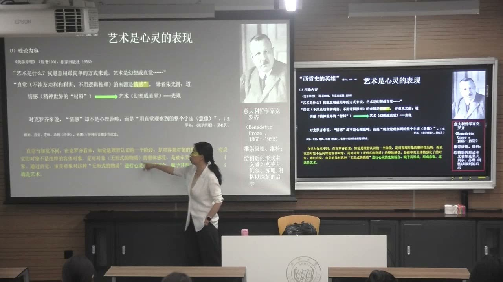
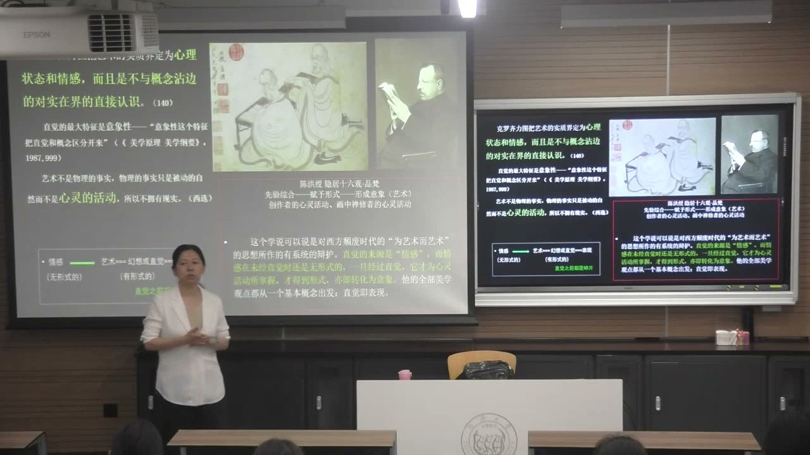
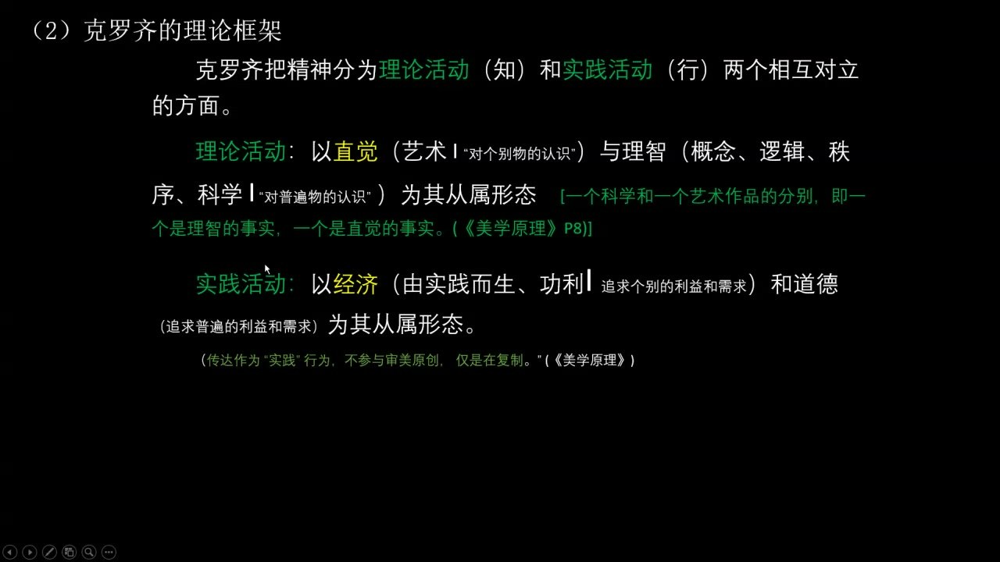

### 课程安排与任务

#### 期中作业继续准备，提交时间另行通知
<!-- source: 94 -->
教师在第7讲结束时提醒，后续将于第9讲阶段继续安排期中事项，具体上交时间会再请同学转发通知。本节没有给出新的明确日期，应继续准备，等待统一信息。

#### 阅读原著，避免用一句标签代替理论
<!-- source: 36 -->
教师已在群中分享托尔斯泰相关著作，要求通过阅读理解他所说的情感及其时代背景，避免把情感说概括为“有情绪就行”。本节也建议结合克罗齐原文感受其直觉论的描述，教师表示后续可分享相关书籍。

在研究图像时，应回到原始资料、尽量查明对象信息。资料难找、既有介绍不充分，并不意味着可以省略最基础的来源核对。

### 图像研究先确认对象与来源

教师围绕羌族释比图经的研究示例，反复追问对象基础。这些追问构成研究方法的要求，不能用象征阐释替代。

#### 传统的历史不等于现存图像的年代
<!-- source: 4 -->
需要区分图像由谁持有、谁出版、谁绘制，以及现存图像本身何时形成。图经传统存在多久，并不能直接给某一本现存图经定年；扫描、翻拍或收入现代出版物的时间，也不是原作年代。

教师要求图注明确交代这些信息，并追问不同持有者的图像有多少、有哪些类型、如何传承、最初渊源是什么。图像整理本身可能就是研究中最困难、也最有价值的部分。

#### 不要只凭风格先认定“民间作者”
<!-- source: 10 -->
朴拙的形式感，不能自动证明画者的身份。教师追问：作品由当地普通人、职业画师还是具有其他社会身份的人绘制？使用“民间绘画”等概念前，应核查其依据，而不是仅沿用一篇研究的定性。

这要求把形式、生产者与社会位置分开调查，再讨论它们之间的关系。看起来像某种风格，不等于已经知道它由谁、在什么条件下制作。

#### 五个W与民族志资料不是可略去的背景
<!-- source: 28 -->
何时、何地、由谁、发生什么、缘由为何，构成图像研究的基础。对于已经有充分馆藏记录的作品，某些信息似乎容易获得；对于语言、传承与记录方式不同的对象，这些“基础知识”反而可能很难厘清。

教师要求追到原始民族志及材料本身，不能只依赖博士论文或后来的论文转述。跨文化研究尤其需要把对象讲清楚，确认自己的解释确实适合当地文化，避免把研究者的理解直接赋予被研究者。早期著作、不同视角和材料清单，可以帮助发现二手论述中默认却没有交代的问题。

### 从情感说进入直觉主义

艺术概论讨论一般性的理论，但理论进入具体作品时，仍需要观察和考证相互支持。

#### 托尔斯泰的情感传达要求
<!-- source: 36 -->
教师回顾托尔斯泰关于艺术传达情感的讨论，强调独特、清晰和真挚三项要求。自然、真诚、有感染力，与矫揉造作、虚伪的表达形成对照。这里的情感还有具体时代背景，不能抽去其社会与伦理关怀，只留下一个模糊的“表达自己”。

前课以苏轼《黄州寒食诗帖》等作品讨论情感表达，并追溯中国相关论述。阅读理论时要同时辨认概念、理论结构、文化中的表达与作品例证，而不只是记住某位思想家的口号。

#### 直觉说排除哪两种预设
<!-- source: 40 -->
在本节所讲的直觉主义艺术观中，艺术经验不能由概念、逻辑推演直接代替，也不以占有、获奖、实用利益等功利目标为前提。教师把它与康德的利害问题联系，并以“看见好看就想买下”说明欣赏与占有愿望不是同一种关系。

这不是否认人日常生活需要推理或利益判断，而是在辨认直觉主义怎样划定艺术的特定经验。一个人若始终计算外在回报，就与该理论所设想的纯粹观照不同。

### 克罗齐：艺术、直觉与表现

课堂围绕“艺术是心灵的表现”展开，把直觉与理智、艺术与物理事实区分开来。

#### 情感成为意象，直觉即表现
<!-- source: 42 -->
在教师对克罗齐的解释中，精神世界的质料尚未具有形式；经由直觉获得形式、形成意象，才成为艺术。情感在此不是简单的伦理评价，也不能仅按日常心理情绪理解，而是进入心灵活动的材料。

直觉的关键特征是意象性。它不是先得到一个概念，再把概念翻译成画面；艺术、直觉与表现，在这套理论中相互关联。讨论的重心由颜料、材料或外部物体，转向创作者怎样形成一个有意味的意象。

#### 直觉与知觉不能当作同义词
<!-- source: 44 -->
教师把知觉联系到对客观对象的认知，指出其中已经可能包含理智层面；直觉则着重整体的、被主体情感化的意象。区分的目的是说明理论层次，不能用日常“有感觉”的说法把两个概念抹平。

结尾引用《美学原理》时，又出现知觉品同时可以是直觉品的表述。这提示同一对象可以进入不同认知关系，不能简单把桌子、墨水瓶等实物排除在直觉经验之外。应结合具体段落，辨认对象被怎样认识和表达。

#### 尼采的例子突出非理性经验
<!-- source: 46 -->
教师借日神、酒神及“醉”的理论表述，说明尼采怎样把直觉、生命力与概念理性的关系推到更强烈的对立上。课堂重心是这套思想如何强调审美状态中的直接体验，不是提出从事艺术必须饮酒的操作要求。

不同思想家共享对非概念性经验的重视，并不等于他们的全部体系一致。教师也指出，直觉主义把艺术重心放在心灵活动，具有明显的精神性取向。

### 《隐居十六观·品梵》：直观与考证同行

教师以自己的作品研究经历说明，具体图像不能只靠一般理论读懂，也不能只堆文献而不仔细看画。

#### 册页细节怎样改变研究方向
<!-- source: 54 -->
陈洪绶《隐居十六观》中的《品梵》被用作例子。研究先追索“十六观”的观想传统，再持续观察整套作品。教师特别指出，《品梵》中人物所看的册页呈现无字的状态，这一细节使讨论转向“空”与心灵观照，而不只是辨认书中具体内容。

这项解释来自教师介绍的研究过程。重点是细节、整套作品的关系与历史语境如何推动问题变化，不是把“画了空白册页”直接套成所有作品都适用的象征答案。

#### “隐”与“观”要结合人物和受画关系
<!-- source: 60 -->
教师介绍，研究进一步追索画中人的身份及作品与受画者的关系，最终把注意力从醒目的“十六”推进到“隐”与“观”。画家、画中人和观看者的心灵活动，可以由此相互联系。

“直觉性的观察”与“学术性的理解”需要一贯而行。感到某处特别，是研究的入口；这种感受能否形成解释，还需要细节、文本及历史关系支持。具体结论属于这项研究的阐释，不能用一般直觉论代替对每件作品的考证。

### 心灵、纯真与精神秩序

教师以不同艺术和文学材料扩展直觉问题，重点在其共同指向的心灵活动；类比不是对不同文化理论作完全等同。

#### 从人人有直觉到人人有艺术能力
<!-- source: 64 -->
若直觉就是艺术，而每个人都有直觉，那么克罗齐便可把艺术能力理解为程度上的区别，而不只是艺术家与普通人之间绝对的质别。教师用它对照把艺术理解为少数人专属能力的看法，并联系当代艺术边界的扩展。

这套推论首先依赖克罗齐怎样定义直觉和艺术。不能只抽出“人人都是艺术家”，就认为所有作品的水平、训练或表达效果从此完全没有差别。教师同时提醒，理论应保持概念和立场的一贯，不能在一篇论证中任意游移。

#### 康定斯基与内在需要
<!-- source: 68 -->
课堂以康定斯基的抽象绘画说明，作品可以指向精神活动与内在需要，而不依赖一个容易命名的再现对象。黑色线条、色彩块及其关系仍可以被观察，但这些观察要与作品所追求的精神秩序联系。

教师用音乐与绘画相互转化的教学例子说明这种感受：听一首曲子后画出自己的视觉反应，能够显示不同人的心灵活动。这个例子来自别的课程经验，不是本节新增的绘画作业。

#### 《印度茅屋》的文学例子
<!-- source: 70 -->
文学故事中，四处向智者求问的学者，在平民那里得到“通过纯真的心”和“到自然中寻找”的回答。教师借此说明，理智、习惯知识和复杂线索之外，还有直接的心灵判断。

故事、禅宗公案及电影情境在课堂中互作类比，说明一种观念如何被表现，并不构成“心的判断永远不会出错”的经验性证明。教师仍强调学习应选择准确、经典的知识，让阅读与观照共同发挥作用。

#### 自然与艺术的补充关系
<!-- source: 82 -->
自然可以成为观照对象，但艺术不一定原样复写自然。课堂借倪瓒《六君子图》和园林景致的例子，说明人可以重新安排自然形态，使某种意象、情感或精神气质更突出。

因此，对心灵表现的关注，并不取消形式与材料，而是追问它们如何获得精神意味。教师把现代绘画的精神性、表现性与这一问题联系，并以儿童观看图像的敏感性作说明。

### 把直觉放回完整理论框架

理解克罗齐，不能只有“艺术＝直觉”一句，还要知道直觉在其精神活动体系中的位置。

#### 理论活动与实践活动
<!-- source: 86 -->
课件把精神活动分成理论活动（知）与实践活动（行）。理论活动包括直觉与理智：直觉关联对个别的认识和艺术，理智关联概念、逻辑、秩序及对普遍的认识。

实践活动包括经济与道德：经济关联个别的利益和需要，道德关联普遍的利益和需要。四个领域的区分，使艺术在理论上不被直接还原为概念推理、实用利益或伦理要求。

#### 美、真、效用与善不能互相替代
<!-- source: 88 -->
课堂把四个方面分别联系到美学、哲学、经济学和伦理学。理解各自的判断方向，才能说明为什么作品的艺术性不能只靠传达了一个正确道理、产生了经济效用，或表现了善行来保证。

教师用一幅仅让人注意“做了好事”的画作说明克罗齐的严格划分：如果所评价的只是道德事实，就仍是在评价道德，不能因此自动证明艺术表现。这里是在重建克罗齐的标准，不是宣布具有道德题材的作品都不能有艺术价值。

#### 回读《美学原理》时检查概念的一贯
<!-- source: 92 -->
月景印象、疆域轮廓、乐曲、抒情文字和日常语言，都可能被放进直觉事实的讨论。关键不只是对象叫什么，而是它在文本中属于怎样的心灵活动，以及是否与概念和理智建立了关系。

理论的难处也在这里：熟悉的对象进入专门概念后，含义会变化。应把例子与前面建立的直觉、理智、实践关系一起读，既不要只按日常词义理解，也不要用一句标签提前替原文作结。

### 概念对照与自测

| 层面 | 本节的核心问题 | 需要避免的跳步 |
| --- | --- | --- |
| 图像考证 | 何时、何地、谁制作、如何传承 | 用传统起源代替原作年代 |
| 直觉 | 非概念性、非功利的意象活动 | 等同日常占有愿望 |
| 表现 | 无形式质料获得意象形式 | 把艺术只当外部物理对象 |
| 理智 | 概念、逻辑与普遍认识 | 用推理代替一切艺术经验 |
| 经济 | 个别利益和需要 | 用实用效果保证艺术价值 |
| 道德 | 普遍利益和伦理判断 | 用善的题材保证艺术价值 |
| 具体作品研究 | 直观细节与资料考证同行 | 只有主观感觉或只有文献堆积 |

#### 为什么必须区分图像持有者、出版者与绘制者？
因为它们可能是不同的人，分别关系到流传、传播与创作。知道图像在谁手里或在哪本书中出现，并不能自动知道谁画的、何时画的。

#### 克罗齐理论中“艺术是直觉”怎样与表现相连？
精神质料经由直觉获得形式，形成意象；这种形成意象的活动也就是表现。艺术性由此被放在心灵活动中理解。

#### 为什么“看到好看就想买”不能直接当成纯粹直觉的例子？
因为其中已经加入占有和利益愿望。课堂所讲的直觉主义，要把这类功利指向与艺术观照区分。

#### 《品梵》的例子怎样说明观察与学术理解的关系？
无字册页等细节推动研究改变方向，但对其意义的理解还要结合整套作品、历史语境、人物及受画关系。单靠感觉或单靠一般理论都不够。

#### 一幅画表现善行，为什么还需要讨论艺术性？
因为评价善行是在作道德判断，不能自动替代对意象与表现的判断。克罗齐的框架把这些活动区分开来。

### 课程时间线

00:00—04:00：读书汇报阶段，教师追问图像年代与来源
04:00—12:00：教师追问持有、传播、作者身份和图像整理
12:00—26:00：读书汇报阶段
26:00—36:00：教师讨论五个W、原始资料、民族志及解释准确性
36:00—40:00：回顾托尔斯泰情感说，进入直觉主义
40:00—46:00：非功利、非概念的直觉，知觉与意象
46:00—50:00：尼采的例子、心灵表现及《品梵》引入
50:00—54:00：课堂观察阶段
54:00—64:00：《隐居十六观》的细节、观想与研究过程
64:00—70:00：理论一贯性、人人的艺术能力与康定斯基
70:00—76:00：《印度茅屋》中的纯真心与求真途径
76:00—82:00：心灵、自然及跨材料的课堂类比
82:00—86:00：艺术对自然的补充及精神秩序
86:00—92:00：理论／实践活动及四个领域的结构
92:00—96:11：回读《美学原理》，期中作业时间另行通知
