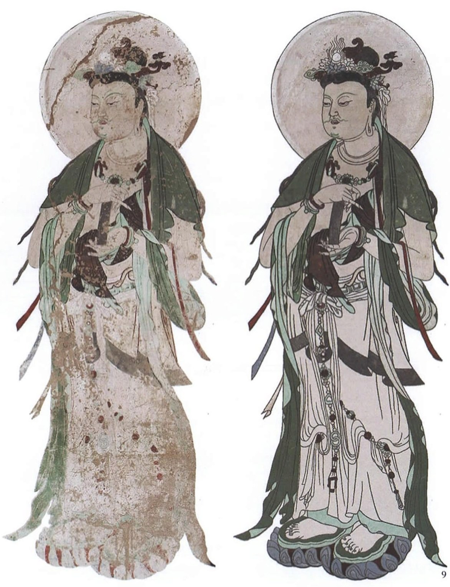

# 面容消失以后，应该重新画出来吗？

——《破损壁画的数字化复原研究——以敦煌壁画为例》拆解与艺术概论心得思路

整理日期：2026年10月29日。用途：辅助阅读、讨论和组织心得，不是可直接提交的心得成稿。

按用户要求，借用 `classic-book-analysis` 的理论类拆书框架，并结合 `humanities-thesis` 的文献拆解方法。本文是设计与技术研究，故重点拆解问题意识、研究对话、概念、论证、方法和可继续追问之处，不设置经典著作的考点预测。下文区分作者陈述、原图观察和本次阅读判断；“延伸批评”是本次阅读提出的问题，不冒充已查证的学界评价。

## 阅读卡片

- 作者：付心仪、麻晓娟、孙志军。
- 题目：《破损壁画的数字化复原研究——以敦煌壁画为例》。
- 刊物：《装饰》，2019年第1期，总第309期，第21—27页。
- DOI：10.16272/j.cnki.cn11-1392/j.2019.01.007。
- 文献类型：以用户为中心的交互设计研究，结合计算机图像处理和壁画专业知识。
- 研究对象：破损敦煌壁画的数字图像；主要实验案例为莫高窟第320窟菩萨像。
- 作者在摘要中的核心表述：“实现了利用壁画的线描图信息对破损敦煌壁画进行复原。”（第21页）
- 全文范围：已读PDF全部7页，并核看各页图表。下文页码统一指期刊印刷页码21—27，分别对应PDF第1—7页。PDF文件的2022年制作信息不能代替论文2019年的发表时间。

[论文原文](../../破损壁画的数字化复原研究——以敦煌壁画为例_付心仪.pdf)

## 一、核心问题意识：作者究竟要解决什么

**作者的核心问题是：怎样结合壁画专家的判断、线描材料和计算机算法，使破损壁画的数字复原更可操作，并得到符合壁画特征的结果？**

作者先从实体保护的困难切入，指出接触性修复须考虑原真性，且面临难度、周期、成本及损伤风险。接着把数字化工作从采集、保存和展示，推进到内容复原。（第21页）

这里要保留作者论述的范围。论文对实体修复的限制有概括性判断，但本文没有通过对照实验穷尽所有实体修复方式。读心得时可以将这些表述作为研究动机，不能据此断言所有实体修复都不可能补全任何图像。

作者具体要处理的是：全自动算法面对复杂构图和严重缺损时，难以获得足够信息；全手工操作又容易过度依赖操作者，造成风格不统一。因此提出由人提供专业判断、由计算机辅助执行的交互式方法。（第21—22页）

**与你的问题的关系：**论文主要检验“如何实现数字复原”；你关心“什么情况下应该复原，以及复原改变了什么”。作者提供了可以细读的操作过程，但没有完整论证艺术作品在修复后的同一性。

## 二、研究对话：作者怎样评价已有方法

以下是本文对既有研究的梳理，不表示本次已另行读过这些被引论文全文。（第21—22页）

| 本文讨论的已有路线 | 作者看到的作用 | 作者指出的不足 | 本文的应对 |
|---|---|---|---|
| 计算机辅助线描与着色 | 提取构图，辅助绘制与上色 | 对线条损伤较轻的图像更适用，部分着色依赖操作者 | 加入外部线描和专业人员的交互调整 |
| 参考相似壁画进行色彩推理 | 结合传统用色、风格及专家知识 | 难以处理结构严重破损 | 先为结构处理补充线描信息 |
| Photoshop等图像编辑方法 | 人工处理裂缝、污染和拼接等问题 | 某些方法难以复现；某些案例存在主观性和颜色过新的问题 | 将过程拆分为较明确的任务和操作 |
| 自动裂痕检测与图像填补 | 可以有效处理某些较小裂痕 | 复杂结构、丰富色彩和大面积缺损会增加困难 | 让专家参与破损选择及内容填充 |

作者的研究位置可以概括为：**把壁画知识转化为计算机可使用的信息，并为专业人员设计一套可操作的复原流程。**本文没有建立一套关于“所有缺损都应补全”的保护伦理。

## 三、关键概念：先分清“复原”发生在哪里

| 概念 | 在本文中的意思与位置 | 阅读时应分清的关系 |
|---|---|---|
| 数字化复原 | 对数字图像中的缺损进行结构、色彩和纹理处理。（第21—24页） | 图像变得完整，不等于原壁上的物质缺损被修好，也不能自动阻止病害发展。 |
| 几何结构复原 | 利用线描提供的轮廓、构图与区域信息组织图像。（第22—25页） | 这里的“几何”主要关乎二维图像结构，不是重建一尊三维雕塑。 |
| 线、色、神 | 作者借助所引临摹研究讨论造型线条、色彩及人物整体神貌。（第22页） | 它们不是三个可以独立、精确测量的历史真实性指标。 |
| 线描参考 | 为构图和形态提供额外信息；本文概述古代手稿和后期临摹等来源，实验案例则邀请专家关晋文绘制相应线描。（第22、26页） | 古代手稿、历史临摹与当代专家绘图的证据地位需要分别考察。不能统称为原作底稿。 |
| 人机交互 | 专家选择或修正区域、标注缺损、选择参考内容；计算机辅助处理。（第24—26页） | 人的解释和选择贯穿过程，算法不会自行消除原本缺失的历史证据。 |
| 原真性、完整性、可识别性、艺术性 | 作者邀请专家评价成果的四个角度。（第26页） | 本文没有给出足以重建全部专家判断的量化细则。不能把这里的“可识别性”自行解释成新增部分必然清晰可辨。 |

## 四、论证骨架：按全文顺序拆开

### 第一部分：敦煌壁画的现状与困境（第21页）

任务：解释为何需要数字复原研究。作者从病害、实体修复的限制和数字化研究的不足，提出自己的研究方向。

### 第二部分：现有的壁画数字化复原方法（第21—22页）

任务：找出已有方法的适用边界。全自动方式在信息不足时受限，全手工方式较依赖操作者，于是需要引入专业知识和交互控制。

### 第三部分：敦煌壁画特点剖析（第22页）

任务：说明为什么选用线描。作者用“线、色、神”解释壁画特点，强调线条对造型的基础作用，也强调色彩的时代差异和人物神貌；进而提出线描可以为结构复原提供补充信息。

### 第四部分之一：用户定位与需求（第23页、表1）

任务：让系统回应实际使用者。目标用户主要是实体壁画修复专家。作者访谈敦煌研究院保护所5位专家，归纳学习、操作、功能、展示和结果方面的需求。

### 第四部分之二：理论与数据准备（第23—24页、图2—3、表2）

任务：把研究方向变成流程。作者准备壁画、线描、样式三类数据，将系统工作分为图像分割、破损标注、内容填充。表2具体列出的壁画图像数据包括45幅整图、542幅拼接图和134幅细节图；这些数量不是已经完成并验证的复原案例数量。

### 第四部分之三：系统原型设计（第24—26页、图4—8）

任务：实现具体操作。

1. **图像分割：**借助线描，把壁画划为可处理的区域。专家可以合并或拆分区域。
2. **破损标注：**用户判断哪些区域属于破损，通过颜色范围选择并逐次调整。
3. **内容填充：**用户选择目标区域和参考区域，计算机利用参考颜色与纹理进行填充，并可调整填充尺寸及范围。

读到这里必须注意：哪些部分被判为病害、哪些颜色被作为参考、哪些范围需要处理，都包含人的决定。作者还允许在目标区域破损占比较高时重绘整个区域，以获得更统一的视觉结果。（第26页左栏）这个选择直接关系到你的问题：画面连贯性的提高，是否会使原存部分和新增解释之间的边界更难看见？这是本次阅读提出的追问。

### 第四部分之四：复原结果与用户实验（第26—27页、图9—10、表3）

任务：证明原型能运行，并考察专业评价与使用体验。作者以第320窟菩萨像作主要展示案例，邀请专家提供线描，并组织专家评价和用户实验。

### 结语（第27页）

作者认为该方法能够帮助解决典型破损壁画的数字化复原问题，具有易学、易用、高效率等特点。作者提出继续扩展样例和数据集、优化算法及界面交互。

全文的推进关系是：**提出复原需求，分析已有方法的不足，选择线描与交互控制，设计系统，再用案例、专家评价和用户体验进行检验。**

## 五、方法与证据：论文证明了多少

### 1. 三类参与者与评价不能混为一项

| 环节 | 文中规模 | 实际考察什么 | 不能直接推出什么 |
|---|---|---|---|
| 需求访谈 | 5位实体壁画修复专家 | 使用者需要什么功能和结果 | 作品原貌已被确定 |
| 成果专业评价 | 6位相关领域专家 | 对复原结果的原真性、完整性、可识别性、艺术性作专业评价 | 所有缺失细节均与历史原貌一一相同 |
| 用户实验 | 15人，专家、工程师、设计师各5人 | 系统易学性、易用性和结果满意度 | 对公众认知的长期效果；所有壁画的适用效果 |

论文未明确交代这些环节中的人员是否重合，不能把人数相加后当作独立样本总量。

表3所列总体评分为5分制：易学性4.30、易用性3.70、结果满意度3.98。它们支持的是受试者对系统的体验评价。**3.98分不能换算为历史复原准确率。**（第26—27页）

### 2. 最关键的案例边界：面部没有完全消失

图版来源：付心仪、麻晓娟、孙志军，2019，第26页，图9；直接提取PDF内嵌原图，未改画。原图注分别标为“320窟破损壁画原图”和“几何复原结果图”。

**原图观察：**左图虽然有磨损和缺失，面部方向、眼鼻口及部分轮廓仍可辨。右图线条、服饰和局部形态更连续。这张图能够展示依赖残迹和线描的数字复原成果，但没有展示从一张完全空白的脸出发、准确找回全部五官的过程。

因此，应把你的“面容已经完全消失”标为在本文案例基础上提出的进一步情境。不能声称它就是作者已验证的实验条件。

### 3. 专家认可的作用与边界

专业知识能够约束复原中的随意性，本文的专家参与具有实际作用。与此同时，本文没有提供可独立核验每个新增细节的原貌对照，也没有用表3评价历史还原的唯一性。认可其风格和结构的合理性，与证明这就是历史上唯一存在过的面容，是强度不同的判断。

## 六、延伸批评：从作者的结果继续追问

以下为本次阅读提出的分析，供本人核读后选择立场。

### 追问一：线描提供的是原貌证据，还是一种有依据的解释？

线描能增加结构信息，但线描本身也有来源。本文主要案例使用专家关晋文绘制的线描，而不是明确展示一张与该壁画逐笔对应的古代原稿。（第26页）需要继续问：哪些线根据原壁残迹整理，哪些经过比较推断？

不能因为线描出自当代专家就否定它；也不能因为它专业，就省略证据说明。你的心得可以讨论不同证据支持不同程度的确定性。

### 追问二：“画面完整”与“历史真实”是否始终一致？

第26页允许为视觉统一重绘整个目标区域。这里显露出两种目标：让观众更容易识读形象，以及保存并呈现图像实际留下的状态。两种目标都值得认真考虑，但在具体操作上可能存在张力。

需要补充一个区分：数字重绘本身不等于覆盖原壁。不过，如果展示只保留一张流畅完整的复原图，观众仍可能难以辨别哪些是原存信息、哪些是推断。这是本次提出的展示问题，本文没有通过公众实验验证其是否实际发生。

### 追问三：同一套工具什么时候用于复原，什么时候用于创作？

第26页记录设计师组反馈：用户选择不同参考区域进行填充，“可以衍生出不同的艺术作品”。这是一段用户反馈，不是作者已经解决作品同一性问题的结论。

它提供了一个很好的思考入口：操作界面和算法可以相同，但工作目标与证据约束不同。以历史材料约束选择时，结果可作为复原研究方案；以个人喜好决定内容时，结果更适合说明为再创作。技术动作本身不足以决定其身份。

## 七、接到你的艺术概论心得

### 1. 与原选题的连续性

你之前从观展疑问进入：新绘的临摹品为何仍然保留残缺面容。原提纲已经区分现状临摹、复原研究和原作保护。现在可以沿着这个区分继续推进：既然技术允许画得更完整，保护工作应在什么依据和目的下使用这种能力？

这样，“文化遗产学习与保护”的兴趣被收束为一个可以讨论的保护判断：**当面容缺失时，如何处理识读形象的需要与尊重历史证据的要求？**传播和学习可以作为复原的作用，但主线仍是保护中如何作出选择。

### 2. 可以直接接到课堂的地方

10月10日课程笔记记录了课堂对罗斯金、《建筑的七盏明灯》及保护问题的讨论：建筑具有材料真实性和历史记忆；求新式修复可能以修复者的想象取代原有痕迹。这里适合作为与数字复原对话的课堂线索。

使用时应说“课堂对罗斯金立场的讨论”，本次没有另行核读罗斯金原著，不能据此制造他的直接引文。也不能把针对建筑的观点不加解释地移用于所有壁画修复。

你可以借用的具体问题是：保存一件作品时，我们希望延续其现存材料与历史，还是希望恢复其图像的可读性？两种需要怎样共存？数字方案提供了同时保留原状图与复原图的可能，但仍需清楚交代证据和不确定处。这一立场由你发展，不归于本文作者或罗斯金。

### 3. 回答“还是原来的艺术作品吗”时，拆成三种情况

| 情况 | 可以怎样判断 | 需要保留的限定 |
|---|---|---|
| 在数字副本中补出面容 | 得到关于原作形象的复原版本，原壁的物质状态不因此改变 | 复原图有研究和审美价值，但新增像素并未成为古代原笔。 |
| 在新画的临摹品中补出面容 | 形成带有复原解释的临摹作品 | 即使外观十分接近，也需要说明它与原作的材料、年代和制作主体不同。 |
| 在原壁上补绘面容 | 原物可能仍被视为同一件历史作品，同时包含后加部分 | “仍是同一件物”不保证面部仍是原作者的表达；也不能说任何修补都会立刻使整件作品变成新作。具体判断需要超出本文的材料。 |

这里区分的是三个问题：是否仍为同一件历史物，是否保留同样的图像表达，以及新增部分出自谁。本文不能给出统一的比例或阈值，替你划定补到多少就成为另一件作品。

面容之所以值得聚焦，是因为眼神、朝向和表情会参与人物的神貌与关系组织。补上不同的眼睛或嘴角，即使图像类别仍然是同一位菩萨，也可能改变我们看到的情绪和观看关系。这是可通过局部形式比较继续论证的判断，不是本文已完成的实验证明。

### 4. 对“应该重新画出来吗”的可辩护立场

可以支持有证据约束的复原研究，并要求展示清楚区分原存信息与推断内容；是否将方案实际补到原壁上，需要单独讨论，本文没有提供足够依据来一概决定。

讨论面容全部消失的情境时，可以按证据强弱区分：若有同一面容的可靠历史记录，复原受到较强约束；若主要依靠同时期、同类型形象，只能支持某些可能的面貌；若几乎完全依据当代审美补画，就更接近创作。以上是本次建议的分析尺度，不是本文制定的行业规范。

也应认真回应支持补全的理由：缺损会妨碍观众理解人物、叙事和风格。保留残缺不等于获得了全部艺术信息。因此，问题不宜简化为“完整一定是假”或“保留残缺一定更好”，而应说明具体目标、具体证据，以及观众能否看见这些区别。

**供你核读后发展的中心判断：复原可以帮助我们理解已经残缺的形象，但一张视觉完整、风格合理的脸，仍需要证据才能被认作历史上那一张脸。数字复原的价值，可以建立在承认其解释性质之上。**

### 5. 心得组织建议

建议题目：**《当佛像的面容消失以后：数字复原与艺术作品的真实性》**。正文说明本文的具体案例是二维壁画中的菩萨像。

1. **从自己的疑问出发。**简述为什么曾期待临摹品补全面容；只写真实经历，不把论文图9冒充自己在展览中看到的作品。
2. **读出论文的方法。**用线描参考、专家选择和图9解释一次数字复原如何发生，保留其改善识读的价值。
3. **抓住一个操作继续问。**选择“重绘整个区域”或“选择参考区域”之一，分析完整形象如何包含新的判断。
4. **区分图像版本与原作。**回答数字副本、临摹品和原壁补绘各自发生了什么变化，再与课堂保护问题对话。
5. **形成自己的有限判断。**说明支持何种复原、需要什么证据、怎样呈现不确定性。保留无法判断的情况。

建议主读顺序：第22页“线、色、神”与线描来源；第25—26页内容填充；第26页图9、专家评价和设计师反馈。之后再回读第21页引言，检查作者的研究动机如何影响评价目标。

## 来源与核读定位

1. 付心仪、麻晓娟、孙志军：《破损壁画的数字化复原研究——以敦煌壁画为例》，《装饰》2019年第1期，第21—27页。上文论文内容及图版均据用户提供的本地PDF核对。
2. [原心得大纲](../壁画临摹中的面容-20261028/心得大纲.md)：用于确认此前观展疑问和问题区分，不将其旧案例当作新论文案例。
3. [10月10日课程笔记](../../原始数据/艺术概论2026-10-10第15_30_13/课程笔记.md)：“罗斯金：自然、记忆与建筑保护”，尤其“材料真实”“记忆之灯”“保护与‘修得像新的一样’之间的冲突”。课堂笔记是本次引用的来源，不等于已核读罗斯金原著。
4. [10月14日课程笔记](../../原始数据/艺术概论2026-10-14第7-8节/课程笔记.md)：“心得可以从一篇好论文入手”，用于理解这次心得的阅读场景。

本次没有另作外部检索；对2019年论文的研究现状陈述不作2026年现状判断。以上延伸讨论均为阅读分析与选题建议，未把它们写成作者已经证明的结论。
