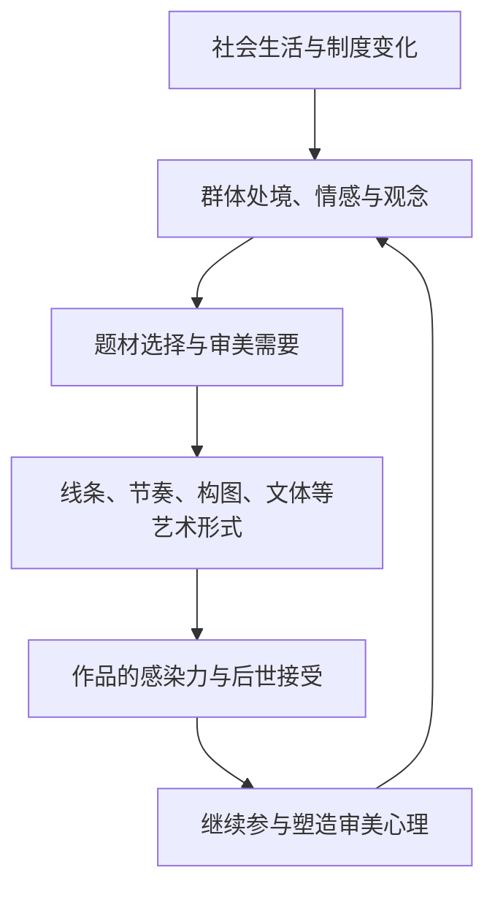

# 《美的历程》全书拆解

作者：李泽厚。整理日期：2026年10月29日。

按 `classic-book-analysis` 的理论类、理解全书场景组织：先抓问题，再辨概念，最后逐章看论证怎样推进。范围为所提供文本的十章及结语。

本文依据所提供的 TXT，按章、节定位。该文件有重复目录、转录错字和夹入正文的推广文字，推广文字不计入原著；图版未完整保留，涉及作品形象的说明依据李泽厚的文字论述。本文不提供未经核实的印本页码。下文的阶段表、比喻和阅读提示属于辅助理解；书中观点均以章节说明出处。

## 一、核心问题意识：艺术怎样把历史变成可以感受的东西？

**《美的历程》通过中国古典文艺的变化，追问审美形式与人的感受怎样在历史中形成。**

最容易记住的是朝代、作品和风格。更需要抓住的是两个互相联系的问题：

1. **为什么不同历史阶段会出现不同的美？** 青铜饕餮的威严恐怖、魏晋人物的风神、盛唐诗书的飞扬、宋元山水的意境，各自回应怎样的生活经验与精神需要？
2. **为什么时代过去了，作品仍然能打动后来的人？** 当年的礼制、政治与信仰已经改变，凝聚在作品里的感受为什么还可以被理解？

第一个问题指向艺术与社会历史的联系，第二个问题指向审美心理的形成与延续。李泽厚在结语中明确提出这两个问题，并把第二个问题保留为有待继续研究的方向。

全书的关键回答是：**社会生活中的情感、观念和经验，可以进入艺术形式，也可以进入人的感知方式。历史留下来的既有作品，也有欣赏作品的能力和习惯。** 作者把这种过程概括为“积淀”。

> 心理结构是浓缩了的人类历史文明，艺术作品则是打开了的时代魂灵的心理学。
>
> ——结语

这句话可以拆成两半读：作品使一个时代的精神获得可见、可听、可体验的形态；人的审美感受也带着历史塑造的痕迹。作者进一步设想，传承下来的艺术又会参与塑造后来人的心理，两者相互作用。

因此，书名中的“历程”既指艺术的变化，也指人如何逐渐形成不同的感受方式。

## 二、学术对话坐标：李泽厚用什么眼光看这些作品？

**他以社会历史解释为基础，把艺术形式分析与审美心理问题连接起来。** 以下列出的是书中可直接找到的思想对话。

### 1. 马克思：艺术的历史条件与持久感染力

作者反复使用社会生活、生产方式、阶级处境、人的对象化等思路，解释艺术为何出现特定面貌。这里的“对象化”，可以先理解为：人把自己的力量、经验和愿望落实在外部事物中。

例如第四章把汉代艺术对山川、生产、狩猎、神仙的广泛铺陈，解释为人对外部世界的积极占有和肯定。结语又追问：社会条件消失后，艺术为何依然有效？这使全书从艺术社会史进一步走向审美心理。

作者在结语特别强调社会条件通过曲折渠道发生作用，也承认经济、政治与艺术之间存在发展不平衡。理解本书时，要保留这些中间环节。

### 2. 克莱夫·贝尔：形式为什么会“有意味”？

第一章第三节直接讨论贝尔的“有意味的形式”。按李泽厚的转述，贝尔用审美感情解释有意味的形式，又用有意味的形式解释审美感情，存在循环论证。

李泽厚尝试增加历史解释：形式曾与具体的社会经验、仪式和情感相联系；这些内容逐渐融入形式和人的感受，使它获得超出几何排列的感染力。这是作者对贝尔概念的重新解释。

### 3. 中国诗画论、宗白华与鲁迅：从艺术内部辨认精神变化

作者大量讨论比兴、传神、气韵、言不尽意、笔墨、韵味等中国诗画概念。第二章借宗白华、邓以蛰等人的论述说明书法的线条、节奏和生命感；第五章借鲁迅对魏晋的分析讨论文学自觉；第十章借鲁迅对《红楼梦》的论述把握其悲凉感。

这些材料帮助他把宏观历史解释落实到具体作品的形式和审美效果上。

**便于阅读的定位：这是一部有明确理论主张的中国古典审美史论，兼论作品、观念与文化心理。** 作者对艺术家的高下品评，以及对历史阶段的划分，都是这套解释的一部分，阅读时应与材料本身分开判断。

## 三、五个关键概念：把后面的章节串起来

### 1. 积淀

**定义：社会历史内容逐渐进入形式，观念与想象逐渐融入感知和情感。**

第一章第三节给出最集中的表达：

> 内容积淀为形式，想象、观念积淀为感受

这里有两个方面：

- **作品方面：** 形式承载长期形成的社会内容。例如作者把部分动物纹向几何纹的演变，解释为图腾意义进入抽象形式。
- **感受方面：** 人对这种形式的反应，也包含被文化塑造的观念、想象和情感。

**易混点：** “积淀”比年代久远更具体，重在说明历史经验怎样转化为感受与形式。第一章也承认，对陶器纹饰的具体来源、顺序和意义仍有推测成分；读者需要区分理论解释与考古假说。结语则把心理结构的具体机制作为待研究问题，没有完成可检验的心理学证明。

依据：第一章（一）（三）、结语。

### 2. 有意味的形式

**定义：形式本身可以传达情感、力量和生命感，其中融入了社会历史内容。**

> 美在形式而不即是形式。
>
> ——第一章（三）

例如第二章谈书法，强调线条的轻重、疾涩、转折和组织怎样表达意兴。第十章谈戏曲，强调唱腔、身段、节奏与内容意义的融合。同一个概念由原始纹饰一路延伸到成熟艺术。

**易混点：** 把形式排列得整齐、对称，尚不足以概括作者所说的“意味”；还要看具体的节奏、力量与情感表达。作者也指出，原先有意味的形式可能因反复仿制而程式化，逐渐失去原有的意味。

依据：第一章（三）、第二章（二）、第十章（一）。

### 3. 实践理性

**定义：理性进入日常关系、伦理感情和政治生活，对人的行为与情感进行引导。**

第三章的典型例子是孔子解释三年之丧：礼制的理由被落实到亲子之爱，以及人是否感到心安。李泽厚关注的是，外在规范怎样成为人的内在情感需要。

这种思路也用于理解艺术：情感经过组织、节制和表达，可以形成具有感染力的作品；建筑则通过布局、秩序和游历过程，提供可居、可游的生活感受。

**易混点：** 这里的理性与情感可以交融，不能把“理性精神”读成取消情感；“实践理性”在本书第三章有自己的具体解释，使用时先依本章语境理解。

依据：第三章（一）（二）（三）。

### 4. 儒道互补

**定义：儒家与道家在相互对立中，又共同参与塑造人的生活态度和审美理想。**

按作者的分析，儒家突出社会责任、情理协调与教化，道家突出自然、独立人格、超功利的审美关系，以及艺术创造的自由。两者可能在同一文人身上形成进取与退避、入世与出世的张力。

第三章提出总线索，第八章再说明：中唐以后，这种张力怎样在士大夫的现实生活中展开，最终使人的心境和意绪成为重要艺术主题。

**易混点：** 互补包含实际矛盾。具体作品要看两面怎样交织，不能看到仕途便归儒家，看到山水便归道家。第八、九章也讨论了佛学、禅宗的影响。

依据：第三章（一）、第八章（二）（三）、第九章（一）。

### 5. 意境

**工作性解释：作品把景物、情感、想象和理解组织起来，使人进入某种可体验、可回味的境界。** 这是帮助阅读本书的概括，不作为作者逐字定义。

第八章讨论“象外之象”“景外之景”“韵外之致”，强调可见、可读的形象之外仍有余味。第九章把这个问题落到宋元山水画，区分情感如何通过景物整体、诗意安排和笔墨表达。

**易混点：** “意境”需要从作品的安排中说明。可以具体追问：画面怎样取舍景物？留白产生什么感受？笔墨怎样传达情绪？只说作品“很空灵”“很有感觉”，分析还没有完成。

依据：第八章（二）、第九章（二）至（四）。

## 四、论证骨架：十章怎样共同回答问题？

**全书按历史大致推进，同时不断比较不同艺术如何表现相近的精神需要。先秦理性与楚汉浪漫有交错和延续；佛教艺术一章也跨越多个时代。**

### 1. 先看解释机制

这张图是对全书解释思路的整理。具体章节提供历史材料与形式分析；结语进一步提出其中的心理学问题。它不是作者已经证明的普遍因果定律。

### 2. 再用一张表记十章

| 章节 | 核心问题 | 本章在全书中的作用 | 重点材料 |
|---|---|---|---|
| 一 龙飞凤舞 | 艺术形式的意味从哪里来？ | 从巫术、图腾、歌舞提出积淀问题 | 龙凤形象、彩陶纹饰、原始歌舞 |
| 二 青铜饕餮 | 狞厉、恐怖为何也有审美力量？ | 解释宗教政治经验如何进入造型，并追踪审美的分化 | 饕餮、礼器、金文、书法线条 |
| 三 先秦理性精神 | 情感如何得到世间化、理性的组织？ | 提出实践理性与儒道互补的长期线索 | 礼乐、《诗经》、诸子散文、建筑 |
| 四 楚汉浪漫主义 | 神话想象怎样继续发挥生命力？ | 展示理性化之外仍活跃的浪漫传统及其变化 | 屈骚、汉赋、帛画、画像石、汉俑 |
| 五 魏晋风度 | 人如何开始集中追问自身生命与精神？ | 把人的觉醒与艺术自觉联系起来 | 《古诗十九首》、人物品评、诗文、书画 |
| 六 佛陀世容 | 同为佛教艺术，为什么面貌持续变化？ | 用同类题材比较不同时代的心理与审美理想 | 北魏壁画、唐代经变、魏唐宋雕塑 |
| 七 盛唐之音 | 旺盛的生命意气怎样获得艺术形式？ | 比较自由抒发与建立法度的两种美 | 李白、张旭、杜甫、颜真卿、韩愈 |
| 八 韵外之致 | 进取与退避怎样变成可回味的心境？ | 解释中唐至宋代对韵味、意绪的重视 | 中晚唐诗文、词、苏轼、宋瓷 |
| 九 宋元山水意境 | 山水怎样从自然对象变成心境的表达？ | 具体分析整体再现、诗意安排与笔墨写意 | 北宋山水、南宋院画、元四家 |
| 十 明清文艺思潮 | 世俗生活与个人真情怎样进入艺术中心？ | 把市民文艺、浪漫、感伤和现实批判联系起来 | 话本、戏曲、李贽、《牡丹亭》《红楼梦》、绘画工艺 |

### 第一章：龙飞凤舞——美的形式带着仪式和群体生活的记忆

**本章先追问艺术和审美怎样产生。** 作者把早期龙凤形象、歌舞和纹饰，放回尚未分化的巫术礼仪之中理解。今天分属宗教、舞蹈、绘画、诗歌的活动，在当时可能结合在同一仪式中。

本章的重要推论是：当某些形象逐渐简化、抽象化，它们曾承载的信仰和情感，也可能融入抽象形式及人的感受。这就把“积淀”引出来了。

阅读时分清两层：一层是作者提出的审美历史解释；另一层是龙凤、鱼鸟纹具体起源与演变的推测。作者自己多次保留“可能”“猜测”“科学假说”等限定。后者不能直接当作已无争议的考古事实。

**读完要能回答：为什么李泽厚认为，看似简单的线条也可能承载丰富内容？**

依据：本章（一）“远古图腾”、（二）“原始歌舞”、（三）“有意味的形式”。

### 第二章：青铜饕餮——威慑、神圣与力量怎样进入美的经验？

**本章用“狞厉的美”扩大读者对美的理解。** 作者强调，礼器的厚重造型、深沉刻饰和怪异兽面，把原始宗教与统治力量凝聚成一种有压迫感的形象。

他特别区分当时的宗教礼器功能与后人的审美欣赏：使用者面对的是神圣威力，后来人则可以在历史距离中感受其造型力量与时代意味。说明这种审美感染力，并不等于要求读者赞同当年的暴力与等级秩序。

本章还有两条线值得保留。其一，文字逐渐发展出较独立的线条、结构与抒情价值，开启书法的分析。其二，到春秋战国，威慑性的神圣意味减弱，人间生活与精巧工艺进入青铜艺术。作者认为，这是一种审美转变，同时也使早期青铜那种特定的力量感成为过去。

**读完要能回答：艺术更精巧，与它是否更有力量，是不是同一个问题？作者为什么作出这种区分？**

依据：本章（一）“狞厉的美”、（二）“线的艺术”、（三）“解体和解放”。

### 第三章：先秦理性精神——日常情感怎样组织成艺术？

**本章奠定全书对中国古典审美的基本解释。** 作者认为，儒家用日常人伦与情感重新解释礼乐，道家则为自然、独立人格和创造自由提供了另一种资源。

“赋比兴原则”一节尤其适合结合艺术概论理解。作者关注主观情感如何获得可共同感受的形象：情感与景物、想象、理解结合，形成可以感染别人的作品。比兴在这里承担的是情感客观化的作用。

建筑一节则把这种思路扩展到空间。作者重点分析群体布局、平面展开、对称秩序与游历过程：建筑让人在连续行进中获得层次、节奏和生活感受。园林进一步把建筑与山水组织在一起。

这些是作者选取的典型特征。使用本章的中外比较时，应保留它所讨论的具体类型，避免把宽泛对比改写为所有中外建筑的统一规律。

**读完要能回答：情感为什么需要经过形式组织，才成为可以共享的艺术经验？**

依据：本章（一）“儒道互补”、（二）“赋比兴原则”、（三）“建筑艺术”。

### 第四章：楚汉浪漫主义——神话成为生命愿望与行动气势的表达

**本章说明，先秦的理性化过程仍与强大的神话想象传统并存。** 作者把屈骚置于南方神话、巫术传统中，又特别强调《离骚》中个人情操与浪漫想象的结合。

汉代艺术进一步形成天上、人间、历史与现实并陈的图景。作者把神仙和长生愿望解释为对现实生命的留恋，把汉赋、画像石和各种生活题材的铺陈解释为对外部世界的全面关注与肯定。

“气势和古拙”一节给出具体的形式分析：夸张动作、简洁轮廓、粗重形体和饱满构图，可以增强运动、速度和力量感。“古拙”在这里获得积极的艺术作用。

这里的浪漫主义，主要指神话想象、生命愿望和奔放气势所形成的艺术倾向。阅读时可沿本章语境理解，不能直接套用欧洲某个文学运动的全部含义。

**读完要能回答：汉代艺术的“不合比例”和缺少细节，怎样参与形成它的气势？**

依据：本章（一）“屈骚传统”、（二）“琳琅满目的世界”、（三）“气势和古拙”。

### 第五章：魏晋风度——生命受到威胁，个人价值反而突出

**本章把“人的觉醒”与“文的自觉”联系起来。** 在李泽厚看来，反复书写人生短促、生离死别，表现了人对有限生命及其价值的强烈执着。

政治危险、既有权威受到怀疑，促使一部分士人重新追问：生命有什么意义，怎样保持人格？相应地，人物品评与绘画开始突出内在神情，文学更自觉地讲究自身价值、创作规律和形式。

两者的联系可以这样理解：个人感情与精神值得珍视，用来表现它们的文章、书法和绘画也因而值得独立研究。传神、气韵、言不尽意，共同服务于通过有限形象表达丰富精神的要求。

阮籍和陶潜让这种觉醒具有具体处境：阮籍的痛苦来自想表达而又难以表达的政治压力；陶潜通过退居田园、维护人格，在生活中寻找慰安。作者也明确限定，本章的“人”有特定社会基础，主要涉及门阀士族及相关士人，不能直接扩大为当时所有人的普遍解放。

**读完要能回答：为什么人生悲哀能够包含积极的生命意识？人的觉醒怎样支持艺术自觉？**

依据：本章（一）“人的主题”、（二）“文的自觉”、（三）“阮籍和陶潜”。

### 第六章：佛陀世容——用相近题材观察时代心理的差别

**本章用佛教艺术说明：宗教题材保持联系，艺术理想仍会随社会与心理变化。** “佛陀世容”抓住的正是神像与人间面貌的关系。

| 作者概括的类型 | 主要审美关系 | 文字论述中的典型表现 |
|---|---|---|
| 魏：以理想胜 | 现实苦难与超脱理想形成强烈对照 | 悲惨的本生故事、超然宁静的佛像；部分成熟作品呈现秀骨清相 |
| 唐：理想与现实结合 | 神圣形象更接近人间生活 | 丰满、庄严、亲切的形象，华丽欢乐的净土图景 |
| 宋：以现实胜 | 世俗人的情态更加突出 | 具体、可亲的形象，更浓厚的现实生活意味 |

作者还追踪敦煌供养人、出行图和世俗场景的扩大，说明人的现实生活怎样在画面中取得更突出的位置。

这三种是作者的概括类型；他明确承认具体作品有成败高下，也有交叉。它们有不同的艺术价值，不能排列成简单的优劣顺序。作者对宗教功能和世俗化方向的评价，则需要与佛教艺术的具体材料分开判断。

**读完要能回答：为什么同属佛教艺术，北魏的苦难叙事与唐代的极乐图景会产生不同审美效果？**

依据：本章（一）“悲惨世界”、（二）“虚幻颂歌”、（三）“走向世俗”。

### 第七章：盛唐之音——自由抒发与建立法度的两种美

**本章的重要辨析，是把通常一起谈论的唐代艺术分出两种风貌。**

| 比较 | 李白、张旭等所代表的一路 | 杜诗、颜字、韩文所代表的一路 |
|---|---|---|
| 形式特点 | 才情奔涌，强烈突破既有束缚 | 把雄厚力量凝聚在严密形式中 |
| 主要审美感受 | 飞扬、自由、出人意料 | 沉着、严整、有可循法度 |
| 对后世的作用 | 展示创造自由与才情的高度 | 提供可以学习、运用和发展的范本 |

作者把狭义的“盛唐之音”更多给予前一路，同时承认后一路的独立价值。韩愈时代较晚，把三者并论，是作者按审美作用所作的组织。

“音乐性的美”也贯穿本章：诗的音调、草书的线条、舞蹈的运动，通过节奏与情感力量发生联系。理解狂草时，可以观察文字所说的轻重、连断、急缓，怎样构成时间中的运动感。

汉代气势与盛唐气势也有差别：第四章重点谈外在动作与整体力量，第七章则突出情感抒发的节奏与个人才情。

**读完要能回答：为什么建立规范也可以是一种艺术创造？**

依据：本章（一）“青春、李白”、（二）“音乐性的美”、（三）“杜诗颜字韩文”。

### 第八章：韵外之致——士大夫的矛盾怎样成为艺术余味？

**本章解释中唐以后对个人心境、情绪与韵味的重视。** 作者把它放在生活方式、士人处境和艺术形式共同变化的背景中理解。

一面是参与政治、承担责任的愿望，一面是仕途受挫后的退避、闲适与个人生活。两者交织，使孤冷、伤感、幽微的心绪获得更充分的表达。诗词、山水小品与细洁单纯的宋瓷，被作者放在一起讨论这种审美趋向。

“韵外之致”可以先理解为：作品引发的感受，能够超过字面所说的事和眼前所见的物。形式与形象需要给想象、体会和回味留下余地。

苏轼在本章尤其重要。李泽厚着重解释他一面关心现实、一面追求解脱的矛盾，并认为这种矛盾可以深入到对整个人生意义的追问。这是李泽厚对苏轼的特定解释，读原作时可以检验它能说明哪些作品，以及哪些作品需要别的角度。

**读完要能回答：作品的淡泊、超脱和回味，背后可能包含怎样的生活张力？**

依据：本章（一）“中唐文艺”、（二）“内在矛盾”、（三）“苏轼的意义”。

### 第九章：宋元山水意境——从景物整体到笔墨中的主观心境

**本章以山水画具体分析情感怎样进入艺术形式，是全书理解意境最集中的部分。**

| 阶段 | 作者强调的重点 | 情感怎样进入画面 | 阅读提示 |
|---|---|---|---|
| 北宋山水的第一种意境 | 整体自然、地域特征、丰富全景 | 通过景物整体间接传达，含义较宽泛多义 | 作者称为“无我之境” |
| 南宋山水的第二种意境 | 选择性场景、细节真实、诗意安排 | 更明确地引导某种诗情画意 | 位于过渡中，作者基本仍归“无我之境” |
| 元代山水的第三种意境 | 笔墨趣味、寄兴写意、主观心境 | 通过笔墨和景物直接表现意兴 | 作者称为“有我之境”，以倪瓒为典型 |

**“无我”仍然包含艺术家的选择与感情。** 作者所强调的是，这种感情没有直接外露，景物整体给观者留下较宽泛的感受空间。“有我”则更明确地把景物与笔墨组织为表达主观意兴的方式。

另一点尤其重要：元画的笔墨自身取得相对独立的审美价值。线的转折、墨的浓淡、枯湿和组织，既描绘对象，也表达精神。前面关于书法与线的艺术的讨论，在这里汇合。

这套分类要按本章的山水画语境理解。作者强调类型之间可以过渡、结合，也承认具体画家和作品未必都能装进某一类。

**读完要能回答：北宋、南宋和元代山水各自怎样组织景物与情感？为什么南宋不能简单划成“有我之境”？**

依据：本章（一）“缘起”、（二）“无我之境”、（三）“细节忠实和诗意追求”、（四）“有我之境”。

### 第十章：明清文艺思潮——世俗人情、真情与繁华中的崩解

**本章把普通生活及个人情感推到前面，并追踪它们怎样走向感伤和现实批判。** 章节虽以明清命名，也回溯宋代说唱与元代戏曲。

第一条线是市民文艺。城市、商业、听众和读者的变化，使话本、戏曲、木刻插图更充分地表现爱情、金钱、遭遇、官司和人情。作者也看到这些作品既有新生因素，又保留报应、功名等旧观念。

第二条线是浪漫思潮。李贽的童心与真情、公安派对性灵的表达，以及《牡丹亭》中情与理的冲突，共同承载了作者所理解的个人真实欲望与自由要求。昆曲、京剧等成熟戏曲，又以唱念做打、节奏和身段，把“有意味的形式”发展为综合艺术经验。

第三条线是文学内部的变化。作者从明代浪漫思潮谈到《桃花扇》《长生殿》《聊斋志异》等的感伤，再谈《红楼梦》《儒林外史》的现实批判。他认为《红楼梦》承接了繁华终将破灭的悲凉体验，又通过细密的社会生活描写，把批判推进到更深处。

因此，阅读本章的《红楼梦》论述，可以同时抓住两面：感伤提供全书的情感气氛，对人情世态的具体描绘、揭示和批判则构成更深的美学价值。

**特别注意：浪漫、感伤、批判现实主义是作者在这里概括的文学思潮进程。** 作者自己指出，绘画没有完全走成这三个阶段，工艺也不能这样划分。

**读完要能回答：为什么表现日常人情能够改变艺术面貌？感伤怎样在《红楼梦》中与现实批判结合？**

依据：本章（一）“市民文艺”、（二）“浪漫洪流”、（三）“从感伤文学到《红楼梦》”、（四）“绘画与工艺”。

## 五、方法论识别：学会他怎样分析，也看清解释的范围

**本书最可借用的方法，是把时代处境、人的感受和作品形式放在同一分析中。**

### 1. 主要方法：社会历史解释与形式比较相结合

作者经常这样推进：先说明某种生活和制度处境，再解释相关群体的愿望与矛盾，最后回到题材、构图、线条、音调和文体。第七章把诗歌、草书和音乐放在一起，第八章把诗词、士人心理和宋瓷并论，第九章把山水的空间安排与主观情感联系起来，都是典型例子。

这个方法的长处，是把“雄浑”“飘逸”“淡泊”等抽象形容落回具体作品，说明它们怎样形成，又回应什么经验。

### 2. 借用时，补足中间环节

以第九章为例，一段完整分析至少需要回答：士人的生活处境怎样改变？为什么更需要寄托和表达某种心境？这种需要又怎样落实为对笔墨的强调？最后，作品的哪些具体特征支持这个判断？

只写一个时代关键词，再给作品贴上同样的标签，论证仍然缺少中间环节。全书的启发正在于要求读者把心理和形式放进解释过程。

### 3. 保留作者自己的限定

结语承认艺术与经济政治发展不平衡，第一章承认部分纹饰解释仍是推测，第六章承认三类佛教艺术有交叉，第十章承认文学、绘画、工艺无法套用同一分期。第九章更明确写道：

> 世界是复杂的，理论上的种种区划、分析是为了帮助而不是去束缚对艺术品的观赏和研究。

把这些限定读进去，能避免把一部富于洞见的宏观史论，读成逐朝适用的固定公式。

### 4. 三个阅读边界

- **区分材料与解释。** 某段诗文、某种造型是讨论材料；它代表何种群体心理、说明何种历史趋势，是作者进一步作出的解释，需要检验推理。
- **留意代表性。** 本书大量讨论文人、士大夫和精英作品。使用“中国人的心理”“民族精神”等概括时，应追问具体涉及哪些人、哪些地区和哪些艺术。
- **留意价值判断。** 作者对某些艺术风格、人物及历史阶段有明确好恶。这些判断能推动讨论，也需要与作品成就、历史事实分别判断。涉及古史分期、资本主义萌芽、宗教发展等问题，若进一步用于论文，应另核专门研究。

以上是由本书论证方式引出的阅读提示，没有将其冒充为外部学界已经达成一致的批评结论。

## 阅读路线与自检

### 建议的两遍读法

**第一遍建立地图：** 先读结语，带着“艺术为何变化、古典作品为何仍能感人”两个问题看十章总览；再重点读第一章（三）、第三章（一）、第五章（一）（二）、第九章（二）至（四）。这些部分分别交代积淀、文化心理、人的觉醒、艺术自觉与意境。

**第二遍回到原书顺序：** 每章选择作者分析的一件作品、一段诗文或一种艺术形式，检验时代解释究竟怎样落实到它的形式。其余章节再据兴趣细读，避免只记概括而丢掉作品。

这是一条理解路线，不是任课教师划定的考试重点。

### 五个自检问题

1. 能否用一个具体例子，说明“内容积淀为形式，想象、观念积淀为感受”的两面？
2. 能否把第三章的儒道互补，与第八章士人的进取、退避和苏轼联系起来？
3. 能否说明魏晋“人的觉醒”与“文的自觉”为什么互相支持？
4. 能否准确区分北宋、南宋、元代山水的三种意境，同时解释“无我”仍有情感？
5. 能否从某个作品的具体形式出发，说明李泽厚的时代解释在哪里有说服力、哪里还需要证据？

若继续深化，适合把第九章做成“无我之境／有我之境”概念卡，或围绕第八章“苏轼的超脱与矛盾”展开文本讨论。期末题型映射、论文选题及外部学界批评可按实际需要另作专题；本稿以理解原著为主。
