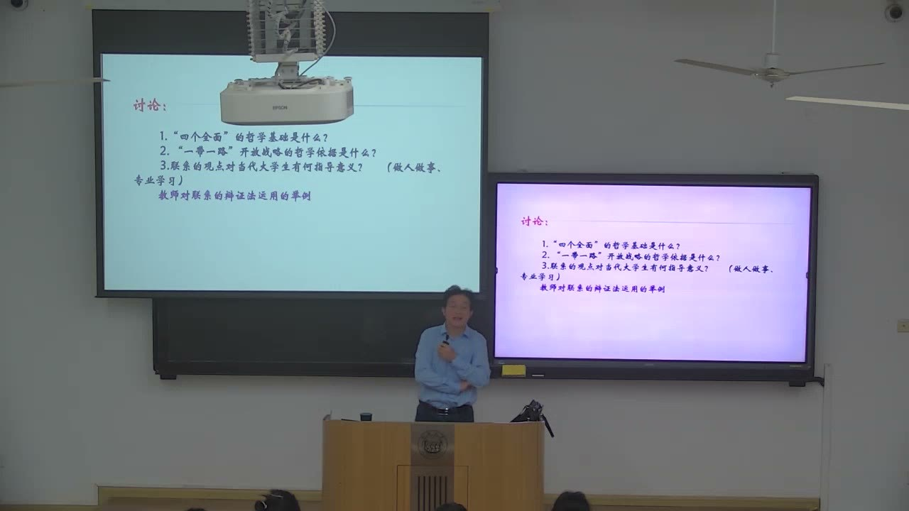
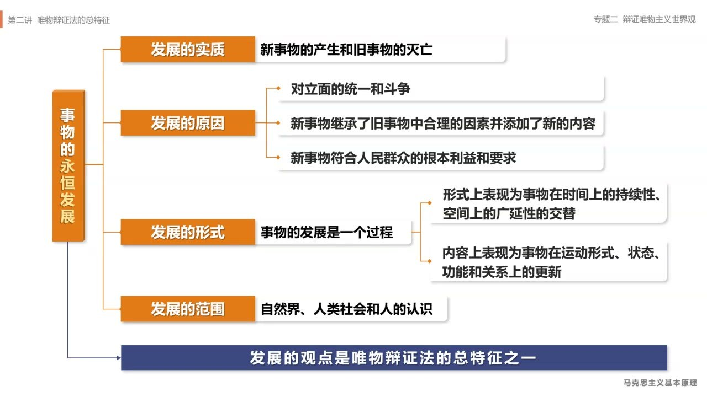
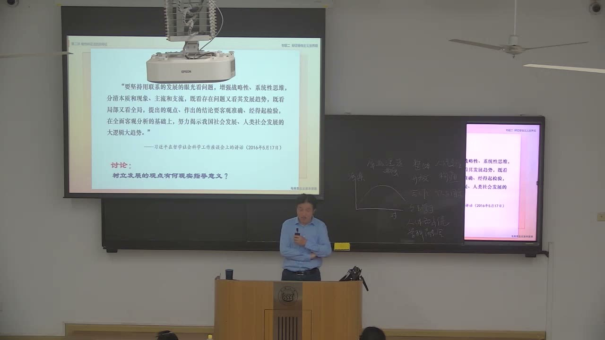
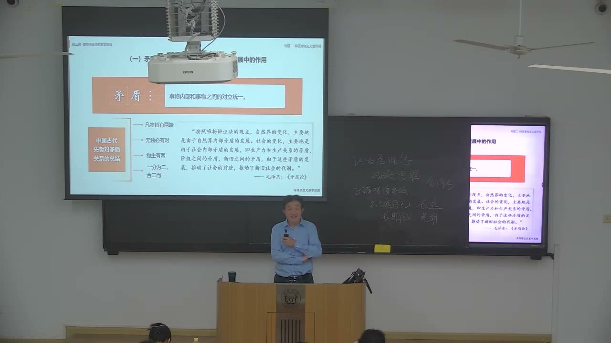
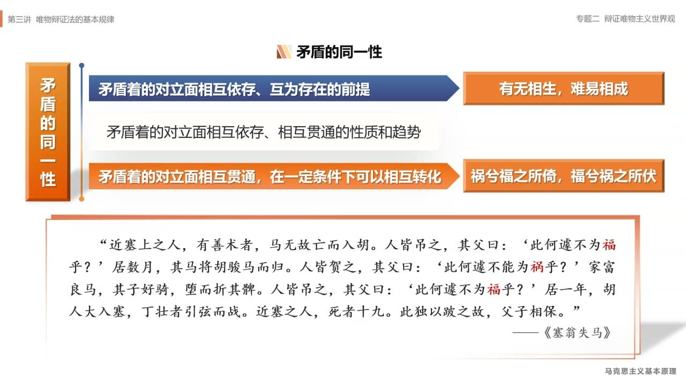

### 课程安排与任务

#### 课程论文与实践报告的格式

教师回应格式问题时说明：总标题用小三号黑体，二级标题用小四号黑体，正文用小四号宋体，行距设为固定值 28。文稿应有题目、作者姓名和学号，并按正常论文组织内容；教师还提到内容概括与关键词。课程论文和实践报告采用这一格式要求。

#### 把马克思主义原理与专业问题结合

课外作业可以从专业实验、专业设计或专业问题中寻找联系的具体表现，说明哪些因素彼此影响、这种关系是否涉及本质和必然性。教师要求把原理用在具体分析中，不能只罗列概念名称。

教师在后面的回应中说明，课程论文讨论马克思主义原理与自身专业的关系即可，不一定要有实验。专业实验是一种切入方式，不是所有课程论文都必须采用的形式。

### 联系的应用：整体性与开放性

把联系的分类与问题的结构对应起来，才能从哲学原理推导出具体的思考方法。

#### 先明确问题，再选择有解释力的联系

教师对三个讨论题的点评强调：哲学依据可以涉及很多原理，但在联系这一教学环节，应抓住与问题最直接相关的概念。分析“四个全面”与开放合作，不宜把普遍性、客观性、各种联系名称全部写一遍后，便认为完成了论证。

这里的关键是区分事物内部的联系与事物之间的联系。前者引出整体性思维，后者引出开放性思维。论述要交代所分析的事物是什么、有哪些要素、要素之间怎样联系，并由此说明为什么需要某种行动方式。

#### 四个全面：由内部联系推导整体性

教师说明，“四个全面”中的第一个全面已由全面建成小康社会转向全面建设社会主义现代化国家，另外包括全面深化改革、全面依法治国、全面从严治党。每个“全面”内部也有许多具体领域，不能把它理解为一项孤立措施。

国家的发展涉及政治、经济、文化、社会、生态与党的建设等相互联系的内部要素。正因为这些方面互相影响，才需要整体性意识、系统性思维和统筹安排。“全面”所回应的就是不能只顾一个局部、忽略其他内部关系的问题。

#### 开放合作：由事物之间的联系推导开放性

讨论一个国家的发展时，其他国家的市场、资源、技术和发展变化，都可能成为影响它的外部联系。教师据此说明，开放性理念来自对事物之间联系的认识：不能把自身的发展理解为与外部世界毫无关系的封闭过程。

教师以“一带一路”合作为例，强调开放需要合作对象的参与，也需要说明共同利益和互利条件。提出倡议之后，还要通过交流与合作把可能的联系变成实际的联系；单方面表达愿望，并不等于合作已经实现。

#### 开放程度与贸易关系也有发展过程

教师用对外开放的推进过程说明，开放不是一个只有“有”或“没有”的状态，还涉及范围、程度和具体制度安排。对外部市场的认识与政策选择，会随着自身能力和外部条件变化而调整。

当某个贸易对象增设壁垒、合作条件发生变化时，可以从贸易对象、产品和主体的多元化寻找新的联系，减弱对单一市场的依赖。教师还用“温室里的花朵”比喻过度保护，说明参与更广范围的竞争与合作，可以促使企业提高自身能力。

#### 个人发展：内部要全面，外部要交流

从内部联系看，大学生的发展涉及德智体美劳、专业能力和综合素养。教师强调，不能把成绩或单项专业技能当成个人发展的全部；各方面能力共同构成自身的发展条件。

从事物之间的联系看，个人生活在校园与社会之中，需要向他人学习、互相帮助和交流。专业学习也有内部知识体系与学科之间的关系，既要了解本专业的各个部分，也应认识其他课程与自身专业可能发生的联系。开放性在这里表现为愿意沟通、学习与合作。

### 联系怎样成为研究方法

从实验关系、社会部门和全球问题中识别联系，能够把“全面地看问题”变成实际的研究工作。

#### 专业实验要从现象关系走向规律问题

教师要求在专业实验和设计中主动识别联系的类型：直接与间接、本质与非本质、必然与偶然等。研究不只是记录几个现象同时发生，还要考察这种关系反映了什么、在什么条件下成立。

教师认为，当实验中发现的联系能够深入到本质和必然性的层面，就可以进一步讨论规律；首次揭示这样的关系，还可能构成创新。这个例子的重点，是让原理帮助提出研究问题，并把关系的论述与专业材料结合起来。

#### 日常交往也是联系的具体运用

教师以参与社区志愿活动、认识邻居和日常互助的经历，解释开放性理念怎样进入生活。人际联系需要通过共同活动、交流和回应形成，不能只停留在“人与人有联系”的抽象判断上。

互相帮助既能解决具体困难，也能增加信任和共同生活的体验。教师把这一经历作为个人运用联系观点的例子：自身的发展与他人的处境并非互不相关，愿意参与和交流，能够改变原来彼此陌生的关系。

#### 从两大部类出发，重新考察整体结构

教师介绍自己的研究，曾从马克思关于社会再生产两大部类之间关系的分析出发，依据所研究的问题扩展为四大部类，并讨论部类之间的比例关系。这里着重展示整体性思维怎样推动模型和研究框架的调整。

分析整体时，要先辨认哪些部分构成它，再考察部分之间如何相互制约和协调。模型中的分类与关系不能脱离具体研究目的；增加部门划分，是为了更清楚地解释现实问题。

#### 可持续发展要看到国家之间的联系

教师用自己关于“可持续发展必须协调八大关系”的研究举例。除人口、资源、环境和代际关系之外，他特别强调发达国家与发展中国家之间的关系，并在本课集中解释这一项。

在教师的论述中，发达国家的发展曾利用发展中国家的资源、劳动力和市场，因此实现全球可持续发展，需要考虑发展机会与责任如何协调。他提出，共同发展和帮助较弱的发展主体改善条件，也是较强主体实现长远发展的条件。

#### 环境责任不能只看一个地区的当期排放

教师把历史积累与当期增量、排放发生的空间与生产经营主体、生产排放与消费需求联系起来分析。同一项环境问题，若只用一个时间截面或一个地区的数据去说明，就容易忽略其他关系。

例如，生产活动的排放可能发生在发展中国家，但相关企业、产品需求和收益安排跨越多个国家。消费也需要能源和生产活动支持。教师借此说明，责任判断需要扩大观察范围，把生产、消费与历史过程联系起来。

教师还以环境库兹涅茨曲线说明工业化阶段、技术进步和污染治理之间的关系，用于解释其关于发展阶段的讨论。这里的分析要回到具体的发展条件、技术与治理过程，不能只比较一个孤立指标。

### 发展：新事物、生命力与过程

联系与相互作用引出运动变化；发展的概念还要进一步说明变化的方向、内容和前途。

#### 从相互作用到发展的问题

事物相互联系，带来相互影响和相互作用，由此发生运动变化。教师用“沧海桑田”等例子引出变化，并进一步追问：怎样把握发展，为什么会发展，发展的动力在哪里？

发展的实质是新事物的产生和旧事物的灭亡，也可以概括为新事物不断取代旧事物。学习发展观点，需要把握这一实质，不能只用“发生变化”四个字代替对发展的判断。

#### 新旧的判断重在生命力

教师把新事物的特点概括为具有远大前途和顽强生命力、适应变化着的条件并符合历史发展趋势。旧事物则逐渐失去存在的历史必然性，在条件变化中丧失继续发展的前途。

因此，判断事物的新旧，关键是它与发展趋势和变化环境的关系。一个做法能否持续、是否有适应未来的能力，是教师反复强调的判断角度；只观察眼前的状态，还不足以解释它的长远生命力。

#### 新事物取代旧事物包含扬弃

发展并不意味着把旧事物的一切全部丢掉。新事物继承旧事物中合理的因素，并增加新的内容，这就是教师在这里解释的“扬弃”。继承和更新需要同时考虑。

教师以社会制度与文明成果的关系举例：讨论社会制度的变化，不等于否定此前产生的所有物质文明成果。发展要处理旧有成果中哪些可以保留、哪些需要改变的问题，新事物还应符合人民群众的根本利益和要求。

#### 发展是一个过程，不能要求一蹴而就

发展的形式是一个过程，在时间上有持续性，在空间上有广延性；在内容上体现为运动形式、状态、功能和关系的更新。理解过程性，就是承认发展需要经历具体阶段和条件的变化。

教师强调，发展道路并非始终直线向前，过程中可能有曲折和反复。长期目标需要战略安排，不能把一个阶段的困难当成对全部前途的最终判定，也不能期望复杂变化一次完成。

#### 发展观点同样适用于人的认识

发展涉及自然界、人类社会与人的认识。人的知识积累、专业能力和所处条件改变后，原有的观念与判断也可能需要更新。教师强调，改变判断应联系新的条件理解，而不能简单视为不坚持原来的立场。

联系与发展的眼光要求同时看本质与现象、局部与全局、存在的问题与发展的趋势。在客观分析的基础上形成判断，结论还要经得起检验；系统性思维与战略性思维由此结合起来。

#### 经济增长还要接受可持续性的检验

教师用经济发展说明“有生命力”的含义。若增长长期依靠大量消耗资源、能源或劳动者的时间，而难以持续，就需要改变发展方式；短期数量的提高，不能代替对发展质量的考察。

教师强调创新与科技进步的作用，并把发展质量同可持续性联系起来。在他的论述中，经济发展应体现能够延续的生命力，而不是只看当期 GDP 的增长。个人的行为选择也可以追问：它是否损害他人利益，是否危害自己的长远发展条件？

### 发展观点的应用：事业、成长与创新

把过程、趋势和变化条件纳入判断，可以帮助应对挫折、调整行动，也能打开研究选题的空间。

#### 对事业的信心需要说明其生命力

教师从党的事业谈发展的现实指导意义，强调革命乐观主义精神。其理由不是简单相信“总会成功”，而是分析所从事的事业是否符合人民利益和历史发展趋势，是否具有不断成长的条件。

教师借“星星之火，可以燎原”说明，暂时力量弱小或遭遇困难，不等于没有发展的前途。判断要把目前的状况放进长期过程，分析支持力量和未来条件，不能只用一个阶段的得失作结论。

#### 乐观还要同认识错误、纠正错误结合

教师回顾社会主义建设中曾出现的挫折与错误，强调看到前途并不意味着否认已经发生的问题。认识错误、加以纠正，是事业继续发展的具体方式。

过去的问题解决后，还可能产生新的情况和矛盾，因此路线、政策和制度安排需要不断改革、创新和更新。“与时俱进”所回应的，正是现实事业和条件持续变化这一事实。

#### 成长过程中的挫折，不等于全部未来

教师把发展观点用于个人成长，强调形成豁达、乐观、奋发向上的人生态度和抗挫折能力。学业、工作、家庭生活等都可能出现困难，当前不顺不能直接推导为未来再无变化。

发展的过程性要求把一个阶段放进较长的时间范围，也要看到环境和条件可能改变。教师从时间与空间变化的角度解释，调整所处环境、行动安排和看问题的方式，可以成为寻找新机会的路径。

#### 环境变了，规划与学习方式也要调整

个人发展环境不断变化，原来的计划、生活安排和学习方式便可能需要重新审视。发展的观点不仅帮助理解困难，也要求行动随条件变化而更新。

长期方向与具体计划不是同一个层次。保持发展目标的同时，应分析现实条件已经发生什么变化，哪些做法仍然有效，哪些需要修正，而不能机械重复过去的安排。

#### 研究新问题，要从变化着的现实中寻找

教师强调研究型大学应培养发现和研究新问题的能力。文献检索后发现许多题目已有讨论，并不等于现实中已经没有新问题；要把目光从重复旧结论转向正在发生的新变化。

人工智能、数字经济、科技革命与新的社会需求，会改变就业、生产、生活和各专业领域的条件。这些变化带来新的对象、关系和难题，研究可以从“旧框架面对新条件时出现了什么问题”切入。

#### 把宏观议题拆成可研究的专业问题

教师用高质量发展、新质生产力、中国式现代化等议题说明，宏观目标还需要研究其具体含义、实现条件和各领域中的问题。例如，质量怎样理解，新的生产力体现在哪里，生态或文化建设中面对哪些特殊条件。

大的变化可以分解为政治、经济、社会、文化、生态等领域的问题，也可以进入数学、物理、化学等专业的研究。把新技术和新条件纳入自身专业，就能发现既有解释尚未充分处理的问题。发展观点因而成为学术创新的一种思考方法。

### 矛盾：从发展动力到对立统一

发展的讨论继续追问动力、形式与道路；对立统一规律把矛盾作为理解事物发展的重要关系。

#### 三大规律分别回答什么问题

教师将辩证法的基本规律分成三个问题层次：对立统一规律回答事物为什么发展、发展的动力在哪里；量变质变规律回答发展的形式和状态；否定之否定规律回答发展的方向和道路。

本课进入的是对立统一规律，也称矛盾规律。量变质变与否定之否定在这里主要用于交代整体框架，随后讲解重点仍是矛盾的含义和基本属性。

#### 逻辑矛盾：两个判断不能同时成立

教师用卖矛又卖盾的故事解释逻辑矛盾：一方面宣称自己的矛能刺穿一切盾，另一方面宣称自己的盾能挡住一切矛。以自己的矛刺自己的盾时，无论怎样回答，都要否定先前的一项判断。

这个例子说明的是表述和判断之间的不相容。它帮助理解“矛盾”一词，但进入辩证法之后，需要把逻辑判断的问题与客观事物中对立统一的关系区分开。

#### 哲学矛盾是事物内部和事物之间的对立统一

哲学意义上的矛盾，反映事物内部各要素之间以及事物之间既对立又统一的关系。它是一种关系，不能只凭日常生活中听到“闹矛盾”的感受来理解。

日常用语常把矛盾等同于关系破裂、争吵或坏事；教师强调，辩证法中的矛盾是中性的分析概念。把事物看成矛盾统一体，需要同时找出它的对立方面和统一关系，而不是只找冲突。

#### 分析时必须把两种属性都揭示出来

矛盾的基本属性是同一性和斗争性。教师在口头说明中也使用“统一性”解释同一关系：双方怎样相互依存、共同构成事物；斗争性则涉及它们的差异、排斥和分离趋势。

把这一原理用作研究方法，就要具体回答：是哪几个方面形成对立？它们为什么又不能完全分开？它们的相互作用怎样改变事物？两种属性共同进入分析，才能说明发展的动力。

### 基本属性与案例：相互依存、斗争和转化

教师以劳资关系和制度变化说明，矛盾双方既存在利益差异，也处在相互依赖的关系之中。

#### 同一性之一：互相依存、互为存在前提

同一性体现为矛盾着的对立面相互依存、互为存在的前提。教师以资本主义社会中的资产阶级与无产阶级举例：在这一生产关系中，资本需要劳动者的劳动，劳动者也处在与资本相联系的劳动和收入关系之中。

双方并非只有相互排斥，它们共同处在同一个社会关系和生产过程里。理解同一性时，应说明这个共同关系怎样使双方联系起来，而不能只说“二者都存在”。

#### 斗争性：对立面互相排斥和分离的趋势

斗争性指矛盾着的对立面互相排斥、互相分离的性质和趋势。在劳资关系的例子中，它表现为劳动成果、工资、利润等利益如何分配的差异与较量。

教师说明，如果劳动者得到的份额过低，生存与生活受到影响，就会产生反抗；这种反抗又会影响资本的长远利益。利益分配的矛盾促使相关主体改变原有安排，体现了矛盾推动事物变化。

#### 利润分享与福利安排：矛盾推动调整

教师举利润共享计划、国家再分配和福利制度等例子，说明资本主义发展过程中出现的改良。在他的解释中，这些安排能够缓和部分劳资矛盾，使劳动者收入和生活条件有所改善，也为制度延续提供条件。

教师同时强调，局部改良不等于基本矛盾已经消失，也不等于制度性质已发生根本改变。分析变化既要看到新的安排，也要考察它仍然围绕什么目标、受什么关系制约。

#### 生产与消费：分配怎样影响产品实现

教师用假设的社会分配结构说明：若大部分财富集中在少数人手中，他们虽然有支付能力，却未必需要消费全部产品；多数劳动者即使有消费需要，也可能缺乏购买能力。由此，生产出来的产品与有支付能力的需求之间出现矛盾。

这个例子中的比例用于帮助理解关系。论证重点是生产、收入分配和消费并非彼此独立，提高劳动者收入、改善分配，既影响生活，也影响商品能否实现销售和生产能否继续。教师用这一关系进一步解释制度为什么受到调整压力。

#### 共同富裕与资本改良的目的要区分

教师把社会主义共同富裕的目标，与资本主义为缓和矛盾而改善劳动者处境的做法加以区别：前者强调以人民为中心，后者在他的分析中主要服务于资本和制度的延续。

某些措施在改善收入方面有相似表现，并不意味着它们的出发点和制度目标相同。比较制度变化，需要同时观察具体措施、作用关系和最终目的，不能仅以一项外在结果来判定整体性质。

#### 股份制变化要放在历史过程中分析

教师通过股份公司与个人业主企业的比较，说明出资、经营、管理和收益关系会发生变化。公司可以有许多股东，劳动者也可能通过持股取得工资以外的收益，不能始终只用早期单一业主企业的形象理解当代企业。

教师把自由竞争资本主义、私人垄断资本主义、国家垄断资本主义放进变化过程讨论，并将自己研究的当代阶段称为“数字国家垄断资本主义”。这一最后的名称是教师在本课说明的个人研究命名，他明确表示并非既有通行的学术阶段名称。

#### 一般趋势还要结合具体历史条件

教师回应历史发展问题时，区分整体趋势与具体条件的特殊性。他从近代中国的压迫结构、民族资产阶级的处境和革命领导力量出发，解释中国选择社会主义道路的历史条件。

这段回应强调，运用一般原理分析社会发展，仍要说明具体社会的条件和选择，不能仅把一个抽象的阶段顺序机械套用到所有国家。历史道路的讨论需要进入现实关系，而不是脱离条件作推演。

#### 同一性之二：在一定条件下相互转化

同一性还表现为矛盾双方相互贯通，在一定条件下可以相互转化。这里的“一定条件”不可省略；转化涉及现实关系和条件的变化，不是仅凭愿望就能把对立的一方变成另一方。

课件用“有无相生，难易相成”说明相互依存，用“祸兮福之所倚，福兮祸之所伏”和《塞翁失马》说明条件变化中的转化。与斗争性的分析结合起来，才能把握矛盾双方既相互依赖又相互排斥，并由此推动发展。

### 概念对照与自测

| 概念或方法 | 本课要点 | 分析时的关键问题 |
| --- | --- | --- |
| 内部联系与整体性 | 内部要素相互影响，需要统筹 | 这个整体有哪些部分，怎样协调？ |
| 事物之间的联系与开放性 | 自身发展与外部条件相联系 | 哪些外部关系可以交流、合作与调整？ |
| 发展与新旧事物 | 新事物产生，旧事物灭亡；判断重在生命力 | 是否符合趋势，能否适应变化条件？ |
| 过程性与战略思维 | 发展需要阶段，道路可能曲折 | 如何兼顾眼前问题和长远前途？ |
| 逻辑矛盾与哲学矛盾 | 判断不相容；客观关系中的对立统一 | 是在检验表述，还是在分析事物关系？ |
| 同一性与斗争性 | 相互依存、贯通；排斥、分离 | 双方为何互相需要，又在哪些方面对立？ |
| 改良与根本变化 | 部分关系调整，并不直接等于整体性质改变 | 改变了哪些安排，基本目标和关系是否改变？ |

#### 为什么教师用整体性解释“四个全面”？

因为国家发展由许多相互联系的内部要素构成。内部联系要求统筹各方面，避免只抓一个局部而忽略整体。

#### 为什么开放性不能只写成“世界有联系”？

需要具体说明自身发展受到哪些外部事物影响，以及怎样通过交流与合作形成有利关系，才能从原理推导出方法。

#### 判断新事物，教师最强调什么？

远大前途与顽强生命力，即符合发展趋势并能够适应变化条件。发展的判断要考察这种关系，不能仅停留在眼前状态。

#### 扬弃为什么同时涉及继承和更新？

新事物保留旧事物中合理的因素，同时增加新的内容。发展并不是全盘丢弃旧有成果。

#### 发展观点怎样帮助发现研究题目？

追踪新技术、新条件和新需求，把它们带入专业领域，寻找既有研究尚未充分解释的新关系与新问题。

#### 同一性和斗争性为什么要一起分析？

矛盾双方既相互依存，又存在排斥和利益差异。只看一方面，就无法说明它们怎样共同构成事物并推动变化。

#### 三大规律分别回答什么？

对立统一规律回答动力；量变质变规律回答形式和状态；否定之否定规律回答方向和道路。本课主要展开第一项。

#### “数字国家垄断资本主义”在这节课中的地位是什么？

教师用于说明其当代资本主义研究的个人命名。他在课堂上明确说明，它并不是已经通行的学术阶段名称。

### 来源范围

原始转写含课堂互动，正文只整理教师讲授、解释、回应与课程任务。时间范围为两分钟音频分段边界，不是逐句对齐时间。

转写缺口：62—64 分钟。具体原因见来源清单；对应课堂截图保留。
