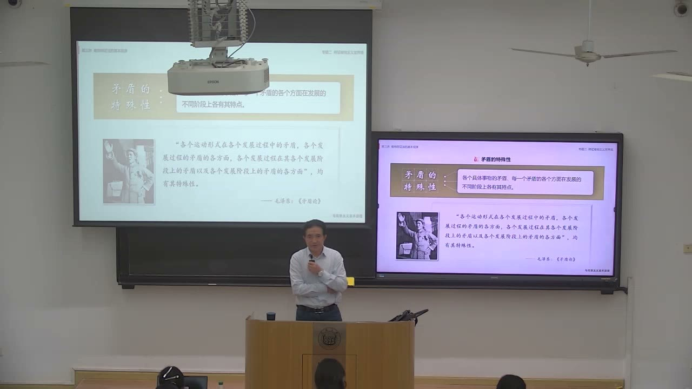
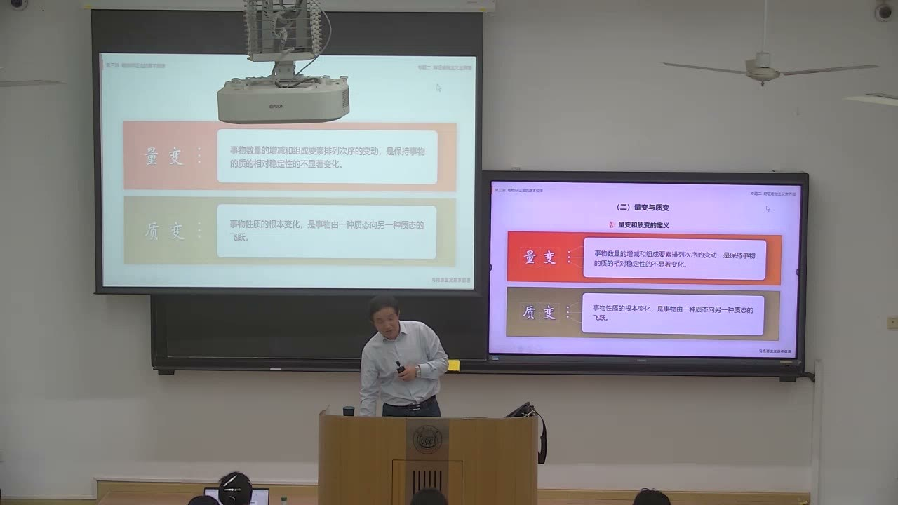
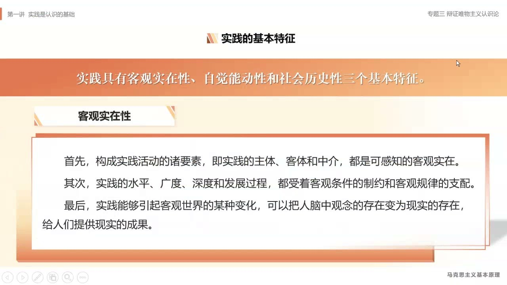
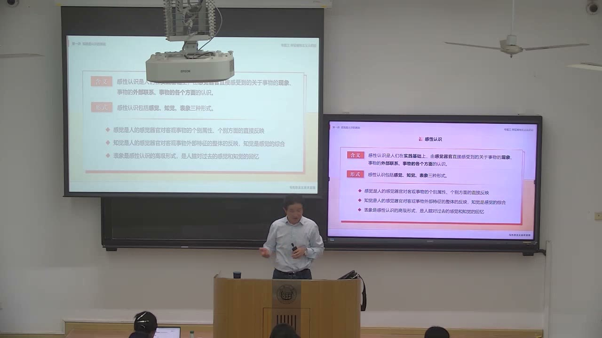

### 课程安排与任务

#### 把原理用于专业实验、设计和自己的发展
<!-- source: 14 -->
教师要求围绕两类对象思考原理的应用：党和国家事业的发展，以及大学期间的学习、生活、能力和事业规划。矛盾观点、量变质变规律，都不能只会背定义，应说明具体对象是什么、有哪些关系、怎样据此行动。

课外大作业中的“马原与专业关联”应结合专业实验、设计或研究，找出矛盾、质、量、度等概念在本专业中的具体对应。教师口述中出现第二题、第三题等不同题号，笔记按任务内容记录，正式题号仍应对照作业要求。

#### 复习时注意概念组与多项选择
<!-- source: 108 -->
教师特别提醒实践相关概念的多项选择：实践的基本特征有三个，结构要素有三类，基本形式有三类；实践的地位与对认识的作用也应分组掌握，不能把不同问题的答案混在一份名单里。

教师把认真听课、尊重劳动、积累习惯与修养联系起来，同时欢迎在理解其论证之后提出不同意见。这里保留的是课堂要求与教师的应用性解释，不把师生关系自动当作所有情境的通用结论。

### 一、矛盾特殊性要展开为具体的差别

特殊性不是一句“每件事都不一样”，而是要求辨认差别发生在哪个层次。

#### 不同事物、不同矛盾、不同方面与不同阶段
<!-- source: 0 -->
矛盾特殊性指各具体事物的矛盾，以及每一矛盾的各方面，在发展的不同阶段各有特点。本课展开为四个观察层次：不同事物具有不同矛盾；同一事物中多种矛盾的性质、地位不同；同一矛盾两个方面的性质、地位和作用不同；同一矛盾在不同发展阶段呈现不同特点。

教师从社会形态、不同国家和阶段变化作说明，强调一般原理进入具体对象时，必须补足实际条件。仅知道存在某类共同矛盾，还不能直接获得适合每个对象的行动方案。

#### 主要矛盾与矛盾主要方面，不是同一组划分
<!-- source: 2 -->
主要矛盾与次要矛盾，是在一个事物所包含的多种矛盾之间区分主次，关系到在有限时间和资源下首先解决什么。矛盾主要方面与次要方面，则是在同一个矛盾的两个方面之间区分地位和作用，关系到怎样判断事物的性质。

因此，分析时要先确定自己在比较“几组矛盾”还是“一组矛盾的两方”。不能因为某一问题重要，就把它直接称为“主要方面”；也不能把处理主次误解为只看一端、完全不顾其他关系。

#### 同一问题在新阶段需要新的应对
<!-- source: 4 -->
教师用我国社会主要矛盾表述的变化，解释发展阶段改变之后，需求和妨碍需求实现的条件也会变化。课堂从物质、精神、政治、社会、生态等生活维度，讨论美好生活不能只化约为收入。

区域、城乡、公共资源及收入分配差异，被用于说明“不平衡”的不同表现。这里的教学重点是随阶段识别矛盾的新特点，而不是用一个旧表述、旧方案覆盖所有时期。

### 二、把矛盾分析转为有对象、有依据的方法

同一性和斗争性、普遍性和特殊性，需要共同进入分析，不能只抽出其中一个词。

#### 从原理、对象到应对，而不是只列口号
<!-- source: 36 -->
教师归纳讨论题的答题路径：说明矛盾的含义和属性，再分别分析同一性、斗争性以及普遍性、特殊性，在具体事业或个人情境中意味着什么，实际应对又是什么。

合作关系与差异、冲突可以同时存在。课堂将合作共赢与增强应对本领并举，强调要看到统一体中的关系，也要具备面对困难的能力。普遍原理需要结合具体国情、历史文化和时代要求，这也是本课理解“特色”和“时代化”的哲学切入点。

#### 学业、个人差异与阶段性安排
<!-- source: 42 -->
同为大学生有共同任务，但每个人的长处、条件和面临问题不同。教师把因材施教解释为特殊性的方法运用，反对用一份统一安排处理所有人的学习生活。

在资源和精力有限时，教师强调大学阶段应重视完成学业，并协调其他生活需要。大一、大二直到研究生与职业阶段，重点又可能变化；规划应跟着阶段任务变化，不能把某一个时期的轻重顺序永久化。

#### 专业设计中的多目标，需要说明取舍依据
<!-- source: 54 -->
教师以设计中的成本、性能、安全、环保、使用需求和文化表达等目标，说明专业工作经常面对多种约束和取舍。分析应先说清对象、目标与实际条件，再判断何者是主要问题，哪些关系可以通过技术和方案改进而协调。

课堂汽车例子是教师说明多目标取舍的生活化举例，不据此断言所有车辆都存在油耗与安全性能的固定反比。把概念用于专业，关键是用专业证据而不是用原理替代具体技术判断。

### 三、质、量、度：判断变化有没有越过边界

矛盾分析解释发展的动力，量变质变规律则讨论事物怎样发生变化。

#### 三种规定性及其分析任务
<!-- source: 58 -->
质是使一事物区别于其他事物的内在规定性；量是规模、程度、速度等可用数量关系表达的规定性；度是保持事物质的稳定性的数量界限，即限制、限度、幅度和范围。

定性分析要判断是什么，定量分析要把握数量关系；度则要求识别边界。教师以企业规模、产量、多元经营等说明，不能一概把越多或越少当成更好，还需说明目标、条件和适当范围。

#### 量变与质变的区别，必须带上条件
<!-- source: 62 -->
量变是数量增减和组成要素排列次序的变动，是保持事物质的相对稳定性的变化；质变是事物性质的根本变化，是从一种质态到另一种质态的飞跃。区分关键不是变化是否醒目，而是质的规定性是否发生根本改变。

课堂用一定气压条件下水的状态变化说明边界，并反复强调条件不同，转化阈值也不同。不能把举例中的某个温度数值抽出来，作为一切情境下的无条件结论。判断应先澄清前提。

### 四、量变质变不是自动向好的进步叙事

积累可以为期望结果准备条件，也可能把问题推向难以挽回的变化。

#### 必要准备与必然结果，需要结合目标判断
<!-- source: 66 -->
量变是质变的必要准备，达到一定程度的量变会引起质变。对于期望实现的知识、能力和事业目标，应重视长期积累；对于不希望发生的后果，则需要在问题尚小时约束其继续积累。

教师以“勿以善小而不为，勿以恶小而为之”说明道德修养的日常性。对知识、能力和习惯的评价，还需区分积累的内容与方向，不能把任何数量增加都叫作发展进步。

#### 互相渗透：整体变化与局部变化并不总同步
<!-- source: 74 -->
量变过程中可能包含局部质变，质变过程中也可能包含新质扩张和旧质收缩等数量变化。教师以历史发展中局部先发生变化、整体随后转变的例子，说明二者不是被一道绝对的墙分开。

在新质基础上又会开始新的量变，并在条件成熟时发生新的质变。这是一个继续发展的过程，不能把完成一次飞跃理解为此后不再需要积累和调整。

#### 从长期目标拆到阶段和年度行动
<!-- source: 78 -->
教师用战略、阶段规划与年度安排的关系，说明期望中的变化要靠过程落实。个人也应结合长处和条件制定学业、能力与事业规划，不把长期目标只写成一个结果。

专业实验中，要用本专业的概念和单位表达质、量与度：测的是什么、数量如何改变、何种条件下达到阈值、怎样判断性质变化。原理提供分析方向，具体界限仍须由实验和研究确认。

### 五、肯定、否定因素与发展的曲折

本课在否定之否定规律部分，重点先介绍肯定因素和否定因素的含义。

#### 这里的肯定与否定，不只是赞成与反对
<!-- source: 88 -->
肯定因素是维持现存事物存在的因素，否定因素是促使现存事物灭亡的因素。这里是分析事物发展的概念，不等同于日常“说好话、说坏话”，也不等同于已经完成了善恶判断。

分析时需明确对象是什么，再判断哪些条件维持它，哪些条件使它衰弱或变化。实际行动还需要说明希望维持或改变什么，不能仅给所有因素贴一个“积极”或“消极”标签。

#### 非线性变化与后续自学内容
<!-- source: 90 -->
两类因素的力量对比可能随阶段与外部条件变化，并非匀速、直线地发展，因此过程可能出现低谷、恢复与转折。教师要求把因素判断用到具体目标，而不是看到曲折就认定没有发展。

本次对否定之否定规律的展开有限，不据此补写尚未讲到的完整理论链条。教师提示教材后续科学思维方法部分可继续自学，并把系统思维联系到联系观点、战略思维联系到发展观点、底线思维联系到量变质变中的边界意识。

### 六、实践是认识的基础

课后半转入“实践与认识及其规律”，100—102分钟的服务拒绝段保留为缺口，不补成教师讲述。

#### 实践的定义，要抓住完整限定
<!-- source: 102 -->
实践是人类能动地改造世界的社会性的物质活动。主体是人，活动指向改造世界，具有目的和计划，同时处于社会联系之中，并依赖客观的主体、对象和手段。

这一定义不能缩成“有想法就是实践”，也不能只因一个人独自操作就认为没有社会性。课堂把已有知识的学习传承与探索新认识作出区分，强调实践在认识形成和发展中的基础作用。

#### 三个基本特征：客观实在、自觉能动、社会历史
<!-- source: 108 -->
客观实在性体现在主体、客体、中介等要素的客观存在，实践的水平和过程受客观条件与规律制约，并能引起客观世界变化，使观念中的存在成为现实成果。

自觉能动性强调实践具有意识、目的和计划。社会历史性包含两个相连方面：个人始终处于社会关系中；实践的内容、方式、范围和水平又受特定历史条件制约，并随条件变化。一个人在实验室工作，仍依赖学校、设备和社会分工。

#### 主体、中介、客体：分别回答三个问题
<!-- source: 114 -->
主体回答谁来实践，可以是具有相应能力的个人、群体乃至人类；中介回答借助什么、怎样实践，包括工具、手段及操作程序和方法；客体回答实践作用于什么对象。

客体可从天然与人工、自然与社会、物质与精神等角度分类。实际研究要说明分类尺度，不把这些不同角度误当作互相排斥的一组选择。人工智能等技术可成为实践中介，但不能因此忽略主体和对象。

### 七、实践形式、作用与感性认识

形式、结构、特征和认识阶段，是不同的问题，应分别归纳。

#### 三种基本形式及其相互渗透
<!-- source: 116 -->
物质生产实践提供吃穿住行等物质资料，是最基本的实践活动；社会政治实践处理社会政治关系；科学文化实践包括科学实验、艺术创作、教育等精神文化产品创造与相关活动。

三者不是彼此封闭的职业盒子。科学成果可以进入物质生产，实践主体也会在不同领域活动。教师另外介绍现代信息技术催生的虚拟实践，并将其与科学技术和新的生活体验相联系；它不意味着现实物质条件已经消失。

#### 实践对认识的四个作用
<!-- source: 130 -->
实践是认识的来源、认识发展的动力、认识的目的，以及检验认识真理性的唯一标准。来源说明认识从哪里获得，动力说明新的问题与条件怎样推动认识继续发展，目的说明认识最终要用于改造世界，标准则回答怎样检验认识是否具有真理性。

课堂用《实践论》的生活化例子，以及科学探索、实验的例子讲解。视频涉及的具体提炼数量未核对，不把其中数值作为独立科学事实列入笔记。核心是观察、理论说明与实践检验之间的联系。

#### 感觉、知觉、表象：感性认识的三个形式
<!-- source: 136 -->
感性认识是在实践基础上，由感觉器官直接获得的关于现象、外部联系及各方面的认识。感觉反映事物个别属性；知觉综合多个感觉，形成对外部特征的整体反映；表象则是在对象不在眼前时，对过去感觉和知觉的回忆。

教师最后以苹果作设想对象：红、圆、香、甜、硬等单项感受属于感觉，综合成整体形象是知觉，离开对象后脑中留下的形象是表象。感性认识具有直接性、具体性，但内容仍是表面现象和外部联系；本节停在这里，尚未完整展开如何上升到理性认识。

### 概念对照与自测

| 区分 | 比较范围 | 要回答的问题 |
|---|---|---|
| 主要矛盾与次要矛盾 | 同一事物中的多种矛盾 | 首先解决哪一个问题 |
| 矛盾主要方面与次要方面 | 同一矛盾内部的两个方面 | 哪一方面地位和作用更主要 |
| 质、量、度 | 性质、数量关系、稳定界限 | 是什么、变化多少、何时越界 |
| 量变与质变 | 质相对稳定的变化；性质根本变化 | 性质是否发生根本改变 |
| 实践特征与实践结构 | 客观实在等特征；主体中介客体 | 有什么性质；由哪些要素构成 |
| 感觉、知觉、表象 | 个别属性、整体反映、回忆形象 | 感性认识处在哪一形式 |

#### “抓主要矛盾”为什么不能写成“抓矛盾的主要方面”？
前者在多个矛盾之间确定主次，后者在一个矛盾的两方之间判断地位。先要确定分析对象和比较层次。

#### 量的增加为什么不必然是进步？
增加的方向与内容不同，后果可能符合目标，也可能有害。还需判断条件、度和目标，而不是只看数字变大。

#### 独自在实验室操作为什么仍有社会性？
实验者的知识、设备、材料和活动目标，都处于社会关系与分工中；独自操作不等于脱离社会。

### 课程时间线

00:00—06:00：矛盾特殊性四个层次、主次矛盾与主次方面。
06:00—14:00：发展阶段、社会主要矛盾与普遍特殊的结合。
14:00—18:00：应用讨论题与课外专业关联任务。
18:00—36:00：学生讨论段及部分未识别区间，不编入教师正文。
36:00—46:00：教师归纳矛盾分析及大学学习的应用。
46:00—50:00：未识别到文字的区间与课堂转换。
50:00—58:00：阶段任务、主要矛盾与专业设计中的取舍。
58:00—66:00：质、量、度与量变质变的定义和条件。
66:00—74:00：量变准备、质变结果与善恶积累的课堂举例。
74:00—80:00：量变质变相互渗透、过程与阶段规划。
80:00—88:00：修养、课堂要求和专业实验的应用。
88:00—94:00：肯定否定因素、曲折性及思维方法自学提示。
94:00—100:00：章间休息与新专题转换。
100:00—102:00：Step Plan返回risk blocked，未获转写，保留缺口。
102:00—108:00：实践定义、限定与基础地位。
108:00—114:00：实践的客观实在、自觉能动与社会历史性。
114:00—122:00：主体中介客体、基本形式及其联系。
122:00—130:00：科学文化实践、艺术教育与虚拟实践。
130:00—136:00：实践对认识的作用及科学探索视频。
136:00—144:41：感觉、知觉、表象与感性认识的范围和局限。
