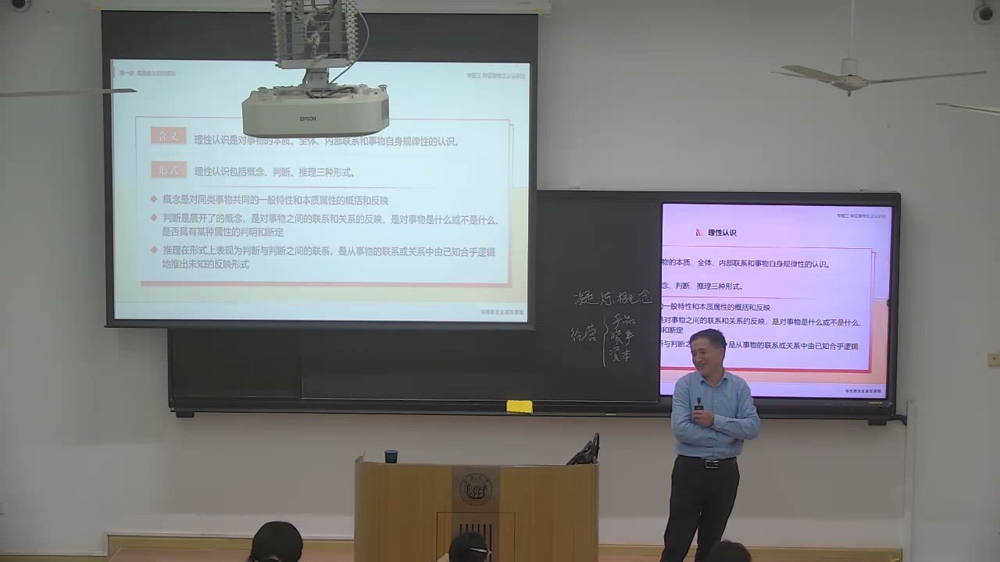
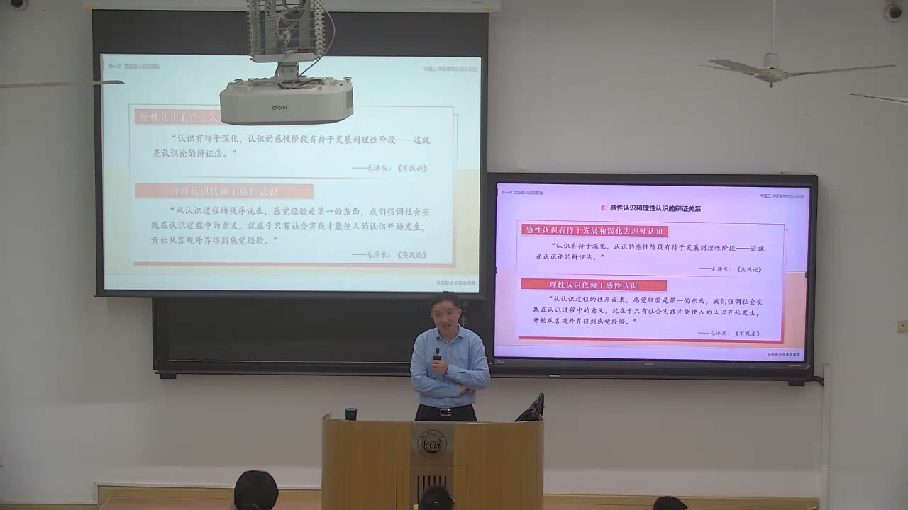
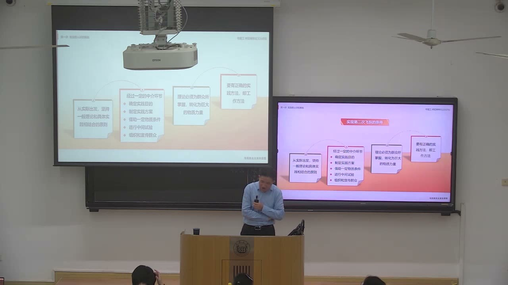
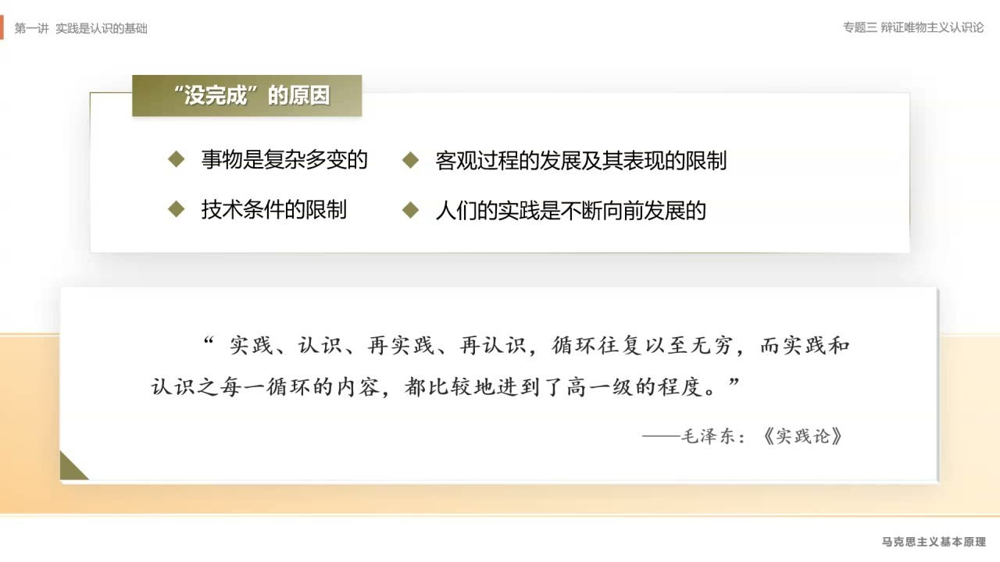
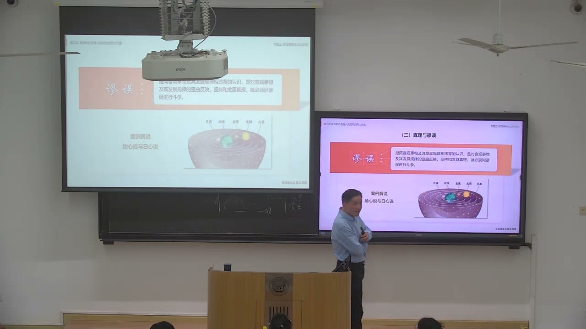

### 课程安排与任务
#### 把认识论落实到自己的专业研究
<!-- source: 52 -->
老师建议在课程论文中联系自己的实验、设计或专业研究，说明最初获得了哪些感性材料，怎样形成概念、发现联系，再怎样把认识用于实践。需要呈现具体的研究过程，不能只把“感性认识、理性认识、实践”几个词贴到专业介绍上。课堂同时区分了研究过程与论文叙述过程：研究常从具体材料出发，成文时则可以先提出抽象概念，再展开材料和论证。

老师推荐结合《实践论》《矛盾论》理解本次内容。本段没有给出新的论文截止日期。

#### 竞赛通知要连同适用条件一起看
<!-- source: 60 -->
老师提醒关注班群中的“使命与担当”思政知识竞赛，鼓励报名，并介绍了竞赛奖励与课程考核的联系。课堂提到，一等奖对应的“免优”仍以考勤达标、完成两次课外大作业等条件为前提，不能理解为获奖即可省去其他课程要求。不同奖项加分的具体对应、报名时间和正式规则，以班群通知为准；此处不把口头介绍中未说清的分值补成确定规则。

#### 两处转写缺口与整理范围
<!-- source: 66 -->
本课在66—68分钟、142—144分钟出现转写缺口，Step Plan 返回“risk blocked”。这两段不根据前后语境补写；对应音频与已抽取的课堂画面保留为回查材料。截图只能证明画面上显示的内容，不能代替缺失的口头解释。正文据其余可识别讲授和已核对画面整理，课堂互动只保留教师的回应。

### 第一次飞跃：从感性材料形成理性认识
感性认识提供材料，理性认识把握本质和联系。老师用概念创新与专业调查的例子说明，这一飞跃需要对材料进行加工。

#### 感性认识与理性认识分别把握什么
<!-- source: 0 -->
开头承接上节的感觉、知觉、表象：感性认识直接联系具体对象，但停留在对象的外部表现，还不能自动把握内部联系。理性认识则指向事物的本质、全体、内部联系和自身规律，具有抽象性、间接性。

“高级阶段”不表示可以跳过感性材料。没有对象、经验和调查作基础，抽象概念容易成为空话；只有零散印象而不加分析，又难以解释事情为什么如此。

#### 概念、判断、推理是三种形式
<!-- source: 22 -->
概念概括同类事物的一般特性和本质属性；判断对事物的性质或关系作出肯定、否定；推理则把判断联系起来，从已有判断推出新的判断。这三种形式相互衔接：概念决定讨论对象和属性，判断形成明确命题，推理说明结论如何得出。

复习时应能分清“提出一个术语”“断定某对象具有某属性”“由前提推出结论”三个动作，而不是把它们都当成一般意义上的想法。

#### 概念改变，会改变研究问题
<!-- source: 4 -->
老师以“国有资产流失”与“国有资本流失”的区分说明概念工作：只检查实物是否还在、账面资产是否保全，与进一步追问投入是否获得相应收益，并不是同一个问题。课堂基础设施案例也是为了区分“资产存在”与“投入发挥效益”，不能把案例中的口头数字直接用作实际项目评价。

随后关于“富裕线”、收入份额以及货币需求细分的介绍，属于老师对个人研究思路的说明。本课可提取的方法是：看既有概念遮蔽了什么，把对象分清，再建立可讨论的命题。这些个人提法不等同于教材通行分类、官方指标或已验证的普遍结论。

### 怎样完成由感性到理性的飞跃
“材料多”与“认识深”之间还隔着一系列工作。课堂把调查、比较和抽象联系到论文研究，也说明了认识中的情感与意志因素。

#### 研究从具体到抽象，叙述可以从抽象到具体
<!-- source: 28 -->
老师强调，做研究时先接触具体事物，收集材料，比较各种表现，再形成概念和对本质的认识；写论文时，为了让读者理解论证，可以先交代概念、理论框架或判断，然后用具体材料展开说明。

两种顺序解决的问题不同。不能因为成文时先讲理论，就倒过来以为研究不需要调查；也不能把收集材料的先后顺序原封不动地当成论文结构。研究过程要产生认识，叙述过程要清楚地展示认识及其依据。

#### 用调查与比较约束抽象
<!-- source: 34 -->
老师以劳动关系研究说明如何缩小对象：从笼统的劳动关系进入企业、所有制、行业与规模等具体层次，再接触劳动者、经营者、有关部门和工会等不同方面。不同地点和对象的材料，需要经过比较才能判断哪些是共同特征，哪些是特殊条件造成的差异。

课堂对特定时期劳动关系的解释，属于老师据其调查提出的分析，不应把一句概括直接推广到所有企业。对专业研究更可迁移的做法是：明确调查单位，纳入不同立场与类型的材料，比较已有理论适用与不适用之处，再提出抽象判断。

#### 感性与理性相互依赖、相互渗透
<!-- source: 50 -->
感性认识有待发展为理性认识，理性认识依赖感性认识；两者又不是互不往来的独立阶段。观察时已经带着既有概念，理论分析也要不断回到经验材料。

完成飞跃需要两个条件：获得丰富、合乎实际的感性材料；运用思维对材料进行加工。老师把后者概括为去粗取精、去伪存真、由此及彼、由表及里。这里的抽象不是删掉具体内容，而是在材料之间建立联系，排除不可靠信息，逐步把握本质。

#### 非理性因素参与认识，但不替代论证
<!-- source: 56 -->
课堂把情感、意志、愿望、动机和坚持等放入认识活动中，联系“知、情、意”说明：研究的选题、投入程度和能否坚持，不仅取决于知识，也与关切、责任感和意志有关。老师借此鼓励形成面向公共需要的研究志向。

这部分强调的是认识活动的动力条件。动力充分仍要接受材料和推理的约束，不能用热情、立场或使命感证明某个具体结论正确。

### 第二次飞跃：让认识进入实践
从认识到实践有两层意义：把认识用于改造世界，同时使认识接受现实检验。课堂进一步把这一飞跃拆成实际工作环节。

#### 为什么不能停留在“已经知道”
<!-- source: 64 -->
认识的目的不止于解释对象，还包括以掌握的规律指导行动。认识是否正确、适用到什么范围，也要在实践中得到检验和发展。因此第一次飞跃形成理论，并不意味着认识过程结束。

这一主题在66—68分钟有转写缺口。已核对的66分30秒画面列出了“认识世界的目的是改造世界”“认识的真理性只有在实践中才能得到检验和发展”两点；此处只记录可见标题和其余时段的明确讲授，不恢复缺失段落。

#### 一般原理必须结合实际条件
<!-- source: 68 -->
将理论用于实际，首先要从实际出发，把一般原理与具体情况结合。课堂用实验和历史经验举例，强调不能抽去适用条件，只记住一个结论再到处套用。

整理时保留的是这个方法要求：说清对象、环境、操作条件以及检验方式。课堂即兴举例中的自然科学细节，不作为本课新增的物理学知识。

#### 通过目的、方案、条件和组织等中介环节
<!-- source: 72 -->
画面列出的第二次飞跃条件包括：从实际出发；经过一定中介环节；理论被群众掌握并转化为物质力量；具备正确的实践方法。中介环节又包括确定实践目的、制定实践方案、借助一定物质条件、进行中间试验、组织和宣传群众。

老师把它转为研究工作中的问题：目的是什么，技术路线怎样展开，采用什么方法，需要哪些实验或调查条件，分几步实施，怎样组织相关人员。理论进入实践需要这些可操作的连接，不能把“理论指导实践”只写成口号。

#### 研究目的要来自已有研究与实际问题
<!-- source: 74 -->
老师要求通过文献了解已有研究做了什么、留下什么问题，再说明自己的理论意义和应用价值。声称“没人研究过”，必须有查阅和比较的依据；换一个名称也不自动构成新问题。

经济周期的长段举例主要展示如何细分对象与检查定义：GDP总量的变化和增长率的变化不能混为一谈。老师关于周期的新提法属于其个人研究说明，此处不将口头推演写成经济预测。可以借鉴的是追问：讨论的量究竟是什么，既有结论用什么指标得到，自己的区分是否改变了问题。

#### 方案要落到路线、步骤和资源
<!-- source: 90 -->
研究目的提出以后，还要交代研究思路、技术路线、具体方法、框架结构与进度。需要实验室、数据、调查对象或中间试验时，应当把这些条件放进方案；涉及他人协作时，还要考虑知识如何传达、行动如何组织。

课堂在此把认识论与论文计划连接起来：方案既要说明“为什么做”，也要让人看得出“如何做、凭什么条件做、怎样检查结果”。

### 认识为什么不断反复并向前发展
反复并不是把原先的话重复一遍。对象、技术和实践都在变化，新的结果会反过来修正旧认识。

#### 四个“没完成”的原因
<!-- source: 100 -->
课件列出：事物复杂多变；客观过程的发展及其表现受到限制；技术条件受到限制；人的实践不断向前发展。某个阶段尚未显现的联系、尚不能观察的现象，可能在后来进入认识范围。

因此“实践—认识—再实践—再认识”没有一次完成的终点。老师强调每一轮应在内容上有所推进，不能理解为回到同一位置的封闭圆圈。新的实践不仅应用旧认识，也提出旧认识无法解释的新问题。

#### 真理与谬误区别在认识同对象的关系
<!-- source: 108 -->
真理是对客观事物及其规律的正确反映；谬误则是对对象及其规律的歪曲反映。两者都是认识活动可能产生的结果，但不是可以任意互换的称呼。

课堂围绕“没有不变的真理”之类表述作了辨析。整理时应区别具体命题的适用条件与讨论认识发展的一般说法，避免把课堂讨论压成“任何结论都无所谓对错”，也不将本课未系统展开的绝对真理、相对真理问题补成完整教材论述。判断一个命题，要明确它对什么对象、在什么条件下成立。

### 实践检验与几种容易混淆的判断方式
课堂后段通过权威、多数意见和实用性展开真理标准的讨论。要保留每一种方式的作用与限度，不能把它们直接替换成真理标准。

#### 依赖权威是利用间接经验，不保证每句话正确
<!-- source: 116 -->
老师提出一个实际困难：个人不可能对所有知识都重新进行昂贵、危险或长期的实践检验。学习中使用他人经过检验的经验是必要的，权威的知识分量也来自其相关实践与积累。

但这不能推出“权威说的都是真理”。需要分清其专业范围、论据与实践基础；具体判断最终仍要接受实践的检验。课堂历史人物的即兴故事服务于这个讨论，不在笔记中扩写成未经核对的历史材料。

#### 多数意见可以形成决定，但多数本身不证明真理
<!-- source: 128 -->
集体讨论和多数意见能够汇集经验，也可以在需要行动时形成决策。它们的实际作用不等于多数人的赞同可以保证一个命题正确。

复习时要区分两个问题：行动如何作出共同决定；关于对象的认识是否合乎实际。前者可能采取表决程序，后者不能由票数代替证据与实践结果。老师用意见改变和实践反馈的例子说明，少数与多数的地位会变化，认识仍需检验。

#### “有用”还需要问对谁有用、是否合乎实际
<!-- source: 134 -->
课堂对实用主义、功利主义的讨论，集中在“有利于个人或某个群体”不能自动等于“认识正确”。老师进一步提出面向人民和公共利益的价值关切。

这里要同时保留事实判断与价值判断的区别：一个说法是否正确反映对象，需要证据与检验；一种行动值得不值得、利益如何评价，还涉及目的和价值标准。不能单凭短期获利证明真理，也不能用良好愿望替代事实根据。

#### 课末进入实践结果与价值评价问题
<!-- source: 140 -->
老师继续追问实践活动的过程、要素与结果，以及人们为什么可能对结果有不同评价。142—144分钟转写缺失，不能据课末几句话还原整套论证。144分钟后可识别的结尾涉及价值判断与共同价值标准，作为后续主题的线索保留，不补列完整体系。

### 概念对照与自测
| 区分 | 前者 | 后者 | 复习要点 |
|---|---|---|---|
| 感性认识／理性认识 | 感觉、知觉、表象，直接而具体 | 概念、判断、推理，抽象而间接 | 理性依赖感性，感性有待深化 |
| 研究／叙述 | 从具体材料走向抽象认识 | 可以从抽象框架展开到具体论证 | 成文顺序不等于发现顺序 |
| 第一次／第二次飞跃 | 实践材料上升为理性认识 | 认识指导实践并接受检验 | 两次飞跃连接成开放的反复过程 |
| 权威／多数／实用 | 可利用经验、协调行动或评价效用 | 均不能单凭自身保证真理 | 最终回到实践与具体条件 |

#### 为什么“收集很多材料”还不等于形成理性认识？
材料提供基础，还需要辨真伪、作比较、建立联系，由表及里地把握本质。没有这些加工，材料仍可能只是零散印象。

#### 把理论用于一个课题，需要补上哪些中介环节？
明确目的，制定方案，准备物质与数据条件，安排必要的中间试验，并组织协作和沟通。一般原理还必须结合对象的具体情况。

#### 为什么不能把投票多数当成真理标准？
表决能够形成集体行动决定，也可能汇集经验，但赞同人数不直接决定命题是否正确。认识仍要接受证据和实践检验。

#### 这节课怎样帮助自己写课程论文？
用一个真实的专业研究过程说明从哪些材料出发、如何抽象出问题、怎样设计并开展实践，再说明结果怎样检验或修正原认识。个人新术语与课堂例子不能代替自己的论证。

### 课程时间线
00:00—04:00：感性认识回顾与理性认识的含义
04:00—22:00：教师以个人研究说明概念区分
22:00—28:00：概念、判断、推理与理性认识特征
28:00—44:00：研究与叙述的顺序；调查和比较案例
44:00—50:00：课间及非实质内容
50:00—56:00：感性与理性的辩证关系；课程论文应用
56:00—64:00：非理性因素与竞赛通知
64:00—66:00：从认识到实践的必要性
66:00—68:00：转写缺口；不补写口头内容
68:00—74:00：具体条件与第二次飞跃的中介环节
74:00—90:00：研究目的、文献基础与概念细分举例
90:00—94:00：研究方案、步骤、资源与组织
94:00—100:00：课间及过渡
100:00—108:00：认识反复发展与四个未完成原因
108:00—116:00：真理、谬误与命题的适用条件
116:00—128:00：权威、间接经验与实践检验
128:00—134:00：多数意见与真理标准的区别
134:00—140:00：实用性、公共利益与价值判断
140:00—142:00：实践过程及结果评价问题
142:00—144:00：转写缺口；不还原缺失论证
144:00—144:40：价值判断主题的课末收束
