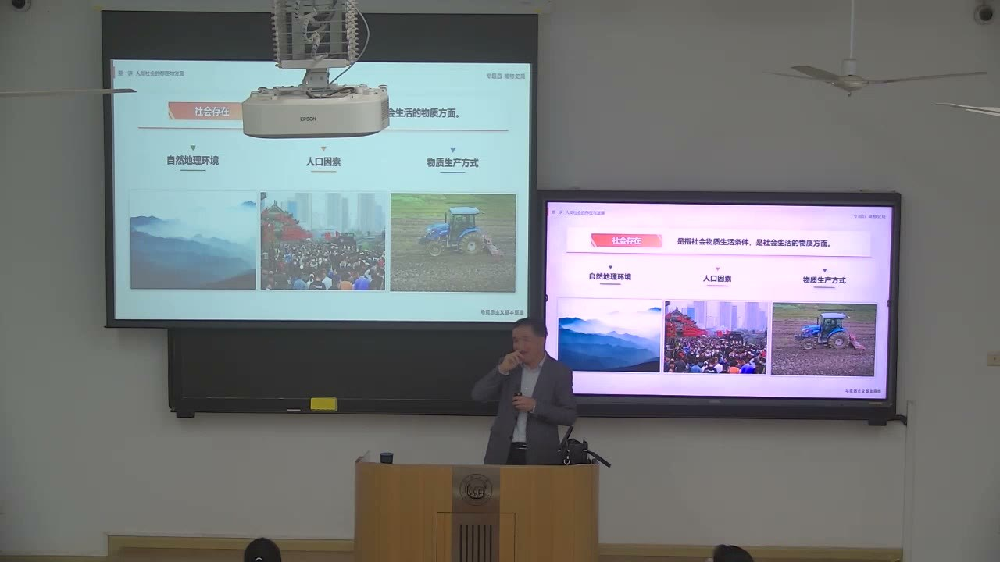
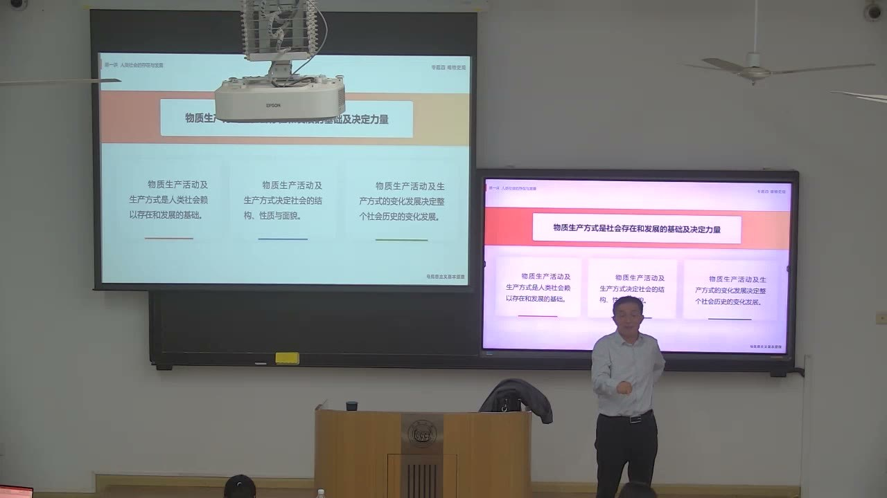
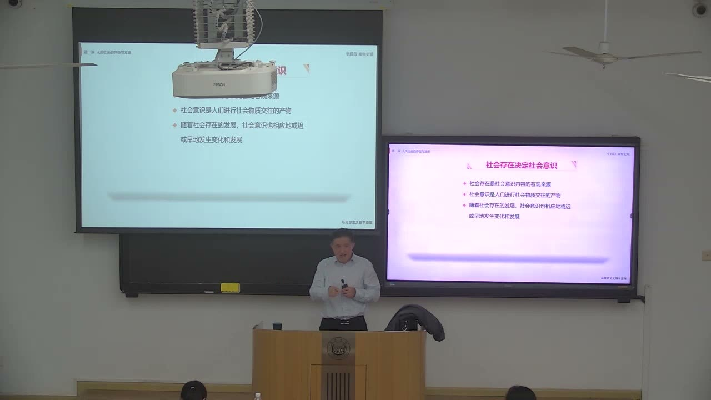
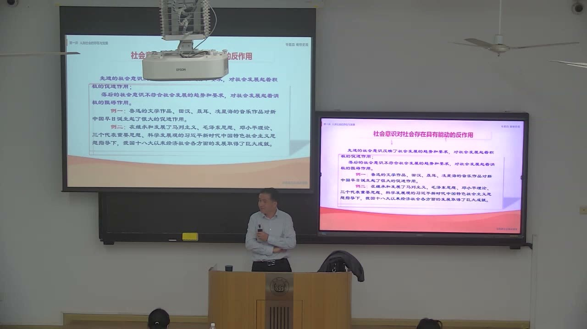

### 课程安排与任务

#### 用整体逻辑复习第三章
<!-- source: 0 -->
本节从第二章的认识论转入第三章唯物史观。教师要求把马原当作一个整体来复习：先有辩证唯物主义和认识论，再把实践、联系、发展的观点用于人类社会，才能理解历史唯物主义为什么被称为马克思的第一个伟大发现。

复习时不能只背“社会存在决定社会意识”一句，还要能说明它从哲学基本问题怎样推出来，又怎样通向生产力与生产关系的矛盾运动。本节没有布置新的书面作业，也没有给出新的提交日期。

#### 下节课进入生产力与生产关系
<!-- source: 140 -->
本节最后给出第三章的分析框架：生产力与生产关系的矛盾、经济基础与上层建筑的矛盾。教师预告接下来先讲生产力，再讲生产关系及其矛盾运动；本节只把生产方式的总体结构交代清楚。

### 从认识论进入历史观

哲学基本问题从自然界扩展到人类社会，就成为历史观的基本问题。怎样回答社会存在与社会意识的关系，决定了两种不同的历史观。

#### 哲学基本问题加上“社会”两个字
<!-- source: 0 -->
第一章讨论哲学的基本问题，即思维和存在的关系；思维的结果是意识，所以也可以表述为意识与存在的关系。现在把考察对象从一般世界收缩到人类社会，在“存在”和“意识”前面各加“社会”，就得到社会存在与社会意识。

这个转换不是文字游戏。它把“世界是什么”的问题带到了“社会是什么、社会怎样发展”的层面，也使历史观有了可以讨论的基本问题。

#### 唯物史观是马克思的第一个伟大发现
<!-- source: 4 -->
教师把历史唯物主义放在马克思主义理论的内在链条中：辩证唯物主义提供一般世界观和方法论，认识论说明实践与认识的关系，历史唯物主义则把这套观点用于人类社会。没有辩证法和实践观点，旧唯物主义在自然观上可以是唯物主义的，一进入社会历史领域却可能转向唯心主义。

费尔巴哈被用来说明这种“半截子唯物主义”：他可以承认自然界是物质的，却在解释人类社会时落入唯心史观。课堂用这一对照强调，唯物史观不是把“物质”一词简单搬进社会领域，而是要把联系、发展和实践的观点贯彻到社会历史分析中。

#### 两大历史观的分歧通向不同的历史主体
<!-- source: 6 -->
如果认为社会存在决定社会意识，就会把社会看作有自身物质基础的客观过程；如果认为社会意识决定社会存在，则容易把历史归因于少数人的思想、意志或英雄人物的决断。

教师由此推出两种历史主体观：唯心史观通向英雄史观，唯物史观通向群众史观。这里的“推”是课堂论证的方向，不是说只要说出“群众”二字就已经完成了全部历史分析；还要说明人民群众在物质生产和社会变革中的具体作用。

#### 五种社会形态是课堂给出的历史框架
<!-- source: 8 -->
课堂把人类社会的发展概括为原始社会、奴隶社会、封建社会、资本主义社会和共产主义社会五种形态，并说明社会主义是资本主义向共产主义的过渡阶段。教师用这一框架说明唯物史观要回答“社会为什么由低级向高级发展”。

这是课程使用的理论框架，不是要求学生在本节就证明全部历史细节。整理时保留其课堂位置，不把其中的类比、举例和个人判断当成已经被逐一核实的历史结论。

### 社会存在的三个要素

社会存在指社会物质生活条件，是社会的物质方面。课堂把它分为自然地理环境、人口因素和物质生产方式，并强调三者对社会发展的作用并不相同。

#### 地理环境是永恒的必要条件
<!-- source: 16 -->
自然地理环境是人类社会存在和发展的永恒必要条件。人要在一定的气候、地形、资源条件下生产生活，社会不可能脱离自然环境而存在。

教师同时提醒，必要条件的地位不等于决定作用。地理环境会影响一个地区能发展什么产业、以什么方式组织生产，却不能单独解释为什么有的社会发展到较高水平，有的社会长期停滞。

#### 地理条件不单独决定社会发展
<!-- source: 26 -->
课堂用印度与中国的对照说明这一点：印度在耕地比例、热量条件等方面有自然优势，中国的人均耕地和适宜耕作的土地相对有限，但两国的发展水平并不能由地理条件直接排出高下。

教师把原因归结为物质生产方式，尤其是制度和社会组织方式。这个对照是课堂论证，不是完整的经济史研究；可以借鉴的是分析方法：先承认地理条件的作用，再追问还有哪些更直接的社会条件在起作用。

#### 人口规模的价值判断会随条件变化
<!-- source: 30 -->
人口因素可以从规模和结构两方面看。课堂回顾了中国人口政策的变化：革命战争年代强调人的力量，新中国成立后随着疾病控制和婴儿成活率提高，人口快速增长，随后出现计划生育政策；到现阶段又调整生育政策。

教师把这些变化解释为“养活人口的能力”和“开放条件”改变后，对人口规模的价值判断随之改变。这里涉及敏感的政策史，笔记只保留课堂的分析线索，不把教师的口头数字和个人评价写成确定的历史统计或政策结论。

#### 人口结构不只是数量问题
<!-- source: 42 -->
课堂提到人口的文化结构、道德修养结构和年龄结构。受教育程度、价值观念、健康状况和年龄分布，会影响社会的消费结构、劳动供给和公共负担。

教师特别谈到老龄化：老年人口增加会改变消费总量和结构，也会加重年轻一代的赡养压力。课堂举出的吃、穿、住、行例子属于经验性说明，不能替代人口统计；可迁移的判断是，分析人口不能只看总人数，还要看人口内部怎样分布。

#### 物质生产方式是社会存在的基础
<!-- source: 66 -->
在三项社会存在中，物质生产方式起基础和决定作用。教师给出三条理由：物质生产活动是社会赖以存在和发展的基础；生产方式决定社会的结构、性质和面貌；生产方式的变化发展决定整个社会历史的变化发展。

这三条不是并列的口号。第一条说明社会首先要能生产出生存资料；第二条说明生产过程中形成的分工、分配和阶级关系会塑造社会结构；第三条说明生产方式变化后，整个社会形态也会随之变化。

### 物质生产方式：生产力与生产关系的统一

物质生产方式不是笼统的“做事方法”，而是生产力和生产关系的矛盾统一体。课堂用“人与物”“人与人”的组合关系来解释这两个概念。

#### 人与物的组合关系形成生产力
<!-- source: 60 -->
生产力首先表现为人驾驭、改造自然物的能力。一个人用农具耕作、一个人操作一台机器、一个人同时管理多台设备，反映的是不同水平的生产力。人能够驾驭的物质资料越多，通常意味着生产力水平越高。

教师用“组合关系”来讲生产力，是为了把抽象概念落到具体的劳动过程中：劳动者、劳动资料和劳动对象怎样结合，决定了人能在多大程度上改造自然以满足社会需要。

#### 人与人的组合关系形成生产关系
<!-- source: 64 -->
生产关系要看劳动者与生产资料所有者是不是同一个人，以及劳动者怎样与生产资料结合。生产资料归劳动者自己所有，与生产资料由少数人占有、劳动者以雇佣方式进入生产，是两种不同的生产关系。

课堂把封建社会的“超经济强制”和资本主义的“资本雇佣劳动”作为例子，说明生产关系不只是谁拥有什么，还包括劳动者进入生产的社会形式。这里的制度分类是课堂概括，不替代具体历史研究。

#### 生产方式决定社会结构、性质和面貌
<!-- source: 68 -->
生产方式变化会改变社会的阶级结构、收入分配结构和政治面貌。教师以自由竞争资本主义为例：生产资料集中在少数资本家手中，多数劳动者缺乏生产资料，阶级结构和政治话语权也随之形成。

当生产力发展、劳动者收入提高后，社会结构可能发生变化，阶级关系和权利要求也会调整。课堂用“中产阶级”“中等收入阶层”等说法描述这种变化；这些是教师的分析用语，不应当作统一的官方分类。

#### 生产方式的变化推动社会形态更替
<!-- source: 70 -->
生产力与生产关系的矛盾运动，被课堂表述为推动社会由低级向高级发展的根本动力。生产力发展到一定程度，原有的生产关系可能不再适合，社会结构和制度随之调整，进而进入新的社会形态。

课堂还补充了“三大社会形态”和“五大社会形态”两种表述：前者分为前资本社会、资本社会和后资本社会，后者是教材常用的五种形态。两种划分的角度不同，整理时不把其中一种当作唯一表述。

### 社会意识的层次与形式

社会意识是社会生活的精神方面，是对社会存在的反映。课堂从不同角度划分社会意识，重点不在记分类名称，而在看清每一种划分回答什么问题。

#### 个体意识与群体意识
<!-- source: 78 -->
个体意识是每个人在自己的经历、地位和利益中形成的意识；群体意识是群体成员在共同实践中形成的意识。二者不是简单的“个人想法”和“集体想法”的相加，个体意识会受到群体关系影响，群体意识也通过个人表现出来。

教师用不同收入阶层、不同职业群体对同一政策的反应说明这种差异。课堂举例中的具体政策效果属于教学说明，不能直接当作已完成的经验研究。

#### 社会心理与社会意识形式
<!-- source: 88 -->
按层次高低，社会意识可以分为社会心理和社会意识形式。社会心理是自发的、不系统的、未定型的意识，表现为情感、情绪、心态、习俗等；社会意识形式则是系统化、自觉化、相对稳定的意识，如政治法律思想、道德、艺术、宗教、哲学和科学。

这个划分帮助区分“社会上普遍的情绪”与“经过理论加工的思想体系”。前者可能影响后者，后者也会反过来塑造前者的表达方式。

#### 意识形态与非意识形态
<!-- source: 90 -->
社会意识形式又可按与上层建筑的关系分为意识形态和非意识形态。意识形态作为思想上层建筑，反映特定社会的经济关系和阶级立场，参与维护或改变社会秩序；非意识形态的社会意识形式则可能具有更大的共通性。

教师把政治法律思想、主流的道德和哲学等放在意识形态一侧，把自然科学以及某些管理方法、经济运行知识放在另一侧。这里的边界不是按学科名称一刀切，而是看它是否直接服务于特定社会的统治关系。

#### 艺术、宗教和科学的位置要具体判断
<!-- source: 92 -->
课堂讨论了艺术和宗教的复杂性：同一门艺术，可以是意识形态的表达，也可以具有跨社会的审美价值；宗教在特定国家可能成为上层建筑的一部分，在另一些制度中则不被作为主流意识形态。

这说明分类是分析工具，不是给每个作品或每种宗教贴上永久标签。判断时要看它服务于什么社会关系、在什么制度中被使用，以及它是否具有超出特定阶级的公共内容。

### 社会存在决定社会意识

社会存在与社会意识的关系是历史观基本问题的具体展开。课堂先讲“决定”，再讲“反作用”，最后落到理论意义和实践意义。

#### 社会存在是意识的客观来源
<!-- source: 102 -->
社会存在决定社会意识，最本质的一点是社会存在为社会意识提供内容来源。人们怎样生产、怎样交往、处在什么社会关系中，决定了他们会形成什么样的感受、概念和思想。

从这个角度看，分析一种社会意识，不能只研究它的概念和表述，还要追问它由什么样的社会存在产生、回应了哪些现实问题、服务于谁的需要。

#### 艺术鉴赏也要了解作品的社会背景
<!-- source: 108 -->
教师用贝多芬和柴可夫斯基的音乐说明这一原理。贝多芬的作品常被描述为从压抑、斗争走向光明，柴可夫斯基的作品则常被描述为从明快走向忧郁；课堂把这些风格差异联系到作曲家所处的社会历史背景。

这是教师用来说明“社会存在影响社会意识”的课堂例子，不是对两位作曲家的唯一解释。整理时保留其论证作用，不把风格概括当成音乐学的定论。

#### 社会意识随社会存在的变化而或迟或早变化
<!-- source: 122 -->
社会存在变化后，社会意识不会在同一时刻全部改变。旧观念可能继续存在，新观念也可能先在少数人那里出现，再逐渐扩散。课堂用“主流社会意识一直在变化”说明这一点。

因此，分析社会意识的滞后或超前，要说明它依赖的社会条件发生了什么变化，而不能只用“观念落后”或“思想先进”作判断。

#### 先进的社会意识具有能动反作用
<!-- source: 124 -->
社会意识不是被动反映。先进的社会意识反映社会发展的趋势和要求，能够动员人们行动，推动社会进步；落后的社会意识不符合发展趋势，可能阻碍社会变化。

教师用鲁迅的文学、田汉和聂耳等人的音乐说明进步文艺的动员作用，又用国民党统治区的流行歌曲说明另一种社会意识如何影响士气。这些例子带有鲜明的课堂立场，整理时保留其论证方向，不把文艺作品的效果简化为单一因果。

#### 理论意义与实践意义
<!-- source: 132 -->
理论意义上，唯物史观第一次正确回答了社会历史观的基本问题，并由此展开生产力与生产关系、经济基础与上层建筑的矛盾运动。实践意义上，分析社会文化、制定政策都要从现实的社会存在出发，同时重视先进社会意识的积极作用。

课堂把这两层意义落到“调查研究”上：要把握社会存在，就要深入实际；要建设先进文化，就要理解文化对社会存在的反作用。

### 从社会存在到社会基本矛盾

本节最后从社会存在过渡到生产方式，再过渡到第三章的分析框架。生产力是理解后面内容的起点。

#### 生产力是改造自然的物质力量
<!-- source: 142 -->
生产力是人类在生产实践中形成的、改造和影响自然以适合社会需要的物质力量。它表现为人们能够生产什么、生产多少、以什么方式生产，而不是单纯的主观愿望。

教师强调“社会需要”不是抽象的全人类需要，而是在特定生产关系中占主导地位的社会需要。这个判断带有教师自己的理论解释，课堂用它引出生产力与生产关系不可分割的观点。

#### 第三章的分析框架
<!-- source: 140 -->
接下来的分析分两层：生产力决定生产关系，生产关系反作用于生产力；生产关系的总和构成经济基础，经济基础决定上层建筑，上层建筑反作用于经济基础。

这两对矛盾被课堂表述为社会发展的基本规律。学习时要把每个“决定”和“反作用”落到具体机制上，不能只记住方向词。

### 概念对照与自测

| 区分 | 本节的问题 | 易混淆之处 |
| --- | --- | --- |
| 社会存在／社会意识 | 社会物质生活与精神生活谁决定谁 | 把“社会意识”当成个人心理活动 |
| 地理环境／物质生产方式 | 自然条件与社会生产谁起决定作用 | 把必要条件当成唯一原因 |
| 生产力／生产关系 | 人怎样改造自然，人怎样结合 | 只讲技术，不讲所有制和劳动组织 |
| 个体意识／群体意识 | 个人经历与群体共同实践 | 把群体意识当成个人意见的相加 |
| 社会心理／社会意识形式 | 自发情绪与系统化思想 | 把两者当成高低优劣的价值判断 |
| 意识形态／非意识形态 | 是否作为思想上层建筑 | 按学科名称简单分类 |
| 社会存在决定／社会意识反作用 | 来源与能动性 | 用“反作用”否定决定关系 |

#### 历史观的基本问题是什么？
社会存在与社会意识的关系问题。它由哲学基本问题扩展而来：把存在与意识的关系放到人类社会，就成为社会存在与社会意识的关系。

#### 为什么地理环境重要却不能单独决定社会发展？
地理环境是社会存在的永恒必要条件，影响生产方式和生活方式；但相同或相似的自然条件下，不同社会可以有不同的发展结果，还要看物质生产方式、制度和社会组织。课堂用印度与中国的对照说明这一点。

#### 生产力与生产关系分别指什么？
生产力是人改造和影响自然、生产物质资料的能力，表现为劳动者、劳动资料和劳动对象的结合；生产关系是人们在生产中形成的相互关系，包括生产资料所有制、劳动者与生产资料的结合方式以及分配关系。

#### 社会存在决定社会意识，是否意味着社会意识完全没有独立性？
不是。社会存在提供社会意识的内容来源，社会意识一旦形成，又有相对独立的发展过程和能动的反作用。先进的意识可以推动社会发展，落后的意识可能阻碍变化。

#### 为什么说物质生产方式是社会存在的基础？
因为物质生产活动提供社会存在和发展所需的物质资料；生产方式决定社会的结构、性质和面貌；生产方式的变化发展又推动整个社会历史的变化。课堂用这三条说明它的基础地位。

### 课程时间线

00:00—02:00：从第二章认识论转入第三章历史观
02:00—06:00：哲学基本问题扩展为社会存在与社会意识
06:00—14:00：唯物史观、唯心史观与群众史观
14:00—26:00：地理环境的作用及其限度
26:00—30:00：印度与中国的课堂对照
30:00—46:00：人口规模、计划生育与价值判断的变化
46:00—48:00：课间休息
48:00—60:00：人口结构与老龄化
60:00—66:00：生产力、生产关系与生产方式的构成
66:00—78:00：物质生产方式的三条决定作用
78:00—88:00：个体意识、群体意识与社会心理
88:00—100:00：社会意识形式、意识形态与非意识形态
100:00—122:00：社会存在决定社会意识及艺术例子
122:00—132:00：社会意识的反作用
132:00—140:00：理论意义与实践意义
140:00—144:36：生产力定义与第三章框架
