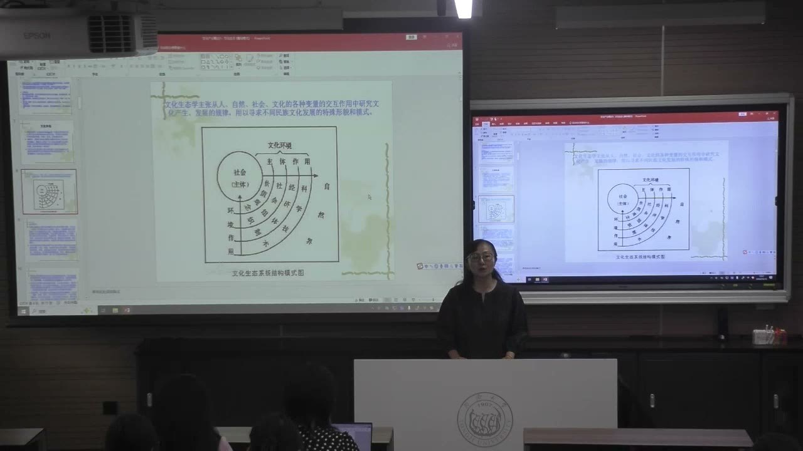
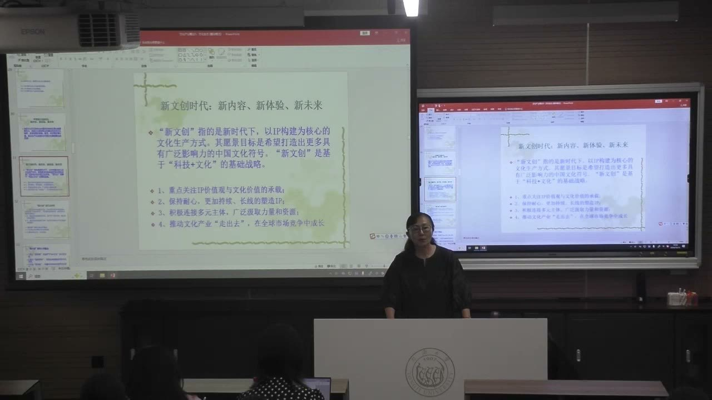
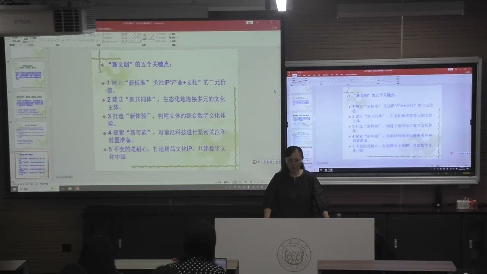

### 课程安排与任务

#### 行业小组汇报：先宏观，再用细分案例论证
<!-- source: 78 -->
各组先介绍负责行业的总体发展状况与重要动态，再选择代表案例或细分领域展开。可查行业协会年报等材料，尽量使用最新可得数据，并注明统计年份；课堂允许在较新年报未出时采用此前年度，不能把年份不同的数据混在一起。

分享时间约半小时，应控制体量、简明呈现重点。研究报告可以细一些，汇报只需简要交代方法，不必逐步复述所有推理。前两组应主动联系教师，把框架发来沟通。

#### 导师沟通与课外观察
<!-- source: 0 -->
教师说明导师分配需兼顾学生意愿、教师意见与工作量，鼓励主动沟通，不必因自己所在导师名下同届人数少而焦虑；如有具体问题，可反馈协调。课堂还建议关注艺术节及公共文化活动的信息和惠民渠道，把现场观察作为理解行业生态的机会；具体演出安排以实际发布为准。

### 一、演艺项目为什么要看一座城市的生态

一个节庆或项目能否持续，不只取决于单次内容，还取决于观众、场所、组织、制度与资源的长期积累。

#### 从国际艺术节回看上海演艺基础
<!-- source: 2 -->
教师以中国上海国际艺术节切入文化生态：历史上的演艺空间、观众消费习惯、改革后的院团与剧场体系，共同影响项目布局。不是先有一个孤立的大项目，再自动形成一切条件。

百乐门、音乐厅等历史场所被用来说明城市记忆和演艺消费的延续。历史基础并不能代替当代改革，但可以解释为什么同样的行业在不同城市呈现不同发展状态。

#### 院团、场地与项目制需要配套
<!-- source: 6 -->
课堂回顾上海话剧艺术中心的改革，强调院团整合与演出场所配套的重要性。只有演出团队、缺乏稳定场地，会增加租用和排期困难；场地与院团协调，则为持续经营创造条件。

教师同时讨论固定组织身份与灵活项目制的结合：不同编剧、导演、演员可以围绕项目流动，但固定机构仍承担组织、演出和履约职责。“院团合一”的重点是把生产和呈现条件衔接起来，而不是只给原有单位换名称。

#### 分类改革：市场化不等于所有院团同一政策
<!-- source: 10 -->
教师按不同阶段回顾演艺集团整合、杂技驻场项目和戏曲保护等改革。上海马戏城与《时空之旅》被用来说明跨团队合作、驻场空间、故事和旅游需求怎样结合。

戏曲等具有重要传承和公共文化价值的对象，未必能仅靠票房维持。课堂强调“一团一策”及支持机制：市场化探索和公益性保护需要同时考虑，不宜用同一盈利尺度处理所有门类。

### 二、改革继续发生，是因为生态中的关系会变化

已有制度能解决一个阶段的问题，也可能在新的条件下形成新的阻碍。

#### 条块分割为什么会妨碍整体资源使用
<!-- source: 16 -->
教师指出，剧场分属不同集团时，可能优先满足本集团项目，跨集团使用变难；从城市整体看，都是公共资源，却产生内部壁垒。资源整合的目标是改善剧场、项目、创作与引进之间的协调。

课堂介绍的新一轮大演艺集团构想，包括整合资源、加强创作、统一品牌与发展新业态。这些属于授课当时介绍的改革安排及预期，未在本笔记中核验其后续公布和执行状态。

#### 原创与新业态需要超越单个项目的投入
<!-- source: 20 -->
原创通常先有较大投入，短期财务压力可能使机构更偏向已有市场的引进项目。较大的组织平台和专项创作资金，被教师视作支持原创的一种可能机制。

沉浸式、虚拟演艺、直播和新的舞美技术，又改变观演方式。课堂提到《剧院魅影》相关沉浸式设想等例子时，强调尚在谈与可能落地，不能记成已完成项目。引进与原创、新技术与既有演出，不是只能保留一端的关系。

### 三、文化生态学看的是因素之间的相互作用

文化生态不能只列“环境很好”，而应说明哪些因素怎样影响文化产生、发展和变化。

#### 从人、自然、社会、文化四组变量进入
<!-- source: 24 -->
课堂把文化生态学介绍为借用生态学方法，研究文化存在和发展的资源、环境、状态与规律的交叉研究视角。重点是人、自然、社会、文化之间的交互作用，而非把文化简单归结为经济的直接产物。

自然条件影响人的生产和生活，人又创造文化，文化对环境的适应与改造因此经过多重中介。相似的生存工具不意味着后来文化必然相同；不同地区长期形成的生产、交往、制度和观念，会使文化类型出现差别。

#### 结构图中的科学技术、制度组织与价值观念
<!-- source: 28 -->
科学技术与人怎样面对自然、扩展生存和表达能力相关；经济体制与社会组织影响资源配置、机构方式和行动规则；价值观念则直接影响社会判断及文化活动追求什么。

教师用滨水城市的贸易与交流、佛罗伦萨和威尼斯的文化形态、演艺技术及文化体制改革作例子。这里要理解多因素关系，不能把“有水就一定开放”当成不需要历史证据的决定论。

#### 精神需求与公共价值为什么影响改革
<!-- source: 30 -->
教师把文化产业接回精神生产：文化产品和服务回应人的精神需求，也具有物质载体与经济属性。正因两者并存，改革不能只考虑市场淘汰，还要考虑文化需求和公共文化权利。

某些戏曲门类继续得到保护和支持，是课堂说明价值观念如何进入制度安排的例子。文化生态既有场所、生产等条件，也有制度、观念、素质和日常文化生活等软环境；不能只建硬件而忽略关系和内容。

### 四、文化的历史语境、延续与变化

理解某个作品，需要把它放回产生和被接受的时间、空间与价值环境。

#### 广义与狭义文化生态
<!-- source: 42 -->
课堂将广义文化生态放在人类历史实践创造的物质与精神财富及其状况中理解；狭义则重点讨论社会意识形态及相适应的制度和组织机构。为便于具体研究，本课更多使用后者。

文化反映一定社会的政治、经济，也会反作用于它们。因而同一文化产品在不同国家、群体或时期被理解的方式可能不同，文化折扣和接受差异不能只当成语言翻译问题。

#### 理解历史语境，不等于取消今天的评价
<!-- source: 50 -->
教师以《英雄》的海外接受争议和《剧院魅影》的当代讨论，说明创作背景与今天的观念之间可能存在距离。作品的情节、音乐、表演与舞美也应分别讨论，不能只用单一的当下标签代替理解。

本课强调文化具有连续性、历史继承性，也具有变异性。理解作品产生时的环境，与分析它今天还产生什么作用，是可以并行的工作；不能把“要理解历史”误记为“只能接受过去的一切”。

### 五、文化生态要保护的是平衡与持续创造

评价文化生态，不宜只做高低等级比较，也要问其内部关系能否维持。

#### 市场重要，但商业尺度并不包含所有文化价值
<!-- source: 60 -->
课堂借公共政策与艺术资助的例子说明，市场可以配置资源，也可能失灵；没有足够商业受众的原创或小众艺术，仍可能有应被支持的文化价值。

教师引用“社会需要市场，也必须约束市场”的思路，强调商业之外的价值需要保护。受到支持的先锋艺术未来可能逐渐被更多人接受，也可能继续作为小众实践存在，不能只用眼前票房判断其意义。

#### 隐性的破坏需要长期观察
<!-- source: 64 -->
文化生态的污染和破坏有时不像物质损毁那样即时可见，却可能长期影响人的判断、价值和文化传承。教师以历史文化遗存受损及当代饭圈问题，提醒关注不理性攻击、声量压制判断和主体性丧失。

追星或粉丝参与并不被一概否定，但人数多、声音大不能自动替代公平规则和独立思考。课堂同时强调通过创新回应问题：保护不是让生态永远不变，而是让变化与持续创造有条件发生。

#### 《创意生态》的成长三部曲
<!-- source: 70 -->
教师介绍约翰·霍金斯《创意生态》，提炼“人人都有创意、创意需要自由、自由需要市场”。创意并非某个特权阶层的专属；宽松环境使想法有机会出现，适当的市场与资源连接又关系到能否落地。

这不是要求所有艺术都立刻商业化，而是提醒管理既要提供支持，也不能管得过死。生态持续变化，需要沟通、政策和新的合作方式，不能只复制过去已经成功的模式。

### 六、开放中的本土生态与新文创

学习国外经验需要考虑本地条件，文化自信也不等于封闭。

#### 全球化带来产品、观念与资本的多重挑战
<!-- source: 74 -->
课堂以加入 WTO 后的开放讨论价值观、传统文化和产业资本面临的变化。外来文化产品可以带来新经验，也使原创能力、知识产权和本土文化表达的问题更突出。

教师反对照搬：不同国家的历史、社会关系、地理条件和制度并不相同。学习成功经验需要说明怎样转化，而不能以为移来同样的机构名称或产品形式就有同样结果。本节口述涉及的投资管理比例未展开核对，不作为具体法规规则列入笔记。

#### 新内容、新体验、新未来：以原创 IP 为核心
<!-- source: 80 -->
课堂把“新文创”概括为以 IP 构建为核心的文化生产方式，以“科技＋文化”为基础，追求形成有影响力的文化符号。它回应模仿依赖、原创力不足与版权意识等问题，不能只把新的技术包装当成新内容。

四个重点是：承载价值观与文化价值；有耐心地长期塑造 IP；连接多元主体与资源；在全球市场竞争中成长。教师以游戏和文化影像等例子强调，表面的突然走红背后可能有长期研发、组织和支持，不能迷信单打独斗或一次宣传。

#### 体验、参与与文化价值和产业价值的循环
<!-- source: 86 -->
消费者不只看内容，也关心以什么形式体验。沉浸式和环境式演艺、数字博物馆情境、VR 叙事等，让参与和互动成为内容组织的一部分，但参与并不意味着必须触摸真实文物。

技术能帮助降本或产生新表达，却不应取消人的丰富经验和有温度的表演。课堂对 AI 内容的讨论，重点是不能把“有新技术”当成一切文化价值的代替品；文化价值与产业价值需要形成良性循环。

#### 五个关键点与未来文化生态的两个方向
<!-- source: 90 -->
新文创的五个关键点是：以产业与文化的双重价值建立新标准；生态化连接多元主体、形成新共同体；构建立体综合的数字文化新体验；关注前沿技术并前置准备新的可能；持续耐心地打造精品 IP。

课程最后归纳两个方向：从传统遗产的继承中获得文化自信，在多元交流中开展文化创新。前者提供根基，后者使文化在开放联系中继续发展，而不是守住传统就停止变化。

### 概念对照与自测

| 区分 | 核心含义 | 课堂中的对应问题 |
|---|---|---|
| 单个项目与文化生态 | 一次产品活动；持续支持它的关系与条件 | 为什么节庆与演艺项目选择某座城市 |
| 市场化与公共价值 | 经营和资源配置；精神需求与传承支持 | 不同院团为何不能一刀切 |
| 历史继承与文化变异 | 延续既有积累；在新条件下改变 | 经典作品怎样在今天被接受 |
| 硬件建设与软环境 | 场所和生产条件；制度、价值与文化生活 | 建了剧院是否等于形成好生态 |
| 技术包装与原创 IP | 改变呈现工具；持续形成内容与文化符号 | 新文创为何要长期投入和协作 |

#### 为什么集团和剧场都属于公共资源，仍可能使用低效？
若组织边界和排期规则形成内部壁垒，资源就难以按整体需要协调；需要分析具体关系和制度，而不只统计设施数量。

#### 文化生态的保护为什么会需要创新？
环境、技术和需求会变化。若只冻结旧形式，原有制度可能不再支持持续创造与传播，保护需要有适应变化的条件。

#### 新文创为什么既讲市场，也讲文化价值？
产业需要可持续运行，但文化还有精神、公共与历史意义；只有技术或短期流量，不能替代原创内容和长期文化积累。

### 课程时间线

00:00—02:00：导师分配与沟通提醒，进入文化生态专题。
02:00—10:00：国际艺术节、上海演艺基础与院团场地配套。
10:00—16:00：集团整合、驻场项目和戏曲分类支持。
16:00—24:00：资源壁垒、新一轮改革构想与演艺新业态。
24:00—32:00：文化生态学、四组变量与结构图。
32:00—40:00：自然、生产生活与文化类型的多因素关系。
40:00—46:00：环境概念、广狭义文化生态与意识形态。
46:00—50:00：课间及公共文化活动信息。
50:00—60:00：历史语境、连续与变异、文化双重性及保护。
60:00—70:00：市场与公共支持、生态平衡、隐性破坏与创新。
70:00—74:00：《创意生态》与成长三部曲。
74:00—78:00：开放条件下的价值、传统与资本挑战。
78:00—82:00：小组汇报要求与新文创背景。
82:00—90:00：原创IP、科技文化、多主体、参与和体验。
90:00—95:27：新文创五个关键点、继承传统与多元创新。
