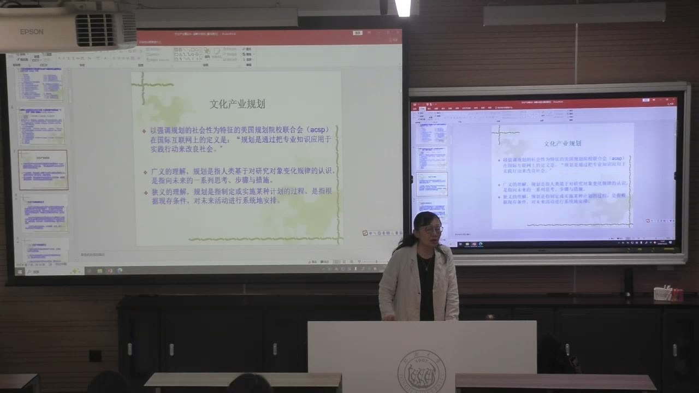
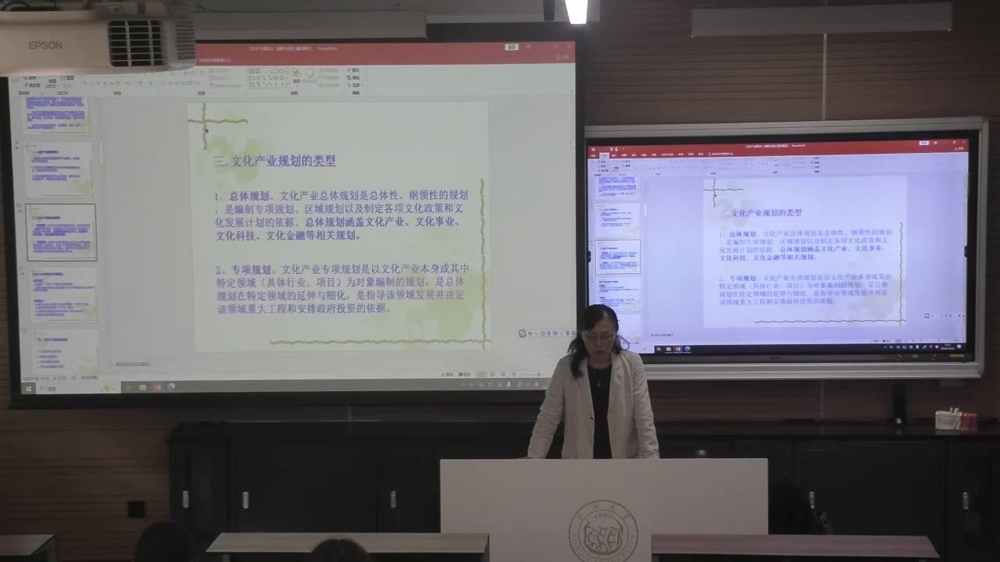
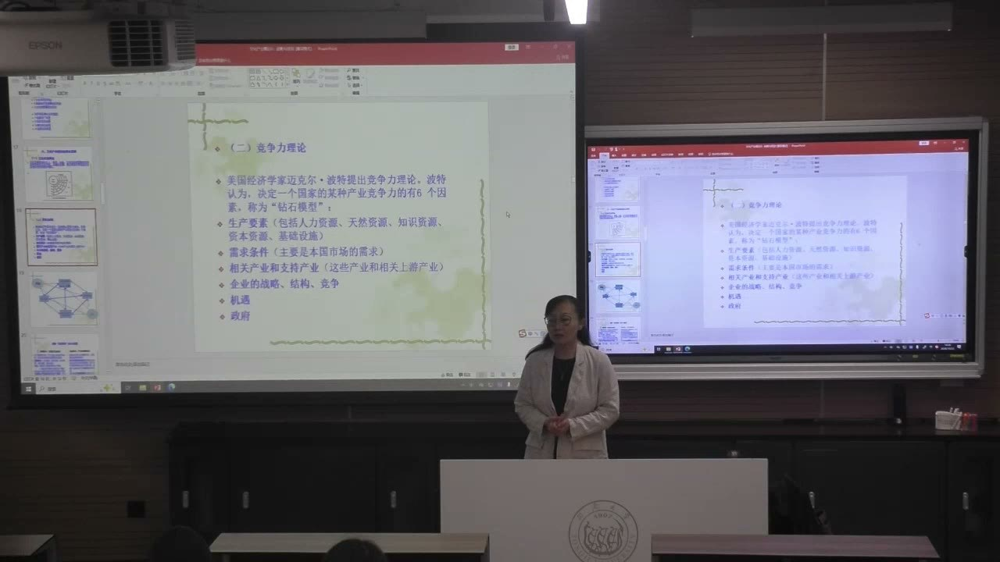
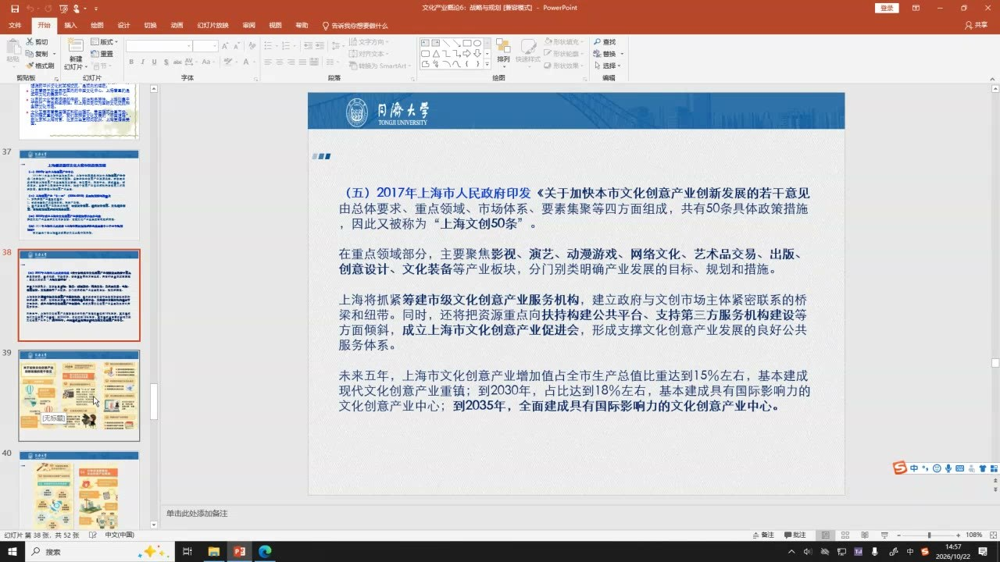
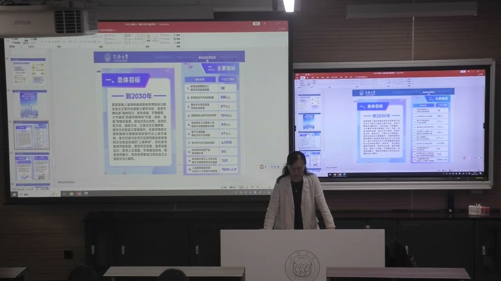

### 课程安排与任务
#### 阅读规划材料，联系专业学习与实践
<!-- source: 64 -->
教师推荐阅读波特讨论国家竞争优势的著作，结合本课的钻石模型，分析一个文化产业具备哪些条件、还缺哪些支持。老师表示将把本节涉及的规划全文发到群里，建议大家了解上海未来的文化发展方向，联系实习、就业和行业观察来阅读。

课堂还提到后续组织参观文博会的计划，具体时间与安排另行通知。本节没有新增一项有明确截止日期的课后作业。开头关于品牌创意比赛的交流，重点是鼓励通过专业积累、社会实践与跨学科学习继续尝试，不把一次比赛结果等同于专业能力的全部。

### 规划的目的、层次与类型
文化产业规划要把专业认识转化为行动安排。它既需要发展方向，也必须说明方向怎样在特定地区和领域落地。

#### 专业知识通过实践行动改良社会
<!-- source: 10 -->
教师引用美国规划院校联合会的定义：规划是通过把专业知识应用于实践行动来改良社会。三个要素相互连接：专业知识提供判断依据，实践行动连接知识与现实，社会改善说明做规划的目的。

广义上，规划基于对对象变化规律的认识，是面向未来的一系列思考、步骤与措施；狭义上，它是制定或实施计划的过程，根据现存条件对未来活动作系统安排。规划不是印成一本厚材料就算完成，而要改变实际发展条件。

#### 战略给出全局方向，规划进行有针对性的安排
<!-- source: 8 -->
本课将战略理解为更具全局性的筹划，将规划放在相对具体的地区、行业或领域中讨论。国家与区域都可能有战略，不能把二者机械区分成“国家才有战略，地方只有规划”。关键是它们在当前讨论中的范围、层次和具体程度。

课堂以数字文化产业相关意见与上海数字经济规划的关系说明：上位文件提出方向，地方要结合自身情况细化内容。地方规划不是把国家文件改一个地名，而是明确当地凭什么发展、重点在哪里、需要什么保障。

#### 总体规划与专项规划形成承接关系
<!-- source: 20 -->
文化产业规划是有关政府部门、管理机构及相关企事业单位制定的发展纲领和蓝图，包含目标、政策策略与评价安排。总体规划具有总领、总体和纲领性，是专项规划、区域规划及相关政策、发展计划的依据。

专项规划针对某个特定领域、行业或项目，是总体规划的延伸和细化。例如总体文化发展之下，可以进一步讨论数字文化、演艺、文化科技或文化金融。专项规划还可能需要实施细则，才能把原则变为重大工程和投资安排。

#### 产业价值不只在直接产值
<!-- source: 16 -->
教师概括了规划的三方面意义：促进经济结构转型与产业升级，为区域发展形成新动力，以及向居民提供更优质的文化资源、丰富精神生活。

演艺案例说明，不能只看剧场票房，还要看餐饮、住宿、交通等周边消费，以及观众获得的文化体验。老师引用百老汇与上海国际艺术节消费带动研究的不同估计，强调常年驻演和阶段性艺术节的时空组织不同。这些课堂举例中的比例不能不加区分地移作任何项目的固定乘数。票根经济的思路，则是进一步把演出与其他消费环节连接起来。

### 好的规划要有基础、有差异，也能实施
规划要面向未来，但不能以一个响亮目标代替现实论证。对地方条件的认识，决定了目标能否转化为行动。

#### 四项原则：生产力、差别化、结构优化和社会协调
<!-- source: 24 -->
文化生产力主导原则要求依据当地文化生产力及综合实力设定目标；差别化发展原则要求体现地区和行业特征，不能各地规划大同小异；产业结构优化原则要求考虑相关产业及环境的互动，而不只关注单个行业；与社会发展相协调原则则把产业放回地区发展阶段和社会需要中考察。

以演艺为例，引进高水平项目不仅是某场演出盈亏的问题，也涉及原创学习、行业标准和相关业态的提升。但这种公共投入必须与城市的现实基础、产业结构和社会效益结合论证，不能以“追求最高水平”替代成本与条件分析。

#### 系统科学性、战略前瞻性与落地实用性
<!-- source: 30 -->
系统科学性意味着立体、全方位、多视角、多层级地研究对象。规划前的调研、既有数据整理和对标研究，是判断依据，不是可有可无的附件。

战略前瞻性强调立足现实、适度超前。只照搬别人提出的“某某之都”，没有产业基础和支撑条件，容易出现园区建成而企业留不住的情况。落地实用性要求符合当地实际，基于地域文化特质，兼顾经济有效性与社会效益。三者需要同时成立：只求稳妥而不面对未来不够，超前到无法实施也不够。

#### 景德镇案例：方向合理仍可能受资金条件限制
<!-- source: 34 -->
老师以自己参与景德镇规划的经历说明：地方拥有陶瓷资源、艺术家与民间生产力量，不代表地方政府当时就有足够财力启动全部项目。一个方案可能在方向上得到认可，却因资金条件而无法立即实施。

这个例子要区分“有没有资源”“谁掌握资源”“谁能投入资金”“何时能够实施”。不能把未来可能形成的条件当成当前已经具备的条件，也不能因为某个设想多年后才落地，就忽略当时的约束。课堂口述的经济总量带有回忆与修正，不用它作精确比较。

### 从现实调研到实施保障的基本结构
规划需要形成前后衔接的链条：调查基础、确定目标、安排空间和结构，再落实载体与保障。

#### 现实基础包含资源，也包含需求
<!-- source: 36 -->
基础调研包括文化产业资源调查与市场评估，也包括文化供需分析与预测。资源回答当地拥有什么，需求分析回答什么内容有受众、市场缺口在哪里。二者不能互相替代。

教师以常州恐龙园说明需求判断的重要性：课堂强调的不是当地必须原生拥有某种文化资源，而是资源引入、科普需求、土地和运营条件可以结合，形成不同于其他地区的项目。案例中关于资源来历的口述属于讲授背景，不作为已经逐项核实的项目史。可提取的方法是：不要把现实基础缩减为一张本地文化资源清单。

#### 总体要求与空间布局要相互连接
<!-- source: 42 -->
总体要求需要说明指导思想、原则、产业定位和目标。目标明确以后，还要安排总体空间布局、功能分区和空间生态系统：项目位于哪里，各区域承担什么功能，彼此怎样配合。

空间不是最后找一块地来填入方案。不同区域的文化特征、设施、交通和人群会影响项目能否运转。既不能没有布局地重复建设，也不能把每个地区都设为同一种中心。

#### 产业结构、重点与载体不能平均分配
<!-- source: 44 -->
产业结构设计涉及相关门类的比例、运营与原创等资源安排，以及文化和相关行业的融合。确定重点产业，需要论证，不是把资源平均分成若干份。

载体建设包括文化设施、园区、集聚区、重点企业与重点项目。剧院的舞台、设备和保护条件，会限制能承载的演出；产业园区需要相应的专业设施与服务。教师以演艺大世界、静安戏剧谷等为例，说明空间集中可以形成不同功能，而不必到处新建同类大型设施。

#### 保障要落实到组织、财税、金融与人才
<!-- source: 56 -->
组织保障需要协调产业之外的部门。教师用演出散场后的交通衔接说明：观众能否便利地往返，会影响其参与文化活动的可能性，地铁等条线需要协作。这是课堂对规划细节的说明，具体线路与末班车时间仍须按实际运营信息查询。

财税、金融和人才保障也要写出作用机制。金融方面，老师讨论文化企业固定资产少、版权等无形资产重要带来的融资困难，并举政府支持、公共设施投入与拓展融资渠道等思路。人才保障则要求分析产业需要什么能力、怎样吸引和培养人员，不能只在末尾写一句“加强人才建设”。

### 制约因素与钻石模型：怎样判断竞争力
文化生态提供整体视角，竞争力理论帮助把产业条件拆开分析。模型用于寻找关系与瓶颈，不是列完要素就自动证明竞争力。

#### 既有条件与认识能力都会制约规划
<!-- source: 60 -->
制约因素包括历史形成的空间布局、体制条件、国民经济基础以及文化要素禀赋。土地、资金或制度上的约束，不能靠重新写目标消失。

规划者对未来的认识也有边界。教师强调视野广阔度、观念先进度、创新度和追求的科学性：既要了解外部实践与行业前沿，也要使提出的新观念合理、可被当地条件支持。国际交流的作用，是扩大判断的参照，而不是照搬一个外地项目。

#### 钻石模型是四个基础因素加两个相关因素
<!-- source: 64 -->
波特的钻石模型在本课中概括为“4＋2”。四个基础因素是生产要素、需求条件、相关产业和支持产业，以及企业的战略、结构与竞争；两个相关因素是机遇和政府。

生产要素又包括人力、天然、知识、资本和基础设施资源。需求条件不能只用“人口很多”概括，还要分析市场对何种产品和服务形成需求。相关及支持产业说明，一个产业的发展依赖与它配合的供应、知识和服务条件。企业层面要看管理、组织、战略与竞争，教师特别提醒关注龙头企业的培育。

#### 集群依靠关联和配套，不只是企业地址集中
<!-- source: 70 -->
产业集群把相关企业、支持产业、专业人才与项目连接起来，能够形成资源整合和协作条件。教师以演艺项目、市场与人才相互吸引说明：缺少某一种既有机构，不等于不能通过项目和市场形成新的资源集聚。

分析一个集聚区时，应追问企业之间有什么联系、依靠什么配套、能否形成持续项目与人才流动。仅有园区建筑或企业数量，不足以说明产业集群已经成熟。国际交流与企业走出去，也需要建立在能力积累、竞争和资源整合的基础上。

#### 国内需求、国际交流与国际竞争不是同一个问题
<!-- source: 68 -->
课堂讨论新兴产业时，提醒外部市场、汇率等变化会带来不能由单个企业控制的风险，因此要重视国内需求基础。但这不等于放弃了解国际水平，更不等于产业永远不能参与国际竞争。

教师把市场基础、学习交流和企业成长后的外向发展分别讨论：先有可持续的需求和能力，再扩大竞争范围。规划中应分清这些层次，不能把“重视国内市场”理解为闭门发展，也不能把国际化写成没有条件的口号。

#### 政府既提供环境，也受到能力边界约束
<!-- source: 76 -->
课堂对照干预与放任两种方向，讨论政府能够通过资源供给、基础设施投入、信息整合、人才培养和融资环境发挥作用。公共实验设施等案例说明，一些小企业无力独立承担的条件，可以通过公共投入和共享使用来改善。

政府因素需要与企业竞争、市场需求和机会共同分析，不能把扶持政策本身当成产业成功的充分条件。时机可能带来突破，但能否利用时机，仍取决于其他条件是否准备好。

### 上海案例：定位、政策、指标怎样逐层展开
本节末的上海材料展示的是规划分析的方法：把总体城市定位、重点产业、量化目标与保障机制联系起来，同时区分历史目标与实际成绩。

#### 国际文化大都市定位与阶段延续
<!-- source: 80 -->
教师将2011年“十二五”时期提出的国际文化大都市构想，放在世博会之后的城市发展讨论中解释。课堂强调海派文化与多种文化交流的特点，并用它说明城市文化定位需要有差别，不能只争一个相同的中心称号。

这一定位不只对应文化产业，还关联文化原创、公共文化服务、文化体制等方面。阅读政策时，要分清城市总体目标与其中某一个行业目标；“亚洲演艺之都”是其中的产业方向，不能取代全部文化发展内容。

#### 文创50条：领域选择与时间目标
<!-- source: 84 -->
课堂展示2017年《关于加快本市文化创意产业创新发展的若干意见》，从总体要求、重点领域、市场体系和要素集聚展开，聚焦影视、演艺、动漫游戏、网络文化、艺术品交易、出版、创意设计、文化装备等领域。

材料提出的2030年文化创意产业增加值占全市生产总值比重达到18%左右、2035年全面建成具有国际影响力的文化创意产业中心，属于当时设定的目标，不能改写为现在已经实现。教师关于后续发展的判断也属于课堂展望。

#### 规划指标必须连同对象、单位与时间阅读
<!-- source: 90 -->
课堂展示面向2030年的总体目标与“十五五”指标，涉及影视精品、原创舞台作品、公共文化服务、细分产业规模、演出场次、游戏电竞增长和大型活动等。指标把抽象定位转成可以检查的方向，但不同指标的口径并不一样。

例如“全市常住人口年人均接受文化场馆服务4次以上”是人均服务人次指标，不表示每一位居民实际都进入场馆四次；“原创”也不能拿引进作品充数。使用这些数字时，要同时保留目标年份、单位和统计对象，不把规划值当作已完成值。

#### 主要任务与保障共同支撑城市目标
<!-- source: 94 -->
教师概括的任务包括全媒体传播体系、城市文脉与历史记忆、文化艺术原创、公共文化服务、文化空间布局、产业创新、文化科技融合与国际影响力等。建筑可阅读、江南水乡古镇联合申遗、大博物馆与大美术馆计划，是课堂指出的具体方向。

这些仍需与文商旅体展融合和人才培养等条件结合。学习重点是看到“定位—领域—指标—项目—保障”的承接关系，而不是背下一串城市称号或把所有项目名称当成已经完成的成果。

### 概念对照与自测
| 区分 | 核心含义 | 不可混同 |
|---|---|---|
| 战略／规划 | 全局方向／有针对性的安排 | 不能只按国家、地方机械区分 |
| 总体／专项 | 纲领与依据／特定领域的细化 | 专项仍需与总体协调 |
| 资源／需求 | 可以调动什么／市场与公众需要什么 | 有资源不自动有需求 |
| 前瞻／落地 | 面对未来／适应当前实施条件 | 超前不等于越远越好 |
| 产业集群／建筑园区 | 关联配套与资源网络／空间载体 | 地址集中不自动产生集群效应 |
| 规划目标／实绩 | 预期达到的状态／已经发生的结果 | 目标数字不能充作完成数字 |

#### 为什么规划不能只做文化资源调查？
资源仅是现实基础的一部分，还要分析文化需求、供给缺口、市场条件与实施能力。缺少需求和运营条件，资源也可能无法转化为持续的文化产品或服务。

#### 钻石模型如何用于一个文化产业案例？
逐项分析生产要素、需求、相关及支持产业、企业战略结构与竞争，再考察机遇和政府怎样影响这些条件。重点是找到相互作用与瓶颈，而非简单打勾。

#### 一个规划“方向好但没有马上实施”，应追问什么？
区分资源、资本、组织、制度和时间条件，判断哪些当前可用，哪些仍需建设，是否超出了当地可承担的启动能力。

#### 为什么人均文化服务人次不能理解为每个人的固定体验次数？
人均值是总体服务量与人口之间的统计关系，个人参与次数可以不同。使用规划指标要保留统计口径与目标年份。

### 课程时间线
00:00—02:00：签到与品牌创意实践交流
02:00—08:00：演艺改革、原创与文化生态的衔接
08:00—16:00：战略与规划辨析；规划定义与文化产业规划
16:00—20:00：经济转型、消费带动与精神生活价值
20:00—24:00：总体规划与专项规划
24:00—30:00：文化产业规划四项原则
30:00—36:00：系统性、前瞻性与景德镇实施条件
36:00—44:00：资源、需求、总体要求与常州案例
44:00—46:00：空间布局与产业结构
46:00—50:00：课间
50:00—56:00：重点、载体与文化设施条件
56:00—60:00：组织、财税、金融与人才保障
60:00—64:00：制约因素、规划视野与文博会计划
64:00—72:00：钻石模型四个基础因素及机遇、政府
72:00—76:00：产业集群、国际交流与企业战略
76:00—80:00：政府支持、公共投入与融资环境
80:00—84:00：上海国际文化大都市定位
84:00—90:00：2017年文创50条与重点领域
90:00—95:40：2030年目标、十五五指标与主要任务
