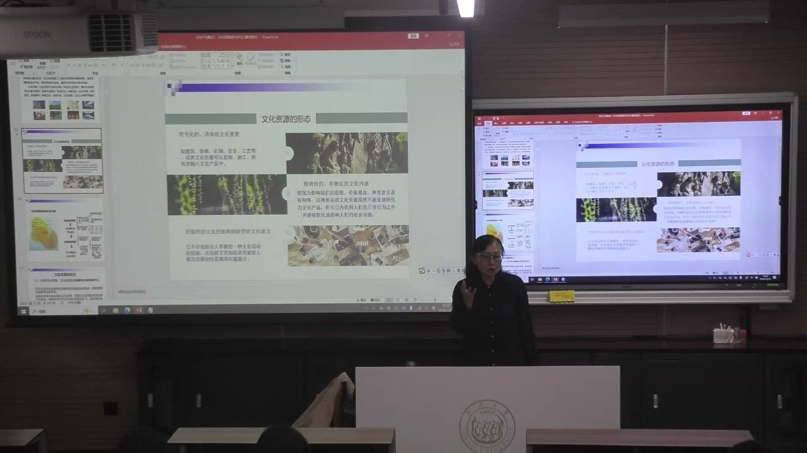

### 课程安排与任务

#### 期末论文与小组作业分开
<!-- source: 46 -->
教师明确说明：期末课程论文与小组作业没有关联，由学生自己选择感兴趣的主题；期末论文不能与期中作业完全相同，不能把同一份内容改头换面重复提交。

小组作业按组进行行业分享，个人期末论文独立完成。本节没有给出新的论文截止日期，具体提交要求仍以课程通知为准。

#### 下一组继续行业分享
<!-- source: 94 -->
本节课前半段由小组分享会展产业，后半段转入教师讲授文化资源。教师提醒下一组继续准备行业分享，并在课堂上随时提问；本节没有布置新的书面作业。

### 会展产业汇报的教师点评

小组分享之后，教师用较长篇幅回应其中的概念、数据和案例。这些回应不是重复学生汇报，而是说明怎样判断一个文化行业的发展质量。

#### 行业介绍要有概念、数据和案例
<!-- source: 30 -->
教师肯定汇报先辨析会展活动、会展产业、会展经济三个概念，再用数据说明中国会展业的位置，最后用案例讨论趋势。这个顺序对其它小组同样适用：先说明行业是什么，再说明它现在怎样，最后分析它为什么这样。

教师特别强调“透过数据看本质”：数据本身不是结论，要比较口径、时间和区域，才能看出结构变化。课堂也提醒，不同报告的统计口径可能不同，不能把不同来源的数字直接相加或排名。

#### 会展是经济与文化的双重窗口
<!-- source: 34 -->
教师把会展称作经济风向标之一。广交会历史悠久、客户积累稳定，又与香港相邻，长期是对外贸易的重要窗口；进博会由国家主办，是消费品领域的国家级国际博览会；国际乐器展、西岸艺博会则代表企业主办或政府与企业合作的专业展会。

这些例子说明会展不只是“租场地办活动”，它还连接产业、城市形象、国际交流和文化消费。分析会展不能只看展馆面积和展期，还要看主办主体、专业分工和交易功能。

#### 场馆数量不等于使用效率
<!-- source: 38 -->
教师提醒，中国展馆总量和面积已居世界前列，但部分场馆出租率低，上海的一些大型场馆也没有达到满负荷。四叶草等场馆开始承接演唱会等其它活动，属于综合利用，但长期闲置仍会带来设备维护和营收压力。

因此判断会展业不能只看建了多少馆、办了多少展，还要看场馆利用率、复展率、单位面积产出和本地产业需求。这个判断与后面文化资源开发中的“避免同质化”相通。

#### 汉诺威综合展停办说明信息差在缩小
<!-- source: 40 -->
教师用汉诺威 CeBIT 的停办说明会展模式的变化：过去综合性大展依靠“别处找不到的信息”吸引客商，互联网削弱了这种信息差，专业展和更细分的平台反而更有生命力。

这不是说所有综合展都会消失，而是说规模本身不再自动构成优势。展会要能持续降低某一产业的信息和信任成本，否则扩大规模也可能加重转型负担。

### 文化资源的概念与层次

文化资源是文化产业的基础，但不是所有文化资源都能直接产业化。课堂先区分资源、文化资源和文化产业资源三个概念。

#### 从一般资源到文化资源
<!-- source: 58 -->
资源是“资财的来源”，包括有形的物质载体和无形的精神内容，既包括自然资源，也包括社会资源。文化资源是人类在生产生活中创造出来的、具有文化内涵及经济和社会功能、可以通过合理开发利用转化为生产性资本的物质和精神成果。

这个定义同时包含“文化内涵”“社会功能”和“可开发性”。只有文化价值、没有开发条件的东西可以是文化资源，却不一定能成为文化产业资源。

#### 文化资源的三个层次
<!-- source: 58 -->
课堂把文化资源分为意识形态层次、生产生活层次和产品服务层次。风俗、传统、价值观念属于意识形态层次；黎族染织刺绣等与日常生活方式相连的技艺属于生产生活层次；电影、戏剧、演出等文化产品和服务属于产品服务层次。

三个层次不是高低等级，而是文化资源存在的不同形态。做产业开发时要判断自己面对的是哪一层，不能把价值观念直接当成可以售卖的产品。

#### 文化产业资源是能进入生产的部分
<!-- source: 60 -->
文化产业资源指文化商品生产和服务所汇总的一系列要素，包括环境、资金、技术、人才、文化等。它强调产业因素，是文化资源中可以转化到生产中的那一部分。

教师特别指出，非遗属于文化资源，但有些非遗无法做产业化开发，因此不能一概纳入文化产业资源。这个区分可以防止“文化资源很丰富”被直接等同于“文化产业一定发展得好”。

#### 文化产业资源具有动态性、增值性和共享性
<!-- source: 60 -->
文化产业资源会随技术、市场和需求变化而改变：原来不被视为资源的东西，可能因为新的开发方式而进入产业；原来可以开发的东西，也可能因为市场变化而失去价值。

增值性指开发后可以形成更高的经济和文化价值；共享性指文化产品和服务可以通过市场流通，被不同地区的人使用。会展就是共享性的例子：展品在展期内被比较、订货和交易，信息与信任在有限时空中集中形成。

### 文化资源的形态与特点

文化资源不只表现为看得见的建筑和文物，也包括技能、制度、审美和价值观。课堂从形态、价值、所有权、可再生性和空间分布几个方面概括其特点。

#### 三种常见形态
<!-- source: 62 -->
第一类是符号化、具体的文化要素，如建筑、绘画、石刻、刺绣、音乐、工艺等。它们可以被识别、复制和加工，进入文化产业。徽派建筑、苏绣、顾绣等例子说明，符号性是文化资源最直观的层面。

第二类是经验性的文化技能和创新性的文化能力，如技艺、管理能力、策展能力。剧场运营、戏剧创新等例子说明，同样的设施在不同团队手中可能产生不同的文化价值。

第三类是精神性的非物态文化内涵，如价值观念、审美意识、国潮趣味。它们不直接表现为产品，却会影响人们怎样理解和使用文化产品。

#### 独特性与多样性
<!-- source: 66 -->
文化资源具有独特性和多样性。能够成为著名文化资源的对象，往往有很高的辨识度，如张家界的喀斯特地貌；同时，世界各民族的文化成果又非常多样，不能用一个地方的标准衡量所有地方。

独特性不是“越奇怪越好”，而是指资源具有难以替代的文化特征。开发时要找到这种特征，而不是复制一个已经成功的模板。

#### 价值潜在、滞后与整体性
<!-- source: 68 -->
文化资源的价值不一定在当时就被认识，可能长期潜伏，后来才被重新发现；这就是价值的潜在性和滞后性。良渚遗址从普通遗址成为重要文化空间，说明考古发现、保护投入和公众认知会共同改变资源的价值。

整体性指文化资源不能只按一个点来看。横复历史风貌区之所以要成片保护，是因为单体建筑之间、名人的生活轨迹之间、街道空间之间有联系。只保护一栋楼，可能失去它所在的环境和关系。

#### 共享性、非独占性与产权
<!-- source: 72 -->
文化资源具有共享性和非独占性。世界遗产被看作全人类的共同遗产；马面裙等传统服饰进入公共领域后，不能被某个主体单独垄断。另一方面，物质文化遗产又有具体的产权和地域属性，历史建筑可能分别属于个人、政府或企业。

这两个层面需要同时看到：文化符号可以共享，具体物质载体的产权却不能随意处置。做开发前要弄清资源属于谁、谁有权使用、哪些部分已进入公共领域。

#### 可再生与不可再生的统一
<!-- source: 74 -->
文化本身会不断繁衍，新的文化资源会不断产生；但具体的物质文化遗产一旦破坏，往往无法真正复原。课堂用上海音乐厅的建筑平移说明技术能力与保护原则的差别：技术可以移动建筑，却难以恢复它与周边环境的关系，因此专家并不主张把平移当成常规方案。

华沙古城的重建是另一个例子。它是在战争摧毁后，依据图纸、照片和记忆整体复建，具有纪念纳粹侵略历史和保存城市文化记忆的特殊意义；这并不表示一般仿古建筑都可以据此申请世界遗产。

#### 集群性：集聚、专业化、网络化与植根性
<!-- source: 80 -->
文化资源在空间上往往集聚，因为地段、交通、历史机缘和同类机构会互相吸引；集聚又会形成专业分工，如戏剧、电影、游戏各自需要不同的技能和服务；资源之间还存在网络化联系，不只是地理上的相邻。

植根性指文化资源与当地的地理、气候、政治、经济和文化条件相关。开发不能把外地模式原样搬来，而要判断本地资源能支撑什么样的产品。

### 文化资源的评估要素

做文化产业规划，第一步是评估文化资源，而不是先画产业园。课堂把评估分为品相、价值、效用、发展预期和传承能力几个层面。

#### 品相要素：特色、保存、知名度、稀缺性
<!-- source: 82 -->
品相要素包括文化特色、保存状态、知名度、独特性和稀缺性及分布范围。文化特色决定资源能不能避免同质化；保存状态决定开发难度；知名度可以减少传播阻力；稀缺性决定它在市场中的位置。

这些指标要一起看。一个资源很有名但保存很差，开发风险就高；一个资源很独特但无人知晓，可能需要先做长期传播，而不能立即追求流量。

#### 价值要素：文化、时间、消费与保护等级
<!-- source: 84 -->
价值要素包括文化价值、时间价值、消费价值和保护等级。文化价值回答它对什么样的文化意义重要；时间价值区分远古文物与当代资源；消费价值判断是否有人愿意使用；保护等级则决定开发的法律边界。

教师特别提醒，很多物质文化资源有文物保护等级，开发不当可能触犯法律。评估不是只看“能不能赚钱”，还要先确认“能不能动”。

#### 效用要素与发展预期
<!-- source: 86 -->
效用要素包括社会效用、经济效用、民俗礼仪、公共道德、资源人群和市场规模。发展预期则看经济发展水平、交通便利程度、生活服务能力和商务服务能力。

百老汇的例子说明交通条件的重要性：剧院区当年地价较低，但市政府优先把地铁修到那里，才使观众能方便到达。文化资源开发不能只看资源本身，还要看它能不能被人到达、被服务、被持续使用。

#### 传承能力：开发后要能交给后人
<!-- source: 88 -->
传承能力包括价值观和传统文化的传承，也包括资源规模、竞争力、成熟度和资源环境。教师强调，开发文化资源要有使命感：开发后应该让资源变得更好，而不是把它消耗掉。

这个标准把“保护”放进了开发评价。一个项目即使短期收益高，如果破坏了资源本身，也不能算成功的文化产业开发。

### 从文化资源到文化品牌

有资源不等于有产业。课堂把转化过程概括为项目制、知识产权、资产与产权、金融和品牌几个环节。

#### 以项目制启动开发
<!-- source: 88 -->
文化资源开发通常以项目制进行：先立项，明确目标、对象、内容和实施条件，再组织团队开发。电影要立项，SIDP 等课程项目也要立项，原因是要把分散的想法变成可执行、可评估的安排。

立项不是形式。它要求说明为什么做、做什么、怎么做、需要什么资源、怎样判断结果。没有这些，资源开发容易停留在口号。

#### 知识产权把开发成果固定下来
<!-- source: 90 -->
项目开发出具有独特性的内容后，可以通过知识产权保护把成果固定下来，如登记、专利、版权等。知识产权再转化为资本资产，形成资产产权，进而通过产权金融获得更多投资。

这个链条说明文化产业不是“有文化就能卖”，而是要把创意变成可识别、可保护、可交易、可融资的资产。每一步都需要法律和商业条件，不是自动完成。

#### 品牌提升有形和无形的价值
<!-- source: 90 -->
资源变成品牌后，除了有形资产增值，还会获得更高的知名度、美誉度和市场信任。品牌不是换一个标志，而是长期积累的质量、内容和关系。

课堂没有把品牌建设说成一条必然成功的路径。它更像一个方向：开发成果要能被识别、被保护、被投资，最后才能形成稳定的品牌价值。

### 保护优先与开发原则

文化资源开发有创新、产业化、适度、整体、协调等原则。其中最需要记住的是保护与开发的关系。

#### 保护是第一位的
<!-- source: 92 -->
教师明确说，历史文化资源的保护和开发之间，以保护为主，保护是第一位的。只能在保护的前提下开发，不能为了开发破坏资源。

这不等于完全不开发。合理开发可以让资源焕发新的生机，但开发方式要受保护要求约束。判断一个项目时，先问它是否损害了资源，再问它能带来多少收益。

#### 创新性与产业化
<!-- source: 92 -->
创新性原则要求开发有自己的内容，不是复制别人的模式。迪士尼不断推出新 IP、更新乐园项目，说明持续创新才能维持吸引力。

产业化原则要求产品能被更多人使用、在市场上推广，提升竞争力。但产业化不是把一切文化内容都变成商品；它适用于那些具备市场条件和公共支持的部分。

#### 整体性与协调性
<!-- source: 94 -->
整体性原则要求把资源放回它的空间、历史和社会关系中看，不能只开发一个点而破坏周围环境。协调性原则要求开发与当地经济、社会、生态条件相协调。

课堂列举了文旅项目、主题公园、节庆、文化地产、创意产品、科技创新、特色产业带、生态博物馆、文创造镇等开发方式。这些方式不是可以随意套用的模板，选择时要看资源类型、保护等级和当地条件。

### 概念对照与自测

| 区分 | 本节的问题 | 易混淆之处 |
| --- | --- | --- |
| 文化资源／文化产业资源 | 有文化价值，是否能进入生产 | 把全部文化资源都当成可开发资源 |
| 文化资源／世界遗产 | 一般文化资源与特定名录 | 把两者当成同一概念 |
| 物质资源／精神资源 | 载体与内涵 | 只保护建筑，忽略技艺和观念 |
| 共享性／产权 | 符号共享与具体载体的归属 | 以共享为由忽视产权 |
| 可再生／不可再生 | 文化延续与实物毁灭 | 认为技术可以复原一切 |
| 保护／开发 | 优先次序与合理利用 | 把开发当成保护的替代 |
| 项目／品牌 | 一次开发与长期积累 | 认为立项成功就等于品牌成功 |

#### 文化资源与文化产业资源有什么区别？
文化资源是具有文化内涵和社会功能的物质和精神成果；文化产业资源是其中可以进入文化商品生产和服务的那一部分。有些非遗有文化价值，却不具备产业化条件，不能直接算作文化产业资源。

#### 为什么说文化资源的价值具有潜在性和滞后性？
资源的价值不一定在当时被认识，可能因为考古发现、审美变化、市场需求或保护投入，后来才被重新发现。良渚遗址、历史建筑等例子都说明，价值判断会随知识和条件变化。

#### 文化资源的共享性与产权为什么可以并存？
文化符号、传统样式可以进入公共领域，被全社会使用；具体的建筑、文物、土地又有明确的产权和管理主体。共享不等于可以随意处置具体载体，开发前要分清这两个层面。

#### 为什么保护要优先于开发？
物质文化遗产一旦破坏往往不可真正复原，开发带来的收益不能抵消资源本身的损失。合理开发只能在保护要求之内进行，先确认“能不能动”，再讨论“怎样用”。

#### 从文化资源到文化品牌要经过哪些环节？
一般要经过项目立项、开发、知识产权保护、形成资产与产权、通过金融方式获得投资，最后形成品牌。每个环节都需要相应的法律、市场和运营条件，不是有资源就自动完成。

### 课程时间线

00:00—02:00：课程说明与小组分享安排
02:00—30:00：会展产业小组分享（正文不整理学生发言）
30:00—42:00：教师点评会展业的数据、案例与场馆利用
42:00—46:00：中国世界遗产与非遗的课堂数据
46:00—48:00：课间，期末论文与小组作业的区分
48:00—58:00：世界遗产、文化遗产与非遗的分类
58:00—66:00：文化资源、文化产业资源及其层次
66:00—74:00：文化资源的形态与价值特点
74:00—80:00：可再生性、华沙古城与仿古建筑
80:00—88:00：集群性与文化资源的评估要素
88:00—92:00：项目制、知识产权、资产与品牌
92:00—95:09：保护优先与开发原则
