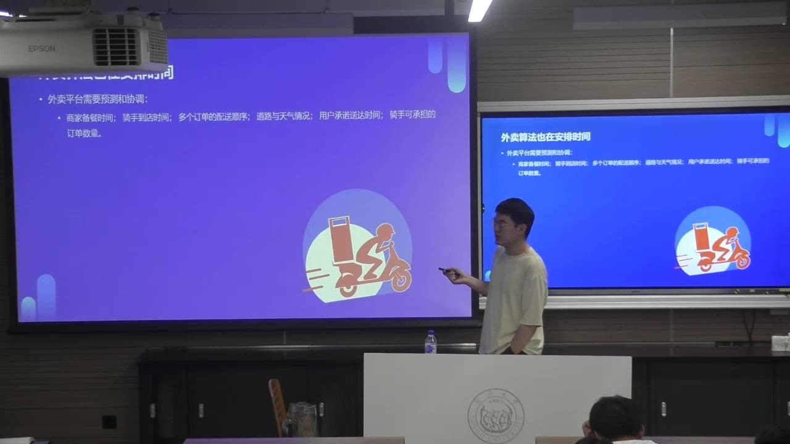
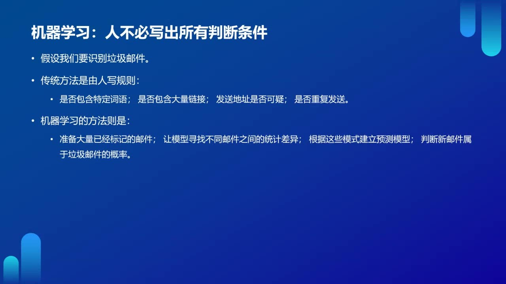
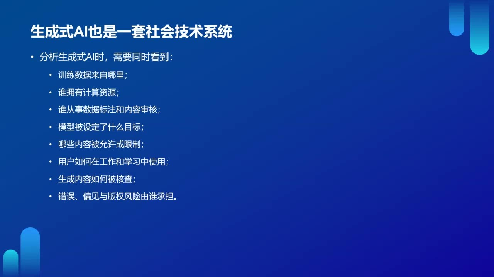
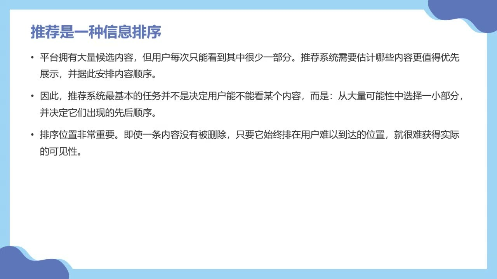
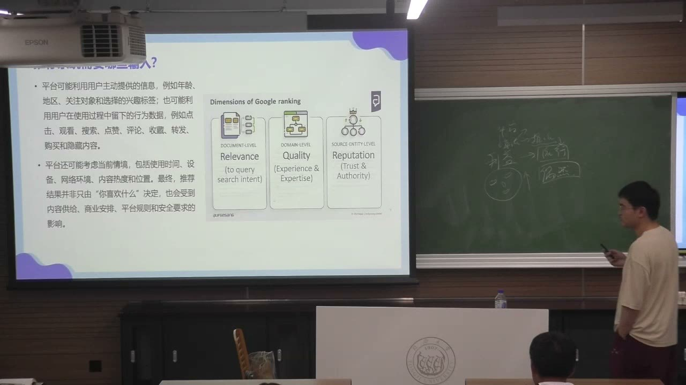
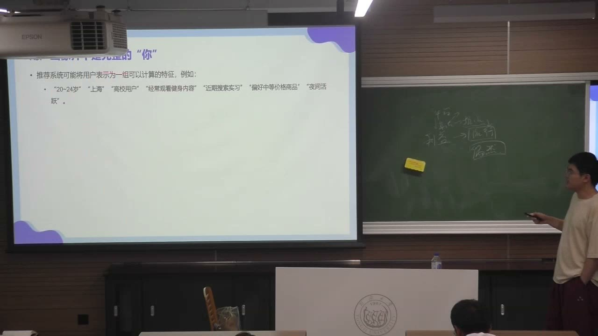
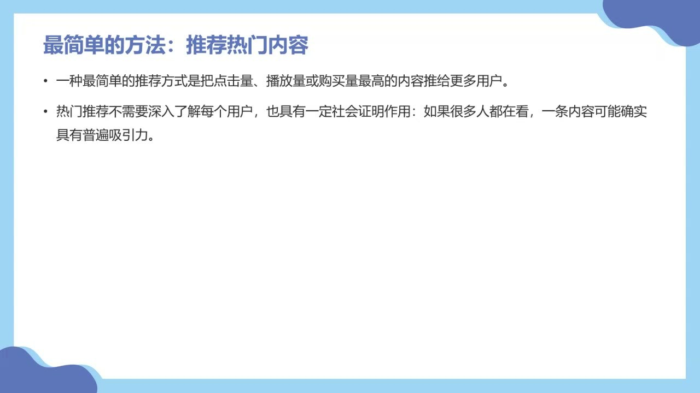
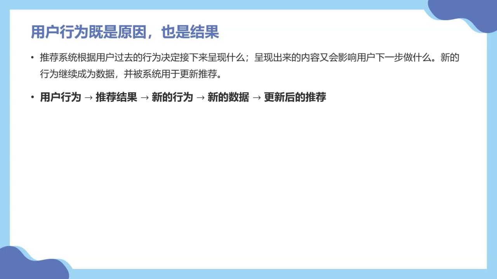
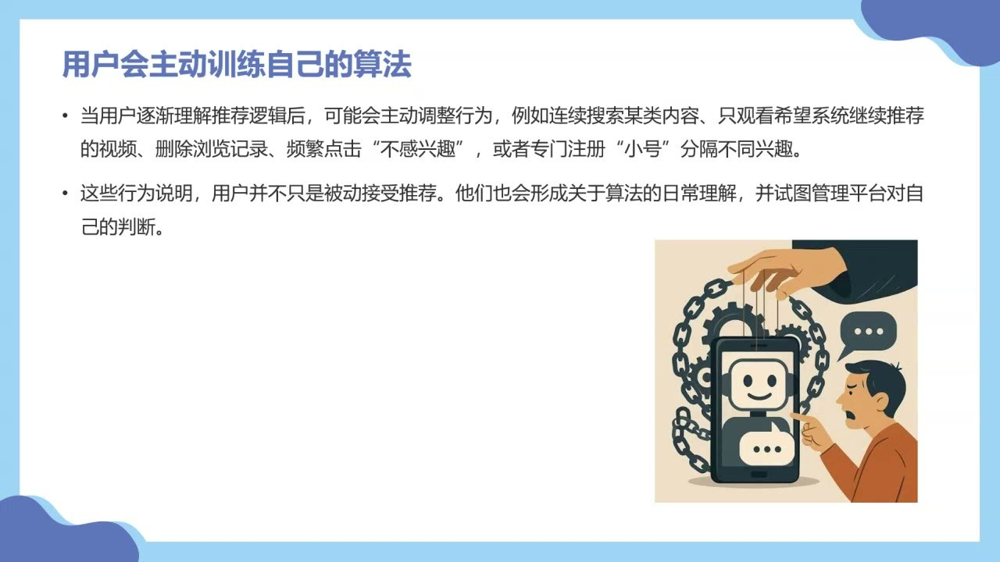

### 移动平台与劳动的实时协调

移动设备让数据收集进入日常生活；平台算法同时协调服务，也参与分配时间压力、机会与责任。

#### 智能手机让数据连续进入算法系统

本节接续算法史。算法从人工操作、组织计算走向互联网与移动平台，面对的数据和任务不断增多。手机、手环、手表等设备，让位置、活动和生活过程持续进入数据系统。

平台不仅传播内容，还通过支付、导航、打车、外卖等服务中介日常生活。算法不再只处理单一、相对稳定的问题，而要同时协调多种目标与持续变化的情境。

打车并不只等于找最近的车：还要考虑乘客位置与目的地、司机位置、道路情况、预计时间、接单意愿、供需关系、等待时间和价格。最近的车辆与最合适的匹配，并非必然一致。

#### 可视化的便利，同时分配时间压力

外卖平台让用户看到骑手在哪里、前面还有多少订单、预计何时送达。商家备餐、出餐、骑手到店与路线都被纳入调度，这确实提供了协调和可视化服务。

教师提醒：轻松的图标、吉祥物和界面背后，是紧迫的时间要求。算法看似在优化配送时间，也在重新分配时间压力；这种压力可能集中落到骑手身上。

红灯、火车道口等现实等待，不一定能被简单的距离与预计速度完整覆盖。教师介绍学者、行业与政策层面的研究和推动，讨论如何把真实等待纳入配送时间。这里保留的是课堂提出的劳动保障问题，而非断言所有平台采用同一种计时规则。

#### 名义上的灵活工作，为什么未必轻松？

教师通过日常访谈式经历讨论数字零工：网约车、外卖、搬家等劳动看似可以自由安排时间，却受到车辆租金、不断到来的订单、派单规则和收入目标约束。

一位司机需要先覆盖当天的车辆成本，才开始获得净收入；即使可以决定何时上线，也可能因成本而被迫长时间工作。平台的评分又影响后续订单，劳动者未必敢自由取消不合适的任务。

教师提及陈龙的**《数字疾驰》**和孙平的**《过渡劳动》**，作为理解平台劳动处境的阅读线索。课堂中的租金、抽成和收入数字来自具体聊天案例，不能把它们直接当成全部劳动者或平台的统一水平。

#### 派单与评级也是组织劳动的规则

平台分配订单、计算评分、设置全勤奖励和等级，使劳动过程进入可计算、可比较的体系。游戏化的等级称谓能让考核显得轻松，也可能遮蔽背后的劳动压力。

教师举一位司机希望通过打赏提高评分的经历，说明劳动者并非完全被动：他们会理解指标、尝试影响评分，与平台规则进行博弈。需要同时考察系统如何控制劳动，以及人如何在其中寻找策略。

劳动保障也是教师关心的问题。关于保险、五险一金等的讨论以具体劳动者经历和教师提出的疑问为限，本节没有给出覆盖所有平台的制度结论。

#### 用户与劳动者发生冲突时，平台在哪里？

配送方式、是否允许放在门口、退款和评分等规则，可能让用户与骑手直接冲突。教师以个人经历说明：规则由平台组织，纠纷却往往表现为两个面对面的人互相责备，平台在冲突中隐身。

抽成、匹配和评价不只是技术问题，还涉及收益、责任与风险怎样分配。一个调查即使宣称匿名，若反馈即时到达，也可能在具体场景中暴露评价者，形成新的紧张关系。

教师鼓励从行动者关系出发分析：平台、用户、劳动者、算法与规则分别做了什么？便利由谁获得，压力由谁承担，纠纷责任又被推给谁？

### 机器学习、指标与生成式AI

机器学习从数据中归纳模式；可测量的行为与指标有助于预测，但不能直接等同于人的社会意义和完整经验。

#### 平台算法形成持续的反馈循环

移动平台这一阶段可概括为：持续收集日常数据 → 实时预测 → 自动匹配和调度 → 用户反馈 → 模型持续调整。用户行为影响系统，系统的呈现又改变后续行为。

教师把持续调整作为理解算法黑箱的一条线索：系统不是写完代码后永远固定，运行中的数据、行为和模型变化，使结果难以只靠最初设计说明。这里不是说算法绝对无法研究，而是需要考察它实际运行的过程。

#### 机器学习不必手写所有判断条件

以垃圾邮件识别为例，传统方式可以手写判断条件，如是否包含大量链接、特定词语或可疑地址；机器学习则从大量已标注邮件中归纳差异，建立模型，预测新邮件属于某类的概率。

教师用猫的识别说明：模型可以发现像素组合与“猫”标签之间的统计关联，但这种识别不能直接等同于理解人为何养猫、猫的文化意义或一张照片为何令人觉得可爱。

**统计上能够识别，与社会意义上理解，是两个层次。**课堂以“表面逻辑”强调系统依赖可见行为和可计算模式，而人的动机与意义不一定完整进入数据。

#### 停留时间不一定等于真实喜欢

教师做饭时让视频自动播放，双手有水而没有划走；这会形成较长停留，却不一定表示喜欢。完整观看也可能出于震惊、忘记划走或暂时无法操作。

点击量、停留时间、完成率等容易测量和计算，因此被用来替代用户满意、兴趣等较难直接测量的目标。指标与目标可能相关，但不是同一个东西。

分析算法时，要追问指标在代表什么、哪些情况会误读，以及系统能容忍怎样的误差。看得久，不足以单独证明内容让人满意；购买一次，也不足以证明长期需要同类商品。

#### 生成式AI同样是一套社会技术系统

AI能力的变化依赖数据、能源、芯片、资本与人的劳动。技术使用又与既有习惯相连：不是所有人都立即欢迎新工具，教师介绍“技术焦虑”“技术倦怠”作为可继续了解的概念。

大语言模型根据上下文预测后续内容，能够生成有用的模式化表达，但这种能力不能直接等同于拥有人的经验。教师以科学家、护士图像中的性别刻板印象说明：技术输出也可能复现社会中的偏见。

应考察谁提供训练数据，谁拥有算力，谁做标注和审核，模型为谁的目标服务，哪些内容被允许或限制，用户如何使用和检验结果，以及错误与收益由谁承担。生成式AI由数据、模型、劳动、平台规则和用户实践共同构成。

### 推荐为什么是一种信息排序

同一平台的首页可以呈现不同世界；个性化推荐组织的是接触信息的机会、顺序与可见性。

#### 为什么你的首页只属于你？

同样打开一个平台，不同用户看到的内容可能完全不同。平台希望用户留下来，于是根据兴趣和行为组织个性化信息流。

**For You Page（个性化推荐页）**与关注页不同：关注页以主动关注的账号为依据；推荐页则可能反复呈现尚未关注的账号和内容，并随使用行为调整。

个性化既能反映原有差异，也可能进一步扩大差异。反复接触熟悉内容，会强化某些兴趣和判断；但不能因此直接推定所有人的信息环境都会同样封闭。

#### 流行文化也在推荐中形成

教师以奶龙、奶蛙等流行形象讨论：相关内容被推给可能感兴趣的人，获得点赞与进一步传播，偶然的内容也可能迅速扩大影响。

流行不是仅靠作品内部特点即可解释，还要观察推荐、传播、商业机会和用户参与。一次爆款的形成有偶然性；即使研究算法，也不能由此保证某类发布一定会火。

这里的重点是流行内容如何进入用户视野，以及小众文化怎样在平台机制中进入更大的传播范围。

#### 内容没有被删除，也可能几乎看不到

推荐系统面对大量候选内容，需要筛选一部分并排列先后。位置越靠前，用户实际接触的可能性通常越高；排序因此参与分配注意力和可见性。

一条内容即使仍存在于网络中，若被排到很后面，也可能很少被接触。分析信息环境时，不能只问内容是否被允许存在，还要问它是否有机会出现在人面前。

教师讨论取消个性化推荐的取舍：用户可能减少基于历史偏好的定制，却仍会看到被组织和排序的内容；也需要在大量信息中自行寻找兴趣。推荐标准与信息寻找成本，都值得考察。

#### 搜索与推荐从不同起点出发

<table><thead><tr><th>维度</th><th>搜索</th><th>推荐</th></tr></thead><tbody><tr><td>起点</td><td>用户明确提出关键词或问题</td><td>用户数据与使用情境</td></tr><tr><td>主动性</td><td>用户主动寻找信息</td><td>系统预测并主动呈现信息</td></tr><tr><td>需求表达</td><td>较明确的即时需求</td><td>未必说出的潜在兴趣</td></tr></tbody></table>搜索也需要排序，推荐也不是完全脱离用户行为。差别在于系统何时介入、依据什么启动内容选择，而不是一方有算法、另一方没有算法。

### 推荐的输入、方式与综合目标

平台把用户和内容转成可计算特征，推测互动概率；推荐还要兼顾质量、风险和平台自身目标。

#### 哪些记录能代表兴趣？

推荐输入包括注册时提供的资料、日常行为，以及内容和情境信息。教师借搜索排序说明相关性、质量、声誉、信任和权威等因素怎样参与结果组织。

**显性反馈**如点赞、评论、转发，是较主动留下的偏好信号；**隐性反馈**如停留、完成率、滑动速度、重播和访问顺序，数量多，却有较大的解释歧义。

平台无法直接读取人的内在兴趣，只能从记录推测。即使显性行为也需要情境解释；一次搜索或购买，不一定表示持续偏好。

#### 用户画像不是完整的你，内容也要数据化

画像可能包含年龄、地点、身份、兴趣标签与经常观看的类别。它是平台为预测建立的可操作模型，不是人的完整描述。

更准确的表述是：平台利用部分行为，对某些下一步动作作出概率性预测。内容同样被转成主题、关键词、类型等特征，形成另一类可计算对象。

推荐就在用户特征与内容特征之间预测互动。需要有相互关联的条件，内容才更可能进入用户的推荐结果；但这种匹配仍只是预测。

#### 三类入门推荐方式各有什么依据？

<table><thead><tr><th>方式</th><th>基本逻辑</th><th>课堂指出的局限</th></tr></thead><tbody><tr><td>热门推荐</td><td>把点击、播放或购买较多的内容推给更多人</td><td>热门也可能由人工推动；已有流量容易继续积累</td></tr><tr><td>基于内容</td><td>根据过去接触的内容特征，推荐相似内容</td><td>可能重复旧偏好，让用户厌倦或难见新内容</td></tr><tr><td>协同过滤</td><td>从相似用户或共同偏好的关系中推荐</td><td>相似性是系统归纳的关系，并非人的全部兴趣</td></tr></tbody></table>热门内容可产生社会证明：很多人看，会让内容显得值得看；更多互动又带来更多流量。教师也用过去实习经历说明，榜单不能一概当作自然流行的直接反映。

现实推荐通常混合多种方式，还考虑具体情境与组织目标，不能只套用其中一种入门逻辑。

#### 从候选生成到排序，推荐分数不等于喜欢程度

入门流程为：海量内容 → 生成候选 → 预测用户与内容的互动 → 综合排序 → 展示。系统会结合多种信号形成推荐分数，而不是只测量“喜欢多少”。

教师用概念式表达帮助理解：**推荐分数 ≈ 观看概率＋互动概率＋关系强度＋内容质量＋平台目标－风险因素。**这是课堂示意，不是任何具体平台公开的真实公式，符号也不意味着各因素只有等权相加。

风险可以涉及内容传播对平台带来的问题，也可能涉及用户不满和离开的可能性。教师着重讨论敏感内容和不良影响，说明收益、传播与风险会共同进入平台决策。

#### 熟悉与陌生之间：利用已有偏好，也探索新兴趣

只推荐熟悉内容，可能让用户厌倦；完全陌生，又可能失去用户的关注。系统需要在继续利用已知偏好与探索尚未表现的兴趣之间平衡。

新内容既是在试探用户，也可能创造新的兴趣。推荐因而同时面对短期留住用户、持续学习和扩大兴趣范围的问题。这种取舍还会受到平台目标和风险考虑影响。

### 推荐与用户的相互塑造

偏好在推荐过程中形成，用户也会调整自己的行为来影响系统；这种互动涉及分类、隐私与可见性的权力。

#### 推荐可能发现兴趣，也可能参与产生兴趣

兴趣并不总在推荐之前完整存在。用户先看到某种陌生食物、地点或流行符号，才可能了解、尝试并发展出偏好。平台展示的内容，扩展了可供判断和选择的范围。

因此，用户行为塑造推荐，推荐也塑造用户。很难用单一的先后因果判定某项兴趣到底完全来自个人，还是完全来自系统。

教师把流行符号联系到文化研究：抽象表达、鬼畜、火星文等可作为亚文化现象观察，思考它们怎样与主流表达形成抵抗、替代和补充。二创、粉丝研究也是理解文化产业与流行内容的重要线索。

对具体形象的分析，应继续追问为什么人感到开心、哪些联想参与意义形成，以及传播机制怎样放大它；不能仅由外形描述穷尽解释。

#### 用户行为既是原因，也是结果

**用户行为 → 推荐结果 → 新行为 → 新数据 → 更新后的推荐。**用户偏好不是一直位于系统外部的固定值，而可能在这个循环中形成和改变。

一次偶然的点击、观看或转发，可能被系统解释成稳定兴趣，留下较长的后续影响。“我只看过一次，为什么一直推？”反映了系统从有限行为推断长期偏好的困难。

偶然行为与长期兴趣需要区分；系统记录越多，也不意味着每条记录都能得到正确解释。

#### 用户会主动训练或“驯化”算法

用户不是只接受系统给来的内容，也会用选择性观看、删除记录、点击“不感兴趣”、表达负面反馈、注册不同账号等方式调整推荐。教师把这种日常管理称为训练、操纵或“驯化”算法。

它还与数字素养有关：知道某个功能在哪里、理解信号如何留下，才能更有意识地使用。相同功能对不同用户，并不必然具有同样的可达性。

教师也说明，分享内容给朋友可能影响朋友接触到的内容和后续推荐。人的社交行为会成为系统的新输入，管理推荐并非只发生在单独的账号内部。

#### 首页也可能成为隐私的一部分

个性化首页可能突然呈现用户不希望别人知道的兴趣。因此，手机屏幕与推荐内容，也可能成为隐私边界的一部分。

隐私边界区分愿意公开和希望保留的信息。用户可以调整在什么地点、时间打开哪个平台，改变与算法遭遇的情境，而不只是修改内容偏好。

教师据此说明对系统的日常管理包含时间和空间：在公开场合避免打开某个首页，也是安排自身与推荐系统关系的一种实践。

#### 推荐之外，AI智能体也体现对工具的调整

教师以新闻写作举例：可以给工具提供范例和评价反馈，反复调整输出，形成帮助特定任务的智能体（agent）。实时新闻、预先准备不同结果的稿件、借助AI快速生成内容，被用来讨论新闻生产方式的变化。

工具提高速度，也让核实、谣言与可靠性问题更突出。教师鼓励尝试可操作的AI功能，说明不会编程也可能利用现有工具完成任务；这里的调整不应直接等同于所有场景下重新训练底层模型。

回到推荐问题，教师强调其中存在**分类权力**：系统决定怎样归类用户、推测未来和赋予暂时的算法身份；用户也在争取“我究竟要看什么”的控制空间。

### 信息茧房：范围变窄与共同讨论

本节结尾刚进入信息茧房。判断重点是信息来源与观点范围，而不只是每天接触的数量。

#### 信息很多，仍可能生活在狭窄范围里

本节结尾，教师强调信息茧房中的主动选择：人也会把喜欢的内容和行为信号不断喂给系统，参与构造舒适、高效、熟悉的信息环境，不能把全部原因都归给机器。

一个人每天看很多内容，仍可能集中在少数来源和主题。判断是否存在茧房，应考察来源多样性、观点差异，以及接触陌生议题的机会，而不是只统计内容数量。

这与此前的反馈循环相连：个人选择、系统预测和重复接触共同组织了信息范围。

#### 个人定制的信息，怎样影响公共讨论？

教师引入桑斯坦关于个性化信息的讨论：如果人完全按个人偏好定制内容，可能减少与不同观点、公共议题和陌生人相关信息的偶然相遇。

“Daily Me”可理解为只按个人兴趣生成的日报，听起来高效，却可能让不同成员失去共享的事实与讨论空间。核心问题是：是否需要一些并非出自个人主动选择、但具有公共价值的信息接触？

信息茧房、过滤气泡与回声室效应之间的区别，以及实证研究是否支持用户越来越封闭，本节仅提出问题，完整讨论留待后续课程。

### 概念对照与自测

| 概念对照 | 前者关注什么 | 后者关注什么 |
| --- | --- | --- |
| 行为／兴趣 | 可被记录的点击、停留、购买 | 行为背后的动机和持续偏好 |
| 画像／完整的人 | 用于预测的可计算特征 | 经验、情境与难以量化的意义 |
| 搜索／推荐 | 明确问题和主动寻找 | 根据数据预判并安排接触 |
| 发现／塑造兴趣 | 回应已表现的偏好 | 新接触与重复呈现改变偏好 |
| 信息数量／信息范围 | 看了多少条内容 | 来源、观点和主题是否多样 |

#### 为什么平台算法不仅是一个技术工具？

它协调派单和服务，也组织时间压力、评分、收益和责任分配；需同时考察平台、劳动者、用户与制度关系。

#### 观看完成率高，能直接说明满意度高吗？

不能。可能出于喜欢，也可能出于震惊、自动播放或不能及时操作；行为是需要解释的代理指标。

#### 内容存在于网络，为什么仍可能没有可见性？

排序决定它是否出现在易接触的位置；没有被删除，不等于人实际有机会看到。

#### 推荐为什么需要在熟悉与陌生之间平衡？

熟悉内容帮助满足已有偏好，陌生内容帮助探索和避免厌倦；两者需在组织目标和风险考虑下协调。

#### 用户怎样参与塑造自己的信息环境？

通过观看、反馈、分享和调整使用场景影响推荐；也可以主动寻找不同来源，考察内容范围是否变窄。

#### 本节是否已证明算法一定导致封闭？

没有。本节提出反映与扩大差异、个人主动选择与公共讨论的问题；完整概念区别和实证证据尚待后续。

### 来源范围

原始转写含课堂互动，正文只整理教师讲授、解释、回应与课程任务。时间范围为两分钟音频分段边界，不是逐句对齐时间。
