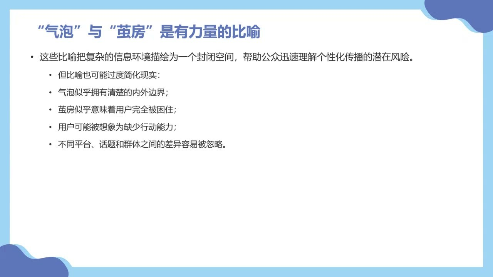
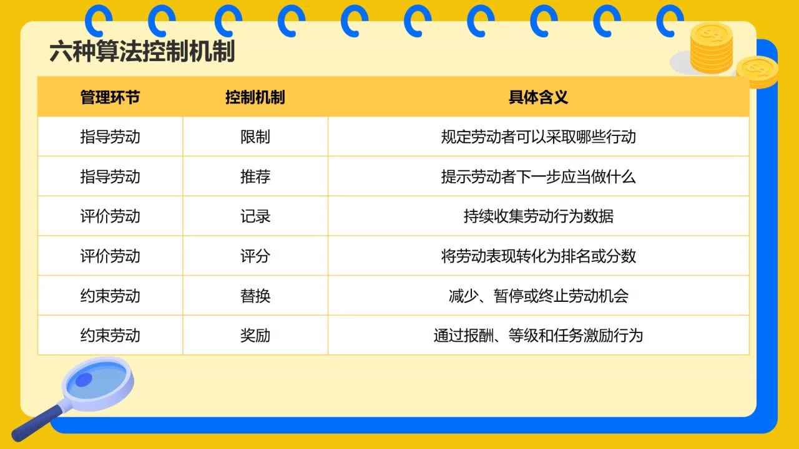

### 一、四个相近概念，各自强调什么

信息封闭不能只归因于机器，也涉及人的偏好、行为与交往环境。

#### 信息茧房、过滤气泡、回声室与选择性接触
<!-- source: 2 -->
本课区分四个侧重点：信息茧房强调个体选择；过滤气泡强调算法筛选；回声室强调同质化社群中观点的反复确认；选择性接触强调人倾向于接近自己喜欢、赞同的信息，回避令人不适或挑战自身判断的信息。

用户点赞、停留、反复观看留下信号，系统再据此推荐类似内容，二者形成反馈。课堂将回声室解释为这种人和系统共同作用下可能出现的结果，但没有把所有人的信息环境都认定为完全封闭。

#### 有力量的比喻，也可能把现实讲得太简单
<!-- source: 8 -->
“茧房”“气泡”“回声室”都让人联想到边界和阻碍，有助于理解风险，却也可能让人误以为边界清晰、用户没有行动能力、不同平台和群体的情况都一样。

“打破”“戳破”“突破”等表达，往往已经预设封闭必然有害。教师要求先检视这一自然化的预设：选择相似信息有时也能维持舒适、安全的环境，不能只凭比喻就决定应当怎样干预。

### 二、从是否封闭，转向谁在什么条件下受到影响

信息来源、接触内容、理解方式和态度后果，是需要分别考察的层次。

#### 点击记录不等于知道用户怎样理解
<!-- source: 12 -->
社会研究可以记录用户点击什么，却不因此自动知道他们怎样理解内容。主动搜索、亲友分享、学校教育和传统媒体，也影响信息获取。访谈等方法可以补充行为记录没有呈现的经验和判断。

教师据课堂引用的研究提醒：信息多样性有来源、主体、观点、形式、社会位置等不同维度，多用几个平台不一定就接触更多不同观点；排序改变也不必然在短期内改变长期形成的态度。具体研究的结论有条件，不能一概扩展到所有平台和人群。

#### 保护性气泡：信息多样性之外，还有身份差异
<!-- source: 18 -->
教师介绍自己的访谈研究：对受到污名或攻击的群体，算法边界也可能被体验为保护。对外，边界减少不期而至的攻击；对内，推荐又能帮助有相近经验的人彼此识别、进入社群。课堂将这种体验称为“保护性的气泡”。

因此，并不是所有人都希望自己发布的内容被所有不同人群看到。只追求信息多样性，可能忽略身份多样性和安全需要。研究应问：哪些人，在什么平台、什么议题和条件下，更容易形成封闭；他们怎样理解这一环境，是否知道筛选发生，是否还有接触其他观点的实际通道。

#### 改善推荐不等于强塞反方观点
<!-- source: 24 -->
舒适空间与认知封闭不能只靠一个标签区分，需要具体调查。增加多样性也不等于随机插入令人反感的内容，或让用户不断面对冲突。教师提出同一议题不同解释、搜索入口和自主调整兴趣标签等方向。

平台优化目标不应只有点击率，还可考虑主题多样性、新内容与创作者机会。让用户更直接地管理兴趣，而不是只能靠反复点击、取消或留下行为痕迹间接“训练”系统，是本课提出的一条改善思路。课堂也提及相关治理规定，但此处记录的是课程方向，不作具体条文适用判断。

### 三、当日常管理变成一个 App

算法管理不只发生在外卖和网约车平台，许多职业的任务与评价都被系统中介。

#### 任务、时间、路线、报酬和评价连成管理过程
<!-- source: 32 -->
骑手上线后，系统可结合骑手位置、商家位置、顾客地址、预计备餐时间、道路及其他骑手状态匹配订单，规划配送顺序、估计送达时间、计算报酬。顾客评价也会进入后续计算。日常指令来自界面，不意味着管理关系因此消失。

仓储物流、客服、办公室考勤、数据标注和高校考核等例子，显示共同变化：管理活动逐步转为数据收集、指标计算、任务匹配与自动反馈。教师以自己的“教师画像”和考核经历说明，教学、科研和评价数据也能被系统汇总并用于比较。

#### 劳动管理要把潜在能力转为实际劳动
<!-- source: 40 -->
组织需要解决谁完成任务、怎样分配、以什么速度进行、如何判断质量和计算报酬等问题。劳动管理的核心，是把组织目标转成劳动者可以执行的具体行动。

购买一定时间的劳动能力，不等于自动得到期望的劳动结果。培训、监督、考核、奖惩等制度因此进入劳动过程。劳动过程理论关注管理者怎样取得过程控制，也关注劳动者怎样保留自主性；组织与劳动者的利益可能一致，也可能有差别。

### 四、从传统控制到数字泰勒主义

算法延续已有管理逻辑，又改变记录、计算和反馈的速度与规模。

#### 直接控制、技术控制与官僚控制
<!-- source: 50 -->
直接控制依靠现场指令和监督；技术控制把节奏写进机器、流程和技术系统；官僚控制通过职位、晋升、制度和绩效评价影响行动。现实中常是多种方式共同运行。

控制也不总以“领导正在逼我”的形式出现。晋升目标和绩效规则可以被个人内化为主动追赶的目标，使劳动者自愿延长投入。这使“自己愿意做”与“受到制度塑造”能够同时存在。

#### 测量、分解、标准化与优化
<!-- source: 52 -->
本课用泰勒主义说明：复杂工作被拆成可测量的小动作，管理者观察每步所需时间，制定标准，再按标准组织执行。课堂将流水线作为理解这种分解与标准化思路的典型例子。

关键并不只是“效率更高”。劳动者积累的经验被转化为管理知识，再以新标准返回来约束劳动者。若有人更快完成某段路线，新的时间要求可能据此调整；单个劳动者突破旧标准，也可能抬高其他人的要求。

#### 算法带来连续记录与实时调整
<!-- source: 56 -->
传统时间研究需要管理者在场观察，算法管理则可持续记录位置、速度、完成时间、接受率和评分，并动态更新任务、标准与界面。课堂将其理解为数字泰勒主义的延伸。

算法管理是组织利用数字数据、计算模型及自动或半自动程序，进行任务分配、过程监督、绩效评价、报酬计算和奖惩管理。它不是“没有管理者”，而是管理经由数据和系统界面发挥作用。

### 五、六种算法控制机制如何形成循环

劳动者完成工作，同时生产关于自身表现的数据；数据又影响下一轮任务和机会。

#### 限制：不是不想选，而是界面不允许
<!-- source: 60 -->
骑手到达商家附近才能点击“已到店”，拣货人员须按终端顺序操作，都是把限制写进权限与流程。劳动者面对的不只是愿不愿遵守规则，而是系统是否允许采取另一行动。

限制因此可以不表现为一句明确命令，而是直接界定可行动的范围。理解系统权力，需要观察按钮、状态、可用选项和必要步骤，而不仅是看规则说明的语气。

#### 推荐：表面建议，实际代价决定强制程度
<!-- source: 64 -->
推荐路线、下一处拣货点、需求集中的区域，看起来都是建议。判断是否具有强制性，要看拒绝后会发生什么：是否减少收入、影响评分、带来超时认定或其他不确定后果。

劳动者也可能用本地经验选择更快的小路，但新的实践又可能被记录并转成更严格的标准。课堂借地图与出行实践说明用户活动和数据生产的联系；具体平台怎样实现算法，需要另外核实，不能把举例当作完整技术说明。

#### 记录与评分：复杂情境被压缩成指标
<!-- source: 70 -->
上线时间、路线、接受率、速度、顾客评分等，成为可自动汇总的劳动数据。系统可以同时观察大量分散的劳动者，这不同于一个主管逐个在场监督。

评分把复杂劳动转为排名或分数，却可能漏掉经验、情绪、等待和突发条件。雨天、保安不让进入、电梯久等，最后都可能只留下“订单未按时完成”。因此，评分不仅是在评价劳动者，也体现平台怎样简化劳动情境。

#### 奖励与替换：用机会的出现和消失约束行动
<!-- source: 74 -->
完成若干单即可获得补贴，能把组织目标变成劳动者主动追赶的短期目标。已经投入时间、接近门槛时，退出的吸引力下降；看似自主的追赶，可能延长工作时间并提高劳动强度。

“替换”则包括减少、暂停或终止劳动机会。订单变少未必显示为明确处罚，劳动者可能难以区分市场变化与系统惩罚，也难以拿到申诉证据。六种机制彼此连接，形成分配、执行、记录、评价、奖惩、再次分配的循环。

### 六、组织为何欢迎算法，责任又去了哪里

协调效率、统一执行与隐蔽控制可能并存，不能只看其中一个方面。

#### 责任空洞与冲突转移
<!-- source: 80 -->
教师用“责任空洞”概括一种追责困难：老板说是系统评分，开发者说系统会自行学习，运营者说自己只保证运行，劳动者却无法让“系统”承担具体责任。组织和人的作用并未消失，但责任链变得不易识别。

在这种情况下，实际可接触的往往只剩劳动者与顾客，等待、超时和服务冲突便可能在双方之间爆发。分析系统不能只描述界面，还要追问规则由谁制定、谁有修改权、谁解释决定、谁提供可行的申诉。

#### 统一执行不等于规则合理
<!-- source: 84 -->
算法能够远程协调大量分散劳动者，减少部分主管偏好、人情和临时情绪造成的差异，并保留记录。这是它被组织采用的重要原因。

但一致的规则可能本身就有问题。稳定执行既能减少随意性，也能把不合理判断更大规模地应用于劳动者。效率、一致性与公平不是同一个指标，不能因计算自动运行，就把评价标准看成天然中立。

#### 预测需求与调配资源，也会改变休息和等待
<!-- source: 88 -->
组织可结合订单、客流、天气和既有安排，预先调配车辆、骑手、仓储人员和客服，或以奖励吸引劳动者上线。课堂以机场地勤受天气影响、促销引发订单积压等情境，解释预测与劳动安排的联系。

从组织角度，这是减少等待和资源闲置；从劳动者角度，却可能意味着休假被打断、临时上线或在积压订单前持续等待。判断管理系统，要把效率收益和由谁承担不确定性一起纳入，而不是只问组织是否节省了劳动力。

### 概念对照与自测

| 概念 | 强调什么 | 不应直接推出什么 |
|---|---|---|
| 信息茧房 | 个体选择参与形成的信息环境 | 全部原因都在算法 |
| 过滤气泡 | 算法筛选和个性化分发 | 所有人都同等受害 |
| 回声室 | 同质社群中的观点确认 | 多塞反方信息就能解决 |
| 选择性接触 | 人接近相符信息的倾向 | 它只在算法时代出现 |
| 算法管理 | 数据、模型与自动化程序介入管理 | 系统背后没有管理者 |
| 标准化执行 | 一致应用某种规则 | 规则必然公平合理 |

#### 为什么不能只问“信息茧房到底存不存在”？
不同身份、平台、议题和条件可能产生不同经验。应进一步调查谁受到怎样的影响，是否有选择和安全需要。

#### 系统把路线写成“建议”，就一定是自由选择吗？
不一定。要看拒绝后收入、评分、时间认定和劳动机会的变化，不能只看界面用词。

#### 为什么更快完成任务可能反而形成新的压力？
劳动者的经验可能被系统记录、汲取并改写成更高标准，再返回来约束自己与其他劳动者。

### 课程时间线

00:00—08:00：四个概念的侧重及人、技术的反馈。
08:00—12:00：比喻的解释力与信息封闭必然有害的预设。
12:00—18:00：多样性、态度后果与条件性的研究问题。
18:00—24:00：教师介绍保护性气泡研究与身份差异。
24:00—30:00：推荐目标、兴趣标签与用户选择入口。
30:00—40:00：转入算法与劳动，比较多类职业的系统管理。
40:00—46:00：劳动管理、能力与实际劳动、劳动过程理论。
46:00—50:00：课间交流；不编入正式知识正文。
50:00—58:00：控制方式、泰勒主义、经验汲取与标准化。
58:00—64:00：算法管理循环、六种机制与限制。
64:00—70:00：推荐、拒绝代价与行动数据。
70:00—74:00：记录、评分及劳动情境的压缩。
74:00—80:00：奖励门槛、机会消失与处罚的不透明。
80:00—88:00：责任空洞、规模协调与统一规则的限度。
88:00—94:52：预测需求、资源调配及劳动者承担的不确定性。
