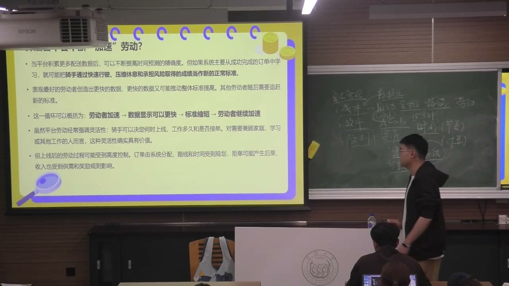
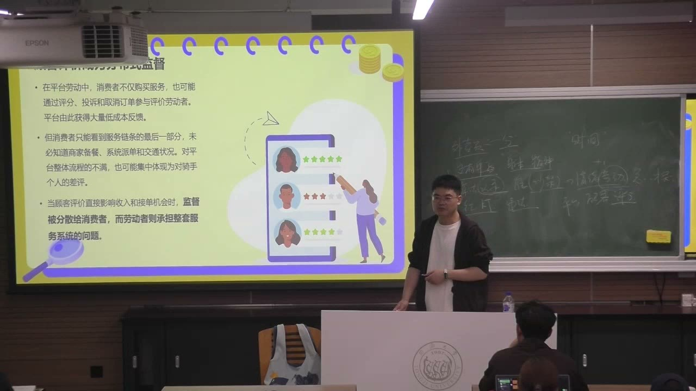
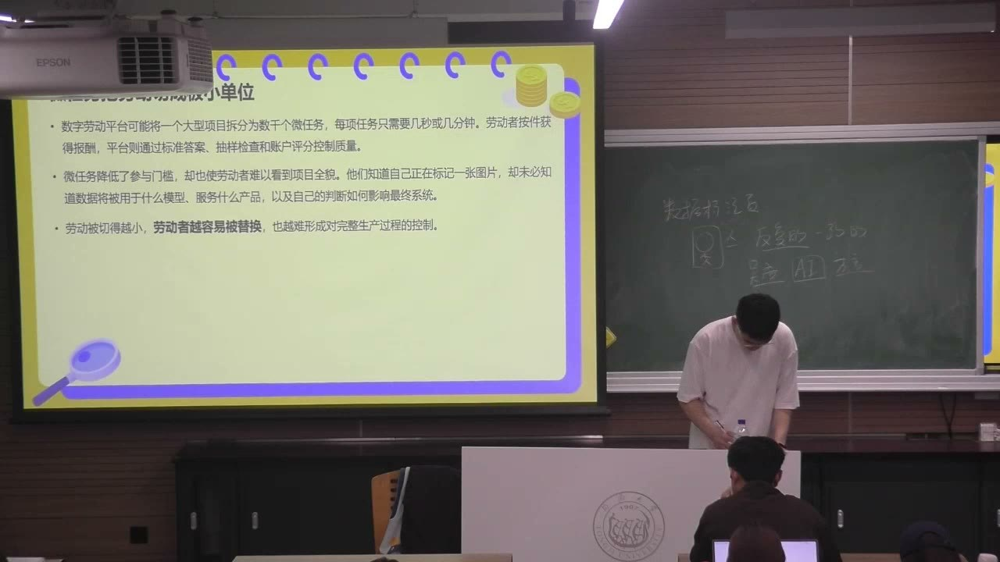
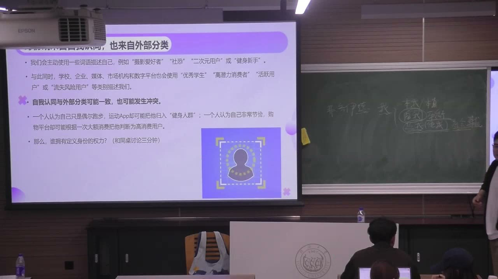
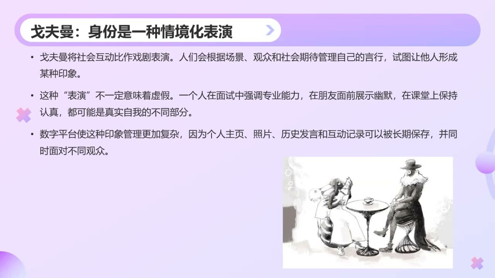
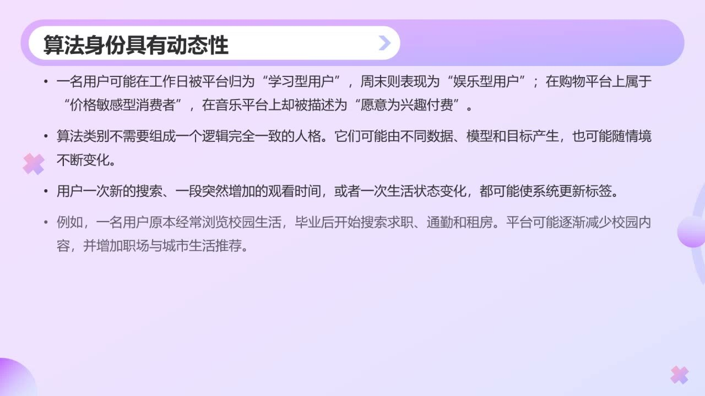

### 课程安排与任务
#### 解释算法黑箱，比较不同版本的“我”
<!-- source: 54 -->
教师特别希望大家能够解释算法为什么是一个黑箱：不只是因为没有公开，也涉及专业知识门槛、不断更新以及商业保密等条件。理解这些原因，才能进一步判断“公开了算法”是否就意味着普通使用者可以理解它。

身份部分的课内思考是比较三个版本：自己认为的自己、熟悉自己的朋友眼中的自己、最常使用的平台推断出的自己。比较时，要说明各方凭什么信息作判断，不只列出三个标签。本节没有明确布置新的提交作业或截止日期。

#### 推荐阅读与后续思考
<!-- source: 56 -->
老师推荐对劳动问题感兴趣的同学阅读《狗屁工作》（Bullshit Jobs），并在讲媒介选择时提到《我该选择哪种媒介说分手》作为阅读线索。后者用于帮助理解：同一件事为什么会通过不同媒介处理，以及这种选择包含怎样的关系、情感与道德考虑。

本课从算法与劳动转入算法与身份，核心联系是：系统选择哪些行为作为数据，又怎样用这些数据决定如何对待一个人。新的行为与情境，还会继续改变系统的判断。

### 算法怎样组织劳动的时间
从组织管理的视角看，算法能降低管理成本、提高调度效率；从劳动者的视角看，同一套安排也会改变劳动节奏、选择空间和风险承担。

#### 自动监测、数据化与预测调度
<!-- source: 0 -->
教师承接上节内容，说明组织采用算法管理的重要动机是降本增效。持续、自动的记录可以减少依靠多个主管现场巡查的成本，也使劳动过程成为可以储存、比较和调用的数据。

预测又把管理推向行动之前：系统根据预期需求提前调度人员与资源。这里不能只看技术是否计算得快，还要继续问它以什么目标配置资源、由谁承担预测和调度失误的后果。

#### 订单中央的人，不一定掌握全部信息
<!-- source: 4 -->
外卖骑手连接平台、商家与顾客，却未必知道决定订单节奏的全部信息。系统计算时间、安排路线并提供所谓“最优”方案；骑手即使在形式上可以拒绝，也可能受到派单、评分和收入机制的约束。

因此，时间不只是一项预测结果，也可能变成劳动必须遵守的标准。所谓“最优”要追问是对谁、按什么目标最优，不能直接等同于劳动者有充分自主权。

#### 加速数据可能反过来抬高标准
<!-- source: 8 -->
课堂把一种循环概括为：劳动者加速，数据显示可以更快，标准缩短，劳动者继续加速。如果系统主要从成功完成的订单学习，就可能把压缩休息、赶路或承担风险后实现的表现当成正常基准。

老师用从十五分钟缩短到十分钟作假设说明，并明确说无法得知平台后台究竟怎样计算。这个例子解释的是可能的反馈机制，不是对某平台具体算法的实测结论，也不能写成“只要一个人更快，平台就一定修改全部标准”。

#### 能决定何时上线，不等于掌握整个劳动过程
<!-- source: 10 -->
平台劳动的灵活性可能体现在上线时间、工作量或是否接单的选择上，这种弹性对某些劳动者确有价值。但上线以后，路线、时间、任务和奖惩仍可能高度受控；收入需要与奖励门槛也会影响劳动者究竟能怎样安排时间。

分析时应区分“进入劳动的时间选择”和“劳动过程中的控制”。不能因为前者存在，就否认后者的限制；也不能只用“灵活就业”四个字概括劳动者的全部处境。

### 被记录的绩效与实际劳动之间有什么差距
系统能够记录某些行为，不意味着已经测量全部劳动。等待、沟通、判断和情绪管理，可能正是服务得以完成的必要条件。

#### 等待不必然等于休息
<!-- source: 12 -->
老师区分了等待订单、等待商家出餐等情形。没有正在配送，不代表劳动者可以完全脱离工作：需要随时准备接单，也可能承受无单的焦虑；配送中等出餐，则更直接嵌在完成服务的过程中。

如果只把接单到送达、尤其是移动中的时间计入劳动，大量准备、等待和恢复就可能消失。课堂进一步用催餐、解释、协调与情绪管理说明，完成订单还依靠难以被计量的付出。老师把其中的情绪投入称为情绪劳动，重点在于它没有自动变成收入或绩效记录。

#### 顾客评价把监督分散给消费者
<!-- source: 16 -->
顾客通过评分、投诉和取消订单等行为，进入平台的管理过程。反馈若影响劳动者的收入和接单机会，顾客就不只在消费，也承担了一部分监督功能。

问题是，顾客通常只看见服务链条的末端，未必知道商家备餐、系统派单和交通等条件。对整体服务的不满，可能集中表现为对最后接触的劳动者的差评。教师用这一点解释，平台、商家与系统的问题为什么可能转化为顾客和劳动者之间的直接冲突，而不把任何一方的单次经历当成所有情况的完整说明。

#### 访谈呈现不能给受访者带来额外伤害
<!-- source: 22 -->
播放骑手访谈时，老师特别提醒研究伦理：涉及可能使受访者受到追责或伤害的画面，应考虑遮挡身份等保护方式。能否取得一个有冲击力的素材，不是唯一标准，还要考虑受访者是否会因为接受采访而承担新的风险。

#### 办公室绩效也会遗漏难以量化的工作
<!-- source: 28 -->
教师用教学科研管理中的数据记录举例：系统容易展示论文、项目、成果数量，会议组织、协调、新闻写作等服务工作却未必进入同样显眼的评价指标。没有出现在图表里，不代表没有做，也不代表没有价值。

如果考核只奖励可测量部分，劳动者就更容易把精力投向被计分的工作。这里的机制不是某类人天然愿不愿意付出，而是制度把哪些工作看见、比较和奖励，又把哪些工作放在了边缘。

#### 数字痕迹可能催生表演性劳动
<!-- source: 32 -->
远程办公中的在线时长、状态和活动记录，可能被用来判断投入。但在线不必然等于正在工作，离线也不必然等于没有工作。若可见痕迹成为主要标准，人就可能努力让自己“看起来在工作”，而不是改善实际产出。

人工介入也不自动消除偏差。管理者可能时间有限、信息不足，或者过度信任系统，仍只接受已被记录的数据。教师要求追问的是：人在什么阶段、什么情境下介入，是否掌握了足够信息，能否修正系统没有看见的部分。

### 自动化背后的劳动者
界面显示“自动完成”，并不表示过程已经没有人。新的技术能力也可能依靠大量被拆细、被隐藏的人工劳动。

#### 数据标注把复杂过程分成微任务
<!-- source: 36 -->
数据标注员为模型训练或系统识别提供判断，例如在图像中标出人物与物体、区分类别，或处理特定语言和声音内容。课堂强调它可能具有重复、耗时和枯燥的一面，不能只从最终AI产品的流畅表现理解背后的工作。

当大项目被切分为许多小任务，劳动者可能只知道自己正在处理某个片段，却看不到完整模型、产品及其用途。老师联系泰勒主义解释：劳动经验被转化为标准，再用于组织和约束劳动；任务越碎，岗位越容易被替换，也越难由劳动者控制完整生产过程。

#### 内容审核是判断劳动，人机共同参与
<!-- source: 42 -->
内容审核需要判断材料能否通过，也可能与创作者发生争议。用户看到的结果，却未必能分辨来自人工判断、机器判断，还是二者结合。

教师由此说明，人和机器已经共同参与生产与管理过程，可以理解为一种集合或组合（assemblage）。越是宣称自动运行的平台，越需要继续追问界面背后谁在做标注、审核、维护和纠错，而不是根据“自动化”的名称推断人已经退出。

### 从替代焦虑转向工作重组与规则治理
“机器会不会替代人”只是问题之一。更具体的问题是：哪些任务转给机器，哪些任务留给人，工作如何重新分配、定义和控制。

#### 人机协作不只是少掉几个岗位
<!-- source: 50 -->
老师讨论规范性、重复性任务可能被系统接手，同时强调应关注任务之间的重新组合，以及人怎样使用工具改善工作。课堂以“人机互生”强调互动和共同变化，而不是把人与机器看成两个永远不变、彼此分离的部分。

这也意味着，不能只比较采用工具前后的总效率，还要看新任务、责任、技能要求与控制关系如何分配。技术让某一环节更轻松，并不自动说明整个劳动过程更加自主。

#### 算法同时也是影响劳动的规则
<!-- source: 52 -->
课堂展示2024年《新就业形态劳动者劳动规则公示指引》，用来说明订单分配、报酬、工作时间、休息、奖惩与算法运行机制等，并不只是平台内部的技术细节，也涉及劳动者可以知晓、讨论与反馈的劳动规则。

老师借此强调，改善不能只要求算法更准确、更高效，还需要考虑透明、权益与规则制定过程。本课材料用于理解这一治理方向，不等于已经逐项检验任何平台的现行执行情况。

#### 公开算法仍可能面对黑箱
<!-- source: 54 -->
算法黑箱至少有几种不同来源：商业保密限制外部获得信息；专业知识门槛限制理解；系统持续更新，使已有认识可能很快落后。公开某些说明，只处理了其中的一部分问题。

因此评价透明度时，不能只问“有没有发布说明”，还要问说明是否可理解、可使用、可追踪更新，是否足以帮助受影响的人理解决定。课堂最后把这点接回劳动控制：算法不只是工具，它会直接影响劳动时间、机会和评价。

### 身份不是一个固定标签，媒介选择也参与其中
算法与劳动讨论的是系统怎样安排人做事，身份部分进一步追问系统怎样描述人，以及这种描述怎样影响后续行动。

#### 平台根据目的、行为和模型形成不同画像
<!-- source: 58 -->
同一个人在不同平台上可能被描述成不同的人。用户使用平台的目的不同，留下的点击、购买、观看和互动也不同；平台的模型与业务目标又不相同，所以它们得到的画像不必一致。

这里的差异不直接证明某个平台“看错了完整的人”。平台本来就只接触到部分行为，并按照特定目标作推断。对比自己、朋友和平台眼中的自己，有助于看见各自的信息来源与判断边界。

#### Polymedia：媒介选择包含关系、情感与道德考虑
<!-- source: 62 -->
老师把multimedia与polymedia作对照：前者在本课中强调媒介形式的多样，后者把多种媒介放进可供选择的关系环境，关注一个人为什么在同一件事上选择某种媒介。

课堂用表达分手的不同方式举例，说明当面、电话、信件或信息等选择，可能涉及是否愿意面对对方、如何处理冲突、希望维持何种关系，以及怎样理解责任。这个例子的作用是分析选择背后的意义，不是规定某一种媒介在所有情境下都更有道德，也不能只凭用了哪个App就判定一个人的感情。

#### 自我认同与外部分类可能相互冲突
<!-- source: 68 -->
身份回答“我是谁”以及“我与他人是什么关系”，包含个人理解，也包含情境中的角色和社会位置。年龄、性别、地域、兴趣等都可能成为维度；一个人不是只有一张固定的标签。

自我认同不自动取消外部分类。学校、企业、他人和数字平台都可能用不同标签描述一个人，且这些分类有时影响评价和机会。教师提出“谁拥有定义身份的权力”，关注的是分类能否产生实际后果，而不只是每个人都可以发表看法。

#### 课堂以弗洛伊德作引入，再回到角色与情境
<!-- source: 72 -->
老师用本我、自我、超我作简化说明：原初欲望、外部或社会期待，以及二者之间的调节，可以帮助进入“我”的复杂性。这里是课堂的引入性类比，并未系统讲授精神分析，也不应把人格结构与平台身份当成一一对应的模型。

课程随后回到个人身份、角色身份与社会身份：在教室、宿舍、工作或其他关系中，首要角色会变化。理解身份时，需要同时考察自我理解、他人分类和当前情境，不能只寻找一个永远不变的“真正标签”。

### 戈夫曼：身份是一种情境化表演
自我呈现的分析，不是揭穿别人都在作假，而是理解人怎样面向不同观众组织言行、管理印象。

#### 演员、观众、舞台与前台后台
<!-- source: 82 -->
教师介绍戈夫曼《日常生活中的自我呈现》与拟剧论，把社会互动类比为表演。人面对不同观众，在不同场景中展现不同言行；舞台上有前台，也有准备、排练或不同互动方式所在的后台。

老师以上课与备课说明：课堂上的讲述、语气和组织方式面向学生，备课和排练则支撑前台呈现。表演不必然是虚假，认真上课、面向朋友展示幽默，都可能是真实自我的不同部分。前台与后台说明情境组织，不能简单等同于“假的我／真的我”。

#### 平台接触的是经过情境组织的行为
<!-- source: 86 -->
把拟剧论带回平台，用户可以被理解为演员，平台是舞台，系统及其他使用者可能成为观众。平台接触到的是用户在特定场景中展示的行为，并不能由此看到人的全部经历、动机与后台活动。

数字记录又使印象管理更复杂：主页、照片、历史发言和互动可以长期保存，也可能同时面对不同观众。原来为一种场景准备的呈现，可能被带到另一种判断中使用。因此，行为数据再丰富，也不自动成为完整的人格档案。

### 算法身份：面向预测的、部分而动态的分类
平台关心身份，往往是为了决定下一步向谁展示什么、预测谁会行动，而不是回答哲学意义上的“你究竟是谁”。

#### 主动声明与行为痕迹是两类来源
<!-- source: 88 -->
注册信息、个人简介、自选兴趣，是用户主动声明的内容；点击、观看、收藏、搜索和购买等，则提供用户实际上做过什么的线索。平台可能更看重后者，但行为本身仍需要解释，不能直接当成完全透明的内心。

数据化是选择某些特征并把它们转成系统可处理的数据，不是把完整的人复刻进去。课堂展示识别系统，是为了说明特征进入分类的过程，并没有证明系统对性别、情绪等推断总是准确。

#### 算法身份回答的是“接下来可能做什么”
<!-- source: 90 -->
算法身份指系统根据网络行为与数据模式推断出的身份属性或类别。它可能描述兴趣、需求、相似人群或行动倾向，不必形成一篇关于这个人的完整故事。

平台的目标往往是预测点击、停留、收藏、购买等行动，再决定怎样分发内容。后台标签未必向用户展示，却会影响系统如何对待用户。因此要区分用户公开写出的身份、系统推断的身份，以及系统据此采取的行动，不能把三者当成同一件事。

#### 动态标签不需要拼成逻辑一致的人格
<!-- source: 92 -->
不同数据、模型和目标可以产生不同类别，新的搜索、点击、观看时间或生活变化又会更新它们。一个人可能在某个平台被视为价格敏感，在另一个平台却愿意为兴趣付费；不同情境中的行为不必被压成一个没有矛盾的标签。

教师最后强调，算法身份具有不完整性和动态性。系统关注的是数据能否支持对行为的解释与预测，而不是要求这些标签组合成一个逻辑完全一致的自然人格。不能把某一时刻的推荐结果，当成一个人长期固定的本质。

### 概念对照与自测
| 区分 | 前者 | 后者 | 本课要点 |
|---|---|---|---|
| 时间预测／时间规范 | 估计需要多久 | 规定必须多久完成 | 预测可能转成约束劳动的标准 |
| 记录绩效／实际劳动 | 系统选择并测量的部分 | 还包括等待、协调、判断等 | 没被记录不等于没发生 |
| 自动化／无人劳动 | 系统完成某些环节 | 背后可能仍有标注、审核等人工 | 需要追问劳动如何重组 |
| 自我认同／外部分类 | 我如何理解自己 | 他人或机构怎样描述我 | 可以一致，也可能冲突 |
| 自我呈现／算法身份 | 情境中展示的言行 | 系统据数据推断的类别 | 都不能等同于完整的人 |
| 公开／可理解 | 信息是否发布 | 受影响者是否能够理解和使用 | 保密、知识与更新是不同障碍 |

#### 为什么“可以自由上线”不能证明劳动过程完全自由？
上线选择与上线后的控制不同。系统派单、路线时间、奖励门槛和生计需要，都可能压缩实际选择空间。

#### 为什么等待可以是需要计入分析的劳动？
等待可能嵌在履行服务的过程里，也可能要求随时准备响应，并伴随沟通、协调和精神投入。只记录移动或完成任务的时间，会遗漏这些条件。

#### 拟剧论中的“表演”是否意味着虚假？
不意味着。它分析人怎样面对观众和情境组织言行；不同呈现可以是真实自我的不同部分，前台后台也不是简单的真假之分。

#### 为什么算法身份可能同时包含看似矛盾的标签？
标签来自部分数据、不同模型和不同情境，服务于预测行动，而不是构造一套完全一致的人格。新的行为还会继续更新分类。

### 课程时间线
00:00—04:00：组织为何使用算法管理；自动化、数据化与预测
04:00—08:00：订单流程、信息差与时间规范
08:00—10:00：劳动加速与形式灵活性的限制
10:00—16:00：等待、准备与不可见的劳动付出
16:00—22:00：顾客评价、责任转移与服务末端冲突
22:00—24:00：课堂播放外卖访谈；教师提醒研究伦理
24:00—28:00：教师回应与不同职业中的算法管理，含仓储视频
28:00—34:00：办公绩效、数字痕迹、表演性劳动与人工介入
34:00—40:00：数据标注介绍，含课堂播放材料
40:00—46:00：微任务、泰勒主义与内容审核
46:00—50:00：课间
50:00—54:00：工作重组、人机互生与劳动规则治理
54:00—58:00：算法黑箱、劳动控制与推荐阅读
58:00—62:00：不同平台怎样描述同一个人
62:00—68:00：Polymedia与三个版本的“我”
68:00—74:00：身份概念与弗洛伊德的课堂引入
74:00—82:00：角色、外部分类与定义身份的权力讨论
82:00—88:00：戈夫曼、拟剧论与前台后台
88:00—92:00：显性声明、行为数据与面向预测的身份
92:00—94:48：算法身份的不完整性与动态更新
