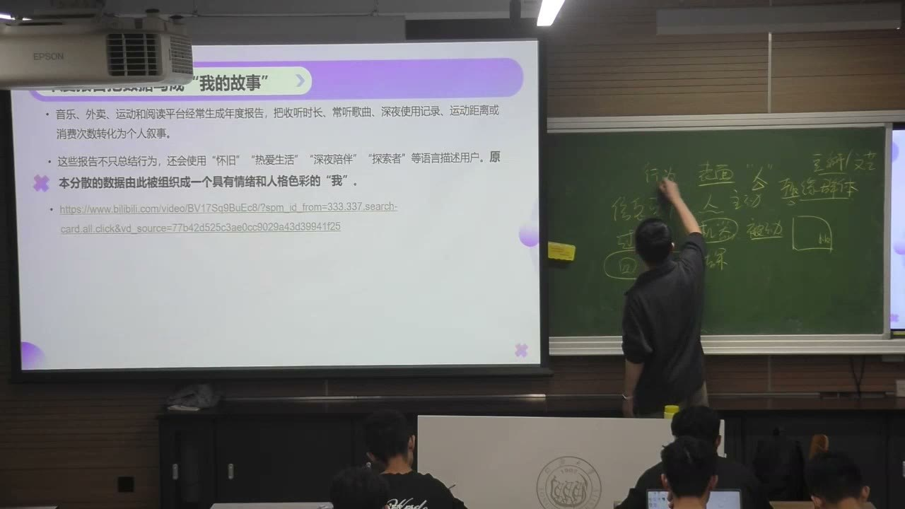
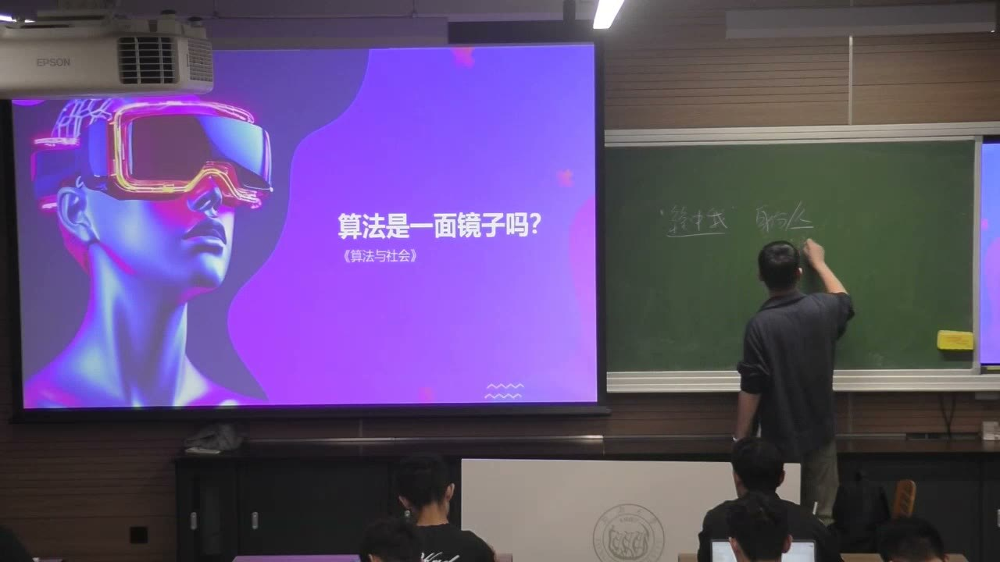
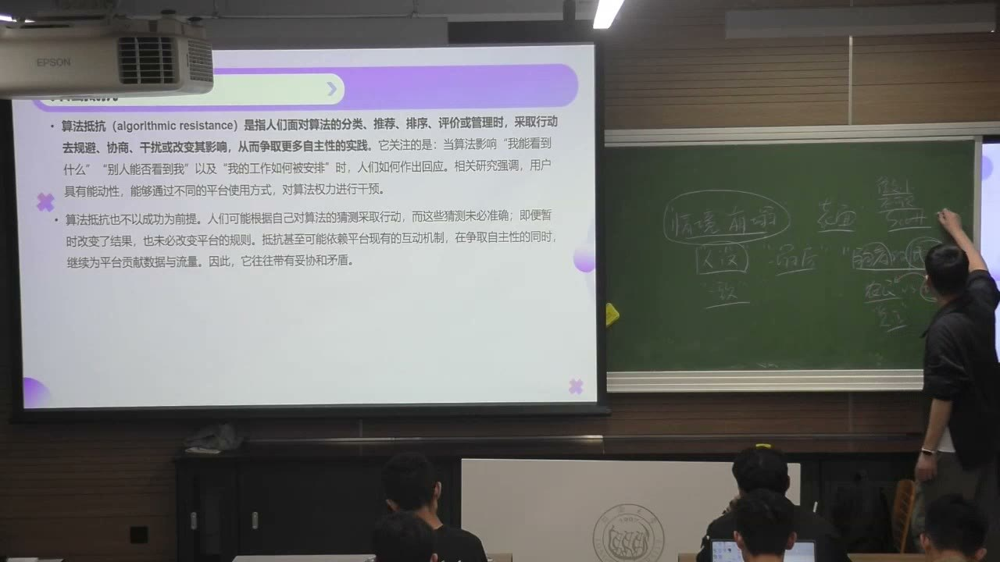

### 课程安排与任务

#### 评教与最后一讲
<!-- source: 8 -->
教师提醒10月31日开始评教，希望同学按实际体验填写。课程随后转入算法与传播，并预告最后一讲讨论算法与隐私；本节没有布置新的书面作业或提交日期。

#### 把理论放回日常经验
<!-- source: 6 -->
教师说明，讲弗洛伊德、戈夫曼等理论不是为了背人名，而是因为它们能解释日常生活中的身份呈现。复习时要能用一个具体场景说明概念，而不是只复述定义。

### 从弗洛伊德到戈夫曼：身份是表演出来的

上节讨论算法与身份，本节先复习两种关于“我”的理论，再把它们延伸到数字平台。

#### 本我、自我与超我
<!-- source: 0 -->
弗洛伊德的人格理论被概括为三个层次：本我是本真的欲望，遵循即时满足；自我在现实条件中协调欲望与规则；超我代表良心和道德标准，是对行为的更高要求。

教师用“被同事阴阳怪气时怎样回应”和“丁字路口红灯是否闯过”说明三者的差别：本我想直接反击或图方便，自我会选择现实可行的方式，超我则依据道德标准约束行为。多数时候人处在自我的平衡中。

#### 拟剧论：前台、后台与印象管理
<!-- source: 8 -->
戈夫曼把日常生活比作戏剧：每个人在不同场景中表演，有表演者、观众、舞台、剧本和角色。前台是呈现给他人的部分，后台是准备、排练和放松的部分；表演的目的是形成某种印象，即印象管理。

教师用自己的课堂举例：台上讲得流畅，是前台；上课前在休息室反复过 PPT，是后台。这个理论把“身份”从内在本质变成一种在互动中完成的事情。

#### 数字时代的观众不只是人
<!-- source: 10 -->
在平台环境中，观众除了同学、同事等具体的人，还包括摄像头、传感器、推荐系统和平台背后的算法。教师指出，监控的位置、角度和数据记录方式，都会影响一个人怎样呈现自己。

因此，算法身份也有“前台”和“后台”：用户在前台展示某些内容，平台在后台记录行为、分类和推断。理解这一点，才能继续追问算法到底看见了什么。

#### 身份是动态的，匿名会放大某些面向
<!-- source: 12 -->
身份本来就会随场景变化；数字平台提供了更多匿名、化名和多账号的可能，使身份切割更复杂。匿名可以保护表达，也可能降低行为约束，产生网暴、攻击等后果。

教师用粉发女孩遭网暴的案例说明匿名环境的伤害，但没有把个案当成对所有平台的普遍结论。可迁移的判断是：匿名改变的不是人性本身，而是行为可见性和责任承担的条件。

### 算法怎样分类并“制造人”

平台要给用户推荐内容，先要判断用户属于哪一类。分类依赖行为数据，而分类结果又会反过来影响人的行动。

#### 分类依赖行为数据
<!-- source: 17 -->
平台通过点赞、停留、观看、购买、搜索等行为数据，把用户放进某个类别。分类的目的不是理解一个完整的人，而是让系统能够预测：和 A 相似的人可能喜欢什么，于是把 B 喜欢的内容推给 A。

教师用“多看了一眼猫狗视频”说明这个过程：一次偶然的停留可能被记为兴趣信号，后续推荐又提供更多同类内容，系统对这类标签的信心随之增强。

#### 类别会影响行动，行动又成为新的证据
<!-- source: 18 -->
分类不只是描述，它会影响人的行动。一个人被推了某类内容，可能看得更多；看得更多又成为“他确实喜欢这类内容”的新证据。这样形成循环，教师称之为“制造人”（making up people）。

这类似于“先有鸡还是先有蛋”的问题：是本来喜欢，还是算法让人逐渐喜欢？课堂没有给出单一答案，而是要求分析推荐、选择与确认之间的相互作用。

#### 算法也在制造关于未来的想象
<!-- source: 19 -->
平台不仅预测用户现在是什么样的人，也可能把用户往某种未来引导。教师用考研、考同济的例子说明：如果一个人不断看到相关内容，可能更努力学习，最后真的走上那条路。

“自我实现的预言”在这里指：预测本身参与了结果的形成。但高考、考研都有随机性和多种条件，不能把一个人的结果全部归因于算法；可分析的是平台如何提供条件、强化某些选择。

#### 分类带来的不适：隐私、茧房与回声室
<!-- source: 20 -->
当平台表现出“比我还懂我”时，人可能感到隐私被看穿，也可能困在同类内容中。教师区分了三个常被混用的概念：信息茧房强调人的主动选择，过滤气泡强调机器和平台的筛选，回声室效应强调在同质环境中观点不断被重复和放大。

三个概念相关但不相同。分析时要说清是哪一种机制在起作用：是用户自己只看喜欢的内容，是平台把内容过滤成单一类型，还是群体内部不断互相确认。

### 数据化的自我

平台用数据描述人，学校、手环、音乐软件也在做同样的事。数据化自我不是某个平台的特有现象，而是一种普遍的衡量方式。

#### 年度报告描述的是被记录的你
<!-- source: 28 -->
音乐、视频、社交平台的年度报告，把一年的行为汇总成“你是什么样的人”。教师用自己的网易云年度报告说明：他写论文时反复听苏格兰风笛，报告却把他概括成某几位风笛演奏者的听众，这与他自我理解并不完全一致。

年度报告呈现的是平台记录到的行为，不是完整的自我。它可以提供有趣的回顾，却不能代替一个人对自己的理解。

#### 步数、睡眠分与绩点也在塑造目标
<!-- source: 32 -->
手环、手机记录步数、卡路里和睡眠分数，学校记录图书馆次数和绩点。数据一旦成为目标，人可能为了达标而行动，甚至在没有实际需要时也被数字推着走。

教师没有否定这些指标的用途，而是提醒：数据化的目标容易取代真实感受。要问的是，这个指标测量了什么、遗漏了什么、谁在用它评价我。

#### 数据只抓表面，必须经过简化
<!-- source: 34 -->
算法要处理大量用户，必须把复杂的人简化成可计算的类别和分数。P 图软件、智能修图提供理想化外表的模板，也是同样的简化逻辑：把多样的脸收束到少数标准。

简化让系统能够运作，却也会制造偏差。被归类的人可能觉得“这不像我”，而系统仍然根据类别行动。理解这一点，就不会把数据画像当成人的本质。

#### 平台不同，突出的身份也不同
<!-- source: 36 -->
同一个人在不同平台上会突出不同的身份：朋友圈、游戏平台、购物平台、求职平台各有自己的场景和规则。平台的可供性（affordance）决定了什么行为容易被做出来、被看见、被记录。

“可供性”指物体或环境能够提供的行动可能，它需要人和环境共同实现。门把手、网页关闭按钮都是例子；平台的设计同样在引导用户做什么、不做什么。

### 算法是不是一面镜子

“推荐页比我更懂我”是一种常见感觉。课堂用镜中我、算法想象和民间理论来分析这种感觉的来源和限度。

#### 镜中我：通过他人的反应理解自己
<!-- source: 50 -->
镜中我指人通过想象他人怎样看自己，来形成自我理解。成长过程中，人会模仿他人的行为、接受评价，再把它内化为“我是谁”。

算法推荐页也像一面镜子：它根据行为数据呈现一个“你”。但这面镜子只反射平台能记录的部分，不是完整的自我。

#### 人想象算法，算法也想象人
<!-- source: 52 -->
“算法想象”（algorithmic imaginaries）指人如何想象算法：觉得它在偷听、在算计、在记录自己。这种想象不一定准确，却会成为人使用平台时的指导原则，比如避免在某些平台说某些话。

与之相对，“算法想象”（algorithmic imagination）在课堂中指算法如何想象人：系统根据数据推断用户是什么样的人。两个方向常被混在一起，分析时要先分清是谁在想象谁。

#### 民间理论不是随意猜测
<!-- source: 58 -->
“算法的民间理论”指普通用户在日常使用中形成的、未经科学验证的解释。它虽然不是学术理论，却经过日复一日的试用和验证，因此能指导人的行为。

教师强调，不能因为它是“民间”的就轻视它；也不能因为它流行就当成事实。研究算法，既要看系统怎样运作，也要看人怎样理解和回应系统。

#### 养号、情境崩塌与向算法表演
<!-- source: 60 -->
“养号”指用户通过持续发布、互动、搜索等行为，让平台把自己识别成某类账号，从而获得流量或特定推荐。教师把它理解为一种“训练算法，也训练平台上的自己”的过程。

当一个人在不同平台上的身份被意外打通，原本分隔的观众突然看到另一个面向，就会出现“情境崩塌”。这解释了为什么有人不愿让熟人知道自己做博主，也说明平台身份从来不是完全隔离的。

### 算法抵抗：弱者的日常武器

面对分类和推荐，人并非完全被动。课堂用“弱者的武器”和“算法抵抗”说明用户怎样争取自主性。

#### 弱者的武器是微小的、不可见的抵抗
<!-- source: 68 -->
斯科特研究东南亚农民与地主的关系，发现农民不总是正面冲突，也会用偷懒、拖延、装糊涂等日常方式维护自己的利益。这些方式不改变权力结构，却能在具体处境中争取一点空间。

教师把这个思路移到人与算法的关系：算法强大、复杂、常常不透明，普通用户很难正面改变它，但可以通过日常操作影响它的判断。

#### 合作型操纵与反抗型抵抗
<!-- source: 72 -->
合作型操纵是顺着算法规则行动，让算法实现自己的目的，比如刻意点赞、搜索、停留，把想看的內容“喂”给平台。反抗型抵抗则是拒绝合作、扰乱算法，比如长按“不感兴趣”、刻意隐藏某些行为。

两者都在争取自主性，但方式不同。不能把所有使用算法技巧的行为都叫抵抗：有些是合作，有些只是适应规则。

#### 日常抵抗争的是自主性
<!-- source: 72 -->
算法抵抗的目标不是摧毁平台，而是在分类、推荐和排序中保留一点选择空间。教师把它理解为一场长期的权利争夺：人想控制自己的自主性，机器也在塑造人的选择。

这个框架不承诺用户一定能赢，也不把每一次操作都当成政治抵抗。它提供的是一个观察角度：看人怎样在规则之内和规则之外行动。

### 算法与传播：从编辑把关到算法把关

课程最后转入算法对信息传播的影响。新闻的生产、分发和反馈都在被算法重组，把关人的位置也随之变化。

#### 新闻价值与议程设置
<!-- source: 76 -->
新闻不同于一般信息，通常要具备真实性、客观性、重要性和公共性。教师用天气预报说明：普通的晴天预报不是新闻，百年难遇的暴雨则可能成为新闻，因为它影响公共生活。

议程设置指什么内容被放到重要位置，并非天然如此。过去由编辑决定头版头条，现在算法通过热榜、推荐和排序参与决定什么被看见。

#### 从生产到反馈都被算法中介
<!-- source: 78 -->
算法可以辅助选题：哪些话题在社交媒体上流量高、讨论多，可能成为报道方向。它也可以参与分发、推荐和反馈，把受众的点击、停留、评论转化为下一轮传播的依据。

课堂提醒，热榜并不完全由算法决定，背后仍有平台运营、商业和政治因素。分析算法传播，不能只看机器，还要看谁在设置规则、谁在购买位置。

#### 把关人从编辑扩展到平台与算法
<!-- source: 84 -->
传播一直需要把关：信息要经过筛选，才能进入有限的注意空间。传统把关人是编辑、记者，他们决定什么能上头版；现在平台、算法、公司政策、用户举报都参与把关。

把关的标准不只是“真假”，还包括新闻价值、公共性、注意力和商业目标。不同主体对这些标准的权重不同，冲突也由此产生。

#### 人工把关与机器把关各有长短
<!-- source: 88 -->
人工把关能理解语境、处理例外、说明理由，但会受个人偏好、组织惯例和有限经验影响，效率也较低。机器把关速度快、能处理海量内容，却可能把不敏感的内容误判为违规，也难以判断信息的重要性。

教师没有给出“谁更准确”的简单结论，而是要求看具体场景：什么内容需要人的判断，什么环节可以交给机器，误判的后果由谁承担。

#### 传播权被释放给用户
<!-- source: 82 -->
过去传播权主要掌握在记者、报纸、电视台等机构手中；平台时代，普通用户的一条帖子也可能成为爆款。用户不再只是受众，也参与生产、分发和反馈。

这并不等于权力已经完全平等。平台仍掌握推荐、审核和变现的规则，用户是在这些规则之内获得表达机会。分析传播权，要同时看到开放和限制。

### 概念对照与自测

| 区分 | 本节的问题 | 易混淆之处 |
| --- | --- | --- |
| 本我／自我／超我 | 欲望、现实与道德要求 | 把三者当成三个人格类型 |
| 前台／后台 | 呈现给他人的部分与准备空间 | 认为后台就是“真实的我” |
| 信息茧房／过滤气泡／回声室 | 主动选择、机器筛选、群体回音 | 把三个概念当成同义词 |
| 算法想象（人→算法）／算法想象（算法→人） | 人怎样理解算法，算法怎样推断人 | 不区分方向，混为一个概念 |
| 合作型操纵／反抗型抵抗 | 顺应规则与扰乱规则 | 把所有使用技巧都叫抵抗 |
| 编辑把关／算法把关 | 人的判断与机器的筛选 | 认为算法完全没有人工参与 |
| 受众／用户 | 被动接收与参与传播 | 认为传播权已经完全平等 |

#### 弗洛伊德的三重人格怎样区分？
本我追求即时满足，自我在现实条件中协调欲望与规则，超我依据良心和道德标准提出更高要求。多数时候人处在自我的平衡中，但三者不是三个独立的人。

#### 戈夫曼的拟剧论怎样解释算法身份？
人在不同场景中表演，管理自己给他人留下的印象；前台是呈现，后台是准备。平台时代，观众还包括算法和传感器，平台在后台记录行为并形成分类，因此算法身份也有前台和后台。

#### 信息茧房、过滤气泡和回声室有什么区别？
信息茧房强调用户主动选择自己爱看的内容；过滤气泡强调平台和机器对内容的筛选；回声室强调在同质群体中观点被反复放大。三者相关，但机制不同。

#### 为什么说算法只懂“表面”？
算法要可计算，必须把复杂的人简化成行为数据和类别。它能记录点击、停留、购买，却难以理解一个人为什么这样做、这些行为对自己意味着什么。数据画像不是人的本质。

#### 算法抵抗为什么被称为“弱者的武器”？
因为普通用户很难正面改变平台规则，只能用长按不喜欢、隐藏、养号、刻意搜索等日常方式影响推荐。这些行动争取的是有限自主性，不一定改变权力结构。

#### 算法把关与人工把关各有什么问题？
人工把关能理解语境和例外，但受偏好、惯例、经验限制，效率较低；机器把关速度快、覆盖广，却可能误判语境、难以判断重要性。实际传播往往是两者结合，关键看谁在什么环节负责。

### 课程时间线

00:00—06:00：复习弗洛伊德的本我、自我与超我
06:00—12:00：戈夫曼的拟剧论、前台后台与印象管理
12:00—16:00：数字时代的观众、匿名与身份动态性
16:00—22:00：算法分类、制造人与自我实现的预言
22:00—28:00：信息茧房、过滤气泡与回声室
28:00—36:00：年度报告、数据化自我与简化
36:00—44:00：可供性、平台身份与匿名伤害
44:00—48:00：课间休息
48:00—58:00：镜中我、算法想象与民间理论
58:00—66:00：养号、情境崩塌与向算法表演
66:00—72:00：弱者的武器、合作型操纵与算法抵抗
72:00—84:00：新闻价值、议程设置与传播权
84:00—90:00：从编辑把关到算法把关
90:00—95:00：人工把关与机器把关的优劣
MD