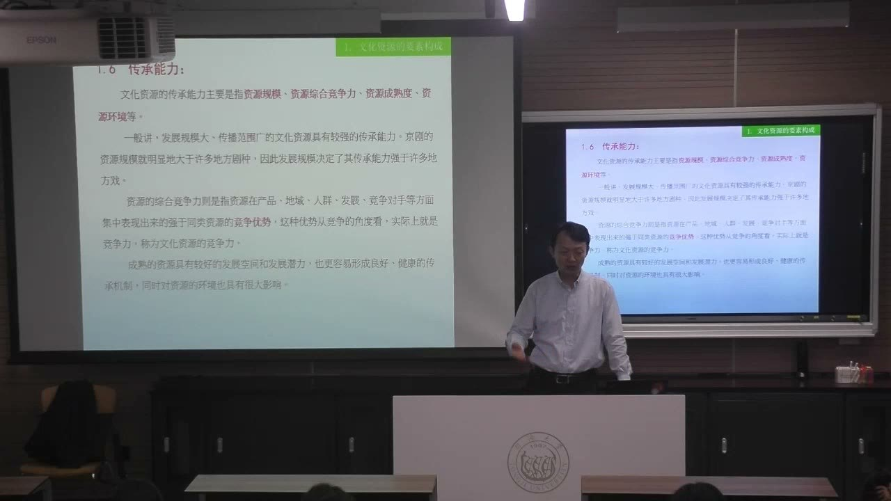
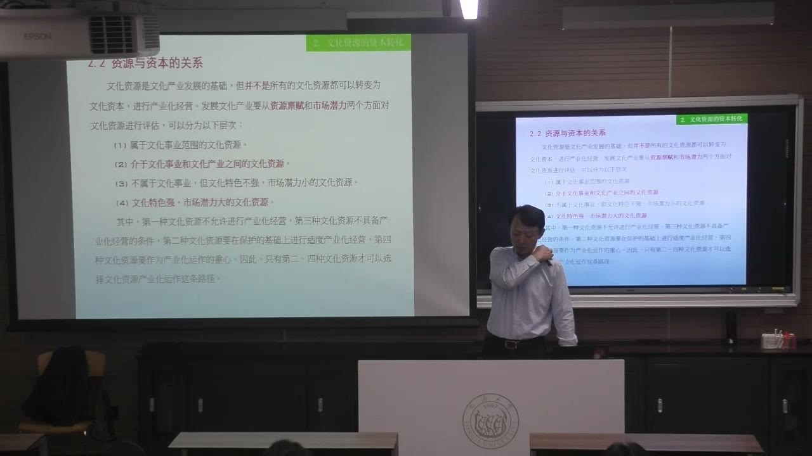

### 课程安排与任务

#### 活动观察、现场调研与阶段成果
<!-- source: 22 -->
教师后文明确通报的是 11 月 8 日中意美食文化交流活动，约三周后举行；早段转写多次出现“10 月 8 日”，与后文时间线不合，采用后文明确安排。原先在世界会客厅举办的较大方案已缩小，课堂最新方案指向进博会国家会展中心 6.2 馆，不能把早期草案地点当成最终安排。

按当时课堂通知，教师拟组织车辆前往，上午活动后同学可继续参观，返程自行安排，建议留出一天体验；证件与集合细节以群内后续通知为准。活动观察重点是怎样策划、组织、沟通和落地，不只是看展览、吃美食。

各组应尽快到北外滩相应调研片区走访，完善第一至第七周的进度安排，考虑对象清单、步行路径、分工、经费与可交付成果。教师鼓励低成本实践，并提醒不能直接照抄去年的成果或 AI 生成方案。课堂还提到 11 月 22—24 日阶段性交流设想，具体执行以之后通知为准。

### 一、把文化活动放进需求与机制中

文化资源的开发不只需要一个好主题，还要让参与各方的需求、资源和持续行动接得起来。

#### 从非遗教学到游戏化传承
<!-- source: 2 -->
教师回顾本帮菜非遗教学与双创项目：从邀请传承人讲授、进入餐厅调研，逐步发展出多模态和游戏化传承的研究与产品尝试。课堂强调，课程作业可以成为继续研究、竞赛、合作和创业的起点，而不是拿到分数后结束。

将食品向外推广，不仅可以改善饮食体验，也可以创造游戏、短视频及其他文化衍生形式。但产业管理学生需要找到自己的专业切口，不能把自己对技艺的了解直接等同于传承人的实践经验。

#### 中意交流的价值在于对话与需求匹配
<!-- source: 8 -->
早期策划希望连接进博会的国际交流、虹口文化资源与北外滩产业导入。教师比较封闭展会场地与城市交流空间时，强调企业需要的不只是露面，还包括技术、供应链、合作和形象展示等需求。

拟参与者包括政府或公共机构、企业、学界与文化界、传承人或厨师，以及媒体。媒体使活动影响得到传播，也关系到合作方为何愿意投入。主题表达不能只追求中文谐音、讨口彩，还要考虑意大利参与者能否理解并愿意回应。

#### 可验收成果与风险保障必须进入方案
<!-- source: 16 -->
方案要回答活动有什么效用、结束后还留下什么机会。课堂列举参与人数、重要嘉宾、新闻报道、签约、满意度和后续推进等可观察成果。原方案中的人数等数字属于草案指标，规模调整后需要相应修改。

外事程序、消防、安保、食品安全、宣传、经费和赞助等，会影响落地。场地也有实际价格与使用条件。文化交流应避免把两种饮食传统简单排成高低优劣，而以“小切口、重机制”的方式促成持续合作。

### 二、AI 是方案工具，判断力仍属于调研者

会生成完整框架，不等于已理解真实场所与问题。

#### 从杨浦与虹口的混淆，检验问题是否问清
<!-- source: 28 -->
教师将课程要求和既有材料交给 DeepSeek 演示生成调研计划，随即指出它把调研区域带向杨浦滨江，而任务对象在虹口北外滩。这个错误说明，条目齐全、文字流畅不等于地点和背景正确。

提问必须补足具体范围、对象、课程阶段与成果要求；发现偏离后，要继续质疑、修正。教师强调，人工智能时代的重要能力包括判断、提问与创新，不能因为系统给出了像样答案，就把识别地点和现场问题的工作交出去。

#### 让方案形成可操作的成果与传播路径
<!-- source: 38 -->
以步行路径串联文化资源，建立清单、绘制地图，是课堂认为本科生能够实际完成的方向。手绘地图的旧案例又展示，课程成果如何经过传播、商户参与和版本更新，逐步进入旅游服务与职业实践。

案例的价值不在于要求所有组都做地图，而是说明成果需要有使用者、呈现方式和传播路径。组内方案应形成自己的亮点，并尊重红色资源等对象的严肃性，不把文化对象只当成包装素材。

### 三、从《琵琶行》短视频看到新的文化资源

情感共鸣、视听形式、历史语境与运营机制，应分别观察。

#### 被打动之后，还要追问它怎样生成意义
<!-- source: 44 -->
教师组织观看《琵琶行》相关 AI 短视频，并在回应中分析音乐、视觉、运镜与叙事。熟悉的诗句可以激活共同记忆；“犹抱琵琶半遮面”等细节，也提供了鲜明的审美与视觉线索。

但影像可能按当代审美生成形象，没有充分还原唐代的历史背景与文化资源的原初环境。评价不能只停在“感动”或“好看”，应同时观察形式的有效性与历史语境的不足。图像、建筑、器物、诗词等资源可互相补充，帮助继续校正和发展表现形式。

#### 短视频既是新资源，也是产业机制
<!-- source: 48 -->
短视频本身也能成为现实文化资源，连接传统文化转化、技术工具、传播和付费。教师要求具有“穿透感”：不仅看内容，还要看它怎样吸引注意力、获得推送、组织用户和形成运营。

教师把当代生成式影像与自己经历过的建筑制图、计算机效果图产业作比较，说明工具进步可能带来主导、配套与周边产业的重组。这里是课堂对产业机会的判断，不能把机会设想当成无需验证的创业收益保证。

### 四、文化资源的要素要分层评估

文化资源难以只用一种数量单位比较，需要建立维度，再说明各维度如何影响判断。

#### 品相要素：特色、保存、知名度、独特性与稀缺分布
<!-- source: 60 -->
品相层面考察文化特色、保存状态、知名度、独特性，以及稀缺性和分布范围。地域与相关文化特征构成资源差别；保存状态既涉及实体状况，也涉及实践能否延续；知名度还可能随代际和时期变化。

教师用晋商大院、提篮桥等例子说明，相近名称或同属历史建筑，不代表保存状况、社会认知和利用可能相同。知名度也可能带着复杂甚至负面的联想，如何解释历史、组织新使用与建立品牌，是转化时需要面对的问题。

#### 价值、消费与保护等级不能混成一个分数
<!-- source: 68 -->
文化价值是资源区别于其他资源的重要依据。教师还讨论形成和延续的时间、社会文化经济环境、稀缺性、地域比较优势、可替代性、复制和传承等维度。差异是文化魅力的来源，但不能把地区差异直接化约为优劣排序。

消费价值涉及现实或未来的需求、习俗、信仰与生活方式。保护等级则来自相应的评价和保护体系，是另一组需要辨认的条件。不同等级、不同用途和不同价值不能简单彼此替代，具体保护边界仍需查相应材料。

#### 效用、发展预期与传承能力
<!-- source: 78 -->
效用要素关注社会、经济及资源消费等效果，是讨论资产化和产业化的前提；发展预期则考察对象的开发潜力，以及周边配套和相关环境。资源不是静止不变的，它的延续与利用始终处在社会条件变化之中。

传承能力包括规模、综合竞争力、成熟度和资源环境。资源之间可能在产品、地域、人群和竞争对手等层面发生竞争；稳定的保护、知识和资金条件，也影响传承能否持续。因此，评估既不能只看眼前门票收入，也不能只列历史价值而不说明延续条件。

### 五、资源、资产、资本：中间不能省掉资产

“资源很多”不等于“已经形成可以持续运作的产业”。

#### 资源进入社会生产生活，才出现转化可能
<!-- source: 82 -->
课堂引入经济资本、文化资本和社会资本等概念，着重讨论文化资源怎样与产业运作连接。教师反复补充“资源—资产—资本”中的资产环节：资源提供基础，经过保护、整理、利用或开发形成可被运营和评估的对象，再可能进入资本运作。

本课的“文化资本”主要服务于资源产业化与市场化的讨论。不能仅凭名称，把所有文化现象、公共遗产、资产和货币都当作同一个概念。资源仍需根据自身性质选择保护、使用或开发方式。

#### 四类资源与不同利用路径
<!-- source: 84 -->
课件从资源禀赋和市场潜力出发，区分四类：属于文化事业范畴；介于文化事业和文化产业之间；不属于文化事业但文化特色不强、市场潜力较小；文化特色强、市场潜力较大。

课堂给出的路径是：第一类不允许按产业化经营；第二类在保护基础上开展适当产业化；第三类尚不具备产业化经营条件；第四类可作为产业运作重点。这个框架强调选择条件，不是要求把所有资源都变成商业项目。

#### 老建筑与景迈山案例：品牌、估值和资本进入
<!-- source: 86 -->
教师用老建筑迁建、酒店品牌及景迈山相关开发的案例，解释资源如何成为资产，品牌和遗产认可怎样参与估值，新的估值又如何吸引下一轮资本。案例中的投资规模、项目过程与企业情况属于课堂讲述，不作为独立核实的投资资料。

这一过程同时可能包含投资与投机、地方生活变化、保护要求和外部介入。教师特别反对只从外部观看者立场要求居民停留在某种“原始状态”，把人固定为可供观看的对象。文化判断必须把当地人的发展需求与资源保护一起考虑。

### 六、产业导入与国际对话，需要长期机制

城市更新的目标不只是更新建筑，还包括持续使用、产业和生活关系。

#### 历史街区与新空间怎样共存
<!-- source: 72 -->
教师以北外滩高层开发与两翼风貌区域并存的设想，讨论历史空间如何与新的城市功能结合。调研时应比较各片区的资源、空间、运营和使用方式，而不是走马观花地拍照打卡。

产业导入、活动组织、空间使用和品牌链接，需要彼此配合。哪些资源应保留、怎样与新生事物结合，不宜简化为“新的一定替代旧的”或“旧的一定不能改变”。具体开发仍应建立在保护条件与实际需求之上。

#### 从资源规模转向运作能力
<!-- source: 90 -->
教师提出，拥有丰富文化资源并不自动形成强的产业能力，还涉及资金、技术、市场运作、创新、竞争与人才培养等条件。国际交流的作用，是看到其他机构如何组织资源、开发产品、提供服务和授权，再反思自己的转化机制。

课末提出产权化与“版权例外”是后续话题，尚未展开具体规则。记录问题即可，不能据此推断某项作品可以任意使用或某个视频没有版权。

### 概念对照与自测

| 区分 | 核心问题 | 调研时怎样观察 |
|---|---|---|
| 文化资源与文化资产 | 有什么文化基础；怎样成为可运营对象 | 对象、利用方式、运营与评价条件 |
| 资产与资本运作 | 对象怎样组织；怎样进入估值和投入循环 | 品牌、估值、投入方与后续收益机制 |
| 品相与效用 | 资源具有何种特征；产生什么效果 | 保存、稀缺与知名度；社会经济效果 |
| 差异与优劣 | 存在哪些地域和运营差异；按什么尺度判断 | 先比较，再说明标准，避免直接排高低 |
| 活动草案与执行方案 | 原先设想什么；最终落实什么 | 对照时间、地点、规模及通知的后续修正 |

#### 为什么不能看到 AI 的完整计划就直接交作业？
它可能混淆区域、场所和任务范围。调研者需要核实对象、补充现场信息，并形成自己的判断和成果。

#### 文化资源丰富，为什么仍不等于产业强？
资源需通过保护、组织、资产化和持续运营，才能与人才、技术、市场、资金和合作机制相接。

#### 景迈山的开发为什么不能只用“保护或破坏”二选一解释？
它同时涉及遗产保护、资本进入、居民生活变化与发展需求，需要分别分析各方位置和具体影响。

### 课程时间线

00:00—08:00：活动缘起、本帮菜项目与课程实践的延伸。
08:00—16:00：中意美食交流草案、需求匹配与参与方。
16:00—22:00：产业导入、验收成果、场地与风险保障。
22:00—28:00：缩小后的活动安排、11月8日通知与现场观察。
28:00—34:00：调研计划和 AI 演示，出现区域混淆。
34:00—42:00：纠正方案、七周进度、手绘地图与成果转化。
42:00—50:00：《琵琶行》短视频及教师对视听和历史语境的回应。
50:00—58:00：短视频运营、工具变迁与专业判断力。
58:00—68:00：品相要素、保存、知名度、独特性与稀缺性。
68:00—78:00：价值、消费、比较、替代与保护等级。
78:00—82:00：效用、发展预期与传承能力。
82:00—86:00：文化资本、四类资源与不同开发条件。
86:00—92:00：资源—资产—资本、品牌估值与景迈山案例。
92:00—96:00：国际运作能力、产权化与后续问题。
96:00—99:47：课后事务沟通；不整理为正式知识正文。
