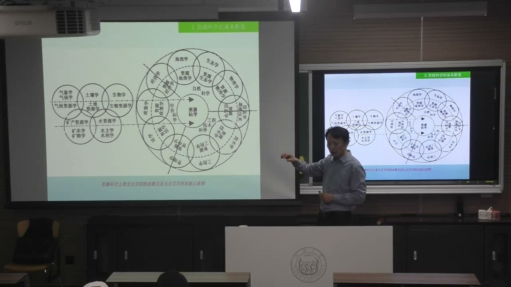
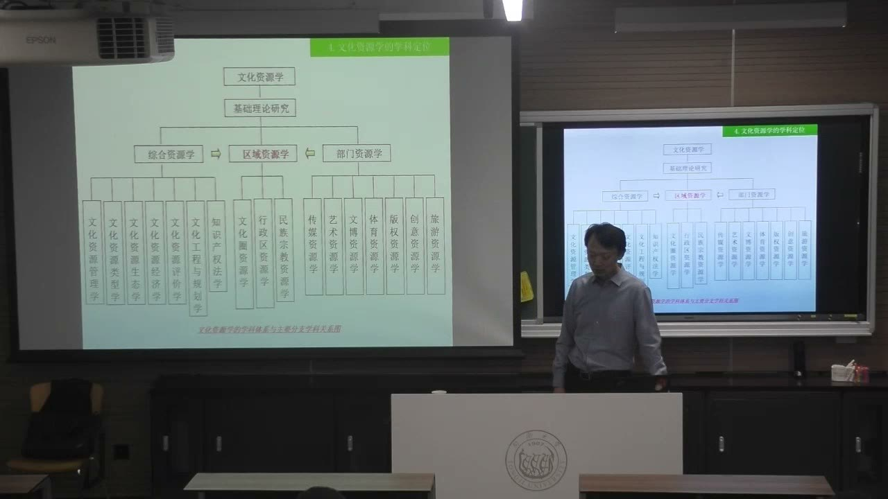
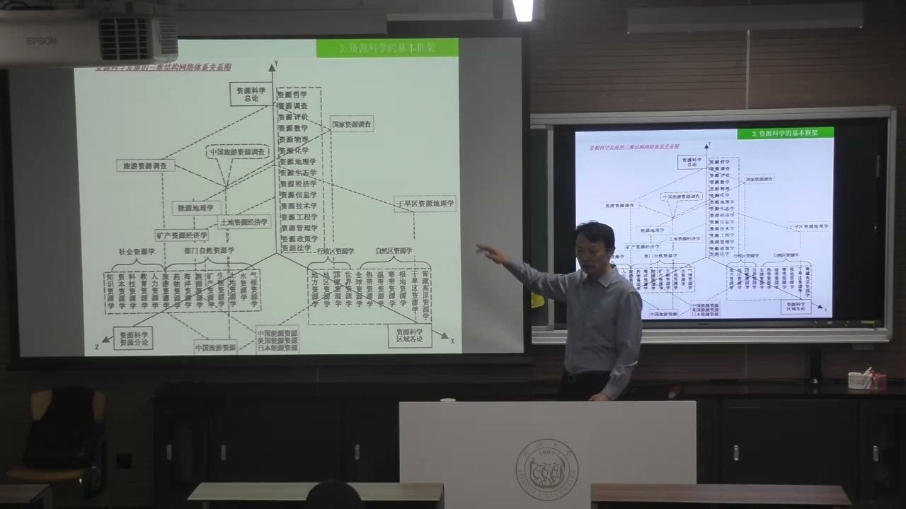
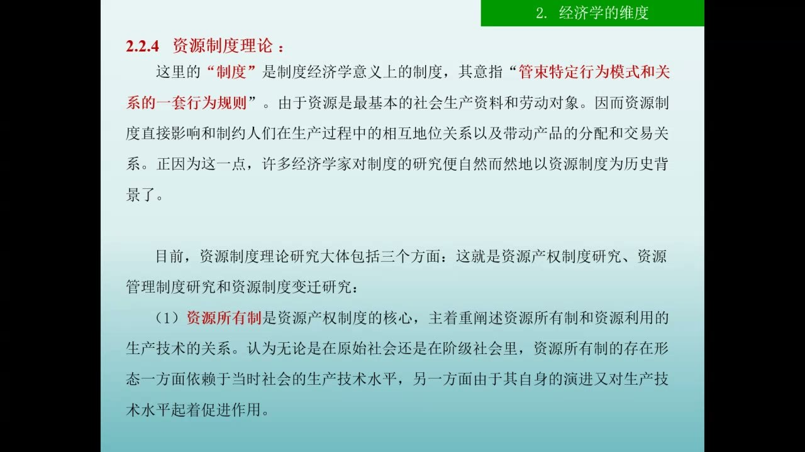

### 课程安排与任务
#### 考核包含计划书、调研报告和课堂汇报
<!-- source: 6 -->
教师本节集中回应作业问题：实践环节包括计划书、调研报告和课堂汇报，计划书有单独的成绩，不能把它埋在报告里当成不需要单独呈现的附件。计划书需要随研究推进持续优化，当前环节先把分工、时间节点与资源匹配讲清楚。

不要求所有小组统一凑字数、凑页数或凑时长，也不要求把操作办法中每一条都平均落实。应抓住本组最核心的问题，在适当篇幅内说明问题、依据与方案。课堂提到的八分钟、三十张以内PPT，是教师自己准备其他项目汇评的例子，不是本课程新公布的汇报限时与页数标准。

#### 超星线上课程按需要学习，不作刷课打卡考核
<!-- source: 14 -->
超星在线课程用于补充理解：遇到困惑或需要深入某个问题时，可以回看；教师明确不把观看时长、视频打卡作为考核要求。学习的关键是是否真正理解和使用内容，而不是把视频挂完。

老师表示会补传本次课件及相关材料。线上已有部分较早、拆分后的课件，后续仍可能更新。课堂临时介绍的10月23日晚线上讲座，可按个人时间与兴趣参加；具体入口和北京时间以群内通知为准，不把它写成强制课程任务。

#### 11月8日进博会：带着准备去观察
<!-- source: 2 -->
11月8日进博会活动定位为观察与学习，教师要求提前准备，不只逛展；活动还涉及开营、外事和组织流程，具体执行安排继续等群内通知。

#### 11月10日：虹口港与1933调研的推进节点
<!-- source: 26 -->
11月10日是课堂明确据以推进虹口港、1933老场坊一带调研的节点。相关组应提前自行踏勘，了解现场，再参加教师联系的对接。其他组可根据实际安排参考或参与，不能把这一处的节点不加区分地套成所有小组的统一调研日。

#### 11月24日交流与后续课程研究
<!-- source: 12 -->
11月24日拟举行中意及合作院校的交流汇报。教师当前考虑以相关小组的基础调研和比较方案为起点，由规划、设计方向研究生协助形态化表达；其他组也参与交流学习。这不是要求本科各组立即完成一套城市设计图。工作营安排可能调整，以后续更新的时间表为准；课程还会延续到12月，短期工作营不能替代整学期的研究。

### 计划书首先是能够调动行动的工具
计划书不是把任务名称排成一张表就结束。它要让组员、研究生和教师能够知道何时配合、如何支持，以及下一步检查什么。

#### 写清谁、何时、何地、做什么和需要什么
<!-- source: 46 -->
教师在查看不同小组材料时反复要求：把具体人员、工作内容、时间节点、调研地点和需联系的对象写进计划，资源匹配也要体现。只有“梳理资源、开展调研、撰写报告”等阶段名称，还不能帮助协作。

例如什么时候去现场、谁去、希望见到谁、需要教师帮助协调什么，都应明确。教师或其他老师能否随行，也依赖这些信息。进度表应放在前面、单独清晰呈现；文件名、年份、对象和上传版本也要检查，不能沿用旧模板却没有改掉关键信息。

#### 研究生提供支持，本科小组仍是行动主体
<!-- source: 8 -->
研究生参与指导与交流，但不是代替本科小组发号施令。本科组长要主动联系、协调分工，把研究生已有的理论、实践或设计能力接入自己的问题。

研究生可能有各自的选题，双方需要找到可以共同推进的部分。教师以基础调研支持后续活化设计为例，说明协作可以建立在双方都受益的工作接口上。不能只把名字放进表里，也不必等对方先来安排全部任务；遇到协调问题应及时反馈。

#### 先踏勘，再带着问题对接
<!-- source: 26 -->
正式联系机构前，可以先分工去现场看，不必等待所有组员和研究生都有空才出发。各人按时间记录观察，再汇总问题，有助于形成连续工作，而不是一次仓促到访。

现场准备能让后续交流更有针对性：对方提出要求时听得懂，自己提出的问题也有依据。计划书还应随踏勘、资料搜集和访谈结果更新。课程末也会有组间评价与相互学习，教师不是唯一的评价来源。

### 活化调研要从孤立建筑走向地区机制
教师针对各片区的点评，重点不在把景点介绍得更完整，而在追问资源之间怎样发生联系、为什么没有形成持续作用。

#### 虹口港与1933：边界可以随问题调整
<!-- source: 22 -->
教师把虹口港、1933老场坊、半岛湾、老洋行1913、音乐谷及周边街区联系起来讨论，提醒研究范围不要被最初地图上的截图固定住。沿水系、道路和实际活动继续观察，可能发现原先划定范围之外的重要关系。

这里的重点是把地区的历史空间、现有使用和未来联动放在一起研究。课堂口述的城市史与机构评价是进入现场的线索，不直接充作已经核实的历史结论或经营数据；具体对象、名称和状态仍需在调研材料中落实。

#### 单个板块各自运营，可能缺少共同方向
<!-- source: 36 -->
教师对1933周边的核心判断是：几个板块彼此割裂，各自争取生意，却缺少整体规划和功能协同。一次节庆活动带来人流，并不等于已经建立长期运营机制。

调研应进一步问：不同园区、街区与社区分别承担什么功能，能否形成业态互补、夜间活动衔接和共同服务，哪些空间需要连接。教师以既有街区更新经验说明，整体方向能减少彼此挖墙脚，也有助于让各参与方理解自己在地区中的位置。

#### 策划先于形态表达，设计要回答研究发现的问题
<!-- source: 34 -->
本科阶段可以先做扎实的调查、比较和策略，说明希望解决什么问题，再由规划、设计方向协作者把方案转成空间表达。AI和设计工具也应围绕这个思路服务，而不是先生成一张漂亮效果图，再倒找理由。

教师采用“促民生、助投资、拉消费、新产业”四个着眼点，提示城市更新需要系统考虑。消费、投资、产业集聚、就业与居民福祉之间有联系，但不能只选一个短期指标替代整体目标。对1933的讨论尤其要求从活动表象进入持续消费和运营机制。

### 对标不是复制，修缮也不等于活化完成
不同案例提供的是可比较的问题与条件。学习对方经验，要同时看优点、局限和制度差别。

#### 国际比较要形成问题闭环
<!-- source: 26 -->
教师建议比较本地与意大利的相关更新案例：双方各有什么条件、什么做得好、什么不足，进而形成发现问题、比较问题、分析问题与提出方案的闭环。不能因为案例来自国外，就预先认定它已经解决所有问题。

资料可以提前搜集，语言不熟悉时可用AI辅助翻译和查找；得到的内容仍要回到具体项目核对。对标对象要与本组的问题相匹配，而不只是名称、年代或外观相似。

#### 提篮桥：把保护、利用与周边体验联系起来
<!-- source: 54 -->
围绕提篮桥及周边地区，教师提醒关注保护要求、接触条件和调研安排的复杂性。对历史记忆与旅游体验的研究，不应只介绍一个馆，还要看参访者能否理解地区、愿不愿意停留，以及周边场景怎样连接。

对于监狱更新，老师提出可比较佛罗伦萨相关旧监狱改作大学空间的案例，考察用途转换与分阶段更新。比较不等于直接提出“哪里该拆、哪里该留”的结论；保护等级、产权、开放范围和审批条件，都需要后续资料与现场对接来确认。

#### 雷士德：建筑修好以后，还要问使用和带动效果
<!-- source: 64 -->
教师对雷士德案例区分了两个层面：建筑保护修缮做得好，未必意味着预期的使用、就业和税收带动已经实现。课堂关于低租金或零租金导入项目的讨论，说明经营安排也需要看后续机制与结果。

因此，不能只拍摄修缮完成的建筑，把它当作活化成功的全部证据。应继续看谁使用、如何进入、实际有哪些活动、原定目标是否实现，以及周边怎样受益。具体预约和开放情况以实际接触时的信息为准。

#### 短期工作营与长期课程积累各有作用
<!-- source: 40 -->
短期交流可以提供新的比较角度、专家反馈和协作机会，课程则需要持续调查、修改与验证。教师鼓励把已有报告、前届成果和研究生工作当成起点，而不是从零重复搜集一套泛泛资料。

有条件时，课程调研可以进一步发展为双创、社会实践或持续研究，但这是可以争取的机会，不是本节新增的硬性成果要求。基础应是本组先提出有根据的问题，并让方案在真实场景中受到检验。

### 文化资源学怎样获得跨学科的位置
资源不仅是一份内容清单，还涉及组织、渠道、制度和使用方式。学科框架的意义，是帮助研究者为自己的对象找到具体位置。

#### 内容、渠道与组织机制都可能成为资源
<!-- source: 68 -->
教师从文化研究、文化产业和资源科学的联系切入，说明文化生产需要相应资源支持。资源可以体现为内容，也可以是传播渠道、生产组织方式、体制机制等条件。

文化产业同时具有地方性与全球联系，地方特色可以成为跨文化交流的基础。课堂所举城市和创意街区的作用，是帮助理解文化生产与地区发展相互联系，不宜把所有文化产业史压缩成一条没有争议的胜负线索。

#### 资源科学连接自然科学、工程技术与社会科学
<!-- source: 74 -->
资源的概念从自然资源扩展到社会、文化等领域，研究也不能只用一种方法。教师借资源科学关系图，说明地理、生态、物理、信息、工程、管理、政策和经济等视角，可以围绕同一个对象交叉。

以矿产为例，勘察、开发、经济评价、管理与权属问题需要不同知识参与；文化资源同样如此。文化产业管理的交叉性，并非“每门学一点”的松散拼盘，而是围绕实际问题，把分析、实施与协调连接起来。

#### 综合、部门与区域研究解决不同层次的问题
<!-- source: 78 -->
综合资源学讨论管理、评价、生态、经济、工程和法律等共通问题；部门资源学针对特定资源类别；区域资源学则把不同资源和共同方法放入具体时间、空间与区域之中。

文化资源学沿用这种组织思路：综合层面可讨论文化资源管理、类型、生态、评价、经济、工程规划与知识产权；部门层面可进入传媒、艺术、文博、体育、版权、创意、旅游等；区域层面则可根据行政区、文化圈或民族宗教等具体对象定位。课堂图示是帮助选题与组织研究的框架，不能把每个分支都当成同一篇报告必须完成的章节。

#### 三维定位让研究对象落在明确交点
<!-- source: 80 -->
教师用资源科学的三维关系图说明，可同时从研究问题与方法、资源类别、区划尺度来定位对象。图中总论、分论与各论承担不同的组织作用；行政区划、自然区划和文化分区也不是同一种边界。

例如“中国旅游资源调查”，既涉及调查方法，又涉及旅游资源类别，还限定了国家范围。只有把这些维度交代清楚，才能知道研究在哪里深入、与哪些学科相交。学科框架的作用是辨明方向和落点，不是为了堆出更多理论名词。

### 可持续发展与经济学，把“怎样用”变成可分析的问题
后半节进一步提供了若干问题入口。行政管理与社会学部分只作简要提示，不能把快速翻过的内容扩写成已经系统讲授的理论。

#### 可持续发展兼顾当代需要与未来能力
<!-- source: 84 -->
课堂借《寂静的春天》《只有一个地球》《增长的极限》及《我们共同的未来》等，梳理资源、环境与发展的讨论。核心界定是：满足当代人的需要，同时不损害后代人满足其需要的能力。

用于文化资源调研时，不只问眼前能否开发或拆建，还要考虑长期维护、社会公平、生态条件和持续使用。资源闲置也可能形成浪费，但“让它动起来”不能等同于不顾未来条件地迅速消耗。课堂关于增长与危机的图示用来解释这种问题意识，不作为一张已经验证未来必然走势的预测图。

#### 六个经济学入口，把价值问题进一步拆开
<!-- source: 88 -->
教师概括了资源价值、资源核算、资源产业、资源制度、资源配置和资源产权等理论方向。价值问题追问价值从何而来、体现在哪些方面；核算要求明确数量、归属与比较口径；产业视角追问资源怎样进入生产、加工、消费和效益循环。

文化资源往往比自然资源更难量化，不能因为不好核算就忽略，也不能为了得到一个数字就把全部文化意义压成市场价格。这些方向在本节属于研究入口，未逐一展开完整模型。

#### 产权、使用、管理与收益要连成链条
<!-- source: 90 -->
资源制度涉及约束行为与关系的规则。教师特别强调所有制与产权条件，并以1933、提篮桥等为例，要求先问对象属于谁，再问如何使用、由谁管理、谁获取收益。

这个链条影响方案能否实施。不能只凭空间看起来闲置，就假定研究者或某个运营者可以自由改作其他用途。产权也不能只理解为“我拥有一个东西”，还涉及财产所有权及相关权利之间的关系。

#### 配置考虑时间空间，也要考虑公平与效率
<!-- source: 90 -->
资源配置关心不同部门、不同地点、不同时间怎样使用资源，并在公平和效率之间作分析。教师把计划与市场作为配置机制的讨论入口，本节没有系统比较其全部制度形式，不能由课堂概括给某个国家贴上“纯市场”或“纯计划”的固定标签。

行政管理与社会学则提示如何协调主体、使用访谈与问卷等工具，后续资源评价还会回到这些方法。AI可以辅助查找线索、围绕问题展开讨论，但宽泛回答不等于已经完成调研；研究者仍要回到自己的对象、材料和判断。

### 概念对照与自测
| 区分 | 本课含义 | 调研中的检查 |
|---|---|---|
| 计划书／调研报告 | 组织行动与协调资源／呈现研究过程及结果 | 计划书单独、靠前、可更新 |
| 修缮／活化 | 建筑保存与修复／持续使用及作用实现 | 看使用、运营、参与和带动效果 |
| 对标／复制 | 比较条件、优缺点与机制／直接移植方案 | 问对象是否真正可比 |
| 综合／部门／区域研究 | 共通问题／特定类别／具体区划中的组合 | 为研究对象找到位置 |
| 资源价值／核算 | 价值的来源与维度／量化口径与归属 | 文化意义不能直接等于价格 |
| 产权／使用／管理／收益 | 权利条件与实施关系的链条 | 先明确主体与权限，再提出利用方式 |

#### 本课程是否要求统一八分钟、三十张以内PPT？
不是。那是教师举自己参加其他项目汇评的例子。本课强调抓住问题、清楚表达，不统一凑字数、页数或时长。

#### 计划表只有“调研、分析、报告”三阶段，为什么还不够？
还缺人员、具体时间地点、接触对象和需要协调的资源。没有这些信息，组员、研究生与教师都难以据此配合。

#### 为什么建筑修好不能直接证明活化成功？
修缮只解决其中一部分问题，还要看实际使用、开放、运营、就业和社区等方面的作用是否持续实现。

#### 怎样用三维框架把“中国旅游资源调查”说具体？
分别说明研究采用的调查问题与方法、针对的旅游资源类别，以及中国这一空间区划与内部范围，再考察它们的交点。

#### 超星视频需要刷完才能满足考核吗？
教师明确表示不把观看时长或视频打卡作为考核要求。线上内容按自己的困惑和研究需要使用。

### 课程时间线
00:00—04:00：本节安排与11月8日进博会观察活动
04:00—08:00：中意交流背景与实践考核组成
08:00—12:00：研究生协作、作业格式和表达要求
12:00—16:00：11月24日交流设想；超星学习不作打卡考核
16:00—22:00：材料补传、线上讲座与跨时区沟通
22:00—28:00：虹口港、1933背景与11月10日调研节点
28:00—34:00：调研范围、历史成果及实践积累
34:00—40:00：策略与设计衔接；地区联动和长期机制
40:00—46:00：协作资源、后续研究机会与版本问题
46:00—54:00：其他组计划的时间、分工与呈现要求
54:00—60:00：提篮桥周边体验与监狱更新问题
60:00—64:00：国际案例比较、协调与工作营时间表
64:00—68:00：雷士德案例；修缮与运营效果的区别
68:00—74:00：文化研究、文化产业及资源的内容渠道机制
74:00—80:00：资源科学交叉关系与综合、部门、区域研究
80:00—84:00：三维坐标定位与文化资源学框架
84:00—88:00：可持续发展的问题背景与核心界定
88:00—92:00：资源价值、核算、产业、制度、配置与产权
92:00—96:00：行政管理、社会学方法与AI辅助研究
96:00—99:48：课程结束后未识别到明确讲授文字
